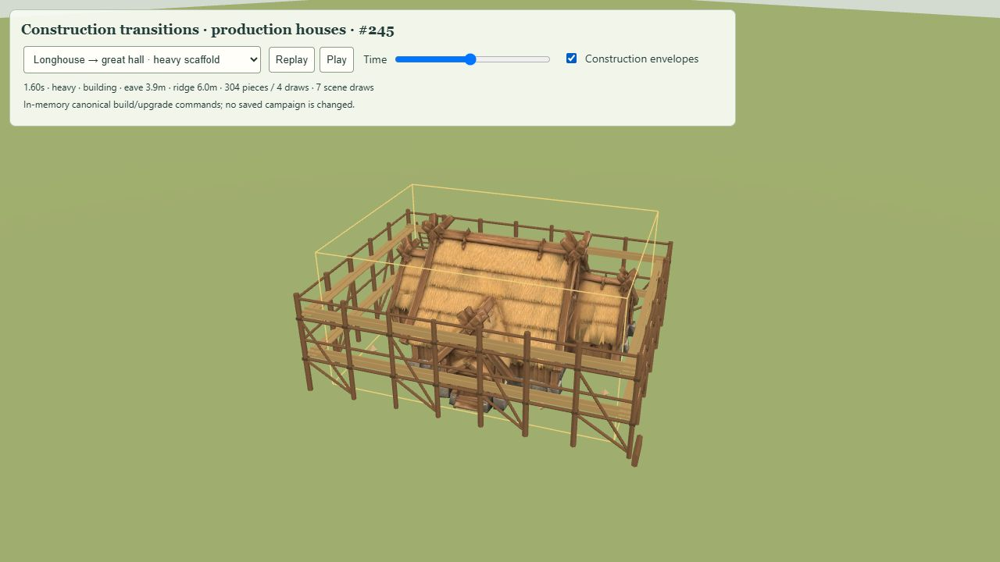
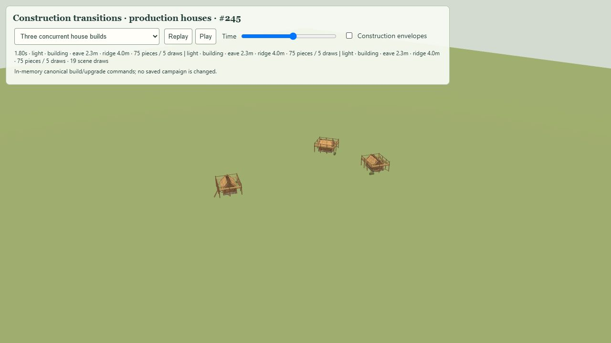
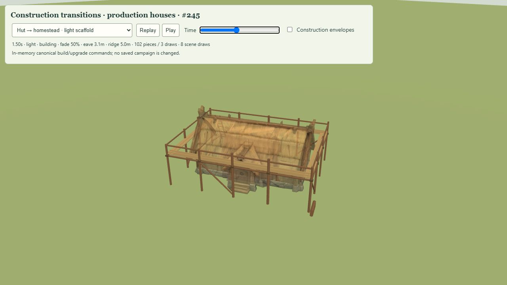

# Construction transition review — #245

The production `FjordEntities` integration now presents a new house or housing size
upgrade with a reusable 3.2-second timber scaffold transition. The canonical command,
simulation clock, costs, saved state and navigation footprints remain unchanged.

## Verification

- 121 targeted tests passed, with zero failures and zero skips:
  `node --test tests/construction-transition.test.mjs tests/fjord-*.test.mjs tests/home-improvements.test.mjs tests/meshy-housing.test.mjs`.
- `pnpm run build` passed public-asset validation (507 files), TypeScript and Vite.
  The existing Three.js chunk-size warning remains.
- The QA TypeScript entry was also checked with strict `tsc --noEmit` because review
  scripts are outside the normal application tsconfig include paths.
- No project formatter is configured. Changed source was reviewed manually and
  `git diff --check` passed.

The new tests exercise envelope exclusion of yards, transformed old/new unions,
deterministic light/heavy frames, staged reveal, retained old model and single release
at the swap, concurrent shared resources, rapid replacement, teardown, deselection,
salvage during construction and silent baseline loads. Real Core commands cover a
farmer house build and every size upgrade; serialized state and navigation footprints
are checked before and after presentation updates.

## Browser proof

The LAN review uses the actual production house assets, `FjordModels`, `FjordEntities`,
Core commands and settlement projection on a flat review stage. It does not access
campaign storage. Scenarios checked:

- New Hut, including bottom-to-top foundation/wall/roof reveal.
- Hut → Homestead, including old model before the 1.45-second swap.
- Homestead → Longhouse and Longhouse → Great Hall, both with the heavy preset.
- Farm Hut → Farm Homestead, using an actual resident farmer so production farmyard
  selection is exercised; the frame excludes the yard and its fences.
- Three simultaneous builds; complete playback removes every scaffold.

The Great Hall review showed 304 scaffold pieces in four construction draws during
the swap. Three concurrent Hut builds showed 19 total scene draws during the dust
phase, returning to four after completion (three houses plus review ground).
`browser.json` captures the concurrent-build diagnostics and unchanged canonical
state indicator. The browser reported no warning/error logs during this review.

This verifies the production house presentation on a desktop browser, rather than a
full physical-device mobile performance benchmark. No worker AI, audio clips, new
house models or construction simulation is introduced. Temporary objects have no
ray hits or navigation entries; existing yard and lifecycle regression tests pass.

## Follow-up — crossfade between upgrade models

The initial masked swap above was visually too abrupt in user review. Upgrades now
crossfade for 0.8 seconds, from 1.1 to 1.9 seconds into the same 3.2-second transition.
The old model remains owned and visible until its fade completes; the new model gains
opacity smoothly. Exact original material bindings are restored before either owner
is released. The baseline screenshots and draw counts above record the initial version.

Twenty-two focused construction, season and housing tests passed after the change.
The nine construction tests were repeated after preserving opaque depth behavior before
the fade begins; all passed. Coverage includes 50/50 midpoint opacities, original
material arrays, translucent material opacity, seasonal hooks, cancelled fades and
single owner release. The production build and strict QA-entry TypeScript check passed.
Formatting was reviewed manually and `git diff --check` passed.

Browser review confirmed the Hut → Homestead midpoint at 50%, followed by the fully
opaque target and completed scaffold removal. No warning/error logs were reported.
The midpoint review used eight total scene draws, including both overlapping house
models. See `crossfade-browser.json` for the captured phase and canonical-state proof.

