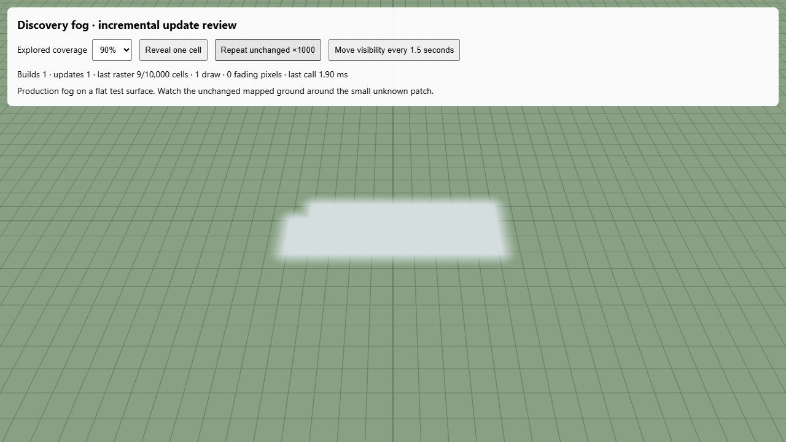

# Incremental discovery fog regression

## Cause

The previous renderer already ignored identical explored/visible masks. However,
one changed visibility bit rebuilt the complete RGBA mask, parsed hexadecimal
knowledge repeatedly for each texel and neighbour, allocated a new material and
texture, and retained the previous full-world mesh for a fade.

The two translucent layers also compounded mapped-ground opacity outside the
changed area. For example, two mapped alpha values of 55/255 compose to roughly
98/255 before the old layer fades away. This produces a global pulse even when
only a distant observer moved. Canonical observations still legitimately change
as groups progress; suppressing those updates would leave current visibility stale.

## Change

- Retain one terrain mesh, material, texture and raster allocation for the scene.
- Compare canonical mask values before decoding or rasterizing anything.
- Decode changed snapshots to cell states once, then rasterize changed cells and
  their one-cell feathering halo. One interior cell costs nine cells, not 10,000.
- Fade only changed texels in that texture. Interrupted reveals continue from the
  displayed alpha; concealment is immediate. Unchanged regions never darken.
- Stop texture uploads when the fade settles. Presentation tint and native
  distance/weather fog remain independent of canonical discovery.

There is no change to sightline queries, observation intervals, detection ranges,
per-clan knowledge, rival visibility, saving, terrain or gameplay balance.

## CPU measurement

Run `node scripts/qa/discovery-fog-benchmark.mjs current`. The reproducible fixture
uses an 800 m flat world, 100×100 discovery cells and the actual `DiscoveryFog`
class. Each row measures the median of eight single-cell visibility changes,
settling each transition between calls. The original and corrected captures were
made on the same workstation. These are CPU mask-update measurements, not total
game frame times, physical-device results or GPU-upload timings.

| Explored area | Before, median | After, median | Rerasterized cells after |
| --- | ---: | ---: | ---: |
| 20% | 65.77 ms | 0.95 ms | 9 / 10,000 |
| 90% | 187.67 ms | 0.20 ms | 9 / 10,000 |

See [before](before.json) and [final after](after-final.json) for construction,
unchanged-call, allocation and timing records. The [initial after capture](after.json)
is retained as well. Wall-clock values vary with JIT and system load;
regression tests assert work counts and resource reuse rather than timing limits.

## Verification

- Incremental and initial masks match the previous complete raster byte-for-byte,
  including partial edge cells and inside-only feathering.
- A thousand repeated snapshots perform no raster work, replace no render
  resources and increment no texture-upload revision.
- Both exploration coverages rerasterize nine cells for one local change.
- Unchanged mapped pixels remain at alpha 55 during local/interrupted reveals.
- Concealment restores alpha 255 immediately; zero/invalid time cannot advance a fade.
- The existing Nordic presentation and interrupted-transition tests use one draw
  throughout; mesh geometry, tint, native fog and raycast behavior are retained.
- All 46 focused fog, discovery, map, spatial expedition and wildlife-sighting
  tests pass. Public asset validation, TypeScript and the production build pass;
  the existing bundle-size warning is unchanged.
- Browser review exercises both coverage levels, a local reveal, a thousand
  unchanged snapshots and repeated moving visibility. It retains one build and
  one draw, with no browser error or warning logs.

The self-contained browser review at `/scripts/qa/discovery-fog.html` uses the
production native fog renderer. It offers 20%/90% coverage, local reveal, repeated
unchanged snapshots and periodic observer visibility changes without campaign
storage or a separate fog implementation. Historical prototype reports remain
unchanged. Formatting was reviewed manually; no project formatter is configured.

[Browser diagnostics](browser.json) record the settled native renderer and empty error/warning log.
