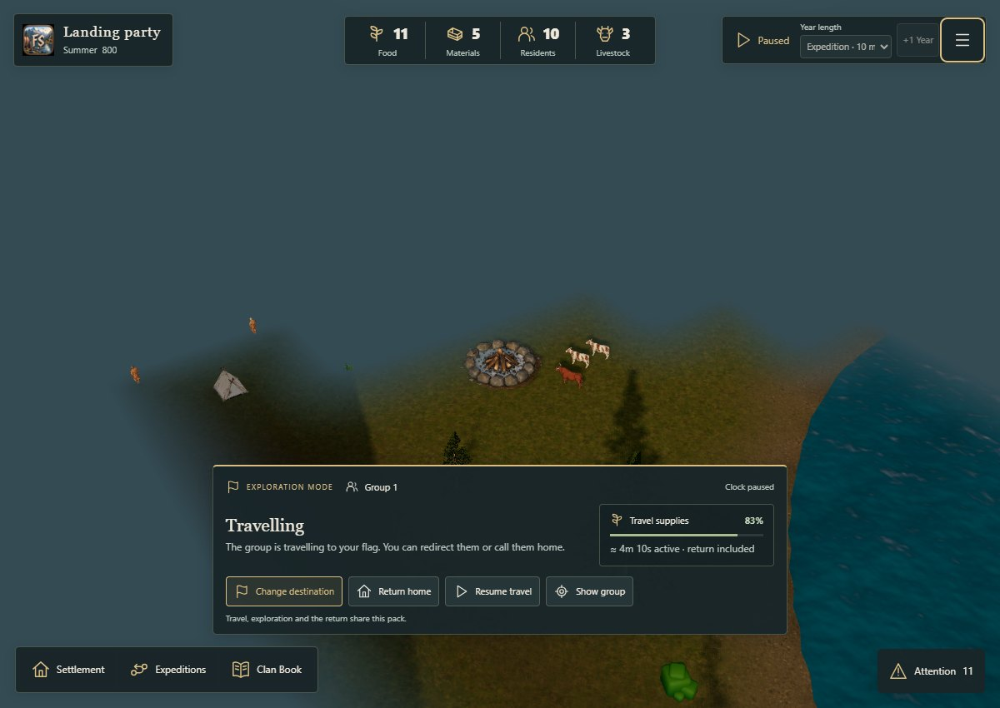
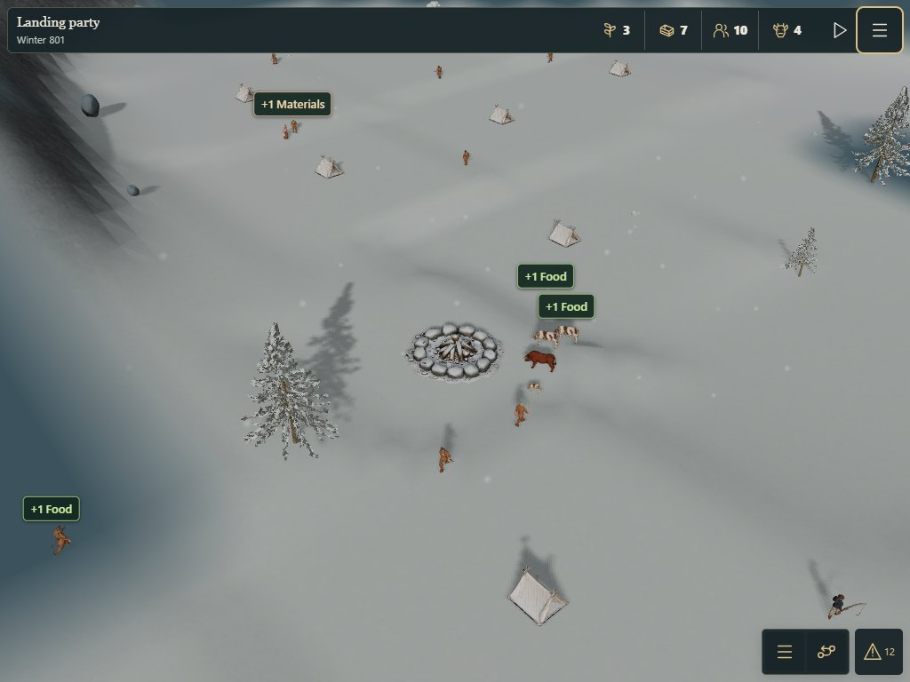

# Exploration integration QA — #151

Recorded 18 October 2026 on top of merged #199 (`76f357f3409e8b485c17c3d4d629d1bc8bbbef1d`). This is an integration checkpoint for [#151](https://github.com/sidesliders1983/Pillagers/issues/151), not acceptance of every child of #146. Physical Recon/Surveillance/Pillage remains [#150](https://github.com/sidesliders1983/Pillagers/issues/150).

## Findings and implemented fix

Actual exploration repeatedly recomputed the same settlement and landing line of sight after each confirmed movement. `ClanDiscovery.ts` now caches at most eight stationary views per immutable world. The cache contains coarse visible-cell indices, never another clan's knowledge. Moving expedition observers always run terrain LOS. Mutable worlds, changed observer positions/policy and invalid input retain their existing validation and recomputation. The cache is weakly held, not serialized, and adds no 1m world raster, rendering pass, dependency or save-format change.

The ten baseline campaign seeds are **17, 42, 91, 1983, 1337, 7, 18, 32, 64, 127**. Held-out seeds are **73, 256, 65537, 20261018**. The current pool maps them to **two curated island geometries (7 and 18)**; this does not demonstrate fourteen independently generated landscapes. All use ordinary founding stocks, population, provisions, travel, terrain and mortality rules. No teleporting, injected discovery, subsidized CPU population or increased pathfinding budget is used.

The QA bridge exposes scene references only when the instrumented source declares them, preserving older pinned lighting baselines which predate the rival scene. Its span edits also handle empty frame callbacks. Three regression cases execute the actual transform and callbacks for legacy, discovery-only and current scene bindings. This follow-up affects QA tooling only; all measured production source fingerprints remain unchanged.

All fourteen final canonical Core and world hashes match the pre-cache control. An independent 100-Winter CPU replay also matches exactly. Results are retained in [control-core.json](control-core.json), [candidate-core.json](candidate-core.json) and [comparison.json](comparison.json). Their `revision` identifies the base checkout; `sourceHashes` identifies measured production sources on Windows, including CRLF line endings. The historical control used a JSON-encoded source-text hash; the candidate uses raw file SHA-256. Compare canonical/world hashes between them, not those differently encoded source fingerprints.

## Acceptance matrix

| Area | Evidence | Status and limits |
| --- | --- | --- |
| Real physical travel | Fourteen SharedSettlement/Core traces, two independent groups, actual founding body origins, paid dispatch, local unknown destination, recall and return | PASS for the two current curated geometries |
| Encounter | Seeds 17 and held-out 73 travel to the actual rival; unknown → currently observed → mapped after withdrawal | PASS; island 18's rival is beyond the existing short pack in the earlier #149 run, so local exploration is tested there without changing range rules |
| Core without renderer | Every recorded command/context, rejected command and save checkpoint replays in a fresh Node process which rejects any Three.js import | PASS; final hashes equal the rendered/shared path |
| CPU independence | Rival stepped once at the same canonical ticks, independent domestic replay, 100,000 ticks / 100 Winters, exact reload at year 50 | PASS for deterministic autonomy; not evidence of sustained colony growth |
| Identity and projection | Own/rival namespaced personas including archives, one rival, sourced visible actors, no returned mission duplication | PASS for these trips and the long-run identity check |
| Persistence | Two traveling groups, observed rival and both returned; full Core/Shared restore, world hash, masks, topology, reservations, RNG and waypoints; real browser local save/load, reload, file export/import and atomic invalid-file rejection | PASS for exploration; physical post-raid save is BLOCKED by #150 |
| Information boundaries | Own header/management remains own-only; unknown/mapped rival has zero actor instances; observed actors use sourced models; public world/group queries and normal body text omit private identities | PASS in tested states; this is presentation correctness, not anti-cheat |
| Camera and presentation | Quality/viewport changes, Home camera travel and restoration, atmospheric fog toggle, night preview and rival picking preserve Core and actor identities | PASS in measured scenes; physical iOS camera feel remains NOT TESTED |
| UI journey | Native Edge at 1200×850 pointer, 1024×768 touch and 390×844 touch; real foreground clock, simulated document-hide pause, no offline catch-up, paused load | PASS with no horizontal overflow; touch emulation is not iOS certification |
| Eligibility and invalid routes | Existing spatial tests cover membership, unavailable/dead residents, water/cliff rejection, reserved buildings, redirects and corrupt saves | Covered by repo validation; these focused fixtures supplement the real-island runs |
| Intel/raid and ships | Existing four-direction Recon, Surveillance, Pillage, ship reservation/salvage, actual people/cattle transfer and legacy save tests | Legacy regression coverage only; physical intel/raid UI and post-raid replay are BLOCKED by #150 |
| Seasonal presentation | Same real physical campaign advances through summer, autumn rain and Mild winter snow with visible particles, Low/Standard, fog toggles and exact no-Three replay; focused tests cover all severity formulas | PASS for these physical seasons; rendered Harsh/Severe winter encounters and owner day/night review remain open |
| Device/performance acceptance | Raw desktop frame/CPU/GPU-query data and bounded storage/allocation estimates | REVIEW: old integrated GPU is slow; actual iPhone/iPad, thermal behavior and device budgets are NOT TESTED |

## Interaction observations

The browser journey follows **Expeditions → Create exploration group → choose a resident → Start Expedition → confirm provisions → select unknown terrain → Send → Resume → Return home**. Packing and map-order cancellation are read-only until their explicit commit points. A one-resident trip spends exactly 2 Food once. The disabled +1 Year action cannot bypass active travel even when a click event is dispatched directly. Both groups return once; the controls become available again. Reload stays paused without charging again.

The existing panel explains ineligible members and blocked orders through Core offers. Focused command tests cover invalid water/cliff targets, while the real browser run verifies enabled Send only after a valid preview. Recon is not yet a next step in the physical interface. Do not describe discovery alone as a scouted/surveyed site or advertise an end-to-end pillage journey until #150 supplies that contract.

## CPU and discovery measurements

The deterministic LOS query count falls by **78.7–79.7%** across the fourteen runs: approximately **38,000 → 8,100** for local trips and **52,100 → 10,600** for encounters. Instrumented matrix timings include QA wrappers, hashing and command validation; use the separate [ABBA measurement](los-abba.json) to assess latency.

That benchmark alternates identical mutable-control and immutable-cached surfaces in ABBA order, three repetitions, 20 observations per block, five warm-ups per treatment. All 240 outputs match exactly, including masks and timestamps. Both paths retain normal validation; no browser workload ran concurrently.

| Stationary/moving observation workload | Samples | Median | p95 |
| --- | --- | --- | --- |
| Uncached control | 120 | 29.23 ms | 30.77 ms |
| Stationary cache, moving scouts still queried | 120 | 8.60 ms | 9.60 ms |

This is a CPU result on one Windows laptop, not a phone FPS improvement. The discovery grid is **100×100 at 8m**, with 2,500 raw explored/visible bytes per clan and approximately 10,376 bytes of serialized discovery metadata/hex masks for both clans. The cache has at most eight `Uint16Array` index lists per live world (absolute validated-grid upper bound 1 MiB), with no player knowledge retained in it. Mutable terrain edits bypass it.

The 100-Winter fixture uses the real unassisted seed-32 rival. It records one birth, eleven resident deaths, resource production, partnerships, livestock production/deaths, occupation assignment, a built house, maintenance and eventual collapse. Living population reaches zero under current rules; no respawn is introduced. Its complete coupled Core save grows from about **62.6 kB at year 1 to 1.47 MB at year 100**, including player and rival history. Household dictionary counts include historical empty households. This is not a stress test of an indefinitely growing settlement. Save cloning/validation/history growth and a populated long campaign require separate profiling before changing persistence or retention rules.

## Rendering and memory

Rendering measurements and screenshots are recorded separately from the CPU optimization. Native headless Edge 155 runs on an i7-7700HQ / 16 GB Windows host using **ANGLE / Intel HD Graphics 630 / D3D11**. Main profiles use one fixed encounter camera, paused Core/effects clock, DPR 1, Low/Standard, three viewport sizes, two warmed 120-frame samples per cell. They include native terrain shadows and discovery fog. They do not measure running-campaign FPS, animation/precipitation cost, physical device thermals or a pre/post GPU regression; the implementation changes no shader, pass or asset.

Hidden, observed and withdrawn fixtures have different real canonical ticks. They share geography and camera, so actor allocation/count comparisons are useful, but their frame-time difference is not an isolated rival-only GPU experiment. Viewport profiles retain mouse capability; functional journeys use actual emulated touch contexts.

[Browser profile summaries](browser-profiles.json) retain every sample's frame/CPU/GPU distribution summaries, counts, allocations and presentation-isolation checks. The table shows the range across both repeats and all three viewport sizes; percentiles use 0.1ms histogram buckets. GPU timer queries returned **1,008 valid samples, zero disjoint results**. Two long tasks of **62ms and 101ms** were observed across the 36 profile windows. Short sample tails and changing GPU scheduling make these diagnostic ranges, not precise device budgets.

| Scene | Tier | Frame median range | Frame p95 range | Draws including shadows | Triangles including shadows |
| --- | --- | --- | --- | --- | --- |
| Unknown | Low | 66.8–66.9 ms | 83.4–83.6 ms | 152 | 4,645,406 |
| Unknown | Standard | 66.7–83.3 ms | 83.5–100.2 ms | 152 | 4,651,550 |
| First contact | Low | 100.1–116.9 ms | 100.2–150.0 ms | 199–203 | 5,823,388–5,834,489 |
| First contact | Standard | 100.1–116.8 ms | 116.8–133.8 ms | 199–203 | 5,829,532–5,840,633 |
| Mapped after return | Low | 50.1–100.1 ms | 50.2–116.9 ms | 166 | 5,053,198 |
| Mapped after return | Standard | 50.1–100.0 ms | 66.8–100.3 ms | 166 | 5,059,342 |

First contact shows **seven rival entities, including two residents**, rather than the whole founding community. This is not the maximum-density encounter stress case. At 1200px Low, 97 of 203 draws and about 2.55M of 5.83M triangles belong to shadows. Median GPU query time is approximately 104ms there, supporting a rendering bottleneck. The wide frame variation after return is another reason to avoid interpreting Low/Standard differences as an isolated regression.

Unknown/observed/mapped scene buffer estimates at Low are approximately **197.6 / 222.8 / 197.6 MiB**. Their common RGBA8-equivalent image estimate is **333.8 MiB**, while actual renderer texture counts are **62 / 68 / 62** and geometry counts **100 / 114 / 101**. The observer introduces sourced instances; unknown/mapped states have zero rival entities and no placeholders. These buffer/image estimates exclude inactive model caches, render targets, programs and driver overhead; they are **not VRAM measurements**. Heap snapshots are sampled usage, not a leak proof. Fog remains one draw, and camera/fog changes preserve Core and actor identities.

[Browser journeys](browser-journeys.json) and [physical seasons](browser-seasons.json) record the separate functional checks. The seasonal run uses the actual foreground clock to generate rain/snow, then pauses before capture. Actual Mild winter keeps the Nordic 125–400m atmosphere range; autumn rain shortens it to approximately 76–302m. Low/Standard retain the discovery shroud. The current run does not visually certify Harsh/Severe winter or every weather/encounter combination.





See also the [390px journey](journey-390.jpg), [native night preview](observed-native-night-preview.jpg) and [physical autumn rain](physical-autumn-standard.jpg). These are captured production scenes through the loopback harness, not image-generated mockups.

## Repository and normal-build verification

[Local validation](validation.json) records the full suite on `776526c`: **942 tests: 932 passed, 10 pre-existing conditional skips, zero failures/cancellations**. Nine skips require optional legacy Meshy runtime/LOD fixture assets; one is the opt-in R3 evidence test (`RUN_R3_EVIDENCE` unset). They are listed explicitly; no assertion or validation rule was disabled. Both real-island integration tests and both cache regressions ran. The final QA-only compatibility correction then passed **seven focused regressions**, including the three new transform cases. TypeScript and the normal Vite production build passed. Character validation with explicit Lab previews passed: **20 assets / 36 GLBs, 12 Golden Characters and 19 equipped modules**. The existing large-bundle advisory remains; its threshold is unchanged. The repository has no configured formatter; source formatting and the staged diff were checked manually and with `git diff --check`.

[Production startup verification](production-start.json) uses the uninstrumented build to check a new default physical island, one hidden living rival, camera/quality isolation, exact paused reload, explicit opt-out, unchanged historical campaigns and New campaign after a legacy save. [Review verification](review-check.json) opens all three presets in new tabs, checks exact canonical data and paused state, performs an actual file export/import during first contact, and rejects a malformed file without changing Core. The production bundle contains no audit bridge/manual clock; the review server refuses QA source paths, Git metadata and write requests.

Current-head CI is a separate PR check, not inferred from these local measurements. The issue remains open for the acceptance gates below.

The observed poor absolute cadence is a release gate for owner/device review, not a passing frame budget. A focused performance follow-up should build on the culling and atmosphere work from closed #131/#191 using matched state/camera/device measurements. Retain the existing proposed mobile ≤10% p95 regression and <100ms simple panel feedback targets; this desktop run does not certify them.

## Reproduce

Use the repository's existing dependencies and prepared licensed assets. No new package is required. The normal tests include `tests/discovery-cache.test.mjs` and `tests/exploration-integration.test.mjs`.

```powershell
node scripts/qa/check-exploration-core.mjs
node scripts/qa/benchmark-exploration-los.mjs
```

These write real-island traces, captured canonical worlds, fresh/observed/returned full saves and measurements under ignored `artifacts/exploration-151`. The replay child loads only Core; any attempted `three` import is an error. `QA_OUTPUT` selects another directory and `GIT_BINARY` can select an explicit Git executable.

In a separate terminal, start the **loopback-only** existing QA server:

```powershell
$env:QA_GOLDEN = '1'
$env:QA_PORT = '5197'
node scripts/qa/fjord-runtime-server.mjs
```

Keep `QA_FOG_STUDY` unset so the normal approved Nordic presentation is measured. Then run:

```powershell
$env:QA_ORIGIN = 'http://127.0.0.1:5197'
node scripts/qa/check-exploration-browser.mjs
```

The browser runner needs an installed Playwright runtime and native Edge. Set `PLAYWRIGHT_MODULE` to that runtime's module path when it differs from this workstation's default. `QA_JOURNEYS_ONLY=1`, `QA_PROFILES_ONLY=1` and `QA_SEASONS_ONLY=1` separate functional actions from otherwise-idle timing; set only one at a time. `QA_WIDTH` selects a journey width, `QA_FRAMES` and `QA_REPEATS` control samples. Normal builds have no audit bridge, manual clock or instrumentation. Never expose this QA server on LAN.

For interactive review and file-import checks, build normally with prepared assets, then use the separate **normal-build** loopback host:

```powershell
pnpm run build
$env:QA_PORT = '5198'
node scripts/qa/exploration-review-server.mjs
```

Open `http://127.0.0.1:5198/exploration-review/`. The three versioned presets keep the Core captured in the integration run; only pause, view target and presentation settings are adjusted. Each opens in a new tab and can update the automatic resume checkpoint. From a second terminal:

```powershell
$env:QA_ORIGIN = 'http://127.0.0.1:5198'
node scripts/qa/check-exploration-review.mjs
node scripts/qa/check-fjord-discovery-start.mjs
```

The [normal Highlands view](production-highlands-standard.jpg) and [normal home view](production-home.jpg) supplement the close encounter captures for owner review. The LAN host may expose these same static files; it does not expose the instrumented server.

## Remaining gates and implementation order

1. Review the discovery/cache change and its exact-head full validation. Keep the PR draft while checks or acceptance gates remain outstanding.
2. Complete #150, then extend these same fixtures through discovered → scouted → surveyed → stale intel → physical Pillage, real casualties/transfers and post-raid reload. Do not close #151 or epic #146 before that evidence exists.
3. Run actual iPhone/iPad Safari tests for camera gestures, picking, background/foreground, memory, thermals and Standard/Low tail latency; compare identical seed/state/camera against the control. Obtain owner high-level and close-range daylight/night acceptance.
4. Make an explicit decision on poor GPU cadence, long-lived populated-world/history cost, and island-18 long-distance expedition reach. Suggested independent issues: **Observed settlement GPU and shadow budget**, **Populated long-campaign save/history scaling**, and **Long-distance exploration range and route offers**. Avoid changing provisions, path budgets or retention policy as a QA shortcut.

Earlier #149/#180/#182/#191 reports remain historical and unchanged.
