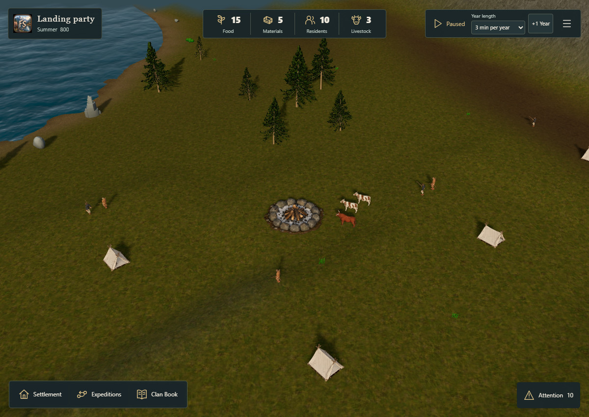
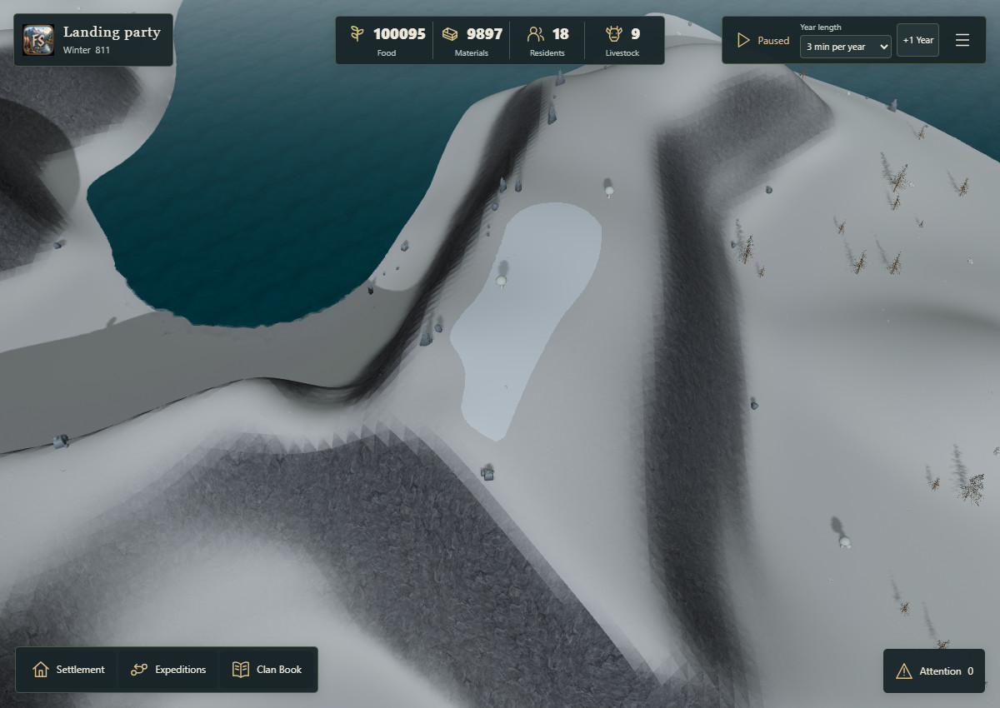

# Nordic fog enabled — issue #191

The owner selected treatment C and requested implementation after reviewing its seasonal and
winter-severity behavior. `fjordPresentation.fogProfile` is now `nordic` in the normal 3D game.
No URL parameter, QA bridge or new-campaign reset is required. Existing saves use the same treatment.

The playable LAN build is available at `/fjord-play`; the original comparisons remain at `/fog-review/`.
The GitHub changes are in [PR #199](https://github.com/sidesliders1983/Pillagers/pull/199), stacked on
the existing housing/shadow fix in #197. This test build is separate from a merged main release.

## Implemented behavior

| Conditions | Fog begins | Full native fog color |
| --- | --- | --- |
| Clear summer | 160 m | 400 m |
| Mild / Normal winter | 125 m | 400 m |
| Harsh winter | 45 m | 260 m |
| Severe winter | 15 m | 200 m |
| Full seasonal rain | 75 m | 300 m |

These are the 800 m island base values, before the existing zoom correction. Width scaling remains
bounded to 0.75–1.5×. Winter influence interpolates smoothly; a Harsh/Severe yearly class does not
impose winter haze on summer. Mild and Normal intentionally share the same clear-winter distances.
The existing season/weather sky and light colors remain in use. Native night-preview settings are
also retained; this change introduces no new day/night simulation.

Unknown territory uses the approved Nordic slate tint, mapped cells keep their existing alpha
floor, and currently visible interiors remain clear. The canonical discovery masks, confirmed
observations, private-entity filtering and 0.8 s visual fade are unchanged. The camera offset is
composed once from the native base and cannot accumulate when the lighting cycle is off.

Snow code, permanent snow boundaries, seasonal snow weights, terrain geometry, asset pipelines,
weather selection and gameplay rules have not changed.

## Verification

- TypeScript and normal Vite production build passed. The existing large-chunk warning remains.
- 34 focused fog, season, weather, discovery, lighting, camera and shadow tests passed.
- Added explicit Mild/Normal/Harsh/Severe endpoint and smooth-transition coverage, including the
  requirement that all yearly winter classes retain clear-summer visibility.
- `check-fjord-fog-default.mjs` exercises the uninstrumented production build with summer discovery,
  the existing Normal-winter save, and an explicit Harsh-winter QA preset.
- Both Low and Standard are exercised. Core JSON exported through the real game must remain
  identical after pause, quality changes and camera movement; hidden rivals and house placeholders
  must remain absent. Normal-winter snow colors, weights and material count must match the approved C review.
- Physical iPhone Safari performance has not been certified. Current-head CI must pass before
  marking the PR ready or merging.

The production smoke check passed all three fixtures in Low and Standard. The six fresh images
and [activation-results.json](activation-results.json) come from the normal built application with
no QA transform. All exported Core snapshots are unchanged. The Normal-winter snow colors,
weights and material count match C exactly; each winter fixture renders all five expected buildings
without placeholders.

| Summer discovery, normal build | Normal winter retention, normal build |
| --- | --- |
|  |  |

The [Harsh winter game frame](winter-harsh-qa-preset-standard.jpg) confirms the 45/260 m base range.

Run the production smoke check against a static build, with the normal dependencies and assets:

```powershell
node scripts/qa/fjord-playtest-server.mjs
# In another terminal, use the matching server port:
$env:QA_ORIGIN = 'http://127.0.0.1:5199'
node scripts/qa/check-fjord-fog-default.mjs
```

The Harsh preset changes only a QA input's regional weather class and regenerates the fixture's
Clan Book through the normal adapter. Every selected save is validated before browser startup.
It is not presented as a naturally reached campaign state or a change to production weather rules.

The first local production attempt found that the scenery-kit junction had been copied into the
build as a symbolic link. The frozen static server correctly excludes such links, so those models
were unavailable over HTTP. This worktree's ignored scenery input was replaced with a physical
copy of the same licensed files and rebuilt with the existing pipeline. No asset generator or
bundler source was changed. The production checker now verifies every scenery GLB's HTTP status
and byte count before opening a browser, in addition to checking house placeholders.

The first cross-start snow comparison incorrectly included Three.js material UUIDs, which are
new for each renderer. The comparison was corrected to require identical snow colors, weights
and material count; random object identities are not snow state. The unchanged summer case had
already passed, and the corrected winter cases are rerun separately with the same runtime hashes.
The housing assertion uses the projected `building` identities (household identities describe tents);
every expected rendered building must be present with no placeholder.

## Original measurements and known limits

The [original A/B/C report](report.md), screenshots, `results.json` and `mask-cpu.json` retain the
original review measurements. Activating C does not change its measured native rendering policy.
The wider far distance still expands the existing shadow fit in some views: the high unknown-ridge
case has 14 additional shadow draws, and the 390px slope has one. Home draws remain unchanged.
The original Standard p99 outlier and physical-device validation remain open performance work;
this activation is not a claim that those acceptance criteria have passed.
