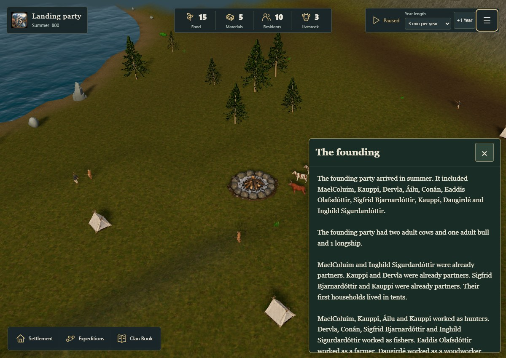
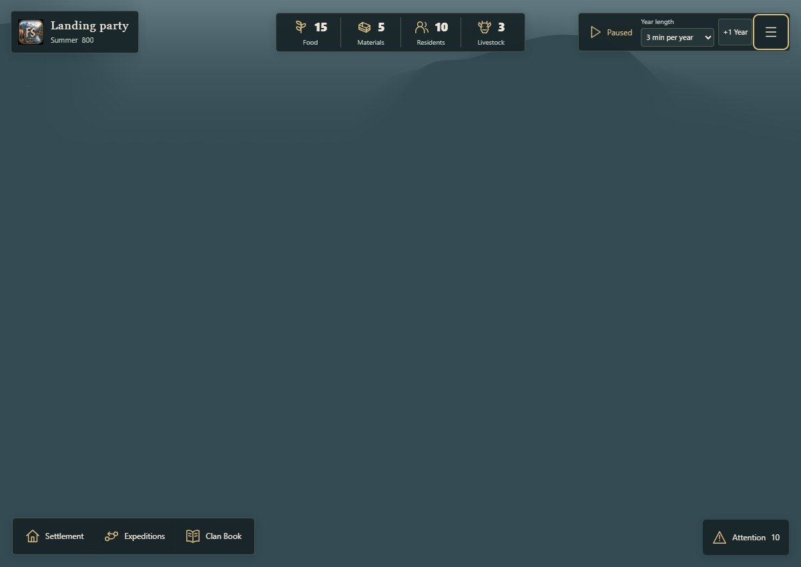

# New Fjord islands include fog of war and a living rival

The ordinary new-game route previously enabled physical discovery only with `?discovery=1`. A fresh browser opening `/fjord-play` therefore created an old-style world without a physical rival or fog-of-war layer. The Nordic atmospheric treatment could still render correctly, so loading an exploration QA save did not catch this entry-path bug.

New `/fjord-play` islands now initialize discovery and exactly one physical CPU clan before the game clock starts. The next-island checkbox also defaults on after loading an old campaign; it is a creation preference, not a switch that rewrites the active save. `?discovery=0` remains an explicit development opt-out. Saved/imported campaigns keep their authoritative geography, knowledge, clans and rules, regardless of URL flags.

The rival exists and advances independently while hidden. Its actors become visible only through actual clan observation. Camera travel, weather and quality controls do not reveal terrain or enemy details. Discovery geometry/materials, observation ranges, expedition costs, the CPU rules and Nordic atmosphere are unchanged.

## Verification

- The new normal-build browser regression failed against the previous LAN build   because an ordinary fresh campaign had no discovery state.
- The corrected build passes the exact empty-browser `/fjord-play` entry, without   a feature flag, fixture injection or QA bridge. It has one ten-resident rival,   531 visible/explored cells and 9,469 unknown cells on the default seed.
- Reload preserves the exact canonical export and the rival. Read-only fog diagnostics   show the existing native mask active with one steady-state draw.
- Both Low and Standard camera controls are exercised. The highlands frame checks   that the camera actually moves to an unknown summit; Core knowledge stays identical   and hidden rival actors/names stay absent.
- Explicit opt-out and a legacy reload preserve the old world exactly, including   when the URL requests discovery. New campaign from that saved world creates the   new physical island and its hidden rival through the real menu handler.
- TypeScript, the production Vite build and 23 focused discovery, rival-clan, fog,   presentation and placement tests passed. Existing chunk-size warning retained.   No formatter is configured; manual review and git diff --check are used.

[Machine-readable results](discovery-default-results.json) include the failed before-check, three passing flows, canonical hashes and source fingerprints. The lifecycle and explicit highlands screenshot checks ran separately against the same build, with identical fresh Core hashes. Physical-device performance and the remaining issue-191 performance gates are still open; this does not certify them.

| Ordinary new game | Camera in unknown highlands, Standard |
| --- | --- |
|  |  |

## Testing an already-started campaign

Refresh the LAN tab, then use **Menu → Campaign → New campaign from seed** with **Enable exploration & rival clan** selected. Export the old campaign first if you want to keep it. Refreshing an existing campaign alone preserves its saved rules and does not insert a new rival into it.

Run the browser regression against a normal production host:

```powershell
$env:QA_ORIGIN = 'http://127.0.0.1:5199'
node scripts/qa/check-fjord-discovery-start.mjs
```
