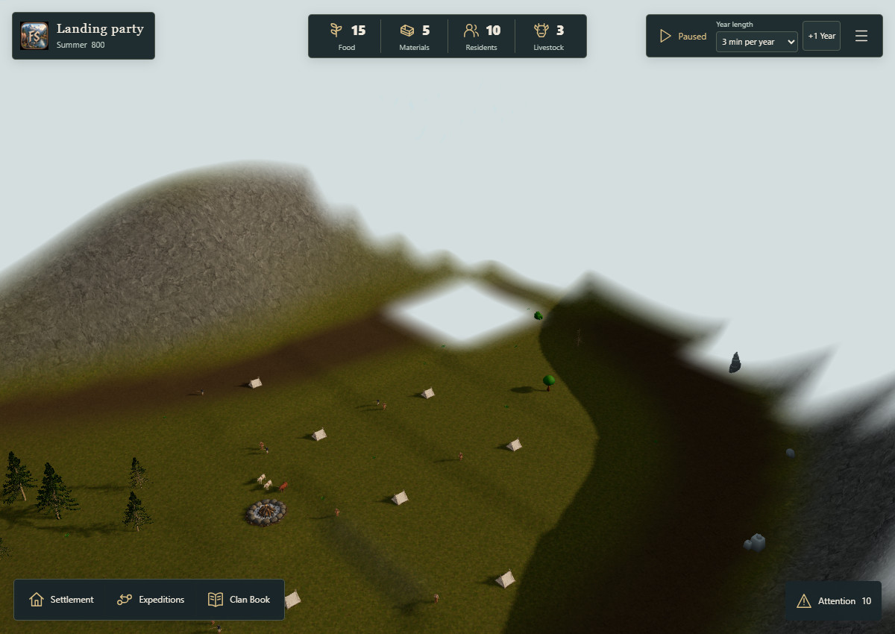
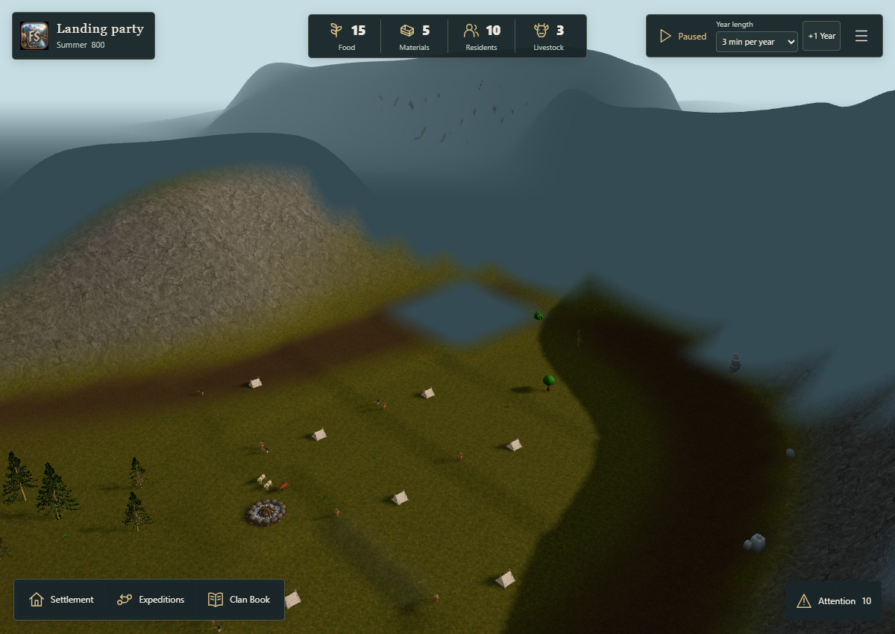
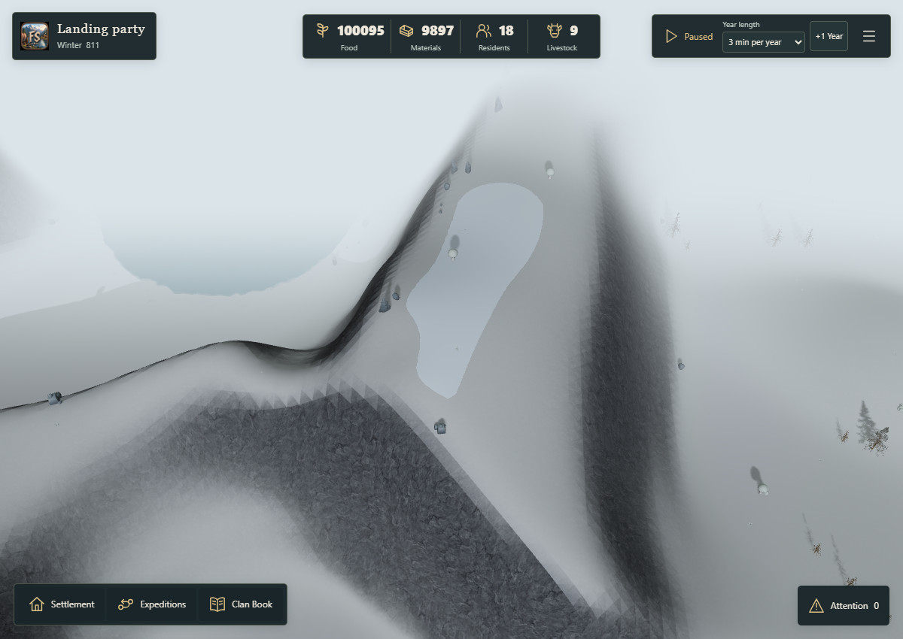
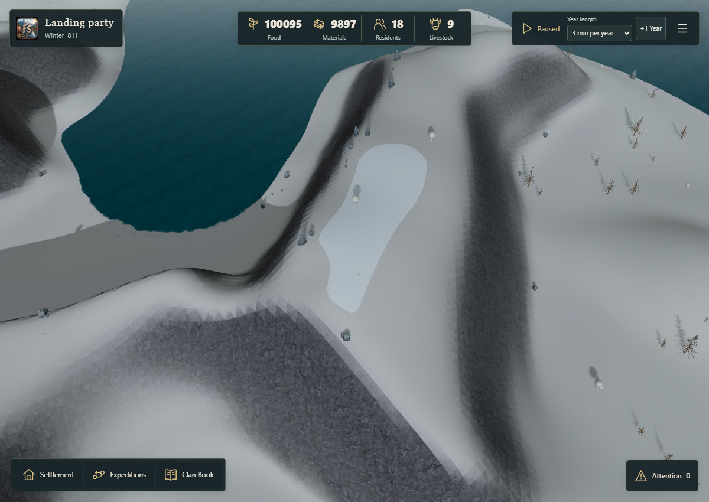

# Nordic fog review — issue #191

Status: review candidate, **production default remains `current`**. Daylight and snowy image approval,
physical iPhone measurements, and the shadow draw-budget decision remain open. Do not close #191
or merge this as an approved visual default.

The branch starts at `ce19f9bf5e8b6f32028815cf48aacc83c75778da`, the housing/shadow test build in
PR #197. The PR is stacked on that branch so its diff contains only the fog work.

## Recommendation

Use a muted Nordic shroud over unknown geography, with native atmospheric fog beginning farther
away on clear days. The proposed 800 m island settings are:

| Conditions | Near / far, before the existing camera offset |
| --- | --- |
| Clear summer | 160 / 400 m |
| Clear winter | 125 / 400 m |
| Full seasonal rain | 75 / 300 m |
| Harsh winter | 45 / 260 m |
| Severe winter | 15 / 200 m |
| Native night preview | 70 / 270 m |

Ranges scale with island width within 0.75–1.5×. Mixed seasons interpolate the same presentation
parameters. The atmospheric tint keeps 75% of the existing season/weather color and mixes 25%
of the existing sky. Lights, exposure, weather selection and weather probabilities are unchanged.

Unknown uses `#344b54`, with a small cool winter/night adjustment. Mapped ground retains the
existing **55/255** alpha floor; visible interiors retain alpha zero. The shroud participates in
native Three.js distance fog so the existing sea apron joins the horizon. No new geometry, texture,
mask resolution, render target, custom shader, dependency or postprocessing is introduced.

This is a visual candidate, not a claim that every acceptance criterion is complete. In particular,
the wider native atmospheric visibility increases shadow work in some views, as detailed below.

## Changes and boundaries

- `src/config/FjordFog.ts`: one presentation resolver for clear, rain, winter and night conditions.
- `src/config/FjordPresentation.ts`: explicit `fogProfile: 'current'` approval gate.
- `src/core/WorldLighting.ts`: compose fog from a cached native base plus one camera offset.
  The offset no longer accumulates when the lighting cycle is off. Season, day/night, quality and
  fog enable/disable retain the same native Fog and light objects.
- `src/fjord-play/DiscoveryFog.ts`: update only native color/fog participation on both existing
  fade layers. New layers inherit the presentation. Mask generation, edge feather, opacity,
  depth testing, raycast exclusion and the 0.8 s interrupted fade remain unchanged.
- `src/fjord-play/FjordPlay.ts`: apply presentation when seasonal/weather inputs change and
  supply camera distance before the lighting update. No per-frame mask generation or new scene walk.
- `scripts/qa/fjord-fog-study.mjs`: opt-in loopback QA diagnostic only. Atmospheric-only hides
  the visual overlay without changing knowledge or creating foreign entities. Nothing is saved.

**Snow is untouched.** No snow source, mask, threshold, seasonal retention, terrain material,
building snow material or asset was edited. The sharply bounded white mountain patch is intended.
Only the pre-existing atmospheric layer over it changes. Seasonal and structure snow diagnostics
are asserted identical within every A/B/C set.

## Controlled evidence

Open `index.html` through a static HTTP server. A = current combination; B = current atmosphere
without the visual discovery overlay, a QA diagnostic; C = the Nordic combination. The wipe
compares A with the selected treatment. Full images and `results.json` are available alongside it.

Daylight, at the same fixed camera:

| Current | Nordic candidate |
| --- | --- |
|  |  |

Snow retention, at the same fixed camera:

| Current | Nordic candidate |
| --- | --- |
|  |  |

The matrix contains the starting settlement, neighboring 390px slope, high RTS fjord view, unknown
ridge, top-down island, native dusk/night previews, returned-scout mapped ground at tablet width,
winter discovery, legacy winter retention, and rain. Legacy saves are labeled explicitly; they
contain no discovery overlay and therefore cannot establish fog-of-war correctness.

The additional Severe winter frame is an explicit QA weather preset cloned from the legacy winter
save. Only its test-input regional weather class is set to `Severe`; it is not claimed as a naturally
reached campaign state. Production weather generation, gameplay modifiers and snow rules are unchanged.
Its Clan Book is rebuilt through the normal campaign adapter to retain strict import identity validation.
Particles are off in all frozen comparisons to isolate fog and keep each pair pixel-comparable.

The mapped fixture is generated from `exploration-800` using real `StartExpedition`, `ExploreArea`,
`AdvanceTicks` and `RecallExpedition` commands. No discovery bits, sightlines, ranges or camera-based
reveal are substituted. The winter discovery fixture advances the same campaign by 500 ticks.
Within each set the checker asserts identical canonical serialization, blueprint, actor poses,
camera, geometry/texture counts, opacity bytes, and snow diagnostics. All model placeholders must
be absent. Rival scene entries and foreign selection-layer keys must remain empty in **all three**
variants. The same canonical filtering also keeps hidden entities out of hover and selection.

Core discovery/save/privacy regression tests cover confirmed observations, mapped history,
immutable player views, rejected foreign masks and atomic legacy-save round trips. Native overlay
tests additionally compare every alpha byte through an interrupted fade and check raycast exclusion.
The QA switch is absent from normal builds and introduces no saved visibility preference.

Owner screenshots were used as context but were not copied into the repository. All committed
images are newly captured gameplay frames. Dusk/night use the existing native preview cycle with
canonical time frozen; this is explicitly identified in the captions.

## Performance evidence and open budget

Native headless Edge, Windows, Intel HD Graphics 630 / ANGLE D3D11, DPR 1. Two warmed ABBA runs
per treatment/quality/view, each 120 RAF callbacks. Desktop 1200×850; phone-shaped viewport
390×844. This is **not physical iPhone Safari validation**. The machine is already GPU limited;
absolute frame times are not a playable-FPS certification.

| View / quality | Current frame p50 / p95 / p99 ms (range across repeats) | Candidate frame p50 / p95 / p99 ms |
| --- | --- | --- |
| Desktop Low | 66.8 / 83.5–83.6 / 83.6–83.8 | 66.8 / 83.5 / 83.5–83.6 |
| Desktop Standard | 72.2–83.4 / 83.6–100.1 / 100.1–100.2 | 66.8 / 83.5–83.6 / 83.6–133.5 |
| 390px Low | 50.1 / 66.9 / 66.9 | 50.1 / 66.8–66.9 / 66.9 |
| 390px Standard | 50.1 / 66.9 / 66.9 | 50.1 / 66.9 / 67.0 |

GPU timer queries are supported: 28 valid samples per run, no disjoint queries. GPU p50 ranges:

| View / quality | Current ms | Candidate ms |
| --- | --- | --- |
| Desktop Low | 66.5–68.0 | 67.4–67.5 |
| Desktop Standard | 70.3–72.0 | 66.5–69.6 |
| 390px Low | 53.1–53.3 | 54.6–56.7 |
| 390px Standard | 54.3–54.4 | 54.4–55.8 |

The 390px view has a small GPU cost; the Desktop Standard candidate also has one p99 outlier.
These short samples do **not** justify a blanket no-regression claim. Keep the defaults unchanged
pending real-device measurement and an agreed draw budget.

The normal shroud remains one draw / 320,008 triangles; the existing fade temporarily uses two.
Its 646,416-byte opacity texture and geometry bytes are unchanged. At the home view, total draws
remain **224 = 113 main + 111 shadow**, with 107 geometries and 62 textures. The diagnostic B
removes exactly the overlay draw. The native fog-enabled BasicMaterial adds one cached built-in
program variant during comparison (31 → 32), not a bespoke shader or extra pass.

The widened far distance feeds the **existing `DirectionalShadowCoverage`**. In the high unknown
ridge view, Standard totals rise **159 → 173**, all in the shadow pass; the main pass is unchanged.
The 390px slope adds one shadow draw; the normal high fjord/top-down views keep their draw totals.
The legacy snowy summit rises **142 → 148**. Terrain geometry and overlays are not increased.
Preserving valid mountain shadows explains the increase, but it does not satisfy the issue's strict
unchanged-total-draw acceptance criterion. Do not silently cap shadows to hide this cost.

Native lighting update plus presentation composition generally measures roughly 0.02–0.04 ms mean per frame in the warmed
runs; one current Standard sample has a 0.39 ms mean outlier. Fade update is around 0–0.003 ms
at timer granularity. Frozen profiles generate no new masks. Heap samples fluctuate with GC
(roughly 381–409 MB) and are not retained-memory proof; renderer geometry/texture counts are
the direct fixed-resource comparison. Raw spans, GPU distributions and heap samples are retained.
Published timing data keeps the relevant fog, render and frame spans; unrelated actor/path telemetry
is omitted from this bounded fog report.

The separate Node CPU mask benchmark alternates the original and legally mapped knowledge views
in ABBA order. Current generation takes 31.85–36.46 ms; Nordic takes 31.48–33.65 ms. Every alpha
byte hash matches for the corresponding view. Each retains 7,056,436 geometry bytes and the same
646,416-byte texture. These are mask-construction wall times without WebGL uploads; the existing
roughly 32 ms knowledge-change cost remains, while frozen frames generate no masks. Raw samples
are in `mask-cpu.json`.

## Acceptance and next step

- [x] Presentation-only candidate and camera-offset drift fix prepared.
- [x] Fixed-state A/B/C gallery, legal mapped exploration, legacy and snow-retention checks.
- [x] Native masks, interrupted fade, hidden-rival filtering and canonical serialization preserved.
- [x] Low/Standard desktop and phone-viewport timing, GPU queries, split main/shadow counters.
- [ ] Owner approval of daylight **and** snowy comparisons.
- [ ] Real iPhone Safari Low/Standard measurement and repeat Standard tail-latency check.
- [ ] Resolve or explicitly approve the bounded additional shadow work before enabling the candidate.
- [ ] Current-head CI confirmed green before readiness/merge.

After approval and budget resolution, enable `fogProfile: 'nordic'` in the same bounded PR,
update the default-gate test, rerun the relevant checks and final captures, then reassess readiness.
Do not change snow or Core exploration to improve these screenshots.

## Local validation

- TypeScript `tsc --noEmit` and normal Vite production build: passed. The existing large-chunk
  warning remains; no validation threshold was changed.
- Complete `node --test tests/*.test.mjs`: **927 passed, 0 failed, 10 skipped** (937 total).
  Nine existing optional Meshy runtime tests lack their ignored legacy source/generated GLBs;
  one existing static R3 evidence test requires `RUN_R3_EVIDENCE=1`. No test was newly skipped.
- `node scripts/validate-characters.mjs --lab-previews`: passed, 20 assets / 36 GLBs,
  12 Golden Characters and 19 equipped modules, including Idle/Walk/Run + World.
- Focused fog/discovery/camera/weather/shadow regression selection: 34 passed.
- `git diff --check`: passed; formatting was reviewed manually because no formatter is configured.
- Production build contains no `__fjordAudit`, `fogStudy` or `atmospheric-only` diagnostic bridge.
- LAN gallery controls passed at desktop and 390px widths, and all eight existing housing assets
  still return the manifest's exact byte counts. The playable LAN game remains the #197 build.

The initial capture run completed ten A/B/C sets and all performance samples, then timed out
loading the rain case. Its QA effects option had an invalid value. The weather cases were corrected
to effects off and captured separately, with the Severe winter case added. Capture provenance
retains these retries rather than treating the initial commands as fully successful. The first Severe
preset was correctly rejected because its original Clan Book identity no longer matched its modified
QA weather input. The corrected fixture regenerates that book through the normal adapter; all
selected saves are now preflighted before opening a browser. Production import validation was not
weakened. Production and QA bridge source hashes are compared across all capture attempts; only
the capture driver changed.

## Reproduce

Use the normal dependency and asset preparation pipeline, including the ignored generated housing
models (`pnpm assets:houses`). Missing assets are not accepted as placeholder captures.

PowerShell, in the branch checkout:

```powershell
$env:QA_GOLDEN = '1'
$env:QA_FOG_STUDY = '1'
$env:QA_PORT = '5195'
node scripts/qa/fjord-runtime-server.mjs
```

In a second terminal:

```powershell
$env:QA_ORIGIN = 'http://127.0.0.1:5195'
$env:QA_OUTPUT = 'artifacts/fjord-fog'
# Set PLAYWRIGHT_MODULE when the existing local QA runtime lives elsewhere.
node scripts/qa/check-fjord-fog.mjs
node scripts/qa/benchmark-fjord-fog-mask.mjs
```

The QA server listens only on loopback and requires the frozen golden clock. Serve the resulting
gallery as static files for remote review; never expose the instrumented development server.
