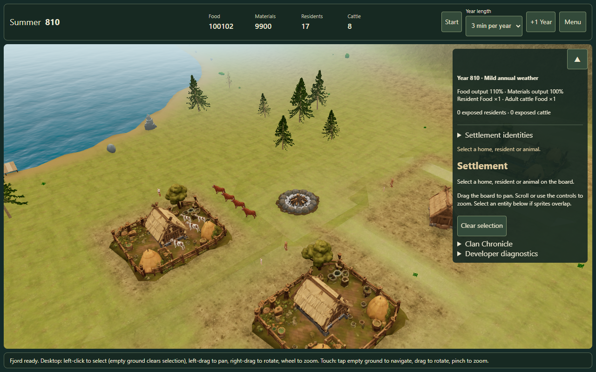

# Fjordside runtime performance audit — issue #166

Status: diagnostic review. No gameplay or rendering optimization is implemented by this change.

**The Running-only hitch is reproduced in the normal production build with the owner's real
house models.** Across three developed-campaign trials, Paused frame p95 is 83.4–83.5 ms with
zero long tasks; Running p95 is 150.1–150.2 ms with 44–45 long tasks per 20 seconds. Running
also has occasional 333–484 ms frames. A first annual transition stalls for **1.64–1.90 seconds**.
The same Intel GPU limits both states, so the low average FPS is not entirely CPU work.

Three CPU findings deserve separate follow-ups after owner review: repeated whole-campaign reads
at each UI refresh, expensive clothing refits at the annual age update, and failed route-search
retries that become sustained work later in the five-minute run. The latter is much
larger on current `b6681d1` than its pinned parent `eda52e1`, with identical saves and house
assets. Native profiling attributes about 1.10 seconds to module refitting, versus an individual
Core command maximum below 24 ms. GPU workload and occasional navigation bursts remain relevant.
This PR contains diagnosis and opt-in QA tools; it implements no optimization.

## Version and evidence contract

Current game source: `b6681d185eca14abd8f5250474e3a01dd472a8cc` (main, merged #165).
Previous comparison: `eda52e106619224dab6790deeba70d016eca0b36` (parent of #165).
The previous revision is a candidate baseline, not an owner-confirmed smooth build. Main was
rechecked before handoff and still points at the audited SHA.

The audit starts on current main in an isolated worktree. Original local changes were not included.
Only new QA tooling and this evidence are proposed for merge. `src/`, the production Vite
configuration, dependencies, rules, saves, RNG and default UI/effects are unchanged.

[Host and source hashes](host.json), [fixtures and Core samples](core.json),
[baseline trials](baseline.json), [ablations](diagnostics.json), [native attribution](prepared/native-summary.json),
[real-house production repeats](prepared/stock-production.json) and the [hashed result index](results.json)
are the evidence. Text evidence is pinned to LF with a local .gitattributes so file hashes survive Windows/Linux checkouts.
Histograms have 0.1 ms buckets; reported percentiles are quantized accordingly.
No large per-frame JSON observer is installed. Existing game diagnostics remain enabled except
in their explicitly labelled ablation.

## Asset correction and evidence sets

The first checkout had the tracked humans/cattle and licensed terrain kit, but omitted ignored,
locally generated house files. Nine house requests (manifest and eight GLBs) used the explicit
AssetManager placeholder path. This setup error was found in the final asset audit. The original
series is retained as a labelled **house-fallback experiment**, not presented as the complete
owner scene. Its GPU, culling and navigation numbers must not be substituted for the owner's
houses. [Original resource manifest](asset-manifest.json) records the nine missing requests.

The correction copies the owner's eight house GLBs and manifest into both pinned revisions,
without modifying game source. The `prepared/` confirmation hard-fails on any entity placeholder.
It repeats current native profiles, three parent annual crossings, three production Running/Paused
pairs plus three production annual crossings, three Running/Paused fixed-orbit pairs, a continuous
five-minute run, and native all-pass
counters. [Prepared resource manifest](prepared/asset-manifest.json) verifies all 70 requested
resources against source/built bytes, with zero missing. All 22 production JS/CSS resource hashes
match the original build. Local licensed/generated binaries are not redistributed by this PR.



## Device and experimental limits

Windows 10 Pro 19045; Intel i7-7700HQ, four cores/eight threads, approximately 16 GiB RAM;
1920×1080 host screen. Edge 155.0.4283.45, headless, actual ANGLE/D3D11 Intel HD Graphics 630.
The NVIDIA GTX 1050 is installed but is **not** the renderer selected by these runs.
Driver versions, free memory, Dell power scheme and raw battery state are in `host.json`.
Temperature, throttling, desktop background GPU utilization and driver VRAM are unmeasured.
The desktop is shared with the owner's session. Absolute laptop timings are not release budgets.

Desktop viewport 1280×800, DPR 1; the actual canvas dimensions are stored per trial because
header/footer/layout affect them. Small viewport 390×844 at DPR 1 is desktop viewport emulation:
**physical mobile untested**. Standard and Low use the same DPR and viewport for resolution-matched
comparisons. Shader/material/water policies may still differ. Runtime switching changes water, shadows and DPR but retains the initially loaded ground tier;
a separate cold Standard capture records that distinction. There is no claim of physical iOS
performance or measured VRAM.

Timing repetitions use Vite development modules. That allows named native CPU frames and
QA-only bindings without changing production code. This is an important limitation when
extrapolating to deployed production FPS. A separate stock production build/control is recorded
to check that development instrumentation does not create the symptom. Native profiling/trace runs are separated from
baseline timing repetitions; the overhead matrix measures span collection and GPU queries off/on. Disabled collection still leaves wrapper dispatch and the 2 Hz async-wall counter in the QA server; the stock control contains no wrappers.
Browser contexts are visible to the browser scheduler; every trial records `visibilityState`.

Each trial starts from the same saved Core/recipe/layout/narrative fixture. The harness explicitly
sets `target: fjord` and paused pacing before startup, selects quality/effects/year length, then
sets the requested running state. Baseline warmup is 5 seconds and capture is 20 seconds; exploratory diagnostics and overhead use 10 seconds, as recorded in each raw group. Trials repeat in alternating forward/reverse scenario order. A fresh
page resets motion RNG, mixers, particles and caches owned by the scene. The browser context is
reused to warm HTTP caches, and decode/shader preparation precedes the warmup/capture window.
The scripted camera path uses elapsed time and the real controller, not frame-count increments.
It is an orbit at 0.12 radians/second about the same camp focus. It does not synthesize human input.

Fixtures:

- `summer-32`: default Summer 800 tick 500, ten residents/three cattle; island recipe 18.
- `summer-17`: same canonical founding phase, second campaign seed and island recipe 7.
- `developed-810`: Summer 810 tick 500, 17 living residents/eight cattle, default lifecycle,
  weather and social rates, real occupations and houses. Generous initial reserves and forced
  founding partnerships are fixture setup, not normal game defaults or measured organic economy.
- `rain-810`: Autumn 810 tick 750, 17 residents/eight cattle; actual calendar rain.
- `snow-811`: Winter 811 tick 0, 18 residents/nine cattle after the real annual boundary.
- `boundary-810`: that developed campaign advanced to tick 990, so the first measured year
  crossing is exercised at 1/3/5 minutes per Winter. Boundary warmup is Paused and Running starts with capture;
  the before/after times and command maximum identify exactly what was sampled.
- `crowd-25`: existing controlled crowd fixture, 25 residents/12 cattle. Its fertility, mortality
  and weather policies are deliberately disabled. It measures load scaling, not natural growth.

Every completed browser trial exports Core and compares its entire parsed state with headless
`applyCommand(initialState, AdvanceTicks(actualTicks))`. The identity check includes warmup ticks
and annual transitions, not an assumed number inferred from wall time. No canonical command is
silently dropped from that comparison.

## CPU/GPU interpretation

CPU spans are synchronous **wall time on the main thread**, not hardware CPU cycle counters.
`inclusive` contains child spans; `self` subtracts instrumented synchronous children. Do not add
inclusive parent and child totals, or add async wall spans to CPU time. `entities.sync.asyncWall`
and `scene.syncAsyncWall` include promise scheduling and uninstrumented continuations. Native
CPU profiles and timeline events provide independent attribution, GC and scheduling evidence.
CDP cumulative Task/Script/Layout/RecalcStyle durations are recorded as differences per trial.

GPU samples surround the complete `renderer.render` command sequence, including its shadow
work, using `EXT_disjoint_timer_query_webgl2`. Results are read asynchronously, at most four
outstanding queries, one sample per four render calls. Disjoint samples are rejected. GPU time
is UNKNOWN where support or valid samples are absent. Query results describe that browser's
GPU command interval; they are not total device utilization or compositor/presentation latency.
See the [Khronos extension specification](https://registry.khronos.org/webgl/extensions/EXT_disjoint_timer_query_webgl2/).
`renderer.render` JavaScript time is render submission/scene traversal/driver interaction and is
never labelled GPU execution time. Neither CPU nor GPU durations can simply be added to predict
rAF intervals because the pipelines overlap.

The original house-fallback dedicated capture observes 137 total native draw calls: 60 shadow and 77 main-scene draws, with 38 native useProgram switches. The native draw sum agrees with renderer.info when reset before the full call. The same capture inventories 822 unique bone nodes and 18 skeletons; repeated bone references across clothing meshes are not additional rigs.

The complete-house all-pass capture records **145 native draws: 68 shadow plus 77 main**;
114 drawElements and 31 instanced draws, with 37 useProgram switches. Its full render totals
6,616,404 triangles, 59 material identities, 62 geometries and 69 textures. Scene inventory
contains 44 skinned meshes but 18 unique skeletons/822 unique bones. The canonical terrain
geometry has 735,446 triangles and six material groups; large conifer instance batches are
also present. These are submitted-geometry and resource counts, not measured per-pixel overdraw
or VRAM. [Native GL/resource inventory](prepared/diagnostics.json).

The ordinary Three.js r180 `renderer.info.render` counters reset **after shadow rendering**.
They count the main scene pass, including material groups, and exclude shadow draws. The
`allPasses` diagnostic explicitly disables that reset and resets before the whole render call.
Mesh/material/skinned-mesh counts are scene inventory; `counts.bones` counts bone references across meshes, while the dedicated diagnostic also reports unique bones/skeletons. Exact frustum-visible draw counts,
shader switch counts and per-pixel overdraw require the dedicated diagnostic or remain unmeasured. Programs are compiled programs, not measured switches.
Heap is Chrome's JS heap observation. It excludes textures, GPU allocations, native decoder
storage and other processes. Growth before GC is not, by itself, a leak.

## Current frame and tick pipeline

`FjordPlay` keeps the camera, scene traversal, labels, water/wind and renderer active while Paused.
It gates ambient motion, animation delta, local fire/precipitation emission and canonical clock
progress with running/visibility/loading state. Paused still calls the entity/model animation
path with delta zero: human pose shaping and the renderer's bone transforms do not disappear.
Water/wind have their own world flags and are not automatically frozen by the game pause flag.

A 500 ms interval queues a synchronous `session.elapse`. Elapsed catch-up is capped at one
second. `actionWork` serializes actions; `sceneWork` coalesces scene requests with `queued`, and
`sceneLoads` gates time while scene assets reconcile. These are not an unlimited parallel tick
pool. Hidden tabs call `setPlayback(false)` and reset the previous clock timestamp. The renderer
has a pagehide disposal path. This code inspection is not a full repeated-navigation leak proof.

Each active tick refresh projects the campaign, clones `session.snapshot`, rebuilds Chronicle
HTML, updates the header/weather/identity/management DOM, persists the campaign and starts
scene sync. `snapshot` uses `structuredClone`, including event history and all target clans.
`persist` exports JSON, projects again and clones again for the narrative. Selection highlighting
projects/clones again. Async scene sync projects, checks weather/ground signatures, reconciles
models and motion, finds standing trees, updates labels and serializes diagnostics. Identical
DNA and installed wardrobe signatures avoid refitting/equipping on every tick.

The Core validates input and output and clones before each command. Validation recursively
checks target clans; per-tick mechanics include economy, cattle, care and world-target work.
Annual transitions add mortality, consumption, maintenance, families, weather and narrative
checkpoint work. A large `AdvanceWinter` benchmark must not be mistaken for normal 500 ms work.

`LivingWorldController` substeps at at most 0.1 s, caps one advance to one second, checks local
terrain/obstacles/neighbours, runs social pairs and occupation/grazing visits, and replans routes
when required. Goal searches stop expanding at a 2,000-node threshold (the final expansion can overshoot it); roaming searches cap at 500. Goal searches sort
the open set repeatedly. The route counter/node/rejection deltas identify real replanning
frequency. There is no rigid-body physics engine in this path.

Models reuse Meshy human rigs and cattle mixers; animation applies DNA proportions each update.
Invisible/frustum-culled actors still participate in motion and model updates. The far-view and
actor-only visual ablations must not be interpreted as permission to stop canonical offscreen
simulation. Terrain uses material groups and alpha-masked layers; water is a shader surface,
nature is instanced and shadows add further rendering. CPU source inspection alone cannot
establish which of those dominates the GPU.

## Measured causes and negative findings

1. **Recurring refresh and campaign copies.** The developed campaign contains player history and
   two CPU-clan histories (about 474 KB full saved session). The real-house Running native sample
   makes 440 full snapshots over 20 seconds: eleven per refresh, 22/s. A snapshot averages 8.10 ms;
   refresh averages 93.57 ms (p95 101.5 ms). The native sampler independently attributes 3.60 s
   self time to `GameplaySession.snapshot` in this capture. Selection raises refresh mean to
   158.48 ms and snapshot rate to 26/s. Selected management availability also calls
   `applyCommand` for previews without committing their results; native Core samples therefore
   include UI preview work as well as clock commands. These costs are outside most animation callbacks.
   The fallback-series artificial single-read cache lowers refresh mean to 41.64 ms, versus
   89.3–99.9 ms repeated baseline; projection reuse gives 78.70 ms and disabling persistence
   gives 72.83 ms. Exact Core replay still passes, but these artificial caches do not prove
   safe snapshot ownership, invalidation or save policy for a shipping implementation.
2. **First annual age/wardrobe reconciliation.** In the real-house native boundary sample,
   seven model reconciliations exceed 50 ms, maximum 233.1 ms each. The scene's asynchronous
   wall maximum is 2,079.9 ms and frame maximum 1,800 ms. The pinned parent repeats show model
   maximum 14.1–18.2 ms, scene wall 491.9–516.7 ms and frame maximum 316.7–383.2 ms.
   Current uninstrumented production crosses at 1,635.1–1,899.9 ms, which rules out the audit
   wrapper as the source of that stall. The parent still has recurring refresh hitches; it is
   not a claimed smooth release. The native boundary profile attributes 1,145.0 ms inclusive
   to `MeshyHuman.applyDNA`, 1,100.7 ms to `MeshyModuleRuntime.refit`, 367.0 ms to
   `Box3.setFromObject`, 292.7 ms to `applyBoneTransform`, and 67.4 ms to gait sampling.
   These overlap: do not add them. Clothing fitting/bounds, rather than gait sampling alone,
   is the main annual presentation cost. Renderer-main GC is 55 minor/2 major outer markers,
   90.6 ms merged wall, maximum 10.2 ms; it does not explain the whole multi-second stall.
   Native profiles include a short inspection/export postlude, so aggregate Core samples are
   not equivalent to timed command spans. Raw [profiles](prepared/profiles.json),
   [parent repeats](prepared/previous-boundary.json), [native attribution](prepared/native-summary.json).
3. **Persistent GPU limit on this adapter.** Actual GPU query means in the real-house native
   Paused/Running pair are 70.55/69.82 ms; renderer JS submission is a separate, much smaller
   CPU span. The ordinary main-pass counter is 79/77 calls, versus 53/51 in the earlier parent
   fallback comparison. Wardrobe mesh count is a plausible contributor to the changed workload,
   not a measured percentage attribution for the owner's last smooth build. Nature, actors,
   shadows and terrain hides materially reduce GPU intervals in exploratory fallback captures;
   water/wind toggles do not produce a comparable reduction. These are overlapping, single-page
   ablations on a thermally unmonitored shared laptop, not additive savings or visual approval.
4. **Real-house failed route retries become sustained CPU work.** The five-minute run adds
   1,058 routes, 888 rejected routes and approximately 1.78 million visited nodes. In its final
   three 30-second windows, route CPU totals are 10.37, 11.94 and 8.03 seconds, across 319, 364
   and 241 calls. That is 27–40% of elapsed time in the synchronous route span alone. The worst
   single route is 459.4 ms; motion advance reaches 498.9 ms. Social work in those windows is
   only about 19–23 ms total, so this is not evidence for disabling social behaviour. Source
   inspection finds repeated goal retries (including the unpathed resident return-home branch) and a repeatedly sorted search queue; the precise
   actor/goal that enters repeated failure is not traced here. Instrument that identity before
   choosing caching, retry budgeting or a queue change. The original house-fallback repeats
   have much smaller route maxima (39.7–47.2 ms): house footprints materially affect the problem.
   Do not transfer that fallback bound to the owner's scene. [Real-house duration data](prepared/soak.json).

The real-house duration run advances from Summer 810 tick 520 to year 811 tick 655 during the
capture, including a real annual age/population change. Frame p95 grows from about 133.5 ms to
267–300.3 ms in the final three windows, alongside the route retry burst, refresh growth and
GPU means of 83.7–89.3 ms. Heap ranges 251.7–346.1 MiB and ends at 277.8 MiB after GC drops;
there is no monotonic retained-heap proof. Weather, population, route state and unmeasured host
thermals all change, so this is not an isolated thermal or memory-leak diagnosis. The simulation
never pauses between the ten windows. Observer histograms reset at each 30-second boundary,
which omits the first rAF interval and can split a delayed long-task/async completion across
adjacent windows. Use the dedicated boundary and production captures for annual-stall maxima,
not the soak window maxima alone.

The existing `lastFrameMs` diagnostic measures the animation callback only. It can show
5–9 ms while a timer/microtask elsewhere blocks input for hundreds of milliseconds. The
500 ms clock also resets `previous` after scene work; original developed trials process
79–82 ticks/20 s at three minutes per year, compared with nominal 111.1. Scene loading and
refresh backpressure reduce achieved simulation speed. Do not repair that by changing year
balance. Record processed ticks as well as FPS in any optimization comparison.

Disabling motion, animation, canonical ticks, labels or diagnostics individually leaves the
recurring refresh long tasks. No rigid-body physics engine is active. Headless Core commands
show significant validation/copy cost even for zero ticks, but their normal small batches are
far below the annual clothing stall. A blanket Core worker migration is not supported as the
first fix. Forced VFX Off/Low/Normal probes and frozen live particles are labelled separately;
fire probes also retain natural early-Summer rain, so their GPU deltas are not fire-only.

Profiler overhead off/on varies alongside host drift; the small matrix does not support one
reliable overhead percentage. Native profiles visibly sample audit `measure` work, so their
absolute FPS is not the unprofiled baseline. Public-control production repeats reproduce both
symptoms with no bridge. Allocation bytes/s and VRAM are UNKNOWN. Heap windows and GC drops
are observations, not a leak certificate; no repeated context-loss/resume or hidden-tab stress
suite was run. Existing lifecycle/disposal code was inspected and visibility is recorded for
every capture. Physical mobile remains untested.

## Measurements

<!-- AUDIT_TABLES -->

### Confirmation with the owner's prepared house models

These repeats require zero entity placeholders, use the same frozen Core saves and real local house GLBs, and keep the JavaScript build unchanged. The original checkout series below remains explicitly labelled as using generated-house fallbacks.

| Production scenario | Trials | Frame p95 ms | Frame maximum ms | Long tasks per 20 s |
| --- | ---: | ---: | ---: | ---: |
| developed-810 / Paused | 3 | 83.4–83.5 | 100.0–100.1 | 0.0 |
| developed-810 / Running | 3 | 150.1–150.2 | 333.4–483.8 | 44.0–45.0 |
| boundary-810 / Running | 3 | 150.2–166.6 | 1635.1–1899.9 | 41.0–42.0 |

| Real-house fixed orbit | Trials | Frame p95 ms | GPU mean ms | Long tasks per 20 s |
| --- | ---: | ---: | ---: | ---: |
| Paused | 3 | 100.2–100.3 | 86.0–86.7 | 0.0 |
| Running | 3 | 183.6–216.8 | 85.4–90.8 | 44.0–46.0 |

| Real-house native/parent scenario | Trials | Frame maximum ms | UI refresh mean ms | Model reconcile maximum ms | Scene sync maximum wall ms |
| --- | ---: | ---: | ---: | ---: | ---: |
| Current native: {"fixture":"developed-810","running":false,"profile":true} | 1 | 99.9 | UNKNOWN | UNKNOWN | UNKNOWN |
| Current native: {"fixture":"developed-810","running":true,"profile":true} | 1 | 366.6 | 93.6 | 0.2 | 100.1 |
| Current native: {"fixture":"boundary-810","running":true,"minutes":3,"profile":true} | 1 | 1800.0 | 101.4 | 233.1 | 2079.9 |
| Current native: {"fixture":"developed-810","running":true,"selected":true,"profile":true} | 1 | 600.1 | 158.5 | 0.1 | 152.3 |
| Parent: {"fixture":"boundary-810","running":true,"minutes":3} | 3 | 316.7–383.2 | 98.4–99.8 | 14.1–18.2 | 491.9–516.7 |

Real-house five-minute run: 10 windows, Core replay true.

| Window | Frame p95 ms | JS heap MiB | Long tasks |
| --- | ---: | ---: | ---: |
| 1 | 133.5 | 251.7 | 66 |
| 2 | 133.6 | 260.9 | 62 |
| 3 | 133.5 | 271.1 | 60 |
| 4 | 133.6 | 346.1 | 59 |
| 5 | 133.6 | 275.2 | 64 |
| 6 | 166.9 | 256.8 | 61 |
| 7 | 133.6 | 274.1 | 62 |
| 8 | 267.0 | 262.6 | 141 |
| 9 | 283.7 | 270.9 | 149 |
| 10 | 300.3 | 277.8 | 120 |


### Original checkout series: generated-house fallbacks

The following baseline, ablation and parent tables use missing generated-house placeholders. Their GPU and navigation values do not describe the complete owner scene. See the real-house confirmation above.

### Repeated Running/Paused trials

| Fixture | Playback / camera | Trials | FPS range | Frame p95 range ms | Frame p99 range ms | GPU mean range ms | Long tasks per capture |
| --- | --- | ---: | ---: | ---: | ---: | ---: | ---: |
| summer-32 | Paused / stationary | 3 | 9.1–12.8 | 83.6–116.9 | 100.1–133.6 | 76.3–106.0 | 0.0 |
| summer-32 | Paused / orbit | 3 | 9.1–12.8 | 83.5–117.0 | 99.9–216.9 | 76.6–106.4 | 0.0 |
| summer-32 | Running / stationary | 3 | 9.0–12.6 | 83.5–133.4 | 83.8–216.8 | 77.7–107.3 | 0.0 |
| summer-32 | Running / orbit | 3 | 9.0–9.8 | 116.8–133.4 | 133.5–150.2 | 100.7–107.1 | 0.0–7.0 |
| developed-810 | Paused / stationary | 3 | 11.2–14.4 | 83.4–100.2 | 83.4–100.3 | 67.9–85.1 | 0.0 |
| developed-810 | Paused / orbit | 3 | 11.2–15.3 | 83.2–100.2 | 83.4–183.5 | 64.3–86.4 | 0.0 |
| developed-810 | Running / stationary | 3 | 11.1–15.0 | 133.4–183.4 | 150.1–183.7 | 65.3–87.4 | 41.0 |
| developed-810 | Running / orbit | 3 | 11.1–15.1 | 133.3–167.0 | 150.0–183.7 | 64.3–87.1 | 41.0 |

### Developed campaign CPU spans

Inclusive rows overlap. Async wall rows are not CPU totals. Rates use the full capture duration.

| Span | Calls/s range | Mean per call range ms | p95 per call range ms | Maximum range ms |
| --- | ---: | ---: | ---: | ---: |
| frame.callback.inclusive | 11.2–15.0 | 7.2–8.8 | 9.3–13.5 | 156.5–179.0 |
| session.command.inclusive | 2.0–2.0 | 11.3–12.8 | 15.3–16.9 | 15.7–22.5 |
| ui.refresh.inclusive | 2.0–2.0 | 89.3–99.9 | 105.1–107.6 | 119.5–139.2 |
| session.snapshot.inclusive | 22.0–22.0 | 7.7–8.8 | 10.1–11.9 | 15.5–22.8 |
| campaign.project.inclusive | 10.0–10.0 | 8.6–9.8 | 11.1–12.9 | 14.8–23.9 |
| shared.persist.inclusive | 2.0–2.0 | 31.7–34.7 | 37.9–40.6 | 46.6–54.6 |
| scene.syncAsyncWall | 2.0–2.0 | 64.9–72.8 | 73.9–80.6 | 83.5–89.4 |
| motion.advance.inclusive | 11.2–15.0 | 1.1–1.6 | 1.0–2.2 | 149.6–165.5 |
| motion.route.inclusive | 0.9–0.9 | 12.2–14.0 | 39.7–47.2 | 39.7–47.2 |
| entities.advance.inclusive | 13.2–17.0 | 1.4–1.8 | 2.2–3.9 | 2.8–5.5 |
| human.update.inclusive | 131.9–170.4 | 0.1–0.1 | 0.2–0.3 | 0.4–0.9 |
| mixer.update.inclusive | 237.4–306.7 | 0.0–0.0 | 0.1 | 0.3–0.6 |
| campfire.update.inclusive | 11.2–15.0 | 0.0–0.1 | 0.1–0.2 | 0.2–0.4 |
| precipitation.update.inclusive | 11.2–15.0 | 0.1–0.1 | 0.1–0.2 | 0.3–0.4 |
| frame.diagnostics.inclusive | 1.8–1.9 | 1.4–1.7 | 2.2–3.5 | 2.6–5.4 |
| selectionLabels.update.inclusive | 11.2–15.0 | 0.0–0.0 | 0.0 | 0.1 |
| productionLabels.update.inclusive | 11.2–15.0 | 0.1–0.1 | 0.3 | 1.2–1.7 |
| world.update.inclusive | 11.2–15.0 | 0.0–0.0 | 0.1 | 0.1–0.2 |
| render.submit.inclusive | 11.2–15.0 | 3.9–4.4 | 5.4–7.3 | 7.8–9.9 |

### Isolated diagnostics

Each row is an exploratory one-system experiment unless repeated explicitly. Artificial cache/persistence, forced emissions, hidden geometry and disabled systems are ablations, not unchanged gameplay.

| Scenario | p95 frame ms | GPU mean ms | UI refresh mean ms | Long tasks | Route max ms |
| --- | ---: | ---: | ---: | ---: | ---: |
| fixture=developed-810, running=true, ablation=snapshot-cache | 133.3 | 103.7 | 41.6 | 20.0 | 21.8 |
| fixture=developed-810, running=true, ablation=projection-cache | 133.3 | 102.6 | 78.7 | 20.0 | 15.0 |
| fixture=developed-810, running=true, ablation=persistence-off | 133.3 | 103.0 | 72.8 | 20.0 | 14.4 |
| fixture=developed-810, running=true, ablation=motion | 216.6 | 106.9 | 109.9 | 20.0 | UNKNOWN |
| fixture=developed-810, running=true, ablation=animation | 200.2 | 101.3 | 109.6 | 20.0 | 13.9 |
| fixture=developed-810, running=true, ablation=ticks | 149.8 | 110.4 | 101.9 | 20.0 | 15.2 |
| fixture=developed-810, running=true, ablation=sync | 200.0 | 100.6 | 104.1 | 20.0 | 13.1 |
| fixture=developed-810, running=true, ablation=labels | 216.6 | 102.2 | 112.8 | 20.0 | 15.6 |
| fixture=developed-810, running=true, ablation=diagnostics | 216.6 | 111.8 | 105.5 | 20.0 | 11.9 |
| fixture=developed-810, running=true, ablation=shadows | 166.6 | 71.6 | 112.3 | 22.0 | 49.1 |
| fixture=developed-810, running=true, ablation=water | 199.9 | 104.6 | 110.0 | 20.0 | 12.5 |
| fixture=developed-810, running=true, ablation=nature | 166.6 | 60.9 | 110.4 | 20.0 | 12.3 |
| fixture=developed-810, running=true, ablation=actors | 150.1 | 69.0 | 107.3 | 20.0 | 12.6 |
| fixture=developed-810, running=true, ablation=terrain | 166.8 | 79.4 | 112.2 | 20.0 | 14.7 |
| fixture=developed-810, running=true, ablation=water-hidden | 216.7 | 102.8 | 107.5 | 21.0 | 54.6 |
| fixture=developed-810, running=true, ablation=wind | 200.1 | 100.2 | 108.7 | 20.0 | 11.0 |
| fixture=rain-810, running=false | 133.3 | 102.7 | UNKNOWN | 0.0 | UNKNOWN |
| fixture=rain-810, running=true | 200.1 | 105.4 | 107.8 | 21.0 | 50.7 |
| fixture=snow-811, running=false | 133.3 | 100.5 | UNKNOWN | 0.0 | UNKNOWN |
| fixture=snow-811, running=true | 200.2 | 100.0 | 116.1 | 20.0 | 10.7 |
| fixture=summer-17, running=false | 166.6 | 128.4 | UNKNOWN | 0.0 | UNKNOWN |
| fixture=summer-17, running=true | 150.1 | 120.9 | 21.9 | 0.0 | 33.6 |
| fixture=summer-32, running=true, quality=low | 150.1 | 125.6 | 20.4 | 3.0 | 37.7 |
| fixture=summer-32, running=true, quality=standard | 150.1 | 123.3 | 14.9 | 0.0 | 38.3 |
| fixture=developed-810, running=false, mobile=true | 116.6 | 89.2 | UNKNOWN | 0.0 | UNKNOWN |
| fixture=developed-810, running=true, mobile=true | 183.4 | 90.3 | 109.6 | 20.0 | 8.7 |
| fixture=boundary-810, running=true, minutes=1 | 216.7 | 105.1 | 113.9 | 18.0 | 8.6 |
| fixture=boundary-810, running=true, minutes=3 | 133.3 | 66.9 | 89.6 | 19.0 | 12.1 |
| fixture=boundary-810, running=true, minutes=5 | 133.4 | 64.9 | 88.6 | 18.0 | 10.3 |
| fixture=crowd-25, running=false | 133.4 | 121.2 | UNKNOWN | 0.0 | UNKNOWN |
| fixture=crowd-25, running=true | 133.4 | 121.2 | 21.6 | 5.0 | 27.2 |
| fixture=developed-810, running=true, far=true | 116.6 | 57.1 | 83.6 | 20.0 | 9.5 |
| fixture=developed-810, running=true, selected=true | 166.7 | 65.9 | 143.4 | 20.0 | 9.5 |
| fixture=developed-810, running=true, allPasses=true | 133.3 | 64.4 | 83.9 | 20.0 | 11.4 |
| fixture=summer-32, running=true, effects=off, weather=rain | 150.1 | 126.6 | 14.9 | 0.0 | 35.8 |
| fixture=summer-32, running=true, effects=low, weather=rain | 150.1 | 124.6 | 15.0 | 1.0 | 42.1 |
| fixture=summer-32, running=true, effects=normal, weather=rain | 150.2 | 132.0 | 15.7 | 0.0 | 36.2 |
| fixture=crowd-25, running=true, weather=snow, effects=normal | 233.4 | 195.6 | 28.3 | 21.0 | 29.5 |
| fixture=summer-32, running=true, fire=true, effects=off | 150.1 | 124.1 | 15.8 | 0.0 | 34.1 |
| fixture=summer-32, running=true, fire=true, effects=low | 150.1 | 125.1 | 16.0 | 0.0 | 8.2 |
| fixture=summer-32, running=true, fire=true, effects=normal | 150.1 | 129.3 | 15.5 | 1.0 | 46.3 |
| fixture=summer-32, running=false, weather=snow, effects=normal | 150.1 | 123.7 | UNKNOWN | 0.0 | UNKNOWN |
| fixture=summer-32, running=true, quality=standard, coldQuality=standard, profile=false | 100.0 | 82.4 | 12.1 | 0.0 | 32.1 |

### Profiler/query overhead

| Instrumentation / GPU queries | Trials | Frame p95 ms | GPU mean ms |
| --- | ---: | ---: | ---: |
| false / false | 3 | 133.3–200.0 | UNKNOWN |
| false / true | 3 | 133.3–233.4 | 64.3–103.9 |
| true / false | 3 | 116.9–216.6 | UNKNOWN |
| true / true | 3 | 133.4–233.3 | 64.7–110.6 |

### Previous pinned source

| Fixture / playback / camera | Trials | Frame p95 ms | GPU mean ms | Refresh mean ms |
| --- | ---: | ---: | ---: | ---: |
| developed-810 / false / false | 3 | 50.1 | 43.7–44.7 | UNKNOWN |
| developed-810 / true / false | 3 | 100.0–116.6 | 44.3–44.8 | 85.0–86.3 |
| boundary-810 / true / undefined | 3 | 116.6–116.7 | 45.0–45.5 | 92.2–94.0 |

### Stock production control

No QA bridge is present; GPU execution time is UNKNOWN in this public-controls-only control.

| Fixture / playback | Trials | FPS range | Frame p95 ms | Frame p99 ms | Long tasks |
| --- | ---: | ---: | ---: | ---: | ---: |
| summer-32 / Paused | 3 | 7.7–8.2 | 133.4–150.1 | 149.9–150.2 | 0.0 |
| summer-32 / Running | 3 | 8.0–9.9 | 133.4–150.0 | 150.0–150.1 | 1.0 |
| developed-810 / Paused | 3 | 6.6–15.3 | 66.8–183.3 | 83.3–199.9 | 0.0 |
| developed-810 / Running | 3 | 15.1–15.3 | 116.8–133.4 | 133.4–133.5 | 41.0 |
| boundary-810 / Running | 3 | 14.0–14.2 | 133.3–133.4 | 150.0–166.6 | 39.0–40.0 |

### Five-minute uninterrupted running sample

| Window | Frame p95 ms | GPU mean ms | JS heap used MiB | Long tasks | Refresh mean ms |
| --- | ---: | ---: | ---: | ---: | ---: |
| 1 | 200.1 | 87.4 | 253.0 | 62 | 111.9 |
| 2 | 133.4 | 65.2 | 252.2 | 61 | 91.5 |
| 3 | 183.4 | 73.8 | 253.5 | 60 | 134.4 |
| 4 | 149.7 | 67.3 | 241.9 | 60 | 99.3 |
| 5 | 133.4 | 65.9 | 243.4 | 59 | 97.5 |
| 6 | 133.4 | 65.1 | 269.0 | 60 | 93.9 |
| 7 | 133.4 | 65.7 | 257.0 | 60 | 97.3 |
| 8 | 166.7 | 66.2 | 260.8 | 102 | 94.8 |
| 9 | 166.7 | 66.4 | 259.9 | 108 | 96.9 |
| 10 | 166.5 | 65.8 | 256.0 | 85 | 95.5 |

### First annual-boundary presentation latency

Scene async wall time overlaps synchronous UI work; it must not be added to the UI span. Model reconcile values below measure its synchronous prefix. Frame maximum is retained because a multi-second event can disappear from p95.

| Source / year length | Trials | Frame maximum ms | Model reconcile maximum ms | Scene sync maximum wall ms | Core command maximum ms |
| --- | ---: | ---: | ---: | ---: | ---: |
| current, 1 minute | 1 | 2149.9 | 245.2 | 2292.1 | 24.4 |
| current, 3 minutes | 1 | 1700.0 | 194.8 | 1773.0 | 13.6 |
| current, 5 minutes | 1 | 1633.5 | 195.6 | 1697.6 | 16.2 |
| previous, 3 minutes | 3 | 233.3–283.4 | 12.0–16.2 | 301.6–334.0 | 16.1–18.3 |

### Headless canonical commands

Forty trials after five warmups, identical frozen input per command. AdvanceTicks(0) isolates validation/copy cost; it is a diagnostic microbenchmark. A 1,000-tick batch is a whole-year command, not ordinary 500 ms pacing.

| Fixture | Ticks | p50 ms | p95 ms | Maximum ms |
| --- | ---: | ---: | ---: | ---: |
| summer-32 | 0 | 1.3 | 2.1 | 2.2 |
| summer-32 | 3 | 2.0 | 3.6 | 4.6 |
| summer-32 | 10 | 2.8 | 4.3 | 4.7 |
| summer-32 | 1000 | 60.1 | 69.5 | 72.9 |
| summer-17 | 0 | 2.1 | 3.4 | 3.7 |
| summer-17 | 3 | 2.1 | 2.6 | 4.1 |
| summer-17 | 10 | 2.6 | 4.0 | 4.4 |
| summer-17 | 1000 | 87.8 | 98.1 | 105.9 |
| developed-810 | 0 | 8.7 | 10.1 | 11.3 |
| developed-810 | 3 | 9.1 | 10.4 | 11.3 |
| developed-810 | 10 | 9.4 | 10.7 | 11.2 |
| developed-810 | 1000 | 78.7 | 83.8 | 87.6 |
| rain-810 | 0 | 8.8 | 9.6 | 9.9 |
| rain-810 | 3 | 9.3 | 10.8 | 33.4 |
| rain-810 | 10 | 9.7 | 10.9 | 12.4 |
| rain-810 | 1000 | 80.2 | 83.7 | 90.2 |
| snow-811 | 0 | 9.1 | 11.1 | 12.4 |
| snow-811 | 3 | 9.5 | 10.9 | 11.3 |
| snow-811 | 10 | 10.2 | 13.0 | 21.9 |
| snow-811 | 1000 | 81.5 | 101.2 | 115.9 |
| boundary-810 | 0 | 10.9 | 16.2 | 19.7 |
| boundary-810 | 3 | 11.7 | 17.0 | 20.5 |
| boundary-810 | 10 | 12.1 | 15.4 | 23.2 |
| boundary-810 | 1000 | 89.6 | 102.5 | 110.7 |
| crowd-25 | 0 | 2.3 | 2.9 | 3.5 |
| crowd-25 | 3 | 2.8 | 3.8 | 4.4 |
| crowd-25 | 10 | 4.0 | 7.1 | 8.0 |
| crowd-25 | 1000 | 119.9 | 159.6 | 193.2 |

### Native profile evidence

Native profiles are separate from baseline timing. Self-samples below exclude the idle pseudo-frame; they do not attribute uninstrumented native work speculatively. Gzip files can be decompressed for local DevTools inspection.

| Scenario | Native profile duration ms | Largest named self-samples | Renderer-main GC outer markers |
| --- | ---: | --- | ---: |
| House fallbacks: {"fixture":"developed-810","running":false,"profile":true} · [CPU](profiles/paused.cpuprofile.gz) · [trace](profiles/paused.trace.json.gz) | 20734.3 | measure: 280.0 ms; update: 171.2 ms; update: 164.9 ms; multiplyMatrices: 42.7 ms; multiplyMatrices: 36.6 ms; renderObject: 28.9 ms | 5 minor / 0 major; 3.3 ms merged wall |
| House fallbacks: {"fixture":"developed-810","running":true,"profile":true} · [CPU](profiles/running.cpuprofile.gz) · [trace](profiles/running.trace.json.gz) | 20721.0 | snapshot: 637.2 ms; applyCommand: 387.3 ms; snapshot: 361.5 ms; snapshot: 346.1 ms; snapshot: 343.3 ms; snapshot: 340.1 ms | 31 minor / 3 major; 69.7 ms merged wall |
| House fallbacks: {"fixture":"boundary-810","running":true,"minutes":3,"profile":true} · [CPU](profiles/boundary-running.cpuprofile.gz) · [trace](profiles/boundary-running.trace.json.gz) | 20535.8 | snapshot: 592.7 ms; applyCommand: 354.2 ms; snapshot: 337.8 ms; snapshot: 331.3 ms; setItem: 323.5 ms; snapshot: 317.9 ms | 45 minor / 3 major; 93.3 ms merged wall |
| House fallbacks: {"fixture":"developed-810","running":true,"selected":true,"profile":true} · [CPU](profiles/running-selected.cpuprofile.gz) · [trace](profiles/running-selected.trace.json.gz) | 20615.2 | snapshot: 638.3 ms; snapshot: 634.6 ms; applyCommand: 632.2 ms; applyCommand: 370.4 ms; snapshot: 368.6 ms; snapshot: 357.7 ms | 42 minor / 4 major; 90.7 ms merged wall |
| House fallbacks: {"fixture":"snow-811","running":false,"freezeAfterWarmup":true,"effects":"normal","profile":true} · [CPU](profiles/paused-frozen-snow-811.cpuprofile.gz) · [trace](profiles/paused-frozen-snow-811.trace.json.gz) | 20546.2 | measure: 289.5 ms; update: 176.9 ms; update: 155.1 ms; getParameter: 57.6 ms; multiplyMatrices: 44.1 ms; WebGLRenderer.renderBufferDirect: 38.2 ms | 51 minor / 1 major; 39.3 ms merged wall |
| House fallbacks: {"fixture":"summer-32","running":false,"freezeAfterWarmup":true,"fire":true,"effects":"normal","profile":true} · [CPU](profiles/paused-frozen-summer-32.cpuprofile.gz) · [trace](profiles/paused-frozen-summer-32.trace.json.gz) | 20417.6 | measure: 254.8 ms; toArray: 134.8 ms; toArray: 59.5 ms; getParameters: 58.4 ms; WebGLRenderer.renderBufferDirect: 36.6 ms; getParameter: 34.4 ms | 5 minor / 0 major; 4.7 ms merged wall |
| Real houses: {"fixture":"developed-810","running":false,"profile":true} · [CPU](prepared/profiles/paused.cpuprofile.gz) · [trace](prepared/profiles/paused.trace.json.gz) | 20668.3 | measure: 293.9 ms; update: 175.8 ms; update: 141.4 ms; multiplyMatrices: 44.6 ms; getParameter: 28.9 ms; multiplyMatrices: 28.1 ms | 50 minor / 1 major; 52.9 ms merged wall |
| Real houses: {"fixture":"developed-810","running":true,"profile":true} · [CPU](prepared/profiles/running.cpuprofile.gz) · [trace](prepared/profiles/running.trace.json.gz) | 20768.7 | snapshot: 624.4 ms; applyCommand: 376.2 ms; snapshot: 372.3 ms; snapshot: 351.5 ms; snapshot: 331.7 ms; snapshot: 330.5 ms | 45 minor / 3 major; 88.0 ms merged wall |
| Real houses: {"fixture":"boundary-810","running":true,"minutes":3,"profile":true} · [CPU](prepared/profiles/boundary-running.cpuprofile.gz) · [trace](prepared/profiles/boundary-running.trace.json.gz) | 20589.1 | snapshot: 570.9 ms; snapshot: 351.2 ms; setItem: 342.9 ms; applyCommand: 328.7 ms; snapshot: 324.9 ms; snapshot: 318.9 ms | 55 minor / 2 major; 90.6 ms merged wall |
| Real houses: {"fixture":"developed-810","running":true,"selected":true,"profile":true} · [CPU](prepared/profiles/running-selected.cpuprofile.gz) · [trace](prepared/profiles/running-selected.trace.json.gz) | 20825.2 | applyCommand: 673.8 ms; snapshot: 670.0 ms; snapshot: 660.9 ms; snapshot: 385.6 ms; applyCommand: 379.2 ms; snapshot: 367.1 ms | 51 minor / 5 major; 111.5 ms merged wall |

## Regression provenance

`#94`, `#95`, `#96`, `#137`, `#144`, `#157` and `#159` are tracking issues, not merged PR SHAs.
Living-world implementation entered through `3610cc2` (#101), `eefd91c` (#102) and lifecycle
commit `aaab55c`. Zoned campaign islands are `bec7765` (#145), Summer start is `bf5529f`
(#158 implementing #157), responsive loading is `6329910` (#160), and camera plus recovered
precipitation is `e50d83e` (#162 closing #144/#159). PR #130 itself remains open/unmerged;
its recovered implementation is present through #162. Current main also contains clothing
restoration `eda52e1` (#164) and actual world wardrobe `b6681d1` (#165).

The pinned parent comparison uses the same saved fixtures, island recipes, cameras and quality.
It isolates the #165 range much better than comparing a different terrain generation or a
winter-start legacy save. It cannot identify the first regression across all recent builds,
or establish that this parent was smooth on the owner's device. Historical #59/#96 reports
are contextual records, not current baselines; none were rewritten.

## Ranked opportunities and proposed follow-up boundaries

| Priority / hotspot | Measured CPU/GPU cost | Evidence | Candidate follow-up | Expected impact / bounded hypothesis | Complexity | Correctness / visual risk |
| --- | --- | --- | --- | --- | --- | --- |
| 1. Repeated campaign reads in refresh/project/persist/highlight/sync | Real-house refresh mean 93.57 ms, p95 101.5 ms; 11 snapshots/update at 8.10 ms each; 44–45 production long tasks/20 s | Prepared native/production repeats; fallback snapshot-reuse ablation; exact Core replay | Pass a consistent read snapshot through one refresh/reconciliation revision; avoid repeated projection/export of identical input | Reuse ablation: refresh mean 41.6 ms. It does not remove every long task or the GPU limit. Candidate target: at least 40% lower total refresh CPU and p95 refresh below 50 ms on this fixture | Small–medium | Preserve snapshot ownership, command ordering, selection, imports, narrative checkpoints and exact saves. Do not return mutable Core internals or silently weaken validation |
| 2. Annual wardrobe refits/bounds after age changes | Real-house current model max 233.1 ms; scene wall 2,079.9 ms; production frame 1,635–1,900 ms. Parent model max 14.1–18.2 ms | Same saved boundary and houses; native module refit 1,100.7 ms inclusive; Core max below 24 ms | Reuse geometry-dependent fit/bounds when valid or safely stage preparation before atomic reconciliation | Target at least 70% lower annual refit CPU and first-crossing frame maximum below 500 ms in matched trials. No claimed result yet | Medium | Preserve age/height, body proportions, clipping/coverage, wardrobe signatures, picking, exact Core/save output; do not skip visible refits or weaken checks |
| 3. Repeated failed route searches with real houses | 8.03–11.94 s route CPU per final 30 s window; 459.4 ms single route; 888 rejected routes over five minutes | Prepared soak spans/counters; source goal retries and open-set sort | Identify failing actor/goal; bound repeated equivalent failures and profile search queue/clearance | Target at least 80% lower late-window route CPU and motion p99 below 25 ms; preserve completion/clearance | Medium | Keep actual home/occupation arrival, body/yard clearance, social/cattle ownership and offscreen simulation; no path-through-obstacle shortcut |
| 4. Fixed GPU workload: nature, actors, shadows, terrain layers | Actual timer-query time is large even while Paused; individual exploratory hides lower it materially | GPU queries; nature/actors/shadows/terrain ablations; dedicated all-pass inventory | Pursue bounded runtime visibility/batch work only where frustum/draw evidence supports it; evaluate #131 against this baseline | Hypothesis: at least 20% lower GPU command interval on the same camera without fidelity/geometry changes. Ablation deltas are overlapping and must not be added | Medium | Preserve silhouettes, shadows, picking, canonical terrain queries and all offscreen simulation; no blanket distance hiding or geometry rewrite |
| Lower. Per-frame animations and diagnostics | Entity animation path about 1.4–1.8 ms/call; diagnostic block about 1.4–1.7 ms near 2 Hz | Named CPU spans; animation/labels/diagnostics ablations leave the recurring hitch | Consider allocation cleanup only after the first slices | Smaller CPU opportunity; no evidence justifying reduced animation fidelity | Small if local | Preserve posed picking, fitted wardrobe, body proportions and production/selection labels |

Recommended optimization boundaries:

1. **A campaign-read/refresh PR.** Keep public snapshot isolation and canonical validation. Require
   three alternating before/after trials on the frozen Summer/developed/boundary/crowd fixtures,
   exact replay for every command, unchanged exported saves/narrative, and at least 40% lower
   refresh CPU with p95 refresh below 50 ms in the developed fixture. Track actual processed ticks
   as well as wall time; do not hide the existing pacing loss by changing year balance. Revert
   that isolated PR to roll back; no save migration should be needed.
2. **An annual wardrobe-reconciliation PR.** Keep this separate from refresh caching. Compare
   three first-boundary crossings with the exact prepared houses, people, quality and age state;
   require at least 70% lower native annual fit CPU and maximum frame below 500 ms, with no
   worsening of steady-state p95/p99. Run child/adult age/height transitions, garment clipping,
   coverage, palette/skin, animation bounds and picking contracts plus pixel review. Keep the
   current full refit available as rollback; no save migration or age-rule change. Geometry
   reuse must be justified by the actual DNA/fit signature, not an assumption that age is cosmetic.

3. **A bounded route-retry/search PR.** First identify the failing actor/goal in the same
   five-minute prepared-house fixture. Require at least 80% less total route CPU in the final
   three windows, motion p99 below 25 ms, no worse successful visit completion, zero new body
   overlaps/out-of-zone actors and exact Core replay. Repeat both islands and the crowd fixture;
   preserve arrival/departure and cattle/social ownership. Avoid repeated equivalent failures
   without concealing unreachable goals or changing collision geometry. Roll back the isolated
   presentation planner change without modifying saves, global tick rate or population rules.

A later **GPU visibility/batch PR** remains justified for investigation on the owner's actual
renderer. Require at least 20% lower GPU interval in three matched quiet-host trials, no worse
p95/p99 pacing, and paired pixel/picking/shadow review inside and away from the settlement.
Use all-pass counters and actual GPU timers, keep canonical offscreen simulation and retain
the existing render path for rollback. #131 is a possible boundary, not automatic approval.

Do not start a broad worker/Core/renderer migration, reduce default weather or actor fidelity,
change world geometry or tune gameplay rates from this audit. Disabling canonical ticks while
leaving refresh active retains the recurring long tasks. Water/wind, labels and the throttled
canvas diagnostic block do not explain those tasks in the isolated probes. Headless Core work
and seasonal material uniforms should not be blamed for all of the observed frame interval.
Initial loading and physical iOS resume remain separate #153/#161 concerns.
Owner review of this report is required before implementing an optimization. No optimization
issues are opened speculatively, no population/tick balances are changed and no fidelity is
reduced by default.

## Reproduction

Use the pinned source and locked dependencies, the owner-prepared `public/game-assets/houses`
manifest/eight GLBs and the same local licensed `Assets/Terrain` kit
that normal World QA requires, and an installed Edge/Playwright. No browser/model download is
performed by these scripts. `PLAYWRIGHT_MODULE` can override the local Playwright path.

```powershell
pnpm install --frozen-lockfile
node scripts/qa/fjord-runtime-fixtures.mjs
node scripts/qa/fjord-runtime-server.mjs
# In a second terminal, run one group at a time, with no build/tests competing for CPU/GPU:
node scripts/qa/fjord-runtime-audit.mjs
$env:QA_GROUP='diagnostics'; $env:QA_REPEATS='1'
node scripts/qa/fjord-runtime-audit.mjs
$env:QA_GROUP='overhead'; $env:QA_REPEATS='3'
node scripts/qa/fjord-runtime-audit.mjs
$env:QA_GROUP='profiles'; $env:QA_REPEATS='1'
node scripts/qa/fjord-runtime-audit.mjs
$env:QA_GROUP='soak'; $env:QA_REPEATS='1'
node scripts/qa/fjord-runtime-audit.mjs
```

For complete-asset repeats, set `QA_ASSET_VARIANT='owner-prepared-houses'`; the runner then
rejects placeholders. Copy the checked-in frozen fixtures to a fresh `QA_OUTPUT/fixtures`
directory first. Reusing these files preserves the narrative ID/seed as well as Core. Do not
regenerate a superficially equivalent narrative. The stock control uses `pnpm run build`, a
local `vite preview` on port 5192, and `node scripts/qa/fjord-runtime-stock.mjs` with
`QA_ORIGIN=http://127.0.0.1:5192`, `QA_FIXTURE_SET=prepared`, `QA_REPEATS=3`.
Postprocess each evidence directory with `node scripts/qa/fjord-runtime-postprocess.mjs` while
its exact `dist/` and source assets are still present. It verifies resource bytes and reduces
native profiles; never regenerate a historical resource manifest against a different build.
Run `fjord-runtime-summary.mjs` for tables/hashes, and `fjord-runtime-evidence-check.mjs`
for matrix/replay/asset integrity. The latter deliberately exits nonzero while the recorded
inherited full-suite failure remains. The two validation statuses are separate.

`QA_WARMUP_MS`, `QA_SAMPLE_MS`, `QA_ORIGIN`, `QA_OUTPUT` and `QA_FILTER` (JSON matching scenario
fields) allow focused repeats. Do not overwrite the checked-in evidence when testing another
source/device: use `QA_OUTPUT` and copy the identical fixtures there. `QA_SOURCE_COMMIT` labels
an archive build; independently verify its source files before setting it. The normal server
has no audit bridge. Do not publish this QA server as a player-facing build.

To reproduce the parent, export `git archive eda52e106619224dab6790deeba70d016eca0b36` into a
scratch directory, install/link the same dependencies and licensed assets, and copy the QA
scripts plus the saved fixtures into that archive. Start its server with `QA_PORT=5191`; point
the runner at that origin and set `QA_SOURCE_COMMIT` to the full archived SHA. Keep output in a
separate directory/group so current results are preserved. Avoid simultaneous browser trials.

## Minimal physical iPhone/iPad handoff

Physical mobile is untested. Load the same exported fixture through Menu → Campaign → Import
campaign on the device. Record model, OS/Safari version, low-power state, device orientation,
quality, local effects, year length, population, exact year/tick and a screenshot of the camera.
Warm for ten seconds. Compare 30 seconds Paused and Running, then repeat three times in reverse
order. Use the same orbit/pan gesture and also take stationary samples. Start with Low and
repeat Standard separately. Record clear and actual snow/rain conditions separately.

For native traces, enable Web Inspector on the device and Safari developer features on a Mac,
connect the device and select its page in Safari's Develop menu. Record Timelines/JavaScript
and allocations separately from the unprofiled A/B. Follow the current
[WebKit remote inspection instructions](https://webkit.org/web-inspector/enabling-web-inspector/).
Do not call missing Safari GPU timer support zero GPU cost; label it UNKNOWN. An inspector
screenshot showing main-thread time alone cannot prove a CPU-only regression. Report a warm
five-minute run and exact same-device before/after build comparison before using desktop
viewport results to set an iOS acceptance gate.

## Verification and remaining acceptance

Local build/TypeScript passes, including a rebuild with complete house assets. Character
validation passes: 20 assets, 36 GLBs, 12 Golden Characters, 19 modules, Idle/Walk/Run and World.
The full suite on unchanged application/tests reports **789 tests: 786 passed, one failed,
two skipped** (concurrency two, 636.6 seconds). The failure is inherited at
`tests/meshy-human-runtime.test.mjs:142`: the skin test expects a literal `0.20` in the
shader while current code uses `pillagersSkinTintStrength`. A focused rerun reproduces it
(eight passed/one failed). [Failure output](validation-inherited.txt) is retained. This audit
neither changes the shader nor weakens the assertion. Full validation remains **failed**.

After the house correction, all 27 housing, lifecycle, stability and clothing tests pass with
zero skips. Production bundle inspection finds zero audit bridge identifiers; the stock control
also asserts the bridge is absent. All new scripts receive `node --check`; formatting is
reviewed manually and `git diff --check` is required because no formatter is configured.
[Validation record](validation.json), [prepared record](prepared/validation.json) and
[integrity record](integrity.json) distinguish measured-data integrity from project test status.
The complete measurement audit passes **134 exact Core replays across 152 capture windows**;
it verifies fixture/build/resource hashes, zero prepared placeholders, visible scheduling,
non-disjoint GPU samples and native draw parity. Its process still exits 1 for the inherited
full-suite failure; measurementIntegrityPass=true does not mean projectValidationPass=true.

GitHub runs build, character validation and tests on the PR head. Its Linux checkout does not
have the ignored original Human source asset that enables the inherited local shader test;
a green CI result does not erase that local failure. The PR remains draft for owner review.
Physical mobile and final visual/optimization approval are outstanding; no audit result grants
permission to implement the proposed fixes.
