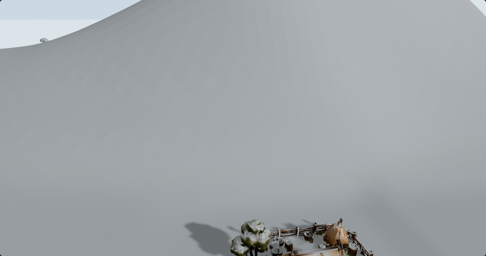
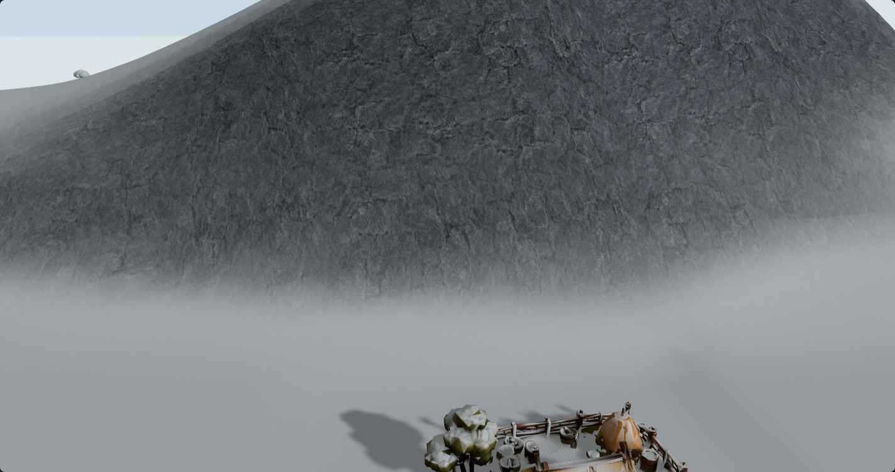
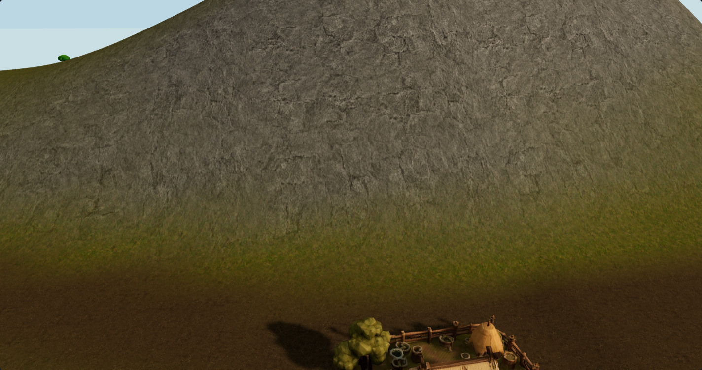
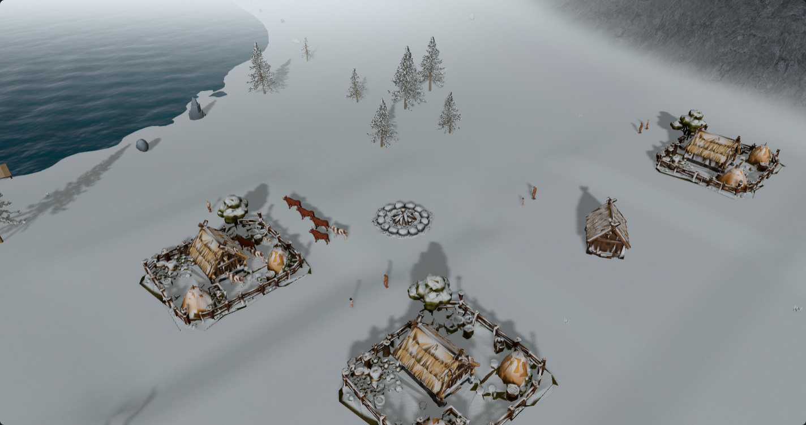

# Rock surface and seasonal snow — #180

This follow-up to the Icelandic colour study makes rock read as a distinct surface and keeps more of it exposed in winter. It reuses the selected generated basalt, enlarges the authored joints, applies the existing cool-grey rock treatment and masks the existing seasonal rock snow by surface orientation. Grass, earth and shore retain the previous candidate.

[Interactive comparison](https://acer-railway-fact-smaller.trycloudflare.com/rocks/) · [Source/delivery recipe](delivery.json) · [Native evidence](observations.json) · [Animated cadence measurements](performance.json) · [Gallery checks](gallery-check.json)

## What the reference calls for

The supplied image has large readable rock planes behind the settlement, dark mineral faces and snow on flatter shelves and upper surfaces. Material detail and the larger cliff silhouette are separate concerns. This study addresses the material on the existing procedural terrain. It does not add a mountain backdrop, modify the heightfield or hand-place rocks for one camera.

## What was hiding the rock

`src/world/SeasonTint.ts` applies the same ground-colour multiplier to all terrain material layers, including `mossy_rock`. Its summer colour can make neutral stone read as ochre. Its existing ground-snow shader also uses the same snow amount on every ground orientation, which obscures cliff texture in winter.

The earlier generic rock camera also looked from the uphill side. The camera-clearance system lifted it above the foreground terrain, so the view was dominated by the vegetated side of the ridge. These captures select a high existing rock-exposure sample, use the native terrain gradient to face it from downhill and retain the resulting camera exactly within each comparison. There is no change to the production camera controller.

## Candidate treatment

- **Readable rock grain:** the same original basalt source now has a 12m authored source span instead of 4m. A four-patch periodic atlas retains larger joint structure than the first twelve-patch recipe. The full atlas still repeats at 24m. This is an explicit readability choice, not real-world scan calibration.
- **Mineral colour:** delivery reuses the existing `prepare-blended-ground.mjs` cool-grey recipe: luminance-preserving desaturation, 1.3 linear gain and a restrained cool tint. Rock no longer receives the grass-coloured seasonal multiplier in the QA candidate. Approved sun, sky, fog and other material colours remain active.
- **Seasonal snow:** the original `SeasonTint` shader and its canonical `seasonSnowAmount` uniform are retained. On the existing three rock projection materials only, the snow mask becomes `smoothstep(0.72, 0.96, worldNormal.y)`. Steep faces receive little or no snow; less steep surfaces retain more. These thresholds are art direction, not a snow physics model.
- **No painted snow:** no snowy albedo, snow texture lookup, displacement, additional material layer or rendering pass is added. The shader carries one world-space geometric normal and evaluates its orientation. Summer still uses the existing zero seasonal snow strength.

The first permissive slope threshold left the walls too white. It was tightened during development before the final evidence set. The final helper and its hashes document the retained thresholds. The existing terrain normals control the result, so coarse facet boundaries remain visible; this does not create new ledges or rock relief.

## Native comparison

Both sides start with the prior Icelandic **colour-only** candidate, with terrain normal and roughness maps disabled on both sides. Native geometric normals still provide lighting. The current side uses its original rock scale, colour multiplier and uniform snow. The candidate changes only the three rock materials as described above. This compares a complete proposed rock treatment, rather than isolating each sub-change independently.

**Winter cliff — current treatment**



**Winter cliff — rock with directional seasonal snow**



**Summer cliff — candidate**



**Winter settlement context — candidate**



The full matrix is three saved fixtures (`snow-811`, `developed-810`, `summer-17`) at Standard and Low, with settlement, cliff and close surface views. That gives two campaign seeds, two island recipes, summer/winter, 18 paired views and 36 native renders. A material cannot be considered approved solely because this cliff close-up looks better.

## Implementation boundary

This remains an opt-in QA experiment on draft #190. Production `src/`, published `public/` maps, simulation, world generation, navigation, save data, entity placement and the asset pipeline are unchanged from the previous study head. The first study's measurements, sources and renders are preserved.

New files involved:

- `scripts/qa/prepare-rock-surface-180.mjs`: deterministic versioned rock delivery from the existing generated source.
- `scripts/qa/fjord-rock-snow-study-browser.mjs`: three existing rock maps, material tint and seasonal shader hook; loaded only by the QA runner.
- `scripts/qa/capture-rock-snow-180.mjs`: matched native cameras, immutable-world checks and exact material restoration.
- `scripts/qa/measure-rock-snow-180.mjs`: a separate animated, paused-simulation cadence comparison.
- `scripts/qa/check-rock-gallery-180.mjs`: all pair images, slider endpoints/midpoint and phone review layout.

The source PNG, selected imagegen revision and exact original/correction prompts remain in [the first study](../iceland-textures-180/generation.json). No new image generation was needed; snow follows the seasonal shader rather than being baked into the generated basalt. The recipe records the original source SHA-256 and delivery hashes. Standard remains 1024px; Low 512px. Existing UV repeats and projection channels are unchanged.

## Validation

Completed native checks: **PASS — 6 fixture/tier cases, 18 paired camera views, 36 images**. Every view restores the prior candidate's exact screenshot pixels. Geometry, masks, state and presentation invariants match, and rendering counts match within every warmed pair. Browser errors and missing-model placeholders: zero.

The gallery passed all 18 image/hash pairs, complete-image slider endpoints and midpoint checks. Its 390 × 844 phone review has no horizontal overflow. The existing ground-blending, terrain-shading and time-visualization suites passed **16/16**, with no skipped tests. All new script modules pass syntax checks. Formatting was checked manually; no formatter is configured.

The production source and dependency diff is empty against the prior study. That prior head passed the TypeScript/Vite build; a fresh full simulation/character-contract suite is not claimed for this QA-only follow-up. Required current-head checks still apply to draft #190.

Native captures check identical reconstructed canonical state, blueprint and actor hashes, cameras, lighting, terrain attributes, index/groups and alpha masks within every pair. Returning to the prior candidate must restore its exact uncompressed screenshot pixels. Rendering counts must match after both texture sets are warm, with zero browser errors or missing-model placeholders.

The timing script runs separately, after other capture/build jobs finish: three alternating current/candidate pairs per tier, 3 seconds warm-up and 8 seconds sampling each. It records all raw rAF intervals and a 5% median/p95 regression budget. Interpret its results as presentation cadence on one device and winter cliff, not isolated GPU time or a guarantee for every world. The measurement file reports `REVIEW` if a tier exceeds the budget; a visual improvement alone does not waive that gate.

Completed timing result: **PASS** on Intel HD 630, 1440 × 900 viewport, DPR 1. All 1,302 sampled intervals are retained. The combined figures below round to 0.1ms; Standard has no change to that precision, while Low median increases about 0.15%.

| Tier | Current median / p95 | Candidate median / p95 |
| --- | --- | --- |
| Standard | 66.8 / 83.4ms | 66.8 / 83.4ms |
| Low | 66.7 / 83.4ms | 66.8 / 83.4ms |

This is a short repeated comparison for a paused winter cliff. Absolute cadence on this old integrated GPU remains slow. It is not a long-running simulation or GPU/VRAM benchmark.

The experiment caches the prior rock and one additional candidate rock colour source while toggling. Equal warmed texture counts do not establish final upfront-loading memory parity. There is no claim of improved long-campaign simulation CPU cost or physical-device mobile performance.

## Reproduction

With the existing dependencies and prepared local model assets:

```powershell
node scripts/qa/prepare-rock-surface-180.mjs
$env:QA_GOLDEN = '1'
$env:QA_PORT = '5197'
$env:QA_CACHE_DIR = 'artifacts/rock-snow/vite-cache-v2'
node scripts/qa/fjord-runtime-server.mjs
```

In a second terminal:

```powershell
node scripts/qa/capture-rock-snow-180.mjs
node scripts/qa/check-rock-gallery-180.mjs
# Run with other capture/build/test jobs stopped.
node scripts/qa/measure-rock-snow-180.mjs
```

As in the previous study, golden mode disables file watching. Restart with a fresh cache after changing shader instrumentation. A complete evidence set needs all three fixtures at both tiers. The ordinary game build never imports these study hooks.

## Next step after review

If this treatment is selected, integrate material-specific tint and rock snow orientation into the existing `SeasonTint` ownership/disposal path, and load only the approved rock source through the existing loader. Finish coherent normal and roughness channels before production promotion.

The remaining visual gap to the supplied background is primarily **large-scale rock form**: angular cliff faces, shelves, ridgelines and distant silhouettes. Investigate that as a separate procedural geometry proposal across seeds, with settlement suitability, coastline, navigation and simulation compatibility explicitly protected. A texture alone cannot create those shapes. The retired 2D view and the mobile UI issue are outside this change.
