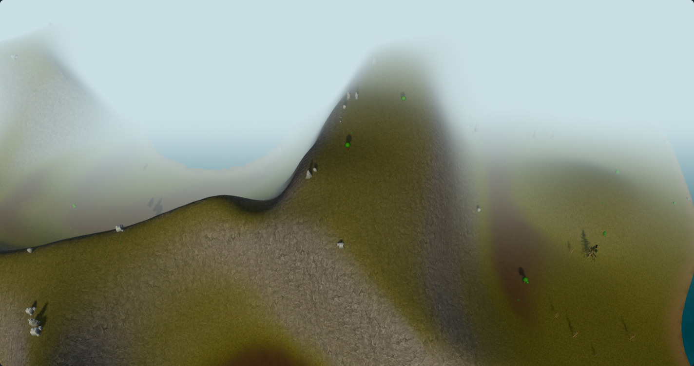
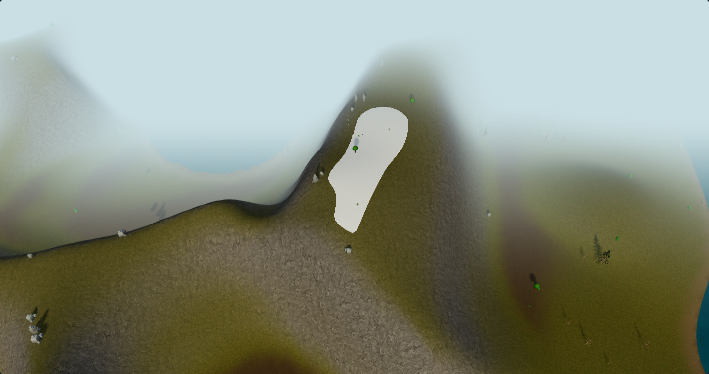

# Permanent snow on flat summits — #180

This opt-in material study adds year-round snow only to the flattest upper terrain. Its boundary against rock is hard. It builds on the separately measured [rock and seasonal snow treatment](../iceland-rock-snow-180/README.md); the original texture, rock and timing reports remain unchanged.

[Interactive comparison](https://acer-railway-fact-smaller.trycloudflare.com/summits/) · [Native captures and invariants](observations.json) · [Gallery checks](gallery-check.json) · [Cadence measurement](performance.json)

## Rules

Both conditions must hold at a fragment:

- Height is at least `waterLevel + 0.90 * (highestTerrainPoint - waterLevel)`.
- The upward component of the existing geometric surface normal is at least `0.97`, approximately a 14° maximum slope.

The shader uses two binary `step` operations, with no height or slope fade band. It applies a pale ice colour (`#dfedf4`) inside this mask, independently of the calendar. Existing seasonal snow remains a separate treatment outside it. Steep upper rock faces therefore remain exposed; flat lower land does not receive permanent snow.

These are explicit art-direction thresholds. The existing islands peak at only 45.96m (campaign seed 32) and 42.66m (seed 17). Their relative snow lines are 41.35m and 38.38m. These are not physical Icelandic snow altitudes or a glacier simulation. No actual landscape, climate, navigation or simulation rule changes in this study.

## Native comparison

**Summer — seasonal snow only**



**Summer — permanent snow on flat upper surfaces**



The baseline already includes the reviewed rock colour, scale and directional seasonal snow. Only the summit shader changes between these images. The permanent mask and colour have no seasonal input; summer and winter use the same seed-32 terrain. A second procedural island checks that the rule is reusable.

The native camera controller raises the requested camera to satisfy its existing clearance rules. This actual camera is recorded and held identical within each pair. Existing distance fog and vegetation remain visible. Some vegetation intersects the new cap because altitude-aware vegetation is not part of this material-only experiment. No scenery is hidden to make the cap look cleaner.

The runner disables an exploration overlay **if present**, but all six saved fixture/tier cases report `discoveryOverlayVisible: null`: no such overlay exists here. The top-level `discoveryOverlayHiddenForSummitInspection` flag records the requested capture mode, not proof of an overlay being found. The visible haze must not be attributed to a hidden exploration layer.

## Validation

Native captures: **PASS — 6 pairs / 12 renders** across `developed-810`, `snow-811` and `summer-17`, each at Standard and Low. Every pair checks identical canonical state, blueprint, actors, actual camera, lighting, terrain attributes, index/groups and alpha masks. Returning to the baseline restores exact uncompressed pixels. Browser errors and missing-model placeholders: zero.

Warmed calls, triangle counts, geometry counts and texture counts are equal within every pair. There are no new maps, geometry buffers or render passes. This does not by itself establish equal shader cost; the summit cadence measurement is recorded separately from the earlier rock benchmark.

The local gallery passed all 6 image pairs, their file hashes, complete-image slider endpoints and midpoint clipping. The 390 × 844 review page has no horizontal overflow. Mobile gameplay usability and device performance remain outside this desktop study.

The existing time-visualization, ground-blending and terrain-shading suites passed 16/16 with no skips after this addition. All four new or changed study modules pass Node syntax checks. Formatting was reviewed manually; no project formatter is configured. Production source, dependencies and the earlier texture-study evidence are unchanged against the previous study head.

The separate animated cadence comparison passed the predeclared 5% median/p95 regression budget at both tiers on Intel HD 630. It uses the saved summer summit, paused simulation, three alternating pairs per tier, 3s warm-up and 8s sampling. All 1,232 raw rAF intervals are retained.

| Tier | Current median / p95 | Permanent-cap median / p95 |
| --- | --- | --- |
| Standard | 83.3 / 83.5ms | 83.3 / 83.5ms |
| Low | 83.2 / 83.4ms | 83.2 / 83.5ms |

Low p95 increases approximately 0.12%; the other combined figures are unchanged at the shown precision. Absolute cadence on this old integrated GPU remains slow. This is presentation cadence for one paused summit, not isolated GPU shader time, a general frame-rate target, a VRAM measurement or a long-campaign CPU benchmark. The earlier rock benchmark remains separate.

## Files and reproduction

- `scripts/qa/fjord-summit-snow-study-browser.mjs` owns the reversible summit shader hooks, uniforms and shader cache key.
- `scripts/qa/capture-rock-snow-180.mjs`, `check-rock-gallery-180.mjs` and `measure-rock-snow-180.mjs` select this separate study with `QA_STUDY=summit`. Their normal mode still addresses the rock study.
- Existing `src/world/SeasonTint.ts`, `BlueprintTerrain.ts`, the generated basalt source and the modular asset loader are reused without production edits. Original imagegen prompts and source hashes remain in [the texture provenance](../iceland-textures-180/generation.json).

Start the existing QA server with golden instrumentation and a fresh cache:

```powershell
$env:QA_GOLDEN = '1'
$env:QA_PORT = '5197'
$env:QA_CACHE_DIR = 'artifacts/rock-snow/vite-cache-v3'
node scripts/qa/fjord-runtime-server.mjs
```

In a second terminal:

```powershell
$env:QA_STUDY = 'summit'
node scripts/qa/capture-rock-snow-180.mjs
node scripts/qa/check-rock-gallery-180.mjs
# Stop other capture, build and test jobs before measuring.
node scripts/qa/measure-rock-snow-180.mjs
```

Captured source hashes and fixture hashes are retained in `observations.json`; both materials and simulation are restored by the study runner. The ordinary game build does not import these QA helpers.

## Integration gate

This is a reviewable native-render prototype on draft #190. Production promotion still needs coherent mountain geometry, an explicit absolute/relative snowline policy, altitude-aware vegetation and consistent material channels. The current cap is a colour treatment without ice volume, crevasses, flow, accumulation or melt. Preserve the sharp boundary and flat-surface restriction when developing those separately.

Integrate any selected shader through the existing seasonal-material ownership/disposal path and validate additional seeds and cameras before shipping. The 2D world is retired and mobile UI remains in #182.
