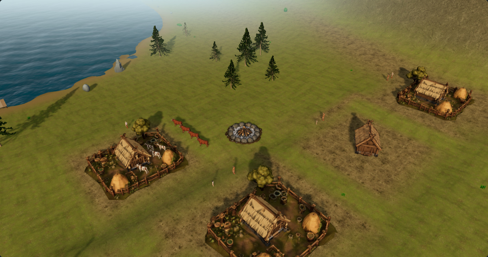
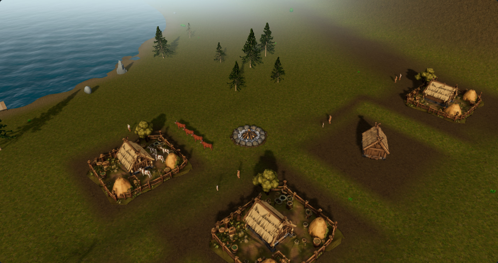
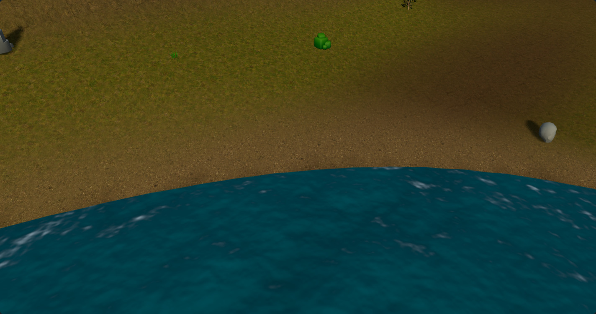

# Icelandic fjord material study — #180

Four generated colour textures are now available for review in the existing 3D world. This is an isolated material experiment on top of the approved Northern sun work in #189. No production source, gameplay, geography, model, vegetation placement or asset-pipeline default changes are included.

**Recommendation: continue with this material vocabulary, but do not promote this first set to the game defaults.** Grass and village earth are substantially darker under the retained seasonal tint, and the green shifts towards ochre. The sources suggest useful surface detail; the combined result needs colour calibration and matched data maps before it meets the target. A prompt requesting a seamless, unlit material does not certify either property.

[Interactive comparison](https://acer-railway-fact-smaller.trycloudflare.com/textures/) · [Exact prompts and research references](generation.json) · [Delivery and seam measurements](delivery.json) · [Native capture evidence](observations.json) · [Validation and reproduction](validation.md)

## Real-world direction

The official [Hornstrandir reference](https://www.westfjords.is/en/destinations/nature-reserves/hornstrandir-nature-reserve) shows green coastal slopes with weathered rock. [Dynjandi](https://www.westfjords.is/en/place/dynjandi) describes layered lava and softer intervening strata. Those landscape-scale layers do not mean a close basalt surface should resemble thinly foliated slate; the first generated rock sample was rejected for that reason.

Icelandic shores are not uniformly black. The official [Rauðasandur description](https://www.westfjords.is/en/moya/extras/5/raudasandur) documents varied sand colours and shell-bearing sediment. The [Vatnajökull National Park biome overview](https://www.vatnajokulsthjodgardur.is/en/nature--history/biome) also describes varied vegetation and habitats; it is broader Icelandic context, not a Westfjords vegetation map. The direction is regional variation in grass, moss, mineral soil and stone, rather than one moss-covered lava texture everywhere.

These are observations for art direction, not a geologically calibrated reconstruction or a statement about historical Viking-age vegetation. Research photographs are linked as references and are not included as game textures.

| Candidate | Role in the current renderer | Intended visual contribution | Remaining issue |
| --- | --- | --- | --- |
| Coastal turf | `Ground037` grass | Low coastal grass, olive moss and small earth gaps | Too dark and ochre in the current summer treatment; recover green midtones without a bright lawn appearance |
| Weathered basalt, revision 2 | `mossy_rock`, all three projections | Massive grey basalt, irregular joints, restrained lichen | Dark cracks may contain baked shading; terrain blends can obscure the rock identity |
| Volcanic earth | `grass_path_2` soil and wear | Dark silty earth with small dull gravel | Broad worn areas become heavy and visually flat; keep small characters readable |
| Fjord shore | `Ground054` sediment | Muted taupe/grey sand and mixed gravel | Check regional colour variants and blend width; do not impose this sediment on every shore |

## Existing implementation, retained

The game already has the relevant systems. `src/world/WorldFactory.ts` loads zoned blending with cool-grey rock for the canonical island. Some older ground-study documentation describes that treatment as Lab-only; the current runtime is the authority for this study.

- `src/world/WorldGroundMaterials.ts` loads colour, normal and roughness maps for Standard; Low already omits normals.
- `src/world/GroundBlending.ts` consumes the existing saved environment fields and live wear, then builds six native material layers. Rock uses three world-axis projections.
- `src/world/BlueprintTerrain.ts` owns the existing mesh, UV channels, masks, material clones and approved terrain normals. Those buffers are retained exactly.
- `src/config/GroundBlendConfig.ts` sets the 24m atlas period and 1024px / 512px delivery tiers.
- `src/world/SeasonTint.ts` retains seasonal colour and existing snow response. This first experiment deliberately tests the sources under that treatment.
- `scripts/prepare-blended-ground.mjs` remains unchanged, including its approved-source hash lock and published `blended-v1` output.

The new offline QA recipe follows the existing periodic colour sampling method in `scripts/qa/prepare-iceland-albedo-180.mjs`. It writes only this study's delivery folder. Seeded quarter-turns and offsets are mixed in linear light; no extra colour grading, terrain inputs, displacement, shader pass or dependency is introduced. The generated originals remain unchanged.

## Controlled native comparison

The browser helper is loaded exclusively by the QA capture runner. It swaps colour sources on the existing terrain material instances, retaining texture transforms, colour space, UV channel and anisotropy. Existing seasonal shader hooks remain active. The ordinary game never imports this helper.

| Mode | Colour | Terrain normal / roughness maps | Purpose |
| --- | --- | --- | --- |
| Native | Current | Current, according to quality tier | Context reference |
| Current colour only | Current | Both disabled, roughness 1 | Controlled baseline |
| Iceland colour only | Generated candidate | Both disabled, roughness 1 | Controlled colour comparison |

Existing normals and roughness were not silently placed under unrelated generated surface features. All three modes retain actual terrain vertex normals, lighting, vertex colours, masks, season tint and snow response. Disabling the texture normal map does not flatten the geometry normals.

The review uses frozen existing `developed-810`, `summer-17` and `snow-811` fixtures, covering seeds 32 and 17, founding and developed settlements, summer and winter, at Standard and Low. The developed scene also includes a yard, coast and a camera selected from the highest saved rock-exposure field near the settlement. That last view is a blended terrain zone, not an isolated pure-rock swatch. Each camera is identical within its comparison.

**Current colour only — developed settlement, Standard**

**Iceland colour only — same world, camera and lighting**

**Coast sediment — Iceland colour candidate**

The temporary review page also exposes all paired views and the current full native materials separately. It is a gallery of actual game renders, not a painted target scene. It does not change the playable game or the selected desktop UI prototype C.

## Source and delivery qualification

Built-in `image_gen` produced the four square sources. The tool did not report an exact model identifier. It returned 1254 × 1254 pixels rather than the requested 1024; those originals are retained under `sources/`. The complete generation and basalt correction prompts are in [generation.json](generation.json).

The four-metre source coverage is authoring intent, not a measured physical scale. The delivery atlases retain the existing 24m period. Standard uses four 1024px colour maps and Low four 512px maps. Together the eight WebP maps total 1,684,818 bytes. Per-file dimensions, bytes and SHA-256 values are in [delivery.json](delivery.json).

Edge checks compare the RGB difference across opposite edges with ordinary adjacent-pixel differences. The delivered seam-to-interior ratios are below 1.5 in both axes for all eight maps. This catches gross colour discontinuities, but cannot certify absence of repeated motifs, local shading or a visible seam at every mip level. Inspect the 3 × 3 gallery previews and native distance views as well.

These are **albedo candidates only**. Matched normal, roughness, height and AO maps have not been generated. Dark cracks and grass shading still need a de-lighting assessment. A successful prompt or a good flat preview is not sufficient material validation.

## Recommended next order

1. **Calibrate colour under the approved lighting.** Retain grass-green identity and readable earth midtones across the current seasonal multipliers. Check neutral diffuse light and a rotated sun to find baked directional shading. Keep basalt irregular and massive; avoid uniform black cliffs or grass-shaped cracks. High impact, low implementation complexity; depends on review of this set.
2. **Finish coherent material channels.** Author or derive matched normal and roughness from a shared surface definition, then review under changing light. Do not treat a greyscale albedo conversion as physically valid height. Medium complexity; the chief risk is shading disagreement between maps.
3. **Review the existing masks with the selected set.** Use current moisture, shelter, rock exposure and wear fields to assess transition width and worn-area coverage across seeds. First distinguish source-colour problems from mask coverage. Medium complexity; any mask adjustment needs its own controlled study rather than being hidden in a texture comparison.
4. **Integrate an approved set through the existing loader.** Version the delivered maps and their manifest, preserve source attribution/provenance and disposal, and load one chosen set upfront. Low complexity after material approval; retain a reversible comparison until visual acceptance.
5. **Measure before promotion.** Repeat the golden scenes and animated Standard/Low timing on an otherwise idle machine. Include rain/wet treatment and at least three procedural seeds before expanding the rollout. Reuse the existing asset sizes and shadow budget.

Independent follow-ups can cover colour calibration, coherent PBR channels, regional sediment variants and mask/wear readability. Vegetation geometry, distant cliff silhouettes and settlement composition remain separate parts of #180. Additional expensive rendering effects are unnecessary for this first material experiment. No work on the retired 2D environment is proposed; mobile UI remains #182.

## Acceptance before changing game defaults

- Identical saved state, geography, entity poses, camera, terrain topology, UVs and placement for every paired material capture; zero placeholders or page errors.
- At least three procedural seeds, founding and mature settlements, summer, winter and wet weather, both quality tiers. The present study covers two seeds and summer/winter; it does not close this gate.
- Zero new rendering passes or terrain draw calls; unchanged triangle and geometry counts. Candidate Standard / Low map dimensions and upfront colour-map count stay within current budgets.
- No more than 5% regression in median and p95 animated frame cadence across three repeated, identically warmed samples per quality tier. GPU time and VRAM should be measured separately where available. This study records rendering counts, not a timing pass.
- Matched channel features under at least two sun directions; no obvious baked cast shadow, visible tile seam or dominant repeated landmark at close, gameplay and distant camera ranges.
- Terrain remains legible around yards and small characters; grass, earth, stone and shore have distinct identities without an all-yellow or all-black landscape. Visual approval is still required.

The toggle experiment retains both old and new colour sources in memory. Its cache therefore cannot prove final-loader VRAM or loading-time parity. Loading one selected set upfront and measuring that path is a later integration gate. No long-campaign simulation CPU improvement is claimed.
