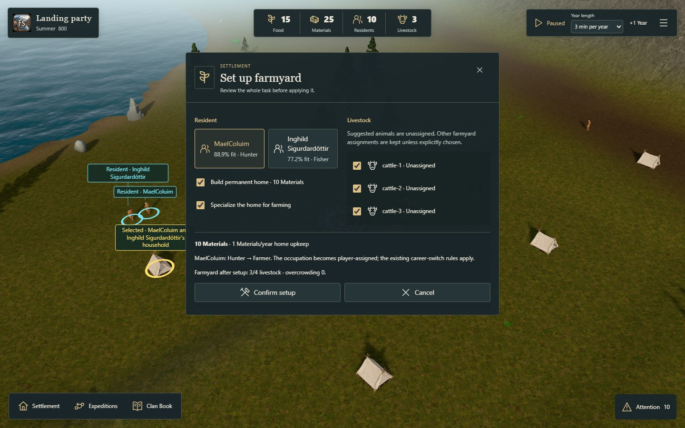
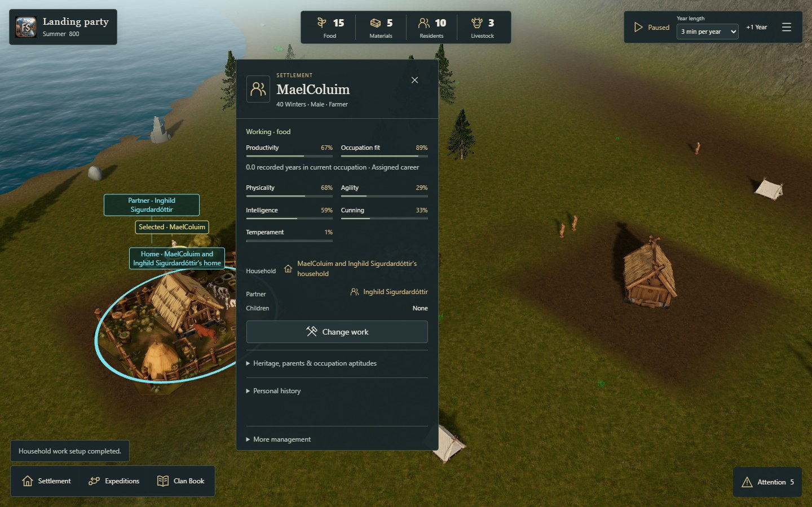
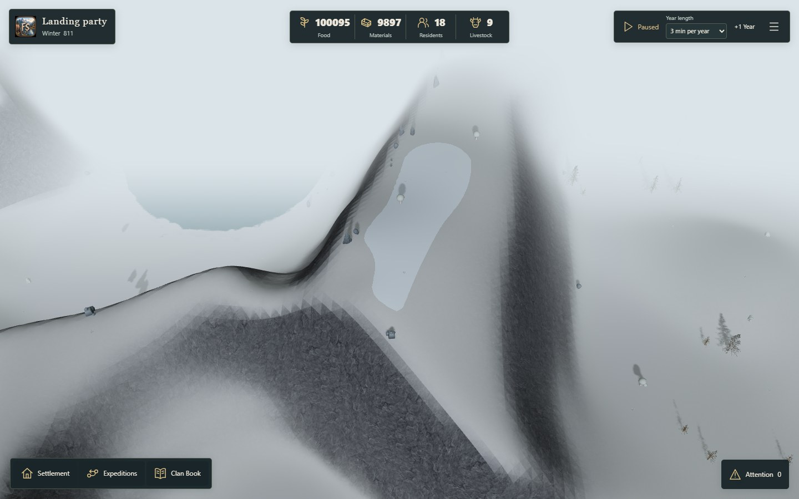

# Integrated FjordSide QA playtest — #180

The real `/fjord-play` now combines the approved Context & Focus direction with Northern lighting, Icelandic ground colours, readable basalt, directional seasonal snow and permanent snow on flat summits. The interface executes canonical commands and renders their actual results in the procedural world.

[QA launcher and scenarios](https://acer-railway-fact-smaller.trycloudflare.com/playtest/) · [Open / resume the game](https://acer-railway-fact-smaller.trycloudflare.com/fjord-play)

This is a separate integration branch, stacked on the material study in #190. The earlier galleries remain historical comparisons at their recorded study revisions. Reproduce those on their pinned commits; this branch has new game defaults.

## Interface

- A full-screen world with compact clan/calendar, resource and clock clusters. Food, Materials, Residents and Livestock open relevant information. Large stock values retain their complete digits on one line.
- A contextual selection card and one central task surface. Settlement, Expeditions, Clan Book and Attention open on demand. Advanced existing commands remain accessible under More management.
- Personal data comes from the actual simulation: age, sex, occupation, productivity, occupation aptitude, recorded occupation time, inherited traits, family, heritage and personal history. Archived identities retain an explicitly historical presentation. No health, mood or skill-level values are invented.
- Ordinary housing, household work, building specialization and farmyard activation remain distinct. All ten configured occupations use the same work-plan UI; farming is optional. Occupations without resource output retain their existing inactive behavior.
- Editable work proposals combine optional housing, a suitable resident and optional specialization. The farmyard task additionally lists explicit livestock assignments. Existing occupations and career settings are kept when already suitable; other residents and animal assignments are preserved.
- Existing expedition, lineage, history, save/import/export and pacing systems remain connected. The 2D link is removed from this Fjord interface; its simulation code is retained.





## Measured task and command safety

From a visible occupied tent in the funded starting scenario:

1. Select the tent in the world.
2. Open Manage work.
3. Choose Set up farmyard.
4. Review and Confirm setup.

Both render tiers complete this in **four physical clicks**, building the home, assigning the proposed farmer and sheltering three actual cattle. Changing suggestions adds the corresponding clicks. The cost/commit area remains visible at 1440 × 900 and 1280 × 720 without scrolling to the button.

`WorkPlan.ts` previews the existing Core commands against a separate returned state. The queued commit rebuilds its commands against current state. `GameplaySession.commandBatch()` supports only the four zero-time management command types and commits after every command succeeds. A failed final assignment leaves state, RNG, history, revision, trend and book unchanged. Reading and reviewing do not automatically pause or advance the campaign.

Changing the last farmer explicitly reviews cattle losing shelter. Salvage and slaughter use a consequence dialog. Cancellation spends no resources. Ordinary house construction preserves the residents' occupations; the separate Smithing browser test does not assign cattle.

## Terrain and material integration

The existing loader gains an optional `iceland-v1` style, selected for validated Fjord islands. Other worlds retain their material path. A preparation script copies the selected study deliveries byte-for-byte into the existing public material tree; its manifest records source paths and hashes. There are four colour sources per tier, the original 24m period, six existing terrain layers and no new dependency or rendering pass.

`SeasonTint` owns the integrated shader and restores its hooks on disposal. Rock keeps its mineral colour. Its seasonal snow uses the reviewed orientation mask. Permanent snow requires both the upper 10% of the height range and an upward normal of at least 0.97, approximately 14°. The boundary uses binary steps and has no terrain-colour fade band; its colour is independent of the season.

Use **Menu → Camera views & controls → View highlands** to inspect the result. Close an existing selection card for an unobstructed landscape. View settlement returns to the village.



## QA scenarios

| Scenario | Purpose | Preparation |
| --- | --- | --- |
| Funded Summer 800, seed 32 | Housing and four-click farmyard/work tasks | Existing starting save; the real SalvageLongship command raises Materials from 5 to 25. The founding longship is already salvaged. |
| Summer 810, seed 32 | Developed settlement and resident inspection | Existing high-stock benchmark, not an economy-balancing scenario. |
| Winter 811, seed 32 | Snow, rock and mature settlement | Existing high-stock benchmark. |
| Summer 800, seed 17 | Another procedural island and ordinary starting resources | Existing unmodified campaign with 5 Materials. |

Scenario loading is explicit and keeps one recovery copy of the previous active browser session. The funded save is exported through the normal SharedSettlement path so campaign, layout and narrative metadata agree. [Scenario provenance](scenarios.json) records its exact preparation command and source/delivery hashes.

## Validation and reproduction

[Native browser observations](observations.json) include source hashes and the complete eight-case matrix: four scenarios × Standard/Low. They verify the restored canonical state, actual 1024px/512px selected maps, both desktop resolutions, one-line stocks, irreversible-action cancellation, personal data, all ten occupation choices, connected expedition/book controls and native highland views. The Standard starting case additionally executes separate housing and Smithing, exact local save/load and real Start/Pause advancement.

[Published-build verification](remote-check.json) runs through the public tunnel without the development audit API. It executes a real task and downloads the game's canonical export to verify the farmer, home, three cattle, cost and unchanged time/RNG. Source, Git and environment-file routes are inaccessible; the host serves an allowlist from the normal build. The game continues to use browser-owned saves.

The complete Node suite reports **898 tests: 897 passed, 0 failed, 1 existing opt-in skip**. The skipped frozen-r3 GLB portability test requires `RUN_R3_EVIDENCE=1`; it was not skipped because of another failure. The new transaction tests cover all occupations and failed-commit atomicity. TypeScript and normal Vite build pass. The existing large-chunk advisory remains. Formatting was reviewed manually; no formatter is configured.

```powershell
node scripts/qa/prepare-fjord-materials-180.mjs
node scripts/qa/prepare-integrated-playtest-180.mjs
node --test --test-concurrency=2 'tests/*.test.mjs'
npm run build
node scripts/qa/fjord-playtest-server.mjs
```

The static host binds to loopback port 5199 by default. For native browser checks, start `fjord-runtime-server.mjs` with `QA_PORT=5198`, `QA_GOLDEN=0` and a separate cache, then run `capture-integrated-playtest-180.mjs`. `check-published-playtest-180.mjs` checks the normal static build; `QA_PUBLIC_ORIGIN` selects its host.

## iPad landscape header correction · 17 October 2026

The previous 1100px breakpoint forced resources onto a second row even when the landscape viewport had enough room. The compact header now retains three columns from 960px upwards, reserving the clock controls' intrinsic width and truncating long clan names. Below 960px, the existing second resource row remains available. Narrow-screen pacing placement stays unchanged.

[Header layout evidence](ipad-header-layout.json) records 30 checks against the normal production build: 15 viewport widths from 320px to 1440px, each with the saved Winter 811 values and with a long clan name, six-digit Food/Materials, Running and the longer expedition pacing label. Checks cover the first row at 960px and above, readable fallback below that, non-overlapping clusters, unbroken numbers, horizontal overflow and pacing accessibility. The menu also fits at 1024 × 636. TypeScript and the normal Vite build pass; no gameplay code changed. Existing full-suite and eight-scene evidence above remains historical for its recorded source hashes.

[1024 × 636 screenshot](ipad-header-1024.jpg) shows the actual winter campaign before synthetic layout stress values. The public tunnel was verified to serve the same current production index. Browser verification used headless Edge; physical iPad Safari review remains with the owner. To reproduce visually, load the winter scenario, resize across 959/960px and 1100/1101px, and inspect the resource row and menu.

## Scope and follow-up

This confirms the integrated workflows and rendering, not a sustained frame-rate target or long-campaign CPU fix. The previous isolated material timing studies remain separate evidence. Hidden legacy forms and the attention chronicle now render only when needed, but prolonged simulation and larger populations still need profiling.

Terrain remains the existing 43–46m game-scale islands. Snow is a material treatment without glacier volume; mountain geometry, altitude-aware vegetation and coherent normal/roughness channels remain follow-ups. Older geography keeps its legacy material path. Texture resolution follows the tier chosen when a world loads; quality changes update rendering/shadows immediately, with the matching texture tier applied on reload.

Desktop is the target of this QA pass; mobile usability remains #182. Cultural gatherings, apprentice recruitment, carts/horses and new clan trading interactions require their actual gameplay systems before interactive controls are added.
