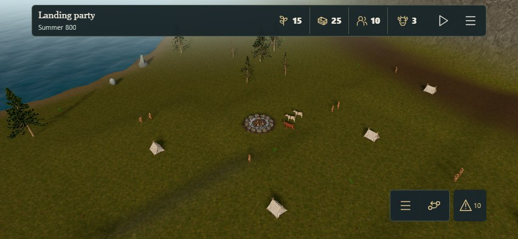
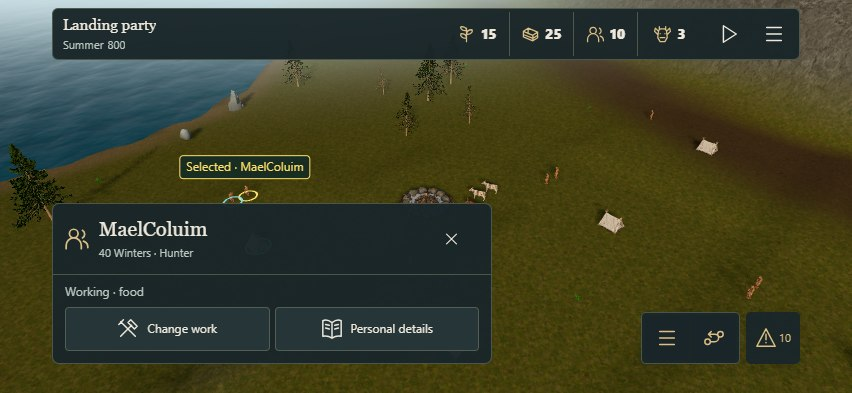
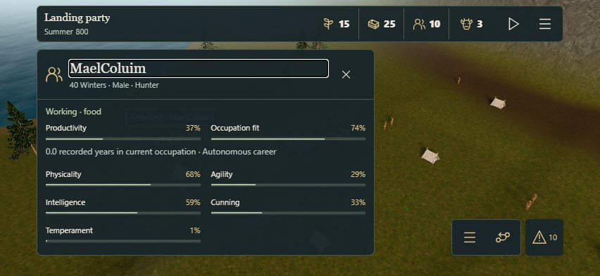
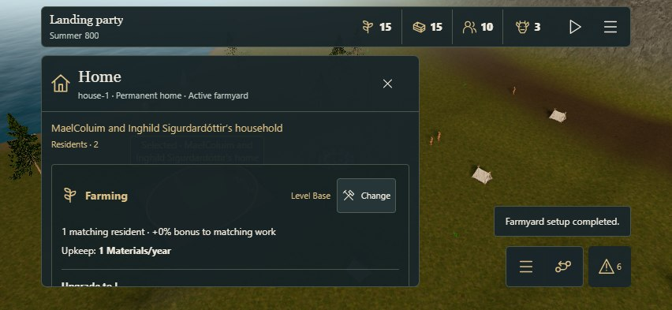
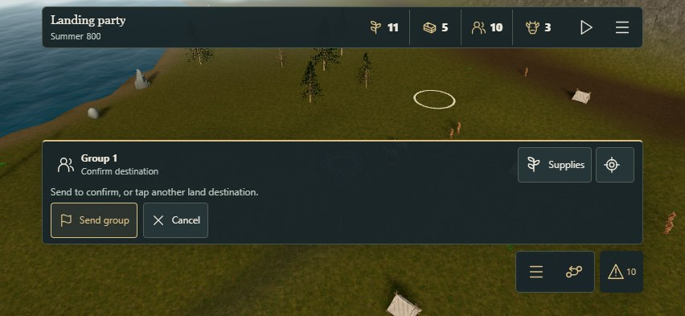
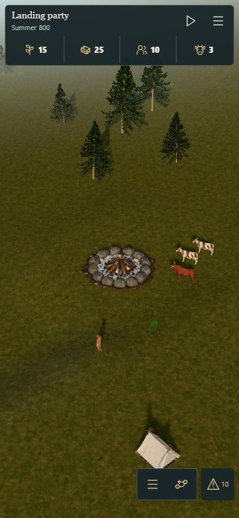

# Horizon mobile implementation — #182

The owner selected **A — Horizon** after reviewing the [separate design reference in #195](https://github.com/sidesliders1983/Pillagers/pull/195). This implements the agreed mobile shell in the actual 3D game, based on #192 at `506033128e05d25d4a9a83f58463a3dc19ac417d`. The disposable prototype is not imported into production.

## Review

- [Open or resume the actual game](https://acer-railway-fact-smaller.trycloudflare.com/fjord-play).
- [Choose a prepared QA campaign](https://acer-railway-fact-smaller.trycloudflare.com/playtest/). Starting a scenario replaces the active browser campaign only after the launcher's explicit confirmation and keeps its recovery copy.
- [Separate A/B/C design reference](https://acer-railway-fact-smaller.trycloudflare.com/mobile-prototype/?variant=A).

Use phone landscape first. The normal game detects a compact touch device; no prototype switcher, special mobile URL or alternate simulation is needed. A phone in portrait has a two-row fallback. Fine-pointer desktop retains Context & Focus, and touch tablets up to 1100 CSS pixels use Horizon.

## What changed

One charcoal status strip holds the real calendar, four resource/population drilldowns, Play/Pause and settings. Year pacing and the existing +1 Year action move into settings on mobile, using the same controls and event bindings. The active expedition still disables manual year advancement. No menu or orientation change automatically starts the clock.

Three controls sit by the right thumb: a transient Settlement/Clan Book drawer, direct Expeditions, and Attention with its actual condition count. Resource details and all existing directories remain available. Salvaged longships stay excluded from Vehicles.

Selection opens a concise bottom-left peek. Personal details expands the existing real productivity, occupation fit, recorded career, inherited traits, family, heritage, occupation aptitudes and personal history. No Health, Mood or invented skill values are introduced. Homes expose Build house and Manage work, with specialization/upgrades and advanced management in the expanded view. All ten occupations remain independent from housing; farmyard setup is an optional combined task.

Exploration has a compact contextual bar on the actual 3D world: group/phase, on-demand crew and pack details, camera focus, land-flag preview, Send/Cancel, redirection and Return home. The header owns the mobile clock control. Prepared/active/returning/stranded states keep their canonical availability and supply rules. Opening another surface cancels only an unconfirmed flag.

Safe-area tokens and visual-viewport height account for the browser viewport and device insets. Touch targets are at least 44 CSS pixels; long content scrolls within its sheet. Mobile keyboard navigation stays in the sheet, and task transitions place focus on the new heading. Related world labels and leader lines are suppressed on mobile; relationship links remain in personal details. Command feedback, including failed/stale offers, stays visible.

## Evidence and reproduction

[Native browser observations and source hashes](observations.json) record the normal compiled application, using Edge touch/device emulation and the unchanged explicit QA campaigns. This is browser evidence, not physical iPhone certification.








Run the ordinary production build, then serve its allowlisted files:

```powershell
pnpm build
$env:QA_PORT = '5183'
node scripts/qa/fjord-playtest-server.mjs
```

In another terminal:

```powershell
$env:QA_ORIGIN = 'http://127.0.0.1:5183'
node scripts/qa/check-mobile-horizon-182.mjs
node --test tests/expedition-mode.test.mjs tests/spatial-expeditions.test.mjs tests/island-clans.test.mjs tests/home-improvements.test.mjs tests/work-plan.test.mjs tests/touch.test.mjs
```

The native check exercises six artboards (667×375, 852×393, 932×430, 1024×636, 640×768 split view and 390×844 portrait), simulated landscape side insets of 44px and a 21px home-indicator inset. It checks visible hit-target geometry, safe bounds, horizontal overflow, resource/settings access, personal peek/expanded/portrait states, actual four-tap world-to-farmyard setup, all occupations, independent upgrades, stale-offer feedback, journal/attention and desktop restoration. Rotation and inspection preserve the entire canonical campaign.

The expedition journey tests cancelled packing, exactly 4 Food for the two-member QA crew, on-demand supplies, drag/pinch release without a flag, read-only flag preview, cancellation, explicit dispatch and Resume, physical discovery, recall/homecoming, paused reload without a second charge, and ending a prepared journey without a refund. It never uses a production audit API or injects canonical gameplay state. Target projection reads the ordinary camera/actor diagnostics; actual user actions drive changes.

At 852×393 the default persistent HUD rectangles leave approximately **86% of the screen outside them**, above the reference's 84% target. This is a geometric coverage measurement, not a claim about unobstructed terrain pixels, frame rate or all possible text sizes. Overlays intentionally occupy more space while a task is open.

[Public build verification](public-check.json) compares the delivered launcher, exploration scenario, JavaScript and CSS with local bytes. Earlier visual/design reports remain historical and unmodified.

## Scope and remaining acceptance

No Core rules, balance, geography, save schema, assets, materials, dependencies, animation loop or rendering passes change. Closed panels retain the existing hidden-work guards. Existing touch gestures remain **drag to orbit, pinch to zoom, tap empty terrain to centre**; this is accurately explained in settings and exploration. A one-finger pan/two-finger camera redesign needs its own input contract and physical testing.

The separate read-only DiscoveryView map in the reference remains a follow-up, as allowed by the reviewed implementation order. Actual discovery/exploration remains on the existing 3D island; no second playable 2D world is reintroduced. Cultural events, apprenticeships, new vehicles/livestock and clan trading remain prospective gameplay capabilities.

Physical iPhone/iPad Safari, Dynamic Island behavior, browser toolbar/keyboard changes, VoiceOver, text enlargement, dense-selection ambiguity and long-run device performance still require owner/device QA. The proposed device budget remains ≤10% p95 frame-time regression for the same seed/camera/state/quality and <100ms simple panel feedback excluding Core/assets; those device metrics are **not measured here**. No synthetic emulation result is presented as GPU/thermal acceptance. The existing large-bundle advisory remains.

Formatting is reviewed manually; the repository has no configured formatter. TypeScript, normal build, focused gameplay/touch regressions, script syntax and diff checks are recorded with the change. Keep the implementation PR draft for current-head required checks and owner QA; do not merge the disposable reference branch.
