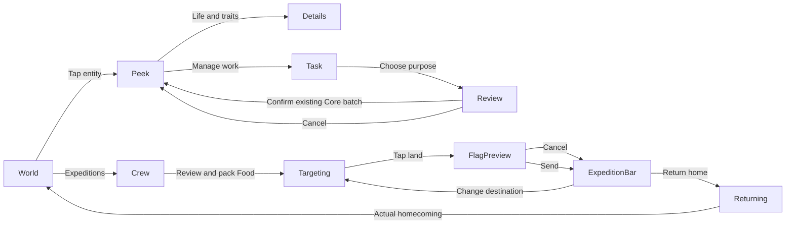

# Mobile UI reference · issue #182

**Design and audit only.** This is the reference pass requested by [#182](https://github.com/sidesliders1983/Pillagers/issues/182), under [#180](https://github.com/sidesliders1983/Pillagers/issues/180). The issue explicitly requires “deliver design + audit first” and review before broad implementation. No production UI, input controller, simulation rule or save schema changes are included.

The prototype is a disposable primary source on `codex/mobile-ui-reference-182`, based on the integrated desktop UI at `506033128e05d25d4a9a83f58463a3dc19ac417d` / PR #192. Keep it out of the production router. After choosing a direction, implement the agreed behavior properly in a separate change rather than merging this prototype into the game.

## Open and compare

- [A · Horizon](https://acer-railway-fact-smaller.trycloudflare.com/mobile-prototype/?variant=A)
- [B · Field journal](https://acer-railway-fact-smaller.trycloudflare.com/mobile-prototype/?variant=B)
- [C · Command ribbon](https://acer-railway-fact-smaller.trycloudflare.com/mobile-prototype/?variant=C)
- [The unchanged real game](https://acer-railway-fact-smaller.trycloudflare.com/playtest/)

Use the blue bottom switcher or the left/right arrow keys. The URL preserves the selected variant, viewport and journey. On a phone the preview uses the current screen; choose **Review** for the named artboards and scenario selector. Rotate the phone to review the primary landscape layout. No orientation lock is required.

Locally, run `pnpm mobile:prototype` and open `http://127.0.0.1:5182/mobile-prototype/`. The server uses Node's built-in modules and an explicit file allowlist. There are no new runtime dependencies. The prototype is served separately from Vite's production entry graph; its switcher cannot appear in the normal game build.

All interactions are in-memory UI previews. They never read or write the game's browser saves or send simulation commands. Camera movement, 3D travel, gestures and elapsed simulation are not simulated. The outlined world circles are review hotspots, not proposed final selection graphics.

## Recommendation and alternatives

**Start with A, Horizon.** It keeps the most frequent actions directly available while replacing the desktop's second status row and large workspace with one compact status strip and a transient sheet. Its active exploration bar reuses the recent desktop journey, with one global clock control rather than duplicated playback controls.

| Variant | Structure | Strength | Tradeoff |
|---|---|---|---|
| A · Horizon | One status strip; three thumb controls; concise bottom sheet; expandable reading/task sheet | Predictable resource/time access and direct Expeditions/Attention | The full status background occupies more area at rest |
| B · Field journal | Separate corner clusters; one thumb wheel; a right edge sheet | Most open world at rest; productivity/occupation fit visible immediately after selection | One extra tap for navigation/expeditions; the expanded edge sheet occupies more of the scene |
| C · Command ribbon | Progressive resource disclosure; transient selection/action ribbon; central detail sheet | Least selected-person clutter; actions remain in one line | More hidden information; reading requires an explicit expansion |

The layouts use the same palette and source data. They disagree about hierarchy, navigation and contextual presentation rather than colour alone. A combined choice is possible, such as A's navigation with C's compact selection ribbon.

At the 852 × 393 landscape reference, the screen area outside the persistent HUD rectangles is **84.4% for A, 91.7% for B and 90.6% for C**. These measurements are geometric layout comparisons: they exclude review hotspots and simulated device chrome, and do not measure FPS or selected/expanded panels. See [design observations](design-observations.json).

## Current implementation audit

| Current system | Evidence in the repository / actual build | Mobile implication |
|---|---|---|
| Calendar, stocks and playback | [FjordHeader.ts](../../../src/fjord-play/FjordHeader.ts), [fjord-interface.css](../../../src/fjord-play/fjord-interface.css) | Under 960px the counters form a second row, including on landscape phones. The 852 × 393 native capture demonstrates this; the mobile header needs its own composition |
| Touch target sizes | [Native visibility measurements](baseline-visibility.json) | Six measured buttons in the default HUD are below 44 × 44 CSS px: the four resource/population buttons are 30px high; playback and +1 Year are 40px high. The raw 17-control count includes closed menu content; it must not be reported as 17 visible controls. This button/disclosure inspection does not exhaustively measure form fields |
| Safe areas | The live page already uses `viewport-fit=cover`; new HUD rules largely use fixed 8/10/16/18px margins | Preserve the existing viewport setting, then apply actual safe-area values consistently to mobile HUD, sheets, dialogs and nav. Do not assume viewport support is missing |
| Entity selection | [FjordEntities.ts](../../../src/fjord-play/FjordEntities.ts) already has touch-specific picking and enlarged nearby persona/livestock candidates | Reuse it. Dense settlements still need an explicit decision on ambiguous hits; the prototype's overlapping review hotspots do not solve that problem |
| Touch camera | [TouchGestures.ts](../../../src/camera/TouchGestures.ts), [RTSCameraController.ts](../../../src/camera/RTSCameraController.ts) | Current one-finger dragging rotates/elevates the camera; pinch zoom already exists. A proposed one-finger pan/two-finger rotate scheme is an input change requiring separate implementation and validation |
| Personal information | [FjordInterface.ts](../../../src/fjord-play/FjordInterface.ts), `inspectWork`, `personaAge`, DNA and family records | Real age, occupation, task/work reason, productivity, occupation fit, inherited traits, heritage, family and history are available. Show a concise summary, then expand real data |
| Health/mood/reference skill list | Current persona UI and simulation sources do not expose the reference image's health/mood bars or discrete skill-number list | Do not fabricate these values. Temperament is an inherited trait, not a live mood meter. Retain actual work/occupation experience information instead |
| House and household tasks | [HomeImprovements.ts](../../../src/fjord-play/HomeImprovements.ts), [WorkPlan.ts](../../../src/fjord-play/WorkPlan.ts), `GameplaySession.commandBatch` | Keep residents, occupations, building specialization, upgrades and farmyard use independent. Preserve the existing atomic setup and consequence reviews |
| Expeditions | [ExpeditionPanel.ts](../../../src/fjord-play/ExpeditionPanel.ts), [SpatialExpeditions.ts](../../../src/simulation/SpatialExpeditions.ts) | Keep explicit packing, flag preview, confirmation, manual clock, same-pack redirects, physical return and stranded/legacy states. Mobile needs a short contextual bar, not the desktop panel scaled down |
| Discovery | [ClanDiscovery.ts](../../../src/simulation/ClanDiscovery.ts), [DiscoveryFog.ts](../../../src/fjord-play/DiscoveryFog.ts) | Physical discovery and fog already exist. The proposed expanded map is a new presentation surface; it is not an already implemented screen or the retired playable 2D world |
| Attention, chronicle, Clan Book | [FjordInterface.ts](../../../src/fjord-play/FjordInterface.ts), [Chronicle.ts](../../../src/lore/Chronicle.ts), existing book reader | One badge opens current conditions and recorded events. The reference's objective checklist is not evidence of a current objective engine. Keep long-form reading deliberate |
| Vehicles and livestock | Current Settlement directory and landing records | Preserve active-vehicle filtering, including excluding salvaged longships. Additional livestock species and horse/cart capability require their actual gameplay data |

## Golden reference and source data

Compare the [user-supplied desktop inspiration](desktop-reference.jpg), [actual mobile-sized build](native-developed.jpg), [actual selected-person UI](native-developed-person.jpg) and [A's proposed default HUD](mock-A-default.jpg). The same paused Summer 810, seed 32, camera and 852 × 393 rendered world underpin the developed mockups. The golden comparison changes the UI over a captured world; it does not invent improved scenery, actors or buildings.

The developed save has **benchmark stocks** (100,102 Food / 9,900 Materials), not normal founding balance. Abbreviated counters reveal exact values when opened. Construction uses the real funded Summer 800 save: 15 Food / 25 Materials, including the existing longship salvage. Discovery uses the actual exploration save: 15 Food / 5 Materials before packing, with two founders ready to explore. Its 531 known cells are derived only from the player's discovery view; no hidden rival positions or names are included.

[fixture.json](fixture.json) contains the selected identities, work inspection, household/home values, occupation choices, real work-plan quotes, family, chronicle excerpts, active vehicles and known map cells. [Baseline provenance](baseline-observations.json) records source-save hashes and camera matrices. The exploration mock uses the starting-world still as illustrative scenery; it is not a captured active trip. The packed-state Food difference is a simulated UI delta matching the existing 4-Food quote.

## Reference screens

| Deliverable | Preview |
|---|---|
| A. Default landscape HUD | [Horizon](mock-A-default.jpg) · [Field journal](mock-B-default.jpg) · [Command ribbon](mock-C-default.jpg) |
| B. Selected persona / household | [Concise person](mock-A-person.jpg) · [Real traits/family expanded](mock-A-person-details.jpg) · [Edge sheet](mock-B-person.jpg) · [Action ribbon](mock-C-person.jpg) |
| C. House selection / construction | [Existing home](mock-A-home.jpg) · [Tent and ordinary housing](mock-A-build.jpg) · [Optional farmyard review](mock-A-farmyard-review.jpg) |
| D. Discovery and notifications | [Known-land map concept](mock-A-map.jpg) · [Attention & chronicle](mock-A-alerts.jpg) |
| E. Compact phone | [667 × 375 default](mock-A-compact-default.jpg) · [Person](mock-A-compact-person.jpg) · [Portrait fallback](mock-A-portrait-default.jpg) |
| F. Current exploration loop | [Prepared bar](mock-A-exploration.jpg) · [Compact prepared bar](mock-A-compact-exploration.jpg) · [Travel controls](mock-A-exploration-travel.jpg) |

The map deliberately shows only known land and the player's home. Its cartographic styling and interactions are proposed; the data behind the mask is current. The mockups do not add a permanent minimap.

## Hierarchy and state transitions

The mobile shell has four layers: the unchanged world/camera; compact persistent status and navigation; one transient selection/task/reading surface; and confirmation or destination targeting when a command requires it. Selecting an entity should not simultaneously leave several desktop panels open.

Opening a sheet, rotating the device, inspecting a map or cancelling a proposed flag never implicitly pauses/resumes the clock, spends Food, advances simulation or changes an existing route. If already running, normal simulation continues. The explicit clock control remains available; expedition pace and +1 Year restrictions remain Core-owned.

## Journeys and tap budget

Count product activations only, excluding the review switcher, optional reading and scenario setup. A world selection counts as one tap. An ambiguous crowded-world hit may require one additional choice; validate that behavior rather than promising a fixed count for every crowded scene.

| Goal from the world | A | B | C | Notes |
|---|---:|---:|---:|---|
| Inspect a person | 1 | 1 | 1 | C initially exposes a compact action ribbon |
| Read full traits and family | 2 | 2 | 2 | Productivity/fit already visible in B's edge summary |
| Open exact resource values | 1 | 1 | 1 | No hover needed; abbreviations disclose full totals |
| Pause / resume | 1 | 1 | 1 | The global clock, not an independent group clock |
| Change normal year speed | 2 | 2 | 2 | Calendar → speed; disabled during expedition mode |
| Open the deliberate island map | 2 | 2 | 2 | Navigation → Map; no permanent map footprint |
| Open attention | 1 | 2 | 1 | B trades a tap for less persistent chrome |
| Build an ordinary home from a tent | 2 | 2 | 2 | Select tent → Build, with the visible existing cost |
| Specialize an existing home | 3 | 3 | 3 | Select → Specialization → occupation; preserve other occupations and upgrades |
| Upgrade an eligible home | 2 | 2 | 2 | Select → priced Upgrade; revalidate the displayed building/level |
| Optional farmyard task | 4 | 4 | 4 | Tent → Manage work → Farmyard → Confirm; suggested worker/animals can be changed with extra taps |
| Send a ready two-person expedition and resume from paused | 6 | 7 | 7 | Navigation, pack review, flag, explicit Send and explicit Resume; A exposes Expeditions directly |

The prototype capture records **2 activations to personal traits, 4 to the farmyard confirmation and 6 to a confirmed route plus Resume in A**. These are UI-path observations, not production usability-study results. The four-tap farmyard quote uses the existing WorkPlan preview: 10 Materials, 1 Materials/year upkeep and 3/4 livestock sheltered; other household members retain their occupations.

In the implementation, core consequence reviews can add a confirmation when an occupation change removes animal shelter. Do not bypass them to meet a tap target. Changing specialization is not the same action as changing a person's occupation, and a farmyard remains an optional household task rather than the default purpose of every tent.

## Responsive and interaction specification

- **Compact touch landscape:** use available height as well as width. A suggested trigger is coarse pointer + landscape + usable height up to about 540 CSS px; a wide phone must not receive the desktop layout merely because its width exceeds 600px.
- **Larger touch/tablet:** retain the single status row and thumb navigation; allow a wider reading/task sheet when height permits. Reflow in iPad split view using the actual viewport, not a device-name test.
- **Portrait fallback:** preserve play, selection and close/cancel actions. A brief optional rotation suggestion is acceptable; do not block the game behind a mandatory orientation screen.
- **Safe areas:** production tokens should derive from `env(safe-area-inset-*)` plus a small content margin. Named prototype artboards use illustrative insets; “This screen” uses actual environment variables. Safari browser chrome, rotation, standalone mode and software keyboard require physical-device QA.
- **Touch targets:** the design target is at least 44 × 44 CSS px for actionable controls, with readable labels, focus indication and no hover-only actions. This follows the intent of Apple's [44pt button hit-region guidance](https://developer.apple.com/design/human-interface-guidelines/buttons). CSS-pixel inspection is not physical-device certification.
- **Gesture proposal:** one finger pans; pinch zooms; two-finger rotation/twist is optional after device testing. This is a proposed change to the existing rotate-on-one-finger controller. A drag, pinch or cancelled contact must never become a selection or destination confirmation. Retain the current pinch-release guard.
- **Keyboard/input:** text search and form interactions own their input. Keep close/cancel reachable when the keyboard reduces usable height. Existing touch picking is reused; consider a short nearby-entity chooser only when ambiguity is demonstrated.

WebKit documents [`viewport-fit=cover` with safe-area environment variables](https://webkit.org/blog/7929/designing-websites-for-iphone-x/). The existing page already opts into this viewport behavior; the work is consistent placement and real-device validation, not adding a missing meta tag.

## Proposed implementation boundaries and order

These names describe proposed boundaries, not existing classes. Reuse current selectors, commands and view data rather than building a second gameplay UI model.

1. **Mobile shell and viewport tokens — small/medium:** adapt FjordHeader placement and CSS using coarse-pointer/usable-height behavior; one status strip, direct playback, explicit resource expansion and safe-area tokens. Keep desktop styling intact.
2. **Entity sheets and navigation — medium:** replace mobile positioning in FjordInterface with summary/expanded/task presentations. Preserve all real personal information, directories, history and advanced management. Resolve focus, dismissal, scroll and keyboard behavior before adding more panels.
3. **Housing/work tasks — medium:** present HomeImprovements and WorkPlan as a concise review. Preserve all ten occupations, independent specialization, existing upgrades, editable worker/livestock suggestions, exact costs and stale-offer checks. No new placement system is required: the current procedural plot allocation remains authoritative.
4. **Exploration controls and gestures — medium:** implement the selected mobile bar using ExpeditionPanel's real states. Keep the clock in the header; show supplies/crew on demand. Reuse actual land proposals and manual confirmation. Gesture changes need dedicated touch regression coverage and physical tests.
5. **Discovery overlay — medium, optional after the shell:** build a read-only map from the player's DiscoveryView, with on-demand rendering and clear close/world navigation. Never query hidden rival actors for unearned labels. The mobile shell can ship while this new map surface remains deferred if necessary.
6. **Physical device and performance acceptance:** review a compact iPhone, a larger iPhone, iPad landscape and split view, including browser toolbar changes, rotation, text scaling, screen reader/focus, save/load, paused return and long simulation runs.

Implementation acceptance targets: no permanent inventory/sidebar; primary global controls remain reachable; default landscape HUD leaves at least about 84% of the reference scene outside its persistent rectangles for A; main journeys stay within the stated budgets except actual consequence/ambiguity choices; controls meet the 44px design target and stay in safe bounds. With the same seed/camera/state/quality/actor count, measure real-device p95 frame time and UI response. A proposed budget is no more than 10% p95 frame-time regression relative to that device's baseline, and under 100ms for simple panel feedback excluding actual asset or Core work. These are future acceptance targets, not measurements from this still-image prototype.

Use the existing SVG language and translucent solid panels. Do not add backdrop blur, a second WebGL renderer, a permanently rendering map, real-time 3D portrait previews or a heavyweight UI package without measurement. Stop work for closed sheets and preserve the stable DOM/focus behavior already present in FjordHeader and the hidden-panel guards in FjordInterface/ExpeditionPanel.

## Future features and deferred polish

Cultural gatherings, weddings/funerals as scheduled player interactions, apprenticeships, horses/carts and new clan trading remain future gameplay capabilities. Reserve homes for these in People/Work, Calendar/Clan Book, Vehicles and observed-clan relations; do not add permanent HUD bars or enabled placeholder actions before those systems exist. Existing recorded family events and CPU-clan simulation must not be confused with those future player-facing flows.

Keep livestock terminology extensible; do not design every animal as a cow or every tent as a farmyard. Final combat command layouts, tactical alert hierarchy, vehicle/cargo selection and foreign-clan trade details should wait for their interaction contracts. Independent follow-up candidates are mobile gesture arbitration, ambiguity handling in dense settlements, a read-only discovery map, and physical-device accessibility/performance QA. They are recommendations, not issues created by this pass.

## What was inspected

[Design observations](design-observations.json) cover **105 layout combinations**: three variants × seven reference states × five artboards (667 × 375, 852 × 393, 932 × 430, 1024 × 636 and 390 × 844). No inspected control was below the 44px target; no inspected non-scrollable control left the simulated safe bounds. Scrollable reading/choice content is deliberately excluded from the non-scrollable bound check. This is limited prototype geometry inspection, not production gesture, VoiceOver, keyboard or hardware acceptance.

The prototype's two/four/six-activation paths were exercised through its buttons. Syntax and Git diff checks cover the authored files. There is no new unit-test suite or full gameplay regression claim for this disposable reference; no gameplay source files changed. The repository has no configured formatter, so formatting was reviewed manually. Physical-device testing, real GPU/simulation measurement and approval of a chosen design remain outstanding before implementation.
