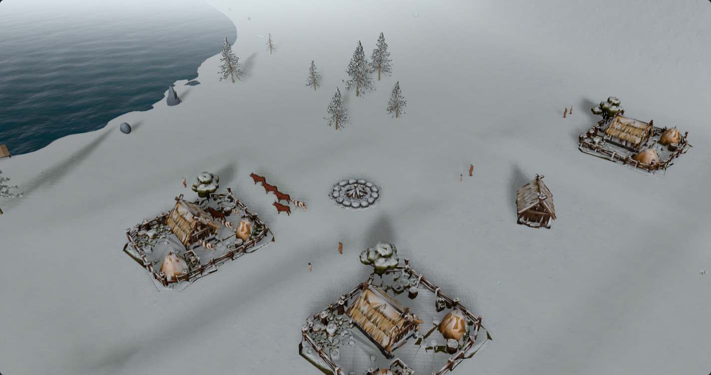
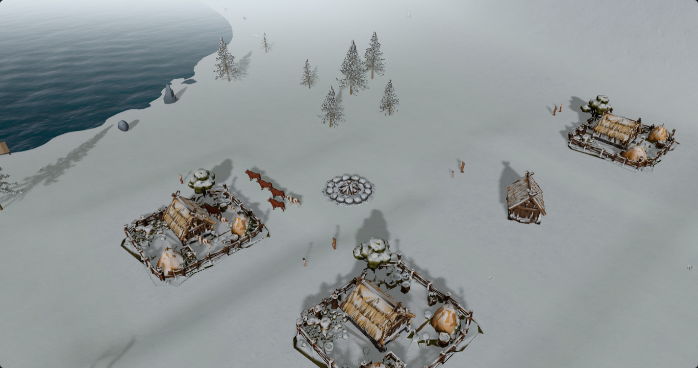
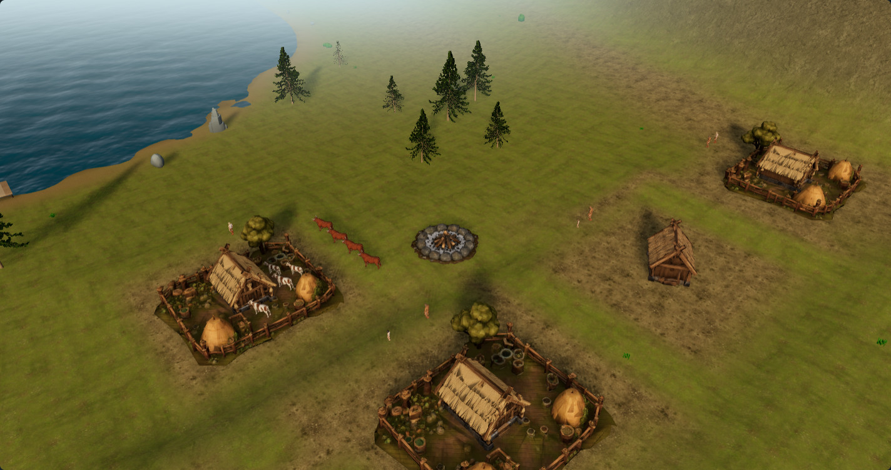

# Northern light refinement · #180

The selected **Northern sun · 25°** study is now the canonical 3D world's lighting treatment.
This slice adds a little fill light for shaded faces and improves use of the existing native
shadow map. It preserves procedural geography, simulation, asset preparation, source materials
and the selected desktop UI work. The original Viking reference remains the art direction;
this change does not claim reference parity.

Open [review.html](review.html) to compare the selected study with the refined implementation.
See [validation.md](validation.md) for completed checks, rendering timings and remaining limits.
Left endpoint means **Selected**; right endpoint means **Refined**. The comparison includes
summer seeds 32 and 17, a developed settlement, rain and snow, each at Standard and Low.
Developed and snowy scenes also have paired building/resident close-ups. The resident close-up
looks almost along the sunlight; the separate side-angle contact capture is more useful for
foot shadows.

## Quick visual comparison

These Standard images also make the change reviewable directly on GitHub. Use the gallery
for full-size wipes, Low quality and the remaining scenes.

| Procedural scene | Selected Northern sun | Refined Northern sun |
| --- | --- | --- |
| Snow · 811 |  |  |
| Developed · 810 |  |  |

## What changed

| Change | Purpose | Cost / limitation |
| --- | --- | --- |
| World-fixed 25° sun / 135° azimuth | Keep the approved low northern light across camera movement | Lighting remains a seasonal art treatment, not a new day/night simulation |
| 12% more hemisphere fill than the selected study | Read clothing, roofs and shaded faces | Slightly reduces contrast; review across snow and summer |
| Native PCF radius 4 → 1.5, normal bias .045 → .02, bias 0 → -.00005 | Clearer silhouettes and less detached contact | Low quality still aliases oblique edges; bias needs future asset qualification |
| Fit visible receiver X/Y independently | Spend the same map pixels on the visible world | Finite detail at far zoom; quantized span changes can still shimmer |
| Keep full caster depth, separate the receiver-only seabed | Retain off-screen upstream shadows without spending depth on distant non-casters | Bounds grow conservatively during a session |
| Cached fit, existing entity sync extends bounds | Avoid a per-frame scene traversal | Camera or bounds changes still recompute a small clipping calculation |

Standard keeps one 2048×2048 shadow map; Low keeps one 1024×1024 map. There is no additional
render pass, shadow source, geometry, material override, SSAO, dependency or asset pipeline change.
Water already has both shadow flags disabled in this native renderer and stays that way.
Native day/night and other labs retain their defaults. Only canonical `/fjord-play` opts in.

## Sources and reproduction

The base is `eeba00d09c4ea0350a9cfc8dd2cde948fd41c66c` from #186. For the **selected** treatment,
the QA server pins that revision's `FjordPlay.ts`, `WorldLighting.ts` and `FjordPresentation.ts`,
then applies the exact archived study helper from `1b4ddba3d9ad2e52ad96f6bb8b021407a7c0da43`
(#188) with `.select('north')`. The **refined** treatment runs the actual changed production
modules with no browser lighting override. Everything else comes from the implementation
checkout; this limited override mechanism is not a general historical build emulator.

Start two local QA servers, using distinct empty caches and restarting them after source edits:

```powershell
# Refined server
$env:QA_GOLDEN = '1'
$env:QA_PORT = '5193'
$env:QA_CACHE_DIR = 'artifacts/northern-lighting/current-cache'
node scripts/qa/fjord-runtime-server.mjs
```

```powershell
# Selected baseline server, separate terminal
$env:QA_GOLDEN = '1'
$env:QA_PORT = '5194'
$env:QA_CACHE_DIR = 'artifacts/northern-lighting/baseline-cache'
$env:QA_SOURCE_REF = 'eeba00d09c4ea0350a9cfc8dd2cde948fd41c66c'
$env:QA_PIN_PRESENTATION = '1'
node scripts/qa/fjord-runtime-server.mjs
```

```powershell
# Capture, third terminal; requires the archived #188 commit to be available locally
$env:QA_OUTPUT = 'artifacts/northern-lighting/captures'
node scripts/qa/capture-northern-lighting-180.mjs
node scripts/qa/check-northern-lighting-camera.mjs
```

`QA_FIXTURES` and `QA_TIERS` select comma-separated subsets. `QA_BENCHMARK=1` additionally
releases the presentation freeze for three 10s-warmup / 30s-sample animation runs per variant.
Do not run other GPU work while measuring. The campaign remains paused: this measures native
rendering with water/wind, not long-running simulation CPU. Baseline repetitions precede refined
repetitions, so timing drift remains a limitation.

## Acceptance and evidence

`observations.json` records exact source/input hashes, camera/projection, calendar, canonical
and blueprint signatures, actor signatures, native lighting, materials, resources and renderer
counts. Each pair must have identical canonical state, geography, actor transforms/animation,
camera, materials, geometries and textures. Consecutive frozen renders must match raw pixels;
missing assets, placeholders, page errors or source edits during capture fail the run. Delivered
JPEGs are compressed from those native renders; their file bytes are not the raw pixel hashes.

The visual matrix must pass all 10 fixture/tier cases (20 settlement captures, 16 details).
The camera check must keep visible entity bases inside finite native shadow coverage through
close/far orbit, pan and both quality tiers, with the canonical state unchanged. Unit tests cover
frustum/receiver intersections, off-screen casters, aspect, zoom, texel snapping, cache reuse,
seabed depth and native mode reset. These checks cannot prove every possible procedural world.

Performance acceptance is no material regression: aim for ≤5% in both median and p95 rAF
intervals versus the selected study on the same device. Report noisy/inconclusive results as such;
do not infer GPU execution time from rAF or claim a simulation CPU improvement. Resource/pass
invariants are separate from timing. Mobile, VRAM, combat, discovery fades and long campaigns
need their own measurements. Detailed validation results are recorded alongside this report.

## Next independent work

1. Qualify moving-camera shadow transitions across larger seeds and far zooms; tune quantization
   only if visible shimmer justifies it.
2. Trial reusable terrain/material blending with this lighting held fixed, including thaw,
   coastlines and settlement ground contact.
3. Attribute long-running simulation CPU independently of these paused rendering captures.

No production formatter is configured. Source formatting is reviewed manually; use
`git diff --check`, the existing tests/character checks and `npm run build`.
