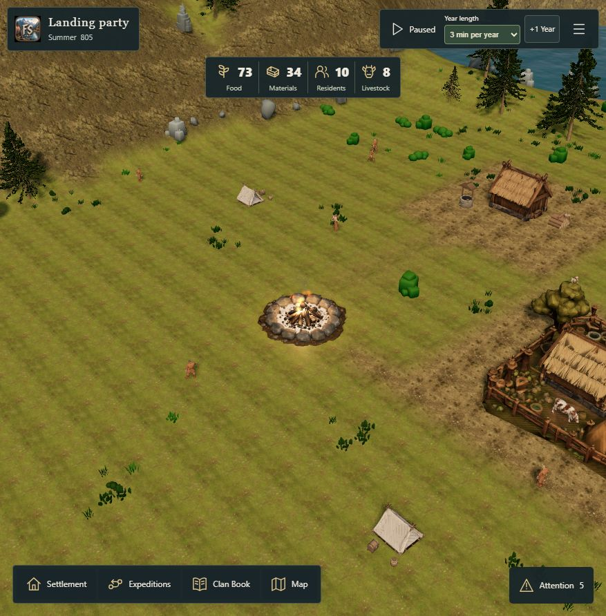

# Settlement soundscape #230 — first mixed-scene review

This is an opt-in integration of actual local candidate recordings into
`/fjord-play`, stacked on #265. Ordinary URLs retain the empty approved pack.
No public release, stock-audio library, provider call, new gameplay rule or save
field is introduced. Source/listening/distribution acceptance from #229 is still
required before general activation. Current main was checked at
`20b53e4d7b0c46734e2b7aff5eb1fe618a86442a`; the stacked foundation includes its
performance/sunlight changes. Unrelated primary-checkout edits were preserved.

## Try the real game

```powershell
# Uses the retained private #229 candidates and the ordinary production build.
node scripts/audio/prepare-settlement-review.mjs
pnpm run build
node scripts/audio/record-settlement-review.mjs
node scripts/audio/serve-settlement-review.mjs
```

Open **http://127.0.0.1:5199/fjord-play?audioMix=1&debugPerf=1**. Use the existing
Sound settings to enable audio explicitly. This loopback-only server serves the
ordinary game plus nine allowlisted, hash-checked candidate WAVs from ignored
scratch storage. Other audio paths fail with 404; foreign hosts/cross-site requests
are rejected. It does not expose the separate audition library or original MP3s.
No stock-audio bytes enter Git, `public/`, Sites or a tunnel.

The first mix contains four seasonal wind choices, an occasional shoreline
texture, occasional localized fire, observed adult female cattle, observed gulls
and one axe candidate. It retains the owner's requested quiet intervals for
waves/fire/animals. Fire therefore uses intermittent localized crackles rather
than a continuously loud loop. Turning visual effects off never extinguishes
the canonical fire or changes its audio eligibility.

Autumn wind is omitted because its supplied attribution identifies Sea Wave.
Rain, leaf texture and an Interface recording are not supplied by the accepted
first pack, so they are silent. No generic cow is substituted for goats, young
animals or bulls. Other fauna and additional work types remain outside this
first-scene review. The two supplied mixed wind recordings and AI-labelled fire
remain as the owner requested.

## Trigger and ownership evidence

- `SettlementSounds` accepts read-only presentation facts. Static coast segments
  are indexed once in 64 m cells. A local query visits at most 512 distinct
  segments. It never scans the terrain grid or consults hidden live activity.
- The existing `FjordEntities` and `WildlifeLayer` expose narrow current-pose
  projections. Wildlife observability is captured before frustum culling, while
  actual current discovery still gates every actor. No private rival state enters
  this mix. Camera movement or model culling cannot manufacture another animal.
- Fire uses its real saved burning state. Canonical state changes, not particle
  quality, control its source. Wind weights crossfade over real presentation time;
  nearby known coast supplies an independent weighted shore texture.
- Woodworker eligibility comes from the existing approach/activity/home visit
  and the actual model's `Attack` clip time, duration, instance/action generation
  and loop. The marker is never inferred from occupation alone or Food/Materials.
  Refreshes retain one stable contact identity. Late observations, pauses, world
  replacement and gaps over 250 ms do not replay skipped contacts.
- `measure-work-contact.mjs` samples the existing source `Attack`: duration
  2.8333332538604736 s, maximum forward right-hand reach at 1.0624999701976776 s
  (37.5%). The source body hash is
  `d2a05aa67337187686325f40e9dd2c4c5867517c933a09aefb857594f2faa682`.
  This is a provisional visual reach marker. The present woodworker has no axe
  model or authored axe/tree collision, and none was invented by this change.
  The retained axe-A onset offset is 0.0005416666666666666 s. Visual/listening
  acceptance must establish whether this makes convincing contact.
- The application still owns one audio context, mixer, buffer cache and scheduler.
  Actual work contacts may update that same scheduler between its ordinary 5 Hz
  selections. Prepared contact audio is warmed only after explicit consent.
  Family spacing, finite range, zoom density and physical voice limits remain.
- A native mixed-scene load exposed a temporary decode-budget condition reported
  as a broken file. A failing public-owner regression reproduced it. A third cue
  now postpones its decode without an erroneous failure notice. Genuine missing,
  invalid and obsolete completions still fail softly and remain covered.

## Village fixture

The original owner export is preserved at
`C:/CodexWorkspaces/Pillagers/scratch/playtest/fjordside-campaign.json`.
The expanded QA village is derived using public commands only:

```powershell
node scripts/audio/prepare-village-review.mjs C:/CodexWorkspaces/Pillagers/scratch/playtest/fjordside-campaign.json
```

Import `scratch/audio-230/village.json` through the normal game recovery/import
flow. Its receipt records exact input/output hashes and commands. Two real houses
are paid for, the existing cattle are assigned to the real farmer's Farmyard, and
the fire consumes one Material. Food stays 6, Materials fall from 26 to 5, and
Winter 801 tick 212 remains unchanged. No extra stock, founder, animal or work
target is injected. The existing farmer/woodworker and active expedition remain.
This is labelled an expanded QA fixture, not a claim that the owner built these
houses during play.

## Measurement and acceptance protocol

Compare the same imported village, Home camera, Low quality/effects, resolution
and clock mode with sound muted and enabled. Record actual warmup/sample duration,
seed/ticks, camera and frame-window exports. Use a coastal pan and a busier normal
view separately. Preserve #151's historical device evidence without relabelling it
as a measurement of this audio change.

`data-audio` reports current/high playing and fading sources, pending decode
clients, buffers, actual retained float PCM and actual encoded download bytes.
Selection/scheduling and decode-invocation timing are main-thread JS spans;
decode-wall timing includes asynchronous completion and is **not** decoder CPU or
GPU cost. Timing windows retain at most 512 samples. Counts exclude native codec,
OS audio and total device memory. `data-audio-mix` separately reports projection
time, current logical sources and visual contact count. Renderer GPU queries
continue to describe rendering only.

Forty-two focused public audio/projection/Core-save/lifecycle/quality tests passed
(zero failures or skips), including the existing real woodworker navigation test
and the actual review pack through the public audio owner. TypeScript passed.
The full build and public/character guards passed during implementation; after
the final diagnostic changes the code bundle was rebuilt without recopying the
unchanged public assets because local free disk space fell below 200 MiB.
The final source hashes and bundle hashes are recorded alongside this report.
No physical-device or human-listening pass is inferred from tests or counters.

## Native desktop observations

The owner reported hearing sounds on desktop. This confirms desktop audibility,
not individual cues, twenty minutes of listening, headphones, mono or Safari.

The seed-32 derived village played seasonal wind, shore, fire and adult cow cues.
Effects Off removed fire particles while the genuinely lit fire still played.
No false file failure remained after the decode-budget correction. The retained
`near-work.json` is an earlier negative observation: visual contacts occurred,
but no axe voice had started in that sample. It has not been overwritten.

A separate positive work control uses existing legacy seed 17. The source save
is created by `prepare-work-review.mjs`: the ordinary founding party salvages its
actual longship, assigns a farmer/woodworker, pays for one Farmyard house, assigns
its three existing cattle and lights the fire. Food remains 15 and Materials are
14. The receipt records all commands and hashes. No work target or resource is
injected. It is an explicitly expanded QA fixture, not a new shipping scenario.

Native play advanced this control normally to Summer 805. After panning near the
actual worker's tree, the actual scene's current animation contacts produced one
native `axe-impact` start. The same run played wind, shore and cows with no audio
failure (`native-work.json`). Distant contacts were correctly excluded. A gull
was not observed in this native fixture; its actual layer/projection contract is
implemented, but a real visible coastal gull and its audible call remain an open
review item. No animal was injected to manufacture a passing sample.

The later reload took 417.7 seconds, primarily 388.2 seconds in existing
construction GPU preparation, then became playable. It is retained in the final
performance export. The machine was under memory/disk pressure. This is not
evidence of acceptable loading time and does not establish audio as its cause.
The legacy fixture also has no discovery mask, so its minimap refuses focus
destinations; ordinary camera panning was used. No unrelated navigation or load
mechanics were changed to make the audio review pass.



## Measured desktop comparison

The three final exports are `paused-final-on-1.json`, `paused-final-off.json`
and `paused-final-on-2.json`. They use the same Summer 805 tick 552 state,
legacy seed 17, 10 residents, 8 livestock, Low quality/Low effects, DPR 1 and
877 × 892 drawing buffer. The camera is unchanged to floating-point tolerance
(matrix component differences below 0.000001). No simulation ticks advance.
This is a paused ambience comparison, not a busy live-world stress acceptance.

| Phase | Frame p50 / p95 / p99 (ms) | JS frame p95 (ms) | Samples / window |
| --- | --- | --- | --- |
| On, first | 83.3 / 250.0 / 283.4 | 19.1 | 49 / 4.899 s |
| Muted | 83.3 / 233.4 / 266.7 | 21.1 | 48 / 4.879 s |
| On, repeated | 66.7 / 333.4 / 383.3 | 21.4 | 43 / 4.739 s |

The first on sample follows over 60 seconds paused; its precise enable warmup
was not separately timestamped. Mute-to-observation elapsed 60.617 s and the
second enable-to-observation elapsed 43.940 s, including the export interaction.
These are actual elapsed periods, not invented fixed ten-second samples. The
statistics use only their stated recent frame windows. Raw exports retain the
preceding history and the loading timeline rather than discarding slow results.

Audio selection/scheduling JS p95 was 0.3 ms in the first on window and 0.2 ms
in the second; these audio windows each retain 512 selections and do not equal
the five-second frame windows. The latest source projection took 0.4/0.2 ms,
respectively (single observations, not percentiles). Decode-invocation JS p95
was 0.2 ms across six files; asynchronous decode-wall p95 was 129 ms. It is not
a measurement of native decoder CPU time. There were six retained buffers,
14,255,808 float-PCM bytes and 3,564,420 encoded downloaded bytes. Current playing
sources were 1/0/1; observed high physical voices were 3. Muting suspended audio
without losing the bounded reusable cache. No audio failure was reported.

The on/off/on windows remain noisy and render-bound: native render GPU timings
are not GPU-audio cost. They do not establish zero overhead or acceptable device
performance. Audio glitches have not been graded by a human listener. The earlier
seed-32 on/off files are retained as exploratory observations from the preceding
build; they lack p50/p99 and are not substituted for this final comparison.

The recorded source overlay and active bundle hashes are in
`source-receipt.json`; the dirty base build ID is not presented as current-head
CI. Formatting was checked manually against the surrounding project style; no
formatter is configured. The focused tests, public/character guards and native
observations cover a reviewable first integration, not all five acceptance gates.

Outstanding acceptance remains explicit: a twenty-minute owner pass in this real
mixed scene, close/normal/far and coastal balance, headphones and phone/mono,
actual iPhone/iPad Safari interruption/background behavior, remaining source
corrections, Interface content and production distribution approval. Keep #230 and
the epic open. Revert the preview by removing `audioMix=1`; no Core/save migration
is needed.

## Owner feedback and gull identity correction — 23 October 2026

The owner heard several sounds but no gull or seal, despite deliberately watching
the flying birds. This is not recorded as a complete sustained/device acceptance.
The missing gull was an integration defect: both the wildlife sound seam and
composer filtered `gull`, whereas the actual canonical species ID is
`great-black-backed-gull`. `gull` is the audio cue/asset ID, not an animal species.
The initial projection test repeated that incorrect synthetic species name and
therefore missed the real integration failure.

The corrected public projection test failed first. A new test through the actual
`WildlifeLayer`, existing habitat fixture and real prepared GLBs also failed
first: zero sound actors instead of its six flying and three grounded gulls.
Both filters now use the canonical ID. The real-layer test then passed, including
retained eligible sound sources when rendering is culled and silence when
discovery/observability disallows the animal. Nineteen focused audio tests passed
with no skips or failures; TypeScript and the incremental production bundle passed.
The historical exports above remain evidence of the preceding version and are
not relabelled as measurements of this correction.

The rebuilt actual game subsequently started the prepared gull recording in an
ordinary new campaign: `startedCues.gull = 1`, no audio failure and a four-buffer
cache. The native observation and screenshot are retained in `native-gull-fix.*`;
`gull-fix-receipt.json` pins the corrected sources and active build. This confirms
the real actor-to-playback path, not the owner's subjective balance approval or
a physical phone test. Reload the local review URL to receive the corrected JS;
existing open tabs keep the earlier code until refreshed. World calls require
the simulation to be running and remain occasional (35–75 s family spacing).

Seal audio is prepared in #229 but deliberately absent from this first nine-file
integration, which covers a gull and cattle before expanding the remaining pack.
The absence of seal calls is therefore a known scope gap, not an accepted audible
seal test. No seal is substituted with a gull/cow cue or made to call underwater.


## Remaining animal integration — D: workspace, 23 October 2026

The owner's request to continue the remaining prepared sounds expands the opt-in
scene from nine to sixteen hash-checked WAV candidates. Development, dependencies,
output and the two local servers now run from
D:/CodexSites/Pillagers/scratch/performance-overlay-260. The original C: copy and
historical receipts above remain intact. This change does not publish audio bytes,
change ordinary URLs, spend provider credits or change any Core rule/save field.

New scene sources are adult sheep, goats and pigs, and currently observed hauled-out
seals. Young livestock do not receive adult recordings. Swimming seals remain
silent. Existing family spacing stays 35–75 s for sheep/goats, 40–80 s for pigs and
40–90 s for seals, shared across individuals rather than multiplied by herd size.
The quiet gull, campfire, waves and work behavior remains in place.

Rabbit, wolf and the owner's chosen lynx placeholder use actual newly published
WildlifeSighted events. The actor must still match the event's instance/species,
be observable in currently visible terrain and be within the shared listener's
finite hearing range. Camera movement alone creates no sighting. The projection
baselines existing history on scene creation, reads only appended events (at most
256 per sync), holds at most 32 fresh candidates for one real second and rejects
sightings over five canonical ticks old. Calls can finish their prepared clip
while the actual source stays eligible; they do not become repeating ambient loops.
Pause, mute, background, lost observation and leaving hearing range discard them.
Reload/import and re-entering visibility do not replay historical encounters.

The wildlife layer projects actual observed poses independently of render culling;
its former gull-only filter is removed. Audio still explicitly supports only the
chosen cue families. No missing animal or private rival actor is manufactured.
Source queries remain on the existing 5 Hz audio cadence, with the same single
context, voice limits, two concurrent decodes and bounded PCM cache.

The owner corrected the lynx choice: the supplied recording is intended as a bobcat
placeholder. That choice is retained for local listening. The saved source link
https://pixabay.com/sound-effects/nature-tomcat2-41730/ was checked again and still
says Tomcat2/cat yowling. Its binary is unchanged; this is an explicit owner-chosen
placeholder with unresolved source identification, not a verified bobcat recording.
The original #229 catalogue is preserved. New source hashes and this distinction
are recorded in animal-candidates.json. Pig and wolf carry the source pages' AI
labels; they remain private listening candidates, not newly approved recordings.

Deer rutting calls, the mixed-tag elk/Bull file, the angry fox recording and
underwater whale/orca candidates remain outside this local mix pending a matching
situation or replacement. The game currently supplies no rutting/aggression/audio
underwater context. Autumn wind's conflicting source link and missing Interface
content also remain open; none is silently relabelled.

Red/green evidence: the public adult livestock projection returned no sheep/goat/pig
sources before wiring; the real-GLB seal fixture returned no calls before expansion;
a real Core rabbit expedition first failed because its fresh-encounter projection
was absent; real wolf/lynx expeditions returned no cue before their addition.
The corrected tests pass. Actual Core expedition routes create the sighting facts;
no internal transfer, invented event or forced audio actor is used. Public-owner
checks play the expanded livestock/seal pack through the shared audio owner.
Historical raw performance exports above are not measurements of this extension.

Rebuild the private manifest and normal production bundle, then restart the existing
loopback server so its allowlist contains sixteen files. On this workstation use
pnpm 10 via node D:/CodexSites/Pillagers/scratch/migration-20261023/tooling/node_modules/pnpm/bin/pnpm.cjs run build.
The listener URL stays http://127.0.0.1:5199/fjord-play?audioMix=1&debugPerf=1.
Reload an already open tab; its old JS does not update by itself. Enable sound and
run the clock. Live wildlife calls need an actual new encounter, not only camera
observation. Physical iPhone/iPad acceptance, prolonged subjective mix listening and
production distribution remain open. No merge or general activation is implied.


Verification for this extension: 25 focused audio tests and 42 additional real
wildlife/canonical-sighting tests passed (67 distinct tests, no failures/skips).
The full public-asset guard, TypeScript and Vite production build passed from D:.
All sixteen locally served candidate files matched their retained prepared SHA-256;
encoded size totals 6,566,888 bytes. A non-allowlisted audio path returned 404.
Formatting and diff whitespace were checked against the existing style manually;
no formatter is configured. The new source/bundle receipt is animal-source-receipt.json;
the original source-receipt.json and gull-fix receipts remain unchanged.

Native verification restored the ordinary campaign 467148170, selected its actual
founding adult sow through Settlement livestock and ran the clock. The shared audio
owner started pig once, gull once, shoreline six times and normal-winter wind once,
with no audio failure. The observation retains five buffers / 8,495,616 PCM bytes
and a high of two physical voices. See native-pig-expansion.json and the matching
screenshot. The scene was paused afterwards. These counters establish an actual
new animal-to-playback path, not an audible approval of every species or sound mix.
The workstation remained slow (roughly 10 fps during play and a three-second hitch
at the Winter boundary); that unfavorable observation is retained in the screenshot.
It does not establish new performance acceptance or an audio-specific cause.
