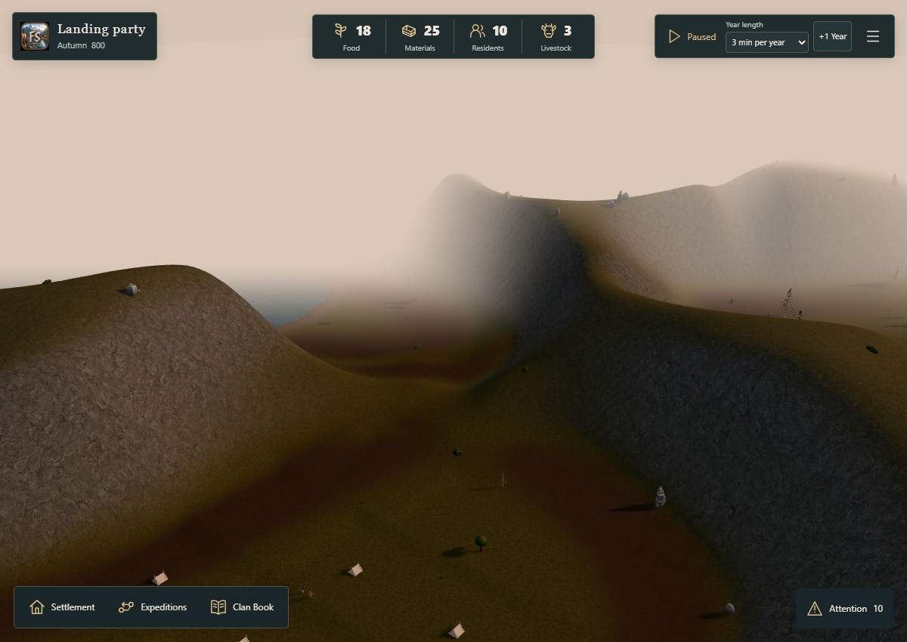
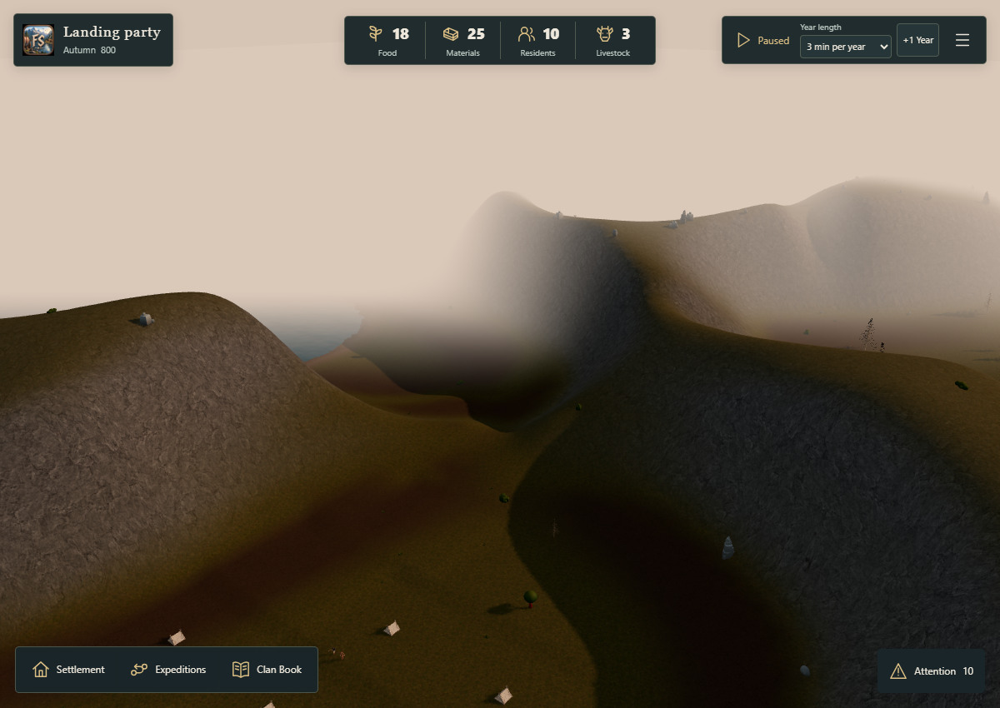
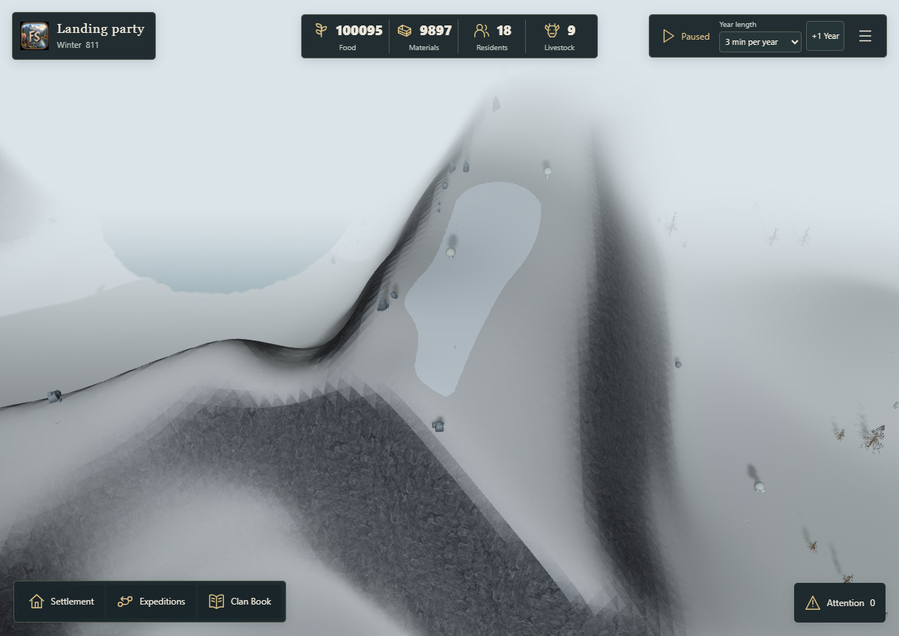
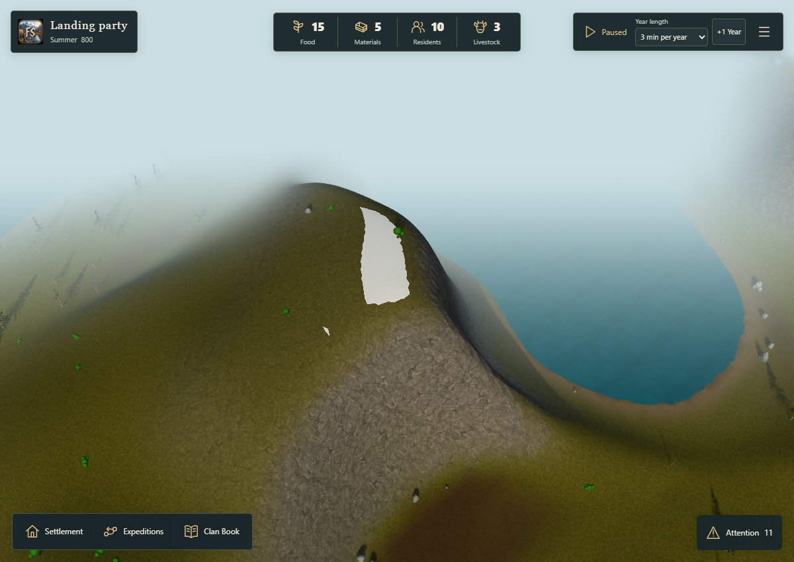
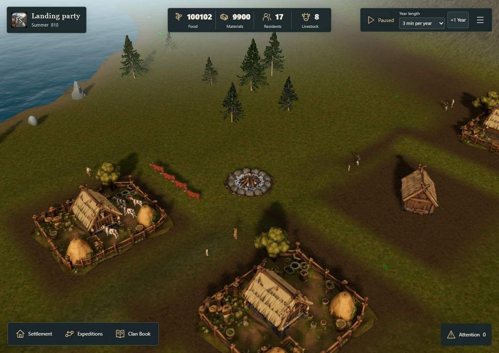
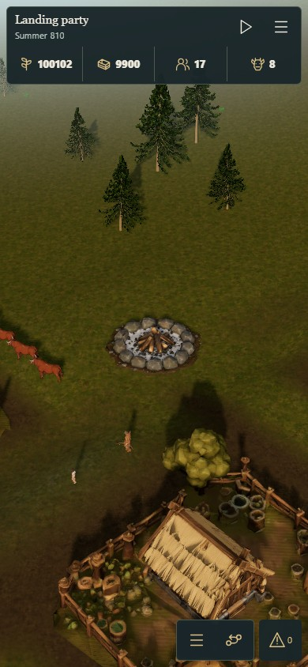

# Canonical terrain shadow QA — #180

2026-10-17. Based on merged main `39bd2030b851441e829fed7cf159b11961d2f65e`.

The generated terrain received object shadows but did not cast shadows. Trees and rocks consequently appeared to cast isolated dark silhouettes into valleys that should already have been shaded by the ridge.

The terrain now participates in the existing directional shadow map. Native back-face casting is retained. The opaque ground base supplies the physical depth once; the coplanar soil, rock and snow colour layers do not repeat that depth draw. Native shadow callbacks restore the complete draw range after each group, preserving colour rendering and navigation. The flat outer seabed remains in receiver coverage while the bounded heightfield supplies caster coverage.

No simulation, saved geography, asset, season, material colour, light direction, shadow-map resolution or light count changes. Rock and grass can still have different brightness because their material and surface orientation differ.

## Visual acceptance

`scripts/qa/check-terrain-shadows.mjs` runs only against the existing opt-in golden QA server. It does not add an audit API to the normal build.

- Ten matched before/after camera and quality pairs: autumn-32 highlands, valley and settlement; summer-17 highlands; snow-811 highlands; each on Standard and Low.
- Canonical state, procedural blueprint, actor poses and camera remain identical within each pair. Effects time is frozen and precipitation is disabled to isolate the rendering change.
- The autumn valley must change more than 1,000 pixels as the ridge occludes sunlight. The normal build retains precipitation.
- Each optimized capture must be pixel-identical to drawing all coplanar ground layers into the shadow map.
- Exactly one additional terrain depth draw, one existing 2048²/1024² shadow map, and unchanged retained geometry and texture counts.
- The full outer sea does not enter caster coverage; the tested map depth stays below 1,500 m, including off-screen mountain casters.

`results.json` contains file hashes, fixtures, canonical/blueprint hashes, cameras, render counters and raw presentation intervals. JPEGs are display copies; pixel identity is checked on the original lossless browser captures before JPEG encoding.

## Rendering cost

| Quality | Baseline median ms | Terrain shadows median ms | Candidate p95 ms | Total draws | Total triangles |
| --- | --- | --- | --- | --- | --- |
| standard | 83.4–83.4 | 83.4–83.4 | 100.0–100.1 | 215 → 216 | 6,874,361 → 7,194,369 |
| low | 83.4–83.4 | 83.4–83.4 | 100.0–100.1 | 215 → 216 | 6,868,217 → 7,188,225 |

No measurable median change in these short samples. This is not a zero-cost claim.

Windows, native headless Edge 155, Intel HD Graphics 630, 1200×850, DPR 1, paused autumn valley. ABBA ordering; each sample has 0.5 s warm-up and 3 s of browser presentation intervals. Timing keeps the candidate coverage constant to isolate the added depth drawing; screenshot comparisons rebuild the original/candidate coverage separately. These short desktop samples are neither isolated GPU measurements nor physical-phone performance certification.

The first six-layer implementation measured 83.4 ms baseline versus 99.9–100.0 ms candidate median on Standard. That implementation was replaced by one physical depth draw. The earlier raw measurements are retained in `layered-results.json`. The optimized and layered depth outputs are pixel-identical in the native comparison.

## Validation and review

- 25 focused shadow, terrain shading, terrain navigation, terrain treatment, lighting and presentation tests pass.
- TypeScript and normal Vite production build pass. The inherited large-bundle advisory and absent optional legacy scenery-kit notice remain unchanged.
- Formatting checked manually against adjacent code and with `git diff --check`; the repository has no formatter command.
- Browser errors: none. The repository CI runs separately on the PR head; this report does not imply CI completion.

Reproduce in separate terminals with `QA_GOLDEN=1 QA_PORT=5194 node scripts/qa/fjord-runtime-server.mjs`, then `QA_ORIGIN=http://127.0.0.1:5194 node scripts/qa/check-terrain-shadows.mjs`. Use the PowerShell `$env:` equivalents on Windows. The browser runner uses the existing Playwright runtime; `PLAYWRIGHT_MODULE` can override its location.

| Autumn valley before | Autumn valley after |
| --- | --- |
|  |  |

## Housing pack recovery

The review worktree was missing `public/game-assets/houses`, which is deliberately ignored by Git. A successful client build therefore did not guarantee usable house models. The eight existing prepared GLBs and their original manifest were restored unchanged from the prior integrated review worktree to the source cache and deployed build. The asset pipeline and generated geometry were not replaced.

`createPlaytestHandler` now refuses to start when the required housing manifest, a required role, or a referenced model is absent or has a different size from its manifest. Fresh review checkouts must run the existing `pnpm assets:houses` preparation or carry over its verified cached output before building. Two host integration tests cover a complete read-only pack and rejection of incomplete packs, bringing focused validation to 27 passing tests.

`scripts/qa/check-playtest-housing.mjs` verifies every original model byte against both review origins and loads the normal production game with `developed-810`. `housing-check.json` confirms five built homes, including three farmyards, without placeholders or browser errors; desktop and portrait screenshots are below. This check uses no development audit API and explicitly exercises built houses rather than only the starting tents.

The earlier shadow measurements and images above are retained as their original records, before this housing-cache restoration. Their autumn timing fixture contains starting tents. The housing validation below records the restored production assets separately.

