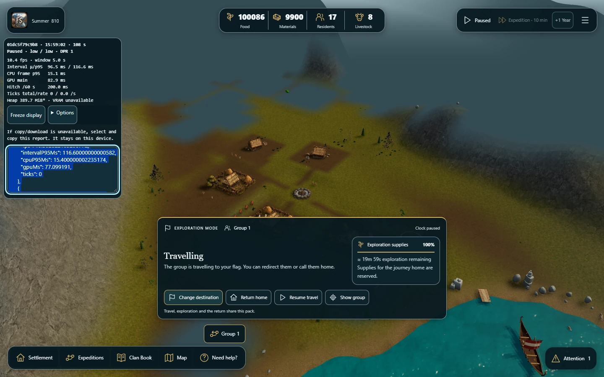
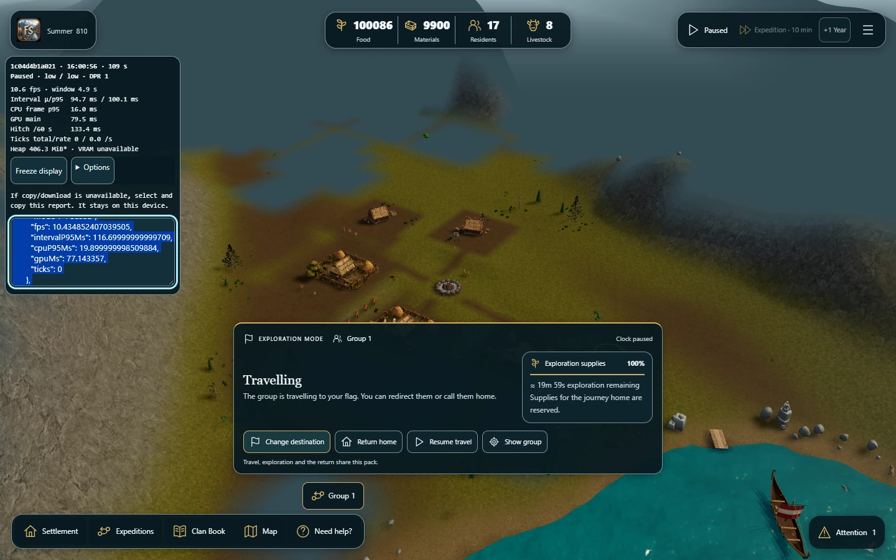
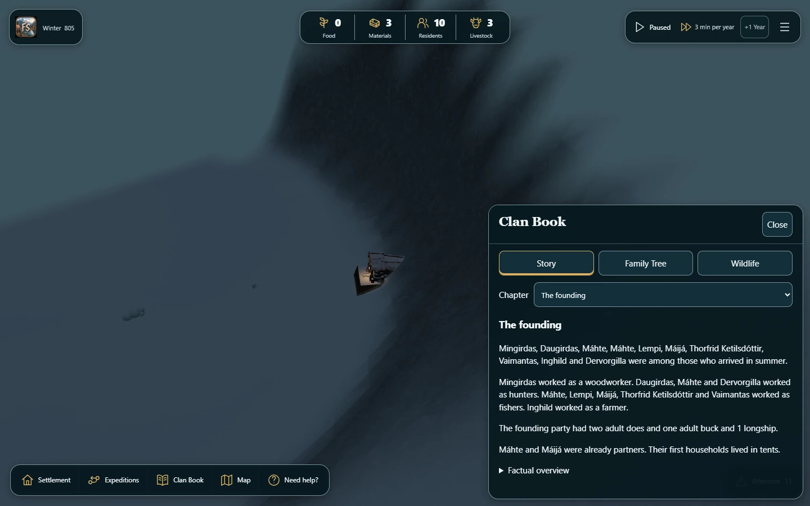
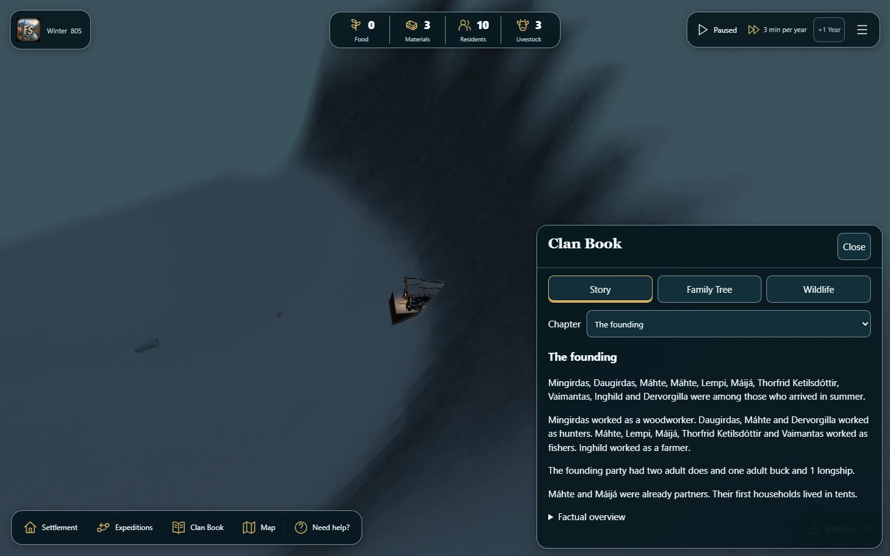
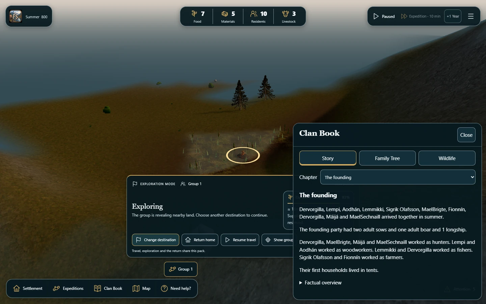
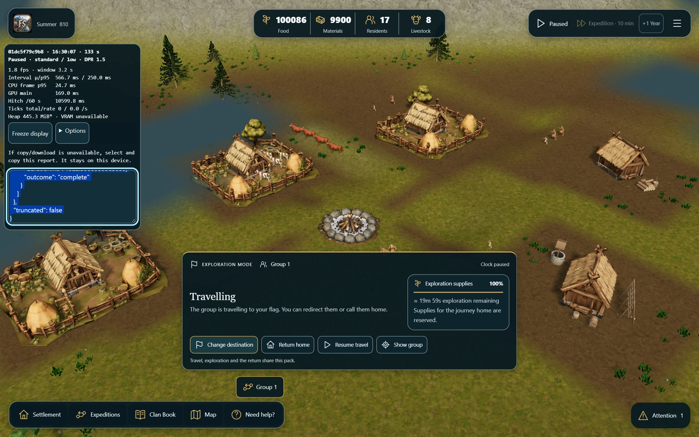
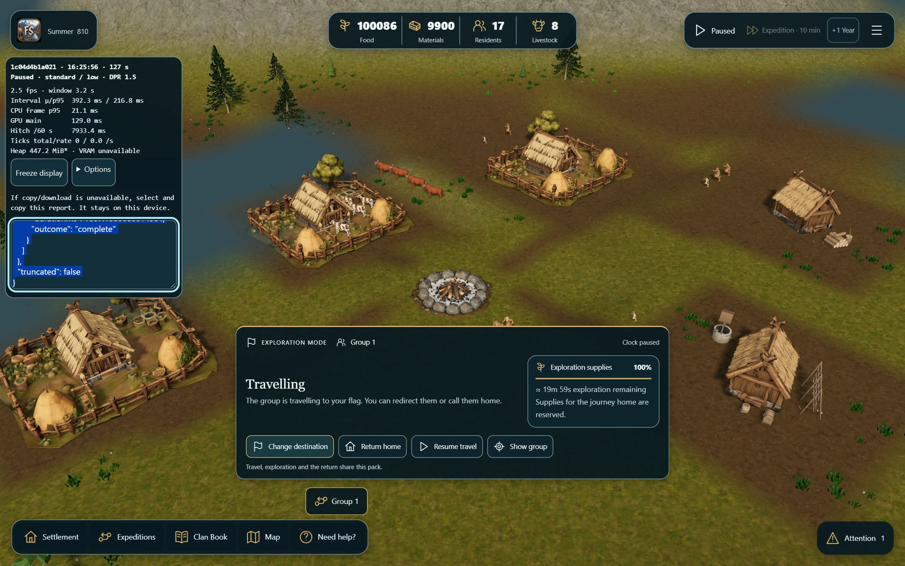
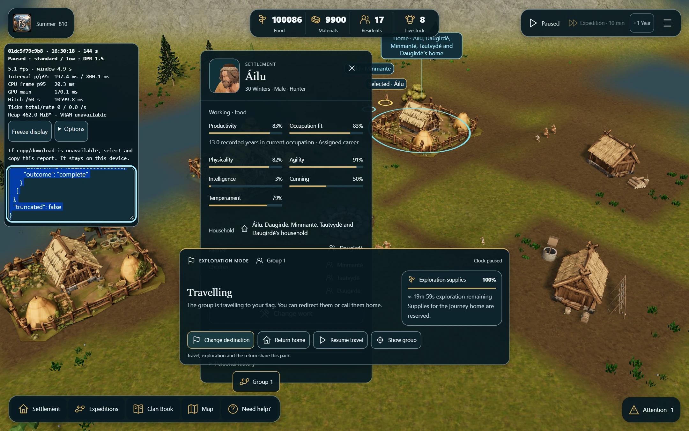
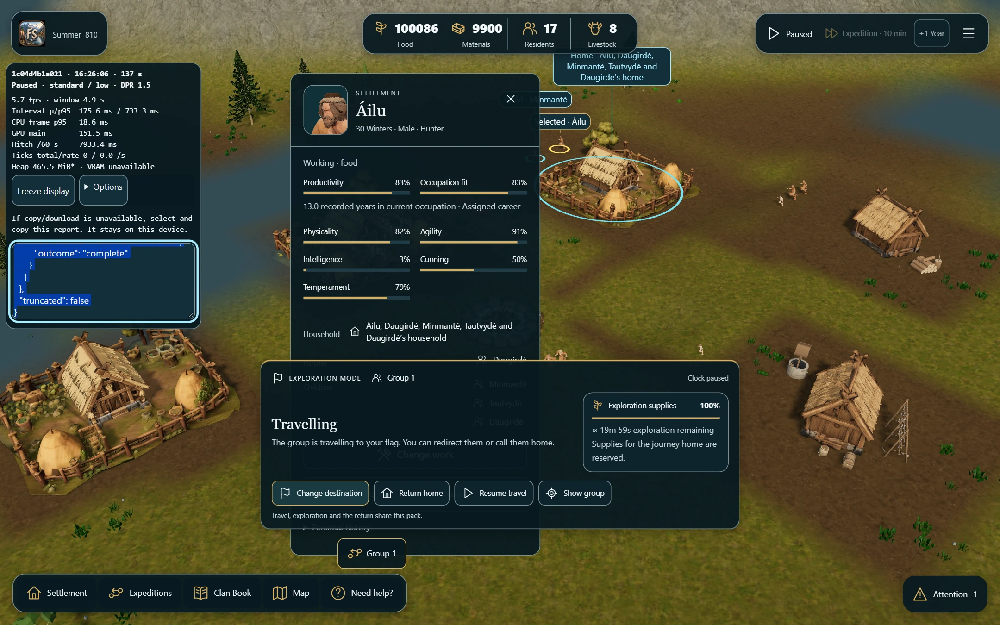

# Three.js r187 spike (#323): defer adoption

The measured upgrade does not yet justify changing FjordSide alpha v0.1 from
r180 to r187. Desktop median FPS improves by 2.9%, below the predeclared 5%
meaningful-gain threshold; p95 frame time is unchanged and retained memory is
similar. The one physical iPhone Chrome pair has almost identical FPS, a slower B
load, and an owner report that the phone felt a bit warm after B. Actual iPhone
**Safari remains unverified**. Keep this experiment isolated and the PR in draft.

No production default, gameplay rule, main branch or public Sites release has
been changed by this spike. The public release remains build 12/r180 at the time
of measurement.

## Provenance and scope

| Item | Measured identity |
| --- | --- |
| Baseline A | main `01dc5f79c9b8ee4024c0fbed338af4778a5f4c97`, Three `0.180.0` |
| Candidate B | `codex/three-r187-spike-323`, runtime commit `1c04d4b1a0213bc38ae1e4bbefc608af78f25bf4`, Three `0.187.0` |
| Review | [Draft PR #324](https://github.com/sidesliders1983/Pillagers/pull/324) |
| Toolchain | Node 24.22.1, pnpm 10.34.9, Vite 7.3.6, TypeScript 5.9.3 |
| Renderer | Native `WebGLRenderer`/WebGL2, ACESFilmic, sRGB; no WebGPU/SwiftShader substitution |
| Desktop | Windows 10 Pro 19045, i7-7700HQ, approximately 16 GiB RAM, Chrome 156.0.8078.74 |
| Actual desktop GPU | ANGLE Intel HD Graphics 630/D3D11, driver 27.20.100.9664; installed GTX 1050 was **not** the renderer |
| Main fixture | Campaign seed 32, island-pool-v3/geography seed 168, 17 residents, 5 homes, 8 cattle, real two-person physical expedition |
| Primary settings | 1440 x 900, DPR 1, low quality/effects, HDR off, audio off, paused after the same saved time |
| Protocol | [protocol.json](protocol.json), SHA-256 `6b8321639ce7135dc10142b77b709bb9290036466211fb1066dca2697f289df3` |
| Main fixture hash | `fc15f2754b5cea06fcd4c62857756e401c6f527102893622a023298571b92944` |

The fixture's high test stocks are controlled performance-fixture inputs, not a
balance change. The expedition was created through current public commands and
paid 16 Food. Both arms use exactly the same saved canonical state, island,
camera and presentation settings. No old CPU/economy approximation is involved.

[source-audit.json](source-audit.json) preserves the initial on-disk inventory and
hashes. [source-audit-final.json](source-audit-final.json) adds the final QA runners,
compiled-build identities and a corrected OutputPass inventory. The original
lexical pattern omitted OutputPass; this is an audit correction, not a new
postprocessing implementation. Windows on-disk CRLF hashes and Git's normalized
LF blobs need not match; the initial audit is the measured on-disk record.

All subsequent changes after runtime commit `1c04d4b` are QA/reporting only.
The primary six runs used its committed sampler. Later sampler additions record
a final canonical checkpoint and permit explicit visual-only camera settings;
they do not replace or rewrite the primary evidence. Source hashes embedded in
later raw runs identify those runner revisions.

## Executed desktop results

The frozen order is **A, B, B, A, A, B**, with 15 seconds warmup followed by a
60-second measured window per run. These are three repetitions on one integrated
GPU, not a population estimate. All six completed, with zero runtime exceptions
and zero dropped observer samples.

| Run | Engine | End-to-ready (s) | FPS | Frame p50 (ms) | Frame p95 (ms) |
| --- | --- | ---: | ---: | ---: | ---: |
| 1-A | r180 | 31.352 | 10.156 | 100.0 | 116.7 |
| 2-B | r187 | 32.017 | 10.440 | 99.9 | 116.7 |
| 3-B | r187 | 30.832 | 10.553 | 99.9 | 116.6 |
| 4-A | r180 | 31.695 | 10.149 | 100.0 | 116.7 |
| 5-A | r180 | 31.730 | 10.084 | 100.0 | 116.8 |
| 6-B | r187 | 30.813 | 10.326 | 100.0 | 116.7 |

| Metric, median [min-max] | A: r180 | B: r187 |
| --- | ---: | ---: |
| FPS | 10.149 [10.084-10.156] | 10.440 [10.326-10.553] |
| Frame p95 (ms) | 116.7 [116.7-116.8] | 116.7 [116.6-116.7] |
| End-to-ready (s) | 31.695 [31.352-31.730] | 30.832 [30.813-32.017] |
| First frame inside load diagnostics (s) | 30.268 [30.249-30.304] | 29.616 [29.301-30.694] |
| Terrain mesh/masks (s) | 6.625 [6.594-6.789] | 6.664 [6.650-6.675] |
| Construction GPU preparation (s) | 10.924 [10.891-11.404] | 10.703 [10.448-11.464] |
| Explicit shader compilation (ms) | 194.7 [188.7-203.6] | 205.4 [202.2-217.6] |
| Per-run median sampled GPU query (ms) | 92.882 [87.761-92.886] | 89.715 [87.392-91.128] |
| Unforced JS heap (decimal MB) | 410.0 [408.7-426.9] | 406.8 [403.6-426.1] |
| Main draw calls / triangles | 240 / 4,290,289 | 240 / 4,290,289 |
| Geometries / textures / programs | 113 / 127 / 58 | 113 / 129 / 61 |

Adjacent paired comparisons `(1-A,2-B)`, `(4-A,3-B)`, `(5-A,6-B)` give FPS
changes of **+2.79%, +3.98%, +2.40%**, respectively. Their load changes are
**+2.12%, -2.72%, -2.89%**. Ranges overlap for loading and heap. The GPU samples
are valid asynchronous queries from the public diagnostics, not a CPU-time
substitute or a pooled frame percentile. Resource counts are not GPU bytes.
Unforced heap varies with garbage collection and is not proof of memory savings.

A separate fresh-context then same-context reload completed in both arms:
A **31.216 -> 22.328 s**, B **30.094 -> 21.854 s**. This is one warm-cache
confirmation per arm, not three extra repetitions or proof of cold OS/driver
caches. The loading stages can overlap and must not be added together as if
all were exclusive.

### Sustained simulation and canonical parity

Both arms ran from Summer 810/tick 500 through Summer 811/tick 500: exactly
**1,000 canonical ticks**, with the settlement, residents, wildlife and physical
expedition active. Actual elapsed sampling was approximately 682 seconds, longer
than the nominal 600 seconds; the endpoint is canonical time, not assumed wall time.

| Sustained metric | A | B |
| --- | ---: | ---: |
| FPS | 10.004 | 10.371 |
| Frame p95 (ms) | 116.7 | 116.7 |
| Worst observed interval (ms) | 2,216.1 | 2,083.3 |
| Long tasks / total duration (ms) | 1,043 / 74,791 | 1,061 / 74,658 |
| End geometries / textures / programs | 115 / 131 / 58 | 115 / 133 / 61 |
| Runtime errors / dropped observer samples | 0 / 0 | 0 / 0 |

The complete canonical Core/RNG state hashes match:
`43b3e40e01c5f0366e268ddbd5538b5b27c49834c9c5bb9cea95e461af8235b1`.
The checkpoint files are archived. Existing approximately two-second stalls
remain; this upgrade does not solve them. End resource increases in a running
world are not, by themselves, evidence of leaks.

### Save/load, disposal, DPR and portraits

Both arms completed four real in-page file imports through the existing menu and
file input: settlement -> marsh -> winter -> settlement, keeping the same
renderer. CDP garbage collection precedes each retained-heap observation. Both
then switched through the real menu to standard quality, HDR on and DPR 1.5,
and selected three actual residents with encoded 2D portrait snapshots. No
runtime exceptions occurred and scene framing was restored after each portrait.

| Retention checkpoint | A | B |
| --- | ---: | ---: |
| Initial JS heap (MB) | 135.47 | 137.19 |
| After four imports JS heap (MB) | 186.09 | 185.71 |
| After four imports backing storage (MB) | 269.209 | 269.270 |
| After four imports geometries / textures / programs | 121 / 132 / 83 | 121 / 134 / 86 |
| After HDR textures / programs | 133 / 109 | 135 / 112 |
| After portraits JS heap (MB) | 187.28 | 188.35 |
| After portraits backing storage (MB) | 269.840 | 269.900 |

JS heap and backing storage are **separate counters**, not a sum of process
memory or measured VRAM. Both versions retain additional resources after visiting
new islands and shader variants. An identical bounded follow-up added two more
settlement imports to both arms. Across the last three observations:

- A: geometries **121 -> 120 -> 120**, textures **132 -> 132 -> 132**, programs
  **83 -> 83 -> 83**, JS heap **186.03 -> 185.53 -> 186.58 MB**.
- B: geometries **121 -> 120 -> 120**, textures **134 -> 134 -> 134**, programs
  **86 -> 86 -> 86**, JS heap **185.63 -> 186.81 -> 187.03 MB**.

This shows a resource plateau in the executed bounded case, not a general
no-leak guarantee. There is no demonstrated 10% retained-heap improvement.
The transient HDR compile/upload stalls in these journeys are not part of the
primary steady-state FPS cohort.

Two failed lifecycle attempts and one interrupted retry are preserved. They fed
a SharedSettlement handoff envelope to an input that correctly expects the
exported `payload.fjord` file format. The real app rejected it without replacing
the current campaign. Correcting the QA runner resolved this integration error;
no application/save parser was changed and these attempts are excluded from
performance comparisons.

## Actual iPhone results and thermal observation

The owner supplied two full JSON files from an **iPhone 16**, as entered in the
review page. Their UA identifies **Chrome iOS 156 (`CriOS/156.0.8078.54`)**, with
reported iOS `27_2_0`; the `Safari` token in that UA does not make it Safari.
Viewport is 393 x 654, device DPR 3, actual low-quality render DPR capped at 1.
Both completed exactly 200 ticks, from 810500 to 810700, with no recorded errors.
Automatic collector receipts duplicate these same sessions: **N=1 per arm**.

| Physical Chrome iOS metric | A | B |
| --- | ---: | ---: |
| Measured simulation window (s) | 157.890 | 157.876 |
| Frames / mean FPS | 2,459 / 15.574 | 2,473 / 15.664 |
| Frame p50 / p95 (ms) | 44 / 108 | 45 / 109 |
| Load to playable (s) | 56.446 | 69.935 |
| First frame (s) | 56.404 | 69.889 |
| Terrain mesh/masks (s) | 12.990 | 13.066 |
| Initial settlement models (s) | 25.440 | 27.234 |
| Construction GPU preparation (s) | 6.446 | 17.999 |
| Explicit shader compilation (s) | 0.046 | 0.406 |
| Island download (s) | 1.068 | 1.170 |
| Geometries / textures / programs | 113 / 127 / 58 | 113 / 129 / 61 |

A started at 16:32:22.952Z; B at 16:36:44.792Z, approximately 31.6 seconds after
A finished. The owner marked both starts **Cool**, then reported: **the phone
felt a bit warm after B**. That is preserved as qualitative evidence. Neither a
temperature measurement nor thermal throttling is demonstrated. Run order,
thermal carry-over and caches are uncontrolled; the slower B load exceeds the
10% investigation threshold and cannot yet be attributed solely to r187.
Most of that difference is in construction GPU preparation, not downloading.
GPU timer, JS heap and long-task APIs were unsupported on this device; no values
are invented for them. Resources were stable throughout both measured windows.

This is useful real-device evidence, but it does **not** satisfy the issue's
explicit Safari acceptance. The same local review pages remain available for a
cooled-device Safari A/B test. Safari evidence is the remaining external gate.

Original attachment SHA-256 values (before any parsing or reformatting):

- A: `b6edd604c1a1c4d73b97c516f10aa03a9ed10754c1833418f71823c1ee883c8e`
- B: `e70c7235697a3b9420d0545a3392c3beeb49da6fb37e2872f22a5a43cec7cf05`

## Compatibility and official migration audit

Only required dependency/type changes were made: Three `0.180.0 -> 0.187.0`,
`@types/three 0.180.0 -> 0.186.0`. Matching r187 typings were not yet published
when checked on release day. `three.quarks` and `quarks.core` remain 0.16.0;
their peer constraint accepts Three >=0.165. Typings add transitive
meshoptimizer 1.1.1, while the application's runtime optimizer remains 0.22.0.
Six minimal type-only fixes identify known DataTexture/bitmap/image types in
LabSceneAudit, LabWorldGeneration, DiscoveryFog, WetlandTextureAsset, WildlifeLayer
and GroundBlending. No rendering algorithm, simulation, exposure or clock was
rewritten to improve the result.

| Area | Actual path, validated risk and result |
| --- | --- |
| Terrain/snow/nature | BlueprintTerrain, GroundBlending, SeasonTint, StructureSeasonTint, NatureWind and DirectionalAtmosphere use native materials/shader chunks; summer, winter and marsh compile and render in both arms |
| Water | FjordsideWater/vendor WaterPlane and UnifiedWaterLighting keep GLSL/clipping/fog; shoreline colour, transparency and reflections remain present in compared views |
| Sky | Fjord uses WorldLighting/SeasonAppearanceTransition and scene haze, not addon Sky; addon Sky migration claims do not apply |
| HDR | FjordHdrLighting uses HDRLoader/PMREMGenerator. r187 replaces CubeUV PMREM targets/sampling; actual HDR enabling completes and material/environment rendering is intact |
| Shadows | Live PCFShadowMap; r182 changed PCF softness. No missing or detached shadows observed; exact pixel equality is not claimed |
| Portraits | ResidentPortraitStudio has two render targets and a native **OutputPass** for tone mapping/output colour, restoring viewport/scissor. DPR 1.5 and repeated actual snapshots passed |
| Main postprocessing | Direct WebGLRenderer.render; no EffectComposer/TSL/WebGPU scene chain. Portrait OutputPass is distinct from that scene path |
| Instancing | Source uses InstancedMesh for nature/scenery/grass. No source BatchedMesh construction; quarks imports it only for a dormant JSON ObjectLoader branch, not live particles |
| Particles | Live campfire/precipitation use quarks BatchedRenderer/ParticleSystem and InstancedBufferGeometry, not Three BatchedMesh; avoid attributing unrelated BatchedMesh fixes |
| Object disposal | r186 adds Object3D.dispose dispatch. quarks 0.16 ParticleEmitter overrides it with an empty method and batches dispose geometry only. This warrants compatibility follow-up before adoption; classic WebGLObjects attaches its object disposal handler to InstancedMesh, not ParticleEmitter. No classic leak from this was demonstrated in the bounded runs |
| Other disposal | Existing scene/model/template/bitmap/portrait/HDR owners remain; import resource counts plateau. New WeakRef/FinalizationRegistry dependencies still need actual Safari confirmation |
| Transforms | Explicit matrixAutoUpdate=false sites include portraits and vendor grass. r185 invalidation changes caused no missing transforms in compared views |
| Menu background | EntryBackdropRenderer uses a standalone native WebGL1 quad, with no Three import. r187 does not improve its aurora/cloud/water animation by itself |
| Generation | Lockfile fingerprints require official prepared-island regeneration. All 14 worlds and compressed entries remained byte-identical; only the catalogue's lock input hash changed |

Official sources reviewed and frozen locally:

- [Three r187 release notes](https://github.com/mrdoob/three.js/releases/tag/r187),
  released 30 October 2026, release commit `7e89746`.
- [Three migration guide](https://github.com/mrdoob/three.js/wiki/Migration-Guide),
  all steps from r180 through r187; extract in `sources/`.

Relevant changes include PMREM/PBR appearance, render-target viewport/scissor
pixel-ratio semantics, PCF filtering, matrix-world invalidation, texture/geometry
disposal and WeakRef/FinalizationRegistry. Numerous WebGPU/TSL improvements are
outside the current renderer. Clock is deprecated but retained and functional;
changing it would confound the timing comparison. There is no separate WebGPU
experiment in this issue.

### Real procedural generation, separately from prepared island loading

The unchanged CPU worker-core harness actually generated and prepared a fixed
island in each arm, retaining the natural-terrain handoff as the real path does.
A took **13.126 s**, B **12.260 s**; source generation was **9.928 s / 9.685 s**.
This single CPU pair uses seed 3055065912/recipe seed 7 and is explicitly separate
from the main prepared-island fixture. It measures no browser, download or GPU.
Complete canonical world/plan hashes match:
`6bcccb9a871df5cf1b1af4b648aeafdf0fddf189d236446ad1e884f51d36be8c`.
One sample does not establish a causal engine generation speedup.

[island-regeneration.json](island-regeneration.json) separately records all 14
prepared entries, whose canonical worlds and compressed bytes match baseline.
Normal Fjord loading downloads/unpacks/adopts these prepared worlds; those load
stages must not be described as procedural regeneration timings.

## Visual comparison

The paired PNGs were viewed side by side at their saved resolutions. The archived
WebP files are compressed display derivatives, not image-generation substitutes;
original PNG hashes are retained in the evidence manifest. The scenes are live:
wind/water/actor animation timing and diagnostic text differ, so pixel equality
or automated image-diff scores would be misleading.

| Checklist | A/B evidence | Observation |
| --- | --- | --- |
| Terrain blending, structures and character materials | settlement-A/B, hdr-A/B | No missing layers, holes or lost model materials; mild tone/shadow differences do not justify an exposure rewrite |
| Water/shore/reflections | settlement-A/B | Shoreline and animated water remain visible; moving ripple phase differs |
| Sky/atmospheric haze | settlement-A/B, winter-A/B | Current top-down scene haze remains intact; this is not a test of unused addon Sky |
| Snow and winter mine | winter-A/B | Snow coverage and the lit mine remain; neither arm loses the winter shader path |
| Marsh water/ground/grass | marsh-A/B | Wet surface, ground transition and vegetation remain visible |
| HDR, lighting, PCF shadows | hdr-A/B at standard/DPR 1.5 | Successful HDR activation, intact lighting/shadow attachment; r187 appearance is not asserted pixel-identical |
| Character Card and 2D portrait | portrait-A/B; three resident selections per arm in raw lifecycle | Correct portrait framing, restored scene/camera and readable UI |

| View | A | B |
| --- | --- | --- |
| Low settlement/water |  |  |
| Winter |  |  |
| Marsh |  |  |
| Standard/HDR |  |  |
| Portrait |  |  |

## Evidence, validation and acceptance

[evidence/manifest.json](evidence/manifest.json) lists all raw run archives,
original/archive SHA-256 values, image derivatives, completeness and exclusions.
JSON compression was verified lossless by decompression and byte comparison.
Approximately 33.8 MB of raw JSON is retained as 4.4 MB compressed, plus 2.5 MB of
review images. Original scratch results are preserved; no generated models or
full asset copies are added to Git.

[comparison.json](comparison.json) is the machine-readable summary, with every
primary run, paired difference, lifecycle checkpoint, cache follow-up, warm load,
CPU generation and unique physical phone session. [environment.json](environment.json)
records actual workstation hardware. A headless wrapper smoke is excluded from
physical-device evidence, as are the short pilots with an earlier narrative
fixture identity. No resource-limited runs occurred in the completed cohorts.

The exact runtime candidate passed GitHub Character contracts on push
[41085186958](https://github.com/sidesliders1983/Pillagers/actions/runs/41085186958)
and PR [41085321195](https://github.com/sidesliders1983/Pillagers/actions/runs/41085321195):
**1,643 tests, 1,633 pass, zero failures, 10 inherited optional skips**, plus build,
tracked-public-assets and character/Lab validation. The skipped Alpha Package
workflow is the existing intentional PR condition, not a bypassed failing check.
Baseline main's exact build passed
[41068136253](https://github.com/sidesliders1983/Pillagers/actions/runs/41068136253).
Final QA-head checks must also pass; the PR remains draft while Safari is open.

| Issue acceptance criterion | Current evidence/status |
| --- | --- |
| Current version/renderer and affected paths | Complete: inventories, engine/dependency hashes and applicability table |
| Migration risks against official sources | Complete audit; identified remaining type/dependency/Safari adoption risks |
| Branch builds and loads on desktop and iPhone Safari | Desktop complete; physical Chrome iOS complete; **Safari missing** |
| Reproducible A/B with raw diagnostics | Desktop and Chrome iOS complete; Safari cohort pending |
| Visual regression checklist | Desktop paired checklist complete; no physical Safari visual approval claimed |
| Resources/new critical regressions | Bounded classic WebGL tests show no new unbounded growth or runtime failures; B phone load regression requires investigation |
| Explicit recommendation | **Defer**, based on measured benefit/risk; no automatic merge/publication |

## Reproduce

Use separate D: worktrees at the measured source commits and frozen locks; do not
substitute current main. Keep the frozen fixtures and protocol intact. The QA
scripts run from the candidate worktree and select the sibling baseline for A.
Use the current Node 24/pnpm 10 runtime and native Chrome, without software-GPU
flags. The Playwright module location can be supplied as `PLAYWRIGHT_MODULE` and
the benchmark Chrome path as `QA_CHROME`.

```powershell
# In each source worktree, install its frozen lock and run its full build.
pnpm install --frozen-lockfile
pnpm run build
# Only B needed official regeneration for the changed lock fingerprint:
# pnpm run assets:islands (already executed; verify island-regeneration.json)

# Start each compiled preview in its corresponding worktree, separate terminals:
pnpm exec vite preview --host 0.0.0.0 --port 5206 --strictPort  # A
pnpm exec vite preview --host 0.0.0.0 --port 5207 --strictPort  # B

# From the candidate worktree; existing completed files are resumed, not erased:
node scripts/qa/run-three-r187-matrix.mjs
node scripts/qa/benchmark-three-r187.mjs --arm=B --origin=http://127.0.0.1:5207 --running=true --ticks=1000 --seconds=600 --output=scratch/three-r187-323/sustained-B
node scripts/qa/benchmark-three-r187.mjs --arm=A --origin=http://127.0.0.1:5206 --running=true --ticks=1000 --seconds=600 --output=scratch/three-r187-323/sustained-A
node scripts/qa/check-three-r187-lifecycle.mjs B
node scripts/qa/check-three-r187-lifecycle.mjs A
node scripts/qa/check-three-r187-lifecycle.mjs B --confirm-cache
node scripts/qa/check-three-r187-lifecycle.mjs A --confirm-cache
node scripts/qa/check-three-r187-warm.mjs A
node scripts/qa/check-three-r187-warm.mjs B

# Focused visual-only cases (repeat with each arm and its preview):
node scripts/qa/benchmark-three-r187.mjs --arm=A --origin=http://127.0.0.1:5206 --fixture=winter.json --siteView=true --seconds=2 --warmup=3 --output=scratch/three-r187-323/visual-winter-A
# Repeat for B/winter and A+B/marsh using --fixture=marsh.json.

# Actual generation, executed from the appropriate source worktree:
node --expose-gc scripts/qa/measure-loading-geography.mjs three323-A --reuse-natural
node --expose-gc scripts/qa/measure-loading-geography.mjs three323-B --reuse-natural ../three-r187-spike-323-baseline/output/island-loading-259/geography-three323-A.json

# Local device wrapper is staged beside, not inside, the shipping game bundle:
node scripts/qa/stage-three-r187-review.mjs
node scripts/qa/collect-three-r187-device.mjs
# Visit /qa/three-r187-323/ on ports 5206 (A) and 5207 (B) in actual Safari.
# Enter device/starting temperature, run A, cool the device, then run B.

node scripts/qa/summarize-three-r187.mjs
node scripts/qa/archive-three-r187-evidence.mjs
node scripts/qa/audit-three-r187.mjs docs/qa/three-r187-323/source-audit-another.json
```

Run new experiments into new output directories; preserve the measured files
rather than overwriting them. The benchmark uses bounded arrays and sequential
runs; screenshots and JSON are compressed sequentially. The local collector
accepts only the known fixture/engines, limits each upload to 2 MiB, and is not a
production endpoint. The observer uses WeakRefs for GL contexts and does not
hold the disposed scenes alive.

## Recommendation and follow-up

**Defer r187 adoption for alpha v0.1.** Keep r180 in production. The upgrade is
small and builds successfully, but the repeated improvement is below the frozen
5% threshold, p95 does not improve, retention is similar, actual Safari is
missing and the phone load regression needs a cooled/reordered repeat. A warmer
phone after one B run is an observation, not evidence of an engine-specific
thermal problem.

The supported follow-up work is to profile application terrain mesh/mask
construction, initial resident/model preparation, GPU construction warmup, and
UI/projection/persistence costs during running simulation. On the phone those
paths take materially more time than downloading the island; desktop steady
rendering is also expensive on the actual integrated GPU. Cache lifetime deserves
separate attention, but this bounded comparison did not establish a new r187
leak. Do not fold those optimizations into this engine A/B or claim that a library
version alone fixes CPU stalls. No gameplay or visual redesign is proposed here.
