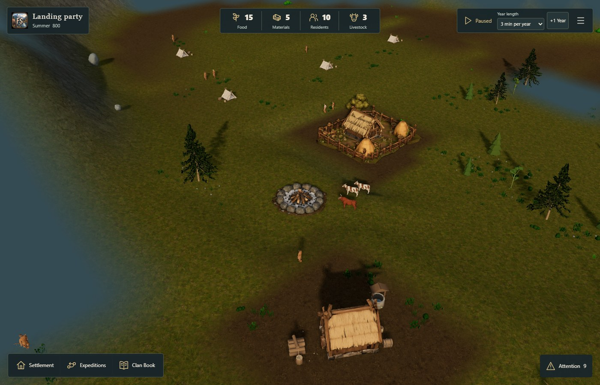
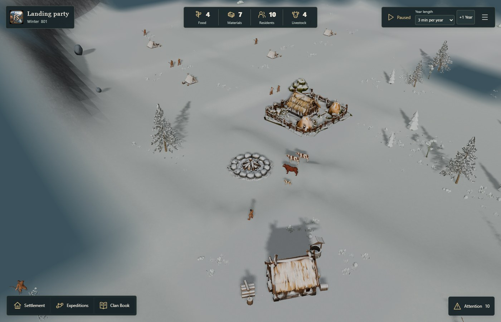

# Village nature review (#203)

Candidate render source: [fb9b009](https://github.com/sidesliders1983/Pillagers/commit/fb9b0091d2cfb8a58c34b4144721d32def331897).
Previous release: [ce9b57c](https://github.com/sidesliders1983/Pillagers/commit/ce9b57c660c8d034abb5c7761da248ccef526304).
Parent: #180. [Implementation/save contract](../../VILLAGE-NATURE-203.md).

## Visible result and playtest

The v2 recipe composes up to five loose tree pockets per site. Canonical trees within 55 m
increase from **6 to 14** on campaign 17 / geography 7 and **8 to 17** on campaign 32 /
geography 18. The full-island canonical quota stays **102**, with identical per-role counts.
Terrain, biome/zoning, coast, foundations and berth retain exact hashes. All future home
plots stay clear. Checked harbor-to-home/rival routes are 84/270 m and 78/822 m respectively;
v2 intentionally computes routes around its new trees. Saved v1 worlds retain their exact
original navigation and complete world hashes.

New sources are already registered Terrain models: birch (456 triangles) and compact spruce
(244 triangles), normalized within their role bounds. Mature pines retain the pinned
19,392-triangle EZ-Tree source. Instance variation changes neither source geometry nor maps.
Low shrubs/grass/stones add no blockers or shadows. Occupied homes retain #206's props.
Per-tree tint does not suppress winter snow; plot clearing preserves colour/matrix bindings.

Open the static nature review page on the playtest host. Its selector covers eight scene
pairs, including both geographies, Summer/Winter, Low/Standard and woodland close views.
**Play this test village** loads the selected normally paid two-home v2 campaign, paused,
and keeps one recovery copy using the existing QA session-backup protocol. The restore
button returns that previous browser session. No benchmark stocks were injected.

| Summer, seed 17 | Winter, seed 17 |
| --- | --- |
|  |  |

## Comparison and resource evidence

Every pair matches terrain, seed, camera, calendar, quality, stock, resident roster and
household facts. Tree positions, navigation/discovery identities and derived actor paths
intentionally differ between v1 and v2: this is not an identical-world on/off comparison.
Renderer-only retakes also assert full Core/RNG and full blueprint/navigation hashes against
a successful earlier run of each *same* recipe. Introductory chapters are marked read and
notified in these QA saves; Core gameplay facts remain canonical.

Final screenshot/resource source is fb9b009. Warm timing traces are from
9c4949c, before the subsequent one-time colour-buffer compaction fix.
That path has zero calls in these warm traces; their steady-state render/shader code is
unchanged. Final screenshots and all four ten-quality-cycle checks use the final source.
Retained geometry, texture and instance counts stabilize in every ten-cycle run.

| Scene | Previous calls / triangles | Candidate calls / triangles |
| --- | ---: | ---: |
| village-summer-standard-17 | 233 / 5,190,473 | 235 / 5,281,421 |
| woodland-summer-standard-17 | 228 / 5,167,493 | 232 / 5,277,833 |
| village-summer-low-17 | 229 / 5,164,043 | 231 / 5,194,671 |
| village-winter-standard-17 | 235 / 5,204,073 | 237 / 5,295,021 |
| village-summer-standard-32 | 244 / 4,408,240 | 244 / 4,514,232 |
| woodland-summer-standard-32 | 234 / 4,379,301 | 234 / 4,485,293 |
| village-summer-low-32 | 239 / 4,357,805 | 239 / 4,428,825 |
| village-winter-standard-32 | 246 / 4,421,840 | 246 / 4,527,832 |

The Low limit remains 40 solid props / 160 cover; Standard remains 64 / 320. Eleven shared
local source families bound colour draws; Standard props reuse the existing shadow pass.
No new asset files, textures, lights, passes, post-processing or dependencies were added.
See [complete measurements](measurement-summary.json) and [gallery data](review-metrics.json).

## Performance interpretation

The four running orbit samples each execute 12 unchanged ticks: **48 tick samples, zero
plan/batch rebuilds**. The measured sync is a small presentation read, not new simulation
work. Frame intervals are rAF wall intervals, **not pure CPU time**; inclusive renderer
callbacks also include driver waits. Timings are in milliseconds.

| Campaign / recipe | Dressing sync p50 / p95 | Frame interval p50 / p95 | GPU sample count | GPU p50 / p95 |
| --- | ---: | ---: | ---: | ---: |
| 17 v1 previous | 0.4 / 1.9 | 117.3 / 2018.6 | 4 | 121.3 / 4008.8 |
| 17 v2 candidate | 0.3 / 0.6 | 129.3 / 233.7 | 12 | 100.6 / 218.7 |
| 32 v1 previous | 0.1 / 0.2 | 133.4 / 167.1 | 10 | 122.1 / 147.8 |
| 32 v2 candidate | 0.1 / 0.2 | 133.5 / 183.5 | 9 | 121 / 144.3 |

This Intel HD 630 / native Edge host has strongly drifting baselines, sparse GPU queries,
and one-off quality/driver stalls. The short ordered traces include the first frames after
quality changes. They cannot establish a causal regression percentage, steady GPU budget,
60-FPS acceptance or physical mobile/thermal certification. Static all-pass costs and the
cache/resource checks above are reproducible. Mature-tree spatial batching/LOD and a
stable target-device performance run remain useful independent follow-ups.

## Validation and reproduction

- Normal production build and public asset validation pass. The required GitHub workflow
  runs the full suite and the unchanged explicit Lab-preview character check; see the
  current-head checks on [PR #207](https://github.com/sidesliders1983/Pillagers/pull/207).
- The source-mask tests pass for pure textured canopies, mixed vertex-coloured foliage,
  seasonal off/restore, discovery shader ownership and uniform stability. Plot compaction
  has a direct colour/matrix/anchor regression. Recipe tests cover v1 fingerprints, both
  version round-trips/caches/workers/restarts, quotas, reservations, access and Core parity.
- The full desktop UI flow (salvage, two real houses, playback, pause, reload) passed on
  9b63c96 with no page/shader/HTTP errors. Subsequent changes touch only foliage snow and
  one-time colour-buffer compaction. The final static release additionally verifies a
  real cold v2 Winter restore, absence of the audit API, and all eight houses/four approved
  beard GLBs/two reused tree sources against served bytes before LAN promotion.
- No source asset approval metadata or validation was weakened. Strict non-preview
  character validation still rejects the pre-existing pending hair/v04-bun LOD2 reference
  review; the required workflow has always used the explicit --lab-previews mode.
- A local full test run was interrupted to free the measurement host; complete suite
  validation is performed by GitHub. Existing ten conditional skips remain unchanged.
  The project has no formatter; existing TypeScript tooling formats the gallery script,
  and git diff --check validates changed whitespace.

Run opt-in golden QA servers from ce9b57c on port 5197 and the candidate on 5198, with
QA_GOLDEN=1. Use an existing Playwright installation through PLAYWRIGHT_MODULE, then run
node scripts/qa/capture-village-nature.mjs --profile. The production build has no QA clock
or audit API. Optional QA_REPLAY_ROOT points at a successful earlier capture: real app
loads still regenerate the pinned recipes and must retain full Core/RNG and world hashes.

Broader #180 work, canonical large-rock redistribution, rival domestic dressing, shore
reservations, new fauna and gameplay events are outside this follow-up.
