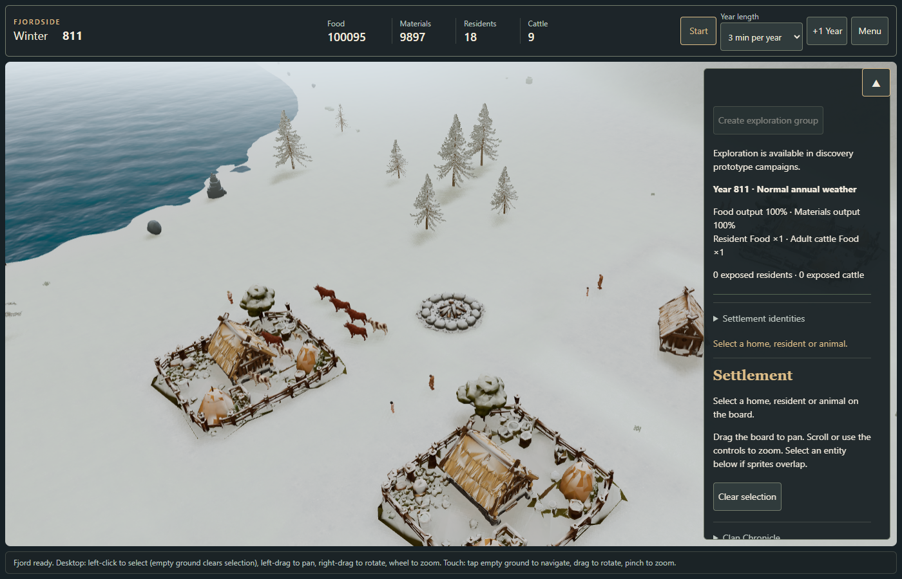
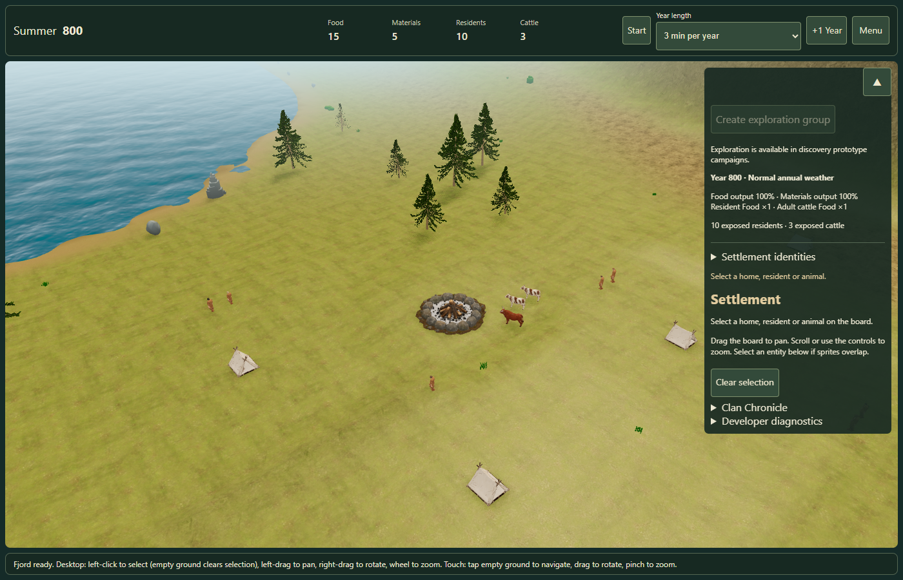
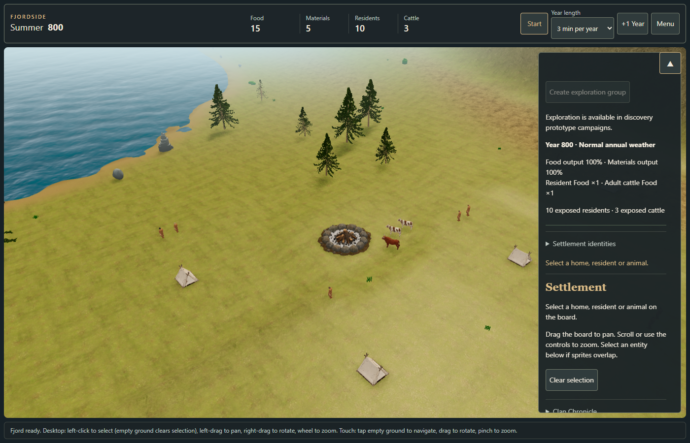
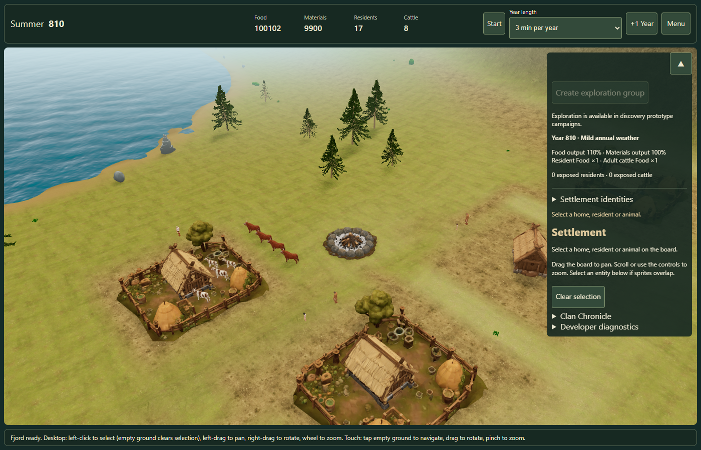
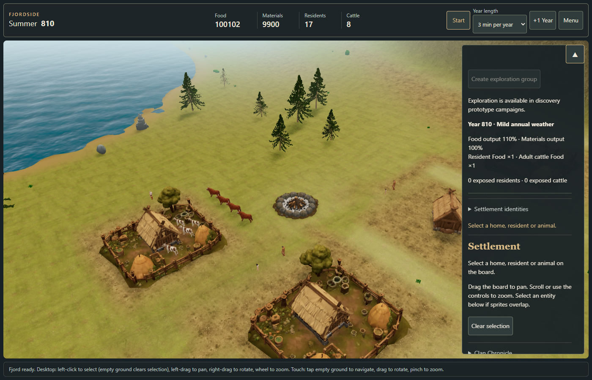

# Visual foundations evidence — issue #180

First bounded Phase A implementation, based on PR #179 merge
`c3027b4cd91ad355d89c1cc158f3993487af2503`. See the
[implementation notes](../../FJORDSIDE-VISUAL-FOUNDATIONS-V01.md) for scope and commands.
The original multi-agent audit in PR #184 used an older source snapshot. This implementation
was revalidated against #179 rather than assuming those older gaps still existed.

## Paired structural scenes

Windows, headless Microsoft Edge 155.0.4283.45, Intel HD Graphics 630 via ANGLE/D3D11,
1400×900 CSS viewport, DPR 1, Standard quality, particles Off. Existing canonical fixtures
are loaded paused; the QA bridge freezes actor and environment time from startup.
These are deterministic structural comparisons, not animated frame-time benchmarks.

| Scene | Shadow-inclusive calls, before / after | Shadow-inclusive triangles, before / after | Geometries / textures, both |
| --- | --- | --- | --- |
| summer-32 | 176 / 176 | 8,079,132 / 8,079,132 | 80 / 57 |
| developed-810 | 162 / 162 | 6,724,274 / 6,724,274 | 68 / 72 |

Both cases passed on two independent page loads, with identical pixels and state across
reloads within each version. Full canonical state, blueprint hashes and actor signatures
match between versions. All actual entities use assets; no placeholders, missing resources
or console/page errors were reported. Resource hashes and exact source inputs are retained
in `baseline.json` and `candidate.json`.

The baseline pins only `FjordPlay.ts` and `WorldLighting.ts` to #179 through the QA server;
other sources are shared. This reproduces the production difference in this bounded change
and must not be reused as a general historical checkout. Baseline capture preceded the final
explicit scene-settle barrier; it already passed consecutive/reload pixel equality and its
complete canonical hashes were independently checked against normalized input fixtures.
Candidate captures additionally assert full canonical equality and await the scene barrier.

`season-smoke.json` additionally records passing consecutive-frame/canonical checks for
`summer-17` (a second seed, 179 shadow-inclusive calls) and `snow-811` (Winter, 164 calls).
These use one fresh page each; they extend coverage but do not certify reload reproducibility
for those additional fixtures. The lighting unit regression also covers eight seasonal phases
across all annual weather classes and Low-quality shadow settings.

The desktop typography changes canvas size from 1384×755 to 1384×752, so the camera aspect
also changes slightly. Camera position, focus and field of view are identical. No pixelwise
before/after equality or matched-resolution FPS comparison is claimed. Reproducibility is
checked independently within each version.

| Before | After |
| --- | --- |
|  |  |
|  |  |

The lighting adjustment reduces ambient intensity to 78% and increases direct intensity to
112% after existing weather composition. It retains fog, sky, exposure and shadow settings.
The screenshots show a restrained first step; terrain richness, tree silhouettes, settlement
framing and environmental storytelling remain open work. The reference image is a direction,
not an acceptance result for this slice.

## Desktop interaction

`desktop.json` records a PASS against the normal production-source server, without QA bindings:

- Header/calendar/resources/controls and inspector fit 1101, 1280, 1400 and 1920px widths.
- Selection, panel collapse and Escape/menu focus preserve the complete canonical state.
- The real running timer advances; the resulting state exactly equals authoritative replay.
- Inspector input focus survives running refreshes.
- At 1100px the new desktop tokens are absent; existing narrow layouts remain in control.

## Acceptance boundaries

Structural repeatability and canonical-state preservation are measured above. No rendering
pass, light, shadow map, geometry, asset or dependency is added. Animated CPU/GPU timings,
the long-run simulation soak, active VFX, discovery fades and physical mobile hardware remain
unqualified by this evidence. A later matched-resolution benchmark must satisfy the Phase A
performance gates before adding expensive effects. Mobile UI remains issue #182; no 2D
presentation work is included.

## Next implementation order

1. Expand this reproducible gallery across seeds, seasonal transitions, Low quality and
   discovery/VFX states; capture a current long-run CPU profile with workload counts.
2. Trial procedural terrain colour/mask and shoreline transitions against the same gallery.
3. Trial reusable vegetation/rock scale and distribution rules with explicit draw/triangle budgets.
4. Improve camera framing and contextual decoration without changing saved placement rules.
5. Continue desktop information hierarchy using real stable gameplay interactions.

Final combat/CPU-clan HUD, combat poses/attachments and gameplay-dependent settlement polish
remain Phase B. None of these later items are claimed complete here.
