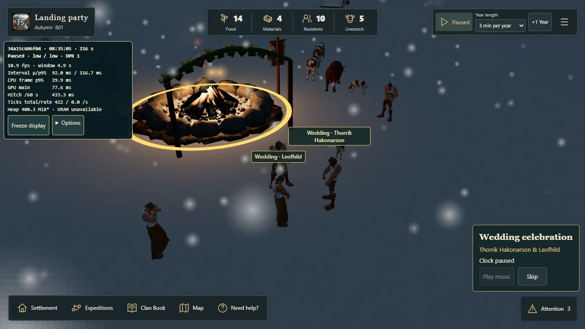

# Wedding cinematic #288 — validation

Base: `main` commit `34a15c606f04f8167e707427abea205888124e7a`.
Branch: `codex/wedding-cinematic-288`. This extends the merged #277 presentation.

## Delivered assets

The original owner files remain in `D:/CodexSites/Pillagers/Assets/Wedding-ceremony`.
The public manifest records exact source and runtime SHA-256 values; originals are not published.

| Slot | Runtime bytes | Geometry | Delivery / validation |
| --- | ---: | --- | --- |
| wedding-lyre | 332,568 | 3,013 triangles | Actual GLB parsed; native support/pluck pose tested |
| wedding-flute | 333,556 | 3,102 triangles | Actual GLB parsed; native head/hand anchors tested |
| wedding-frame-drum | 338,108 | 3,067 triangles | Actual GLB parsed; native support/tap pose tested |

Three shared rigid props use one 512px colour JPEG each, approximately 3 MiB of base decoded pixels combined, excluding mipmaps/GPU overhead. No extra human, skeleton, renderer or render target is created. Preparation preserves source topology, normals and UVs and removes the large source normal/metalness textures. The original source exports total about 135 MiB; the runtime GLBs total about 0.96 MiB.

The only music is the unchanged owner-selected `Firelight_Vow_2026-10-26T145442.mp3` (737,916 bytes), SHA-256 `a927f51c2975c5164173c2087eb5575fa32b312b3807d86616423afe6d6a70cf`. MPEG frame duration is 30.041 s; observed browser metadata is 30.040792 s and controls the actual presentation. It streams through a native media element into the existing audio owner, outside the decoded SFX cache. No alternate take or new generation is used.

`reference.jpg` is the owner-supplied composition image from 27 October. It guides the intimate grouping and shots. The accepted garland and existing low-poly faces are preserved.

## Public contracts and reproduction

```sh
pnpm install --frozen-lockfile
node scripts/prepare-wedding-assets.mjs D:/CodexSites/Pillagers/Assets/Wedding-ceremony
node --test --test-concurrency=2 tests/wedding*.test.mjs tests/cultural*.test.mjs tests/fjord-audio*.test.mjs
pnpm build
pnpm test
```

Asset preparation needs the original owner files; ordinary builds and tests use only committed compact public assets.

The physical tests restore the genuine affordable #277 checkpoint and load its actual prepared island (campaign seed 2 / terrain seed 227). They issue the real SponsorGathering command, retain both spouses and the oldest recorded eligible attendee, verify body/terrain clearances and native Run pace, then test pause and Skip. Low (6) and Standard (8) are tested both immediately and after normal village motion. A running-clock arm steps an independent identical campaign and compares complete serialized Core output. No invented people, free sponsorship, teleport or hidden RNG stream is used.

## Lifecycle and limits

The accepted Core receipt remains the only authority: 3 Food per canonical attendee and existing fire fuel when needed. Cinematic entry, duration, music denial, pause and Skip add no resource cost or simulation event. Loading event history never starts another wedding; no historical 3D replay is offered.

One transient director owns the saved camera/input, UI and foreground audio lease. Normal finish, Skip/Escape, selecting another HUD task, backgrounding, context loss, world replacement and disposal release it. Pause keeps the current scene still and suspends music without changing manual clock state. Mute and existing master/world preferences apply. Deferred/failed assets use an honest pose fallback; disposed late downloads cannot restore templates.

A coherent arrangement is selected from eight fixed orientations using the current known-ground/body authorities. Initial routes and up to two delayed stall repairs retain the existing 2,000-node cap. Compact wedding routes use 0.5 m waypoints, retaining all terrain/body checks; ordinary ceremonies and navigation retain their existing behavior. No per-frame unbounded route search is introduced. Residents physically run out and follow retained trails back. Unavailable actors or an impossible approach end only presentation; they never refund or duplicate the accepted wedding.

Local desktop rendering and a landscape viewport review are required before handoff. These are not a physical iPhone performance certification. Owner iPhone landscape acceptance remains pending.

The initial browser run also exposed a pre-existing DirectionalAtmosphere duplicate GLSL injection on a forest material before wedding entry. This is recorded as inherited renderer evidence, not a passed clean-console claim or attributed to wedding audio. No unrelated lighting rewrite is included.

## Executed validation, 27 October 2026

- Final targeted run: **161 passed, zero failed/skipped** (`scratch/wedding-final-integration.log`). This includes actual review DNA, both actor caps, late/missing assets, safe-camera failure, pause/Skip and full serialized parity with a running control.
- Final production build: passed public-asset validation, TypeScript and Vite (`scratch/wedding-final-build.log`). Existing chunk-size advisory remains unchanged as a build warning.
- Complete repository suite: running separately with two workers; not yet claimed green in this record. Exact-head GitHub CI remains required before readiness/merge.
- Browser: actual Firelight Vow media metadata 30.040792 s; six real actors / three instrument props / three shared templates / no unavailable assets. The final observed maximum native hand-target error was 0.06791 m. Pause stopped native media; normal finish released all actor/prop bindings and restored camera position `[96, 32.732528686523445, -28]`. This verifies playback state, not a physical-device listening review.
- The desktop composition capture below was taken before the final shoulder-relative couple-gesture correction. That later correction passed the actual-resident rig test and the final browser diagnostics above. Do not treat this earlier still as a new physical-device or final-pose sign-off.
- At an 844 × 390 browser viewport, Skip and Attention occupied separate DOM rectangles. The initial 40px control override was corrected to 44px. A browser resize capture did not supply reliable full-scene landscape pixels; physical iPhone landscape remains explicitly pending.
- A later actual partnership was also sponsored for exactly 24 Food with existing fire fuel. That receipt remained recorded when physical staging could not present a film; there was no repeat payment or fake stand-in. The finite presentation can decline/abandon an unreachable physical cast while keeping the canonical celebration/history intact.


