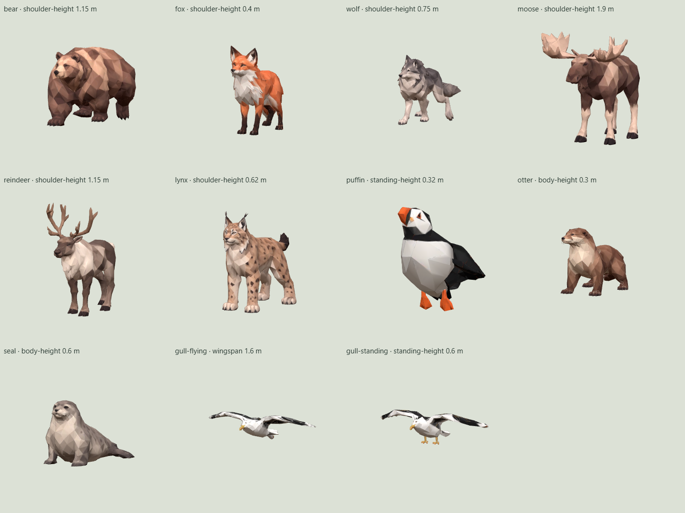
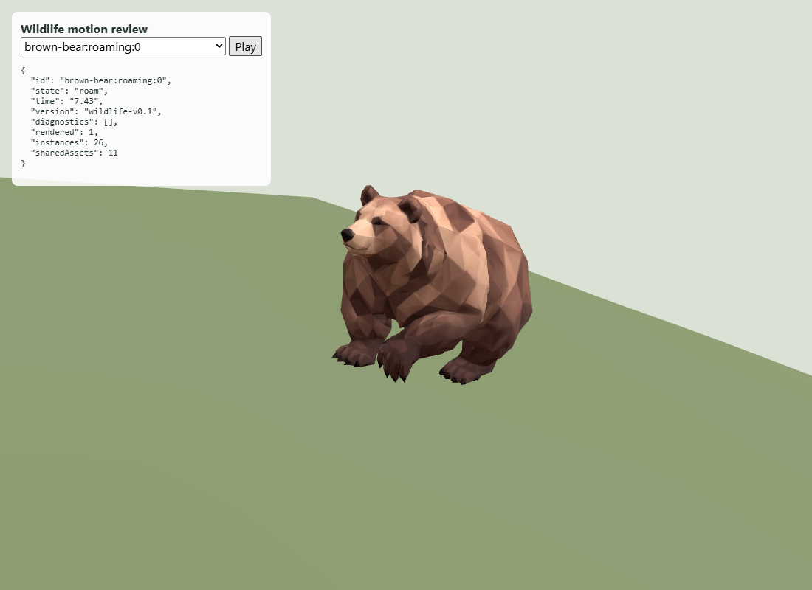
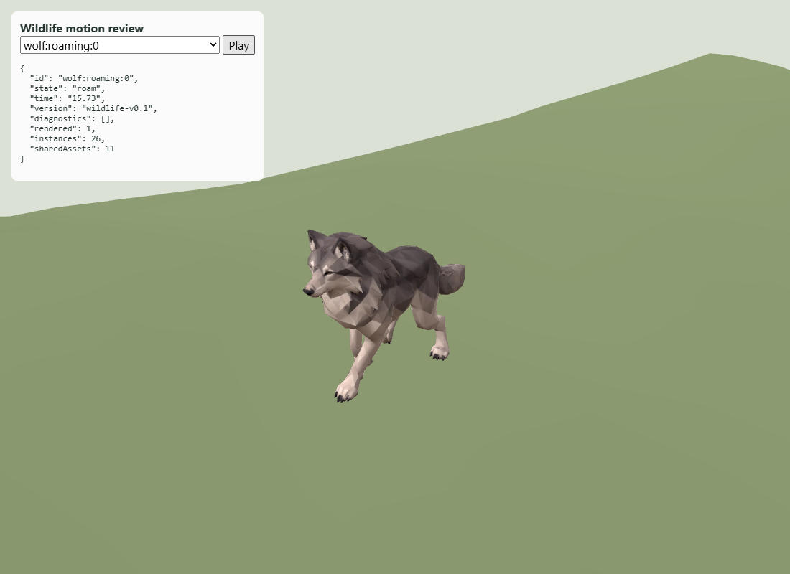
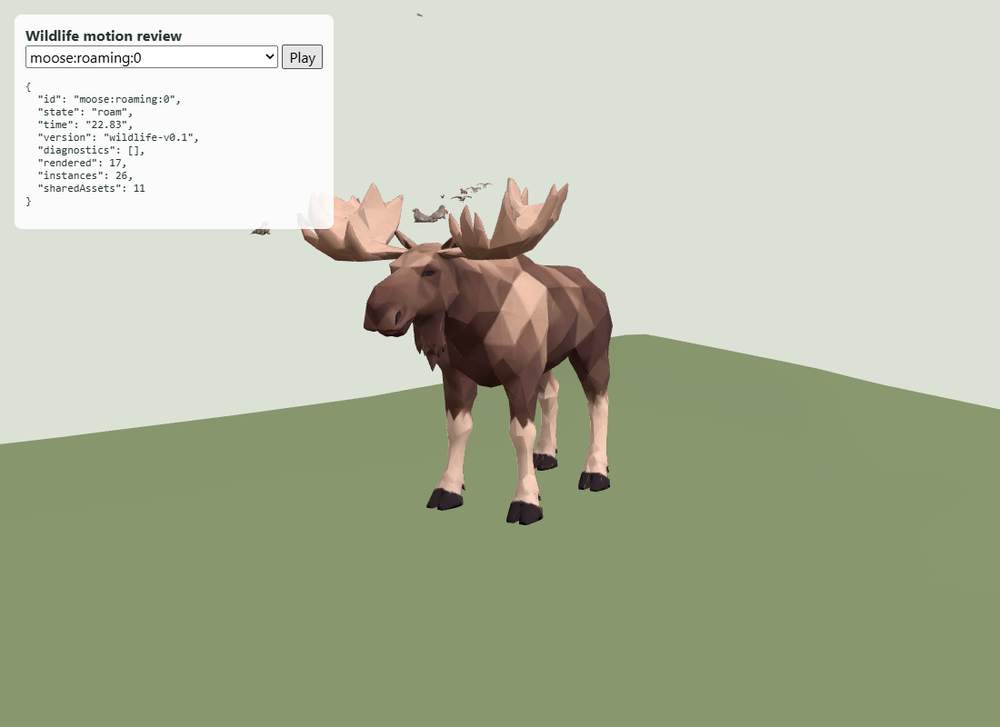
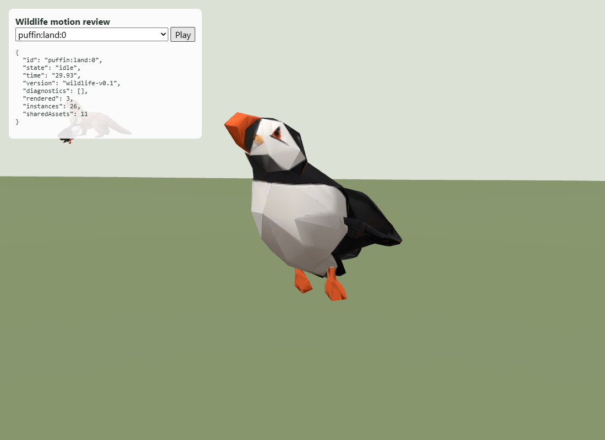

# Wildlife #213 visual and placement evidence

The contact sheet shows all eleven compact runtime assets. Each tile is framed
independently; the labels give canonical size references, not relative screen scale.

These motion views use the actual `WildlifeLayer`, all 26 instances, their real
campaign-island positions, the authoritative terrain height surface, source walk
clips for bear/wolf and the procedural fallback for moose. The lightweight scene
omits the full terrain shader, vegetation and buildings to make close inspection
practical. Puffin shows the compact rest pose authored with its supplied wing rig.

`planning-0.json` and `planning-1.json` record both real curated island recipes
(18 and 7) after 60 simulated seconds: all 26 instances, no missing-habitat fallback,
and every non-flying actor still in valid habitat. All six ground mammals found
valid roaming routes. Repeat with `node scripts/check-wildlife.mjs`.

`browser-summary.json` records an actual Fjord Play render using a pre-generated,
unchanged `createCampaignIsland(1)` worker-result fixture. All eleven model requests
succeeded and all 26 instances loaded without page errors or failed requests.
An initial attempt with live generation exceeded the headless browser timeout;
fixture-based rendering then succeeded. This isolates wildlife rendering from
unchanged island generation. The separate close-up scene also had no page errors.
This software-rendered check is not a mobile performance benchmark.

The supplied grounded gull has its wings extended. That source pose is preserved;
no fabricated folded wing geometry is introduced. Bear and wolf have walk clips
but no authored idle clip; resting freezes the source pose. Other animation limits
and all population/habitat values are described in [the current wildlife rules](../../WILDLIFE-213.md).
