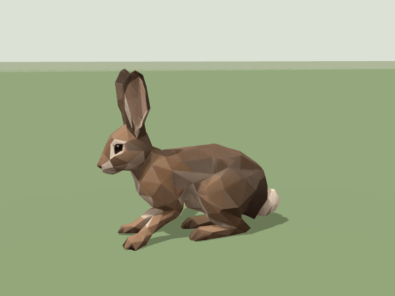
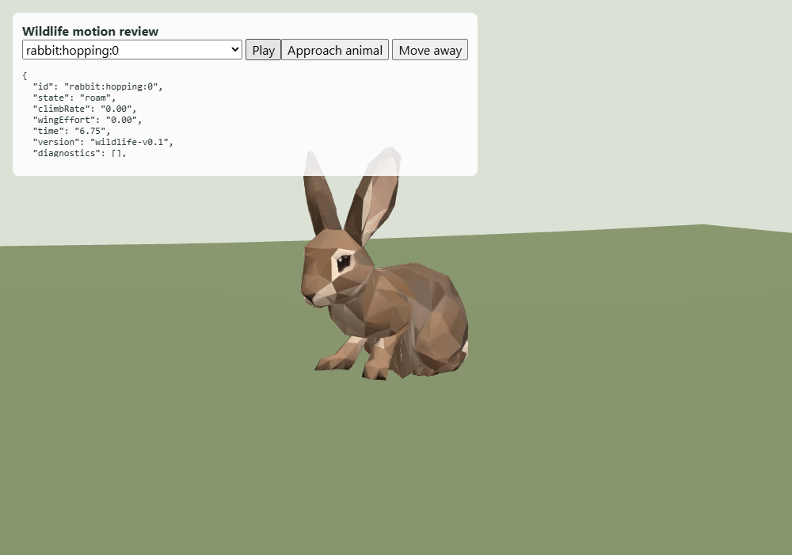

# Rabbit wildlife — revision 001

The supplied `bunny.glb` contains a 41-bone skeleton and no authored animation
clip. Its existing geometry, skin weights and UVs are retained. The runtime asset
uses a metre-scale wrapper (0.42 m including ears), a 512 px WebP colour map and
the existing wildlife compression pipeline. It is 113,088 bytes; the previous
eleven runtime GLBs remain byte-identical. Original source models and the supplied
reference GIF are not included in the public assets.

The procedural hop interprets the reference GIF's sequence: gather, hind-leg push,
flight, forepaw landing, then hind-paw recovery. One phase controls horizontal
travel, vertical lift and joint posing. Two-bone IK anchors supporting paws to the
terrain; every frame starts from the authored joint transforms. Body compression,
head stabilization and small ear movements accompany the stride. This is a
procedural reference interpretation, not motion capture or a new Meshy clip.

The loop uses twenty samples of the shared gait and pose modules on a flat contact
review plane. Its 0.8-second playback is slightly slower than the live roaming
cycle. The interactive local review is `/output/rabbit-wildlife-001/index.html`.

Two rabbits are added as a forest-edge/lowland pair, at least 60 m from settlement
centres and 18 m inland. Their roaming radius is 12 m and they react to people
within 16 m, using the existing six-second alert behavior. Normal pace is 0.65 m/s
before seeded variation; fleeing pace is 1.8 m/s. Visual lift is 6 cm / 8.5 cm, with
stride duration clamped to 0.42–0.70 seconds. A stride completes before rest or
redirection. Pause freezes the current position and pose. Wildlife remains an
ambient presentation layer and does not create Core entities or alter RNG state.

## Validation

- All 21 focused wildlife, Fjord yard-cache and presentation-quality tests pass.
  New checks cover phased travel, complete landing, timestep subdivision,
  finite compact skinned geometry, planted paws on a 25% slope, bounded ground
  penetration, independent skeletons, paused poses, valid movement and fleeing.
- `node scripts/check-wildlife.mjs` passes for both curated island recipes (18
  and 7): all 28 actors are placed, no habitat diagnostics, geography unchanged
  and 60 seconds of valid roaming. The six solitary mammal territory reservations
  remain separated; the rabbit pair is deliberately excluded from that solo rule.
  Results are retained in `planning-0.json` and `planning-1.json`.
- The actual WildlifeLayer loads all twelve shared runtime assets and 28 actors
  on the campaign terrain fixture. A hopping rabbit was inspected in the browser
  with no page errors or layer diagnostics (`island-browser.json`).
- The flat-plane animated close-up also has no page errors (`browser.json`).
  These are focused motion previews, not a full Fjord Play end-to-end test.
- Public-asset validation, TypeScript and the Vite production build pass.
- No project formatter is configured; changed source formatting was reviewed
  manually and `git diff --check` passes.

