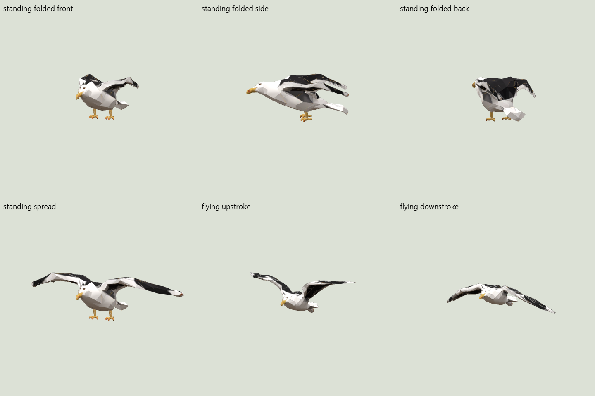

# Wildlife #213 — revision 002

Flying gulls remain around the settlement harbour. Wingbeats follow actual ascent;
level and descending flight uses a stationary-wing glide, with a short transition.
Grounded gulls turn more visibly and mostly rest with folded wings. Their own
stretch phases briefly spread their wings approximately every half minute.

The grounded variant uses a folded morph target with the supplied topology and
UVs. Head and feet stay fixed; upper/lower wing surface separation is retained.
The airborne variant uses seven lightweight wing bones. Render resources are
shared while each bird controls its own pose.

The six land mammals now reserve separate roaming discs with at least 40 m between
their edges. All valid inland candidates are considered together, preserving
scarce habitats and removing the former nearest-harbour bias. Both actual curated
islands retain all 26 actors and every mammal stays within valid habitat.

Nearby displayed residents, expeditions and observed rival people trigger a safe
escape. Animals remain within their own territory and do not teleport. A blocked
animal watches rather than moving its legs in place. Camera position is not a
threat input. Seal meshes and movement are unchanged.

The focused tests cover territory gaps, coastal gull proximity, safe escape and
pause behavior, actual human-position selection, ascent/glide effort, the folded
rest duty cycle, fixed feet/beak and finite target geometry. Existing asset,
resource ownership and deterministic habitat tests remain enabled. Island
inspection records are in `planning-0.json` and `planning-1.json`; reproduce with
`node scripts/check-wildlife.mjs`.

The browser motion review recorded a climbing gull at +0.78 m/s with wing effort
0.74, and a descending gull at -0.10 m/s with effort below 0.02. It also verified
a nearby human triggers the fox's flee state, with no browser errors. Captures
and measured state are retained in this directory (`behavior-002.json`).
