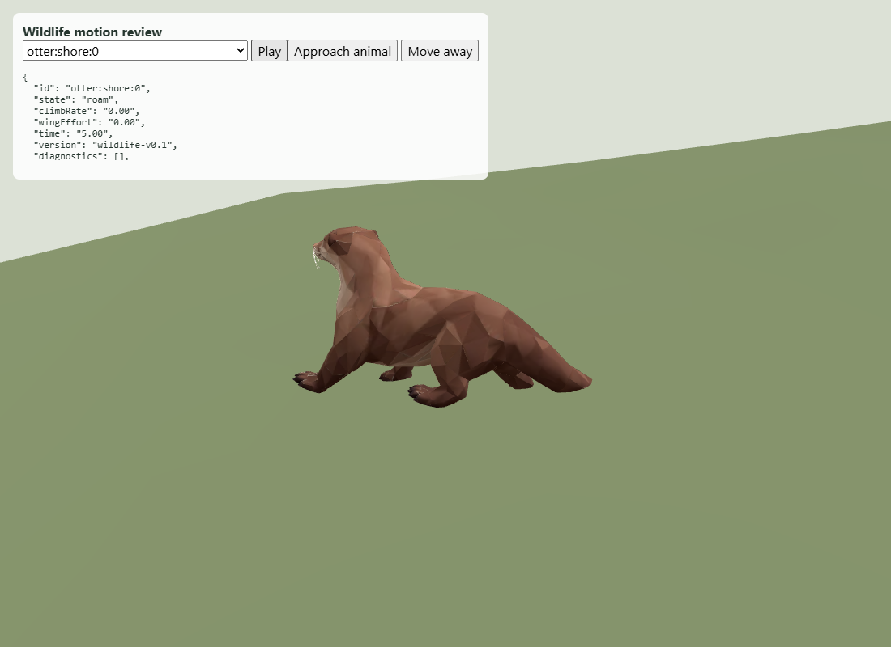
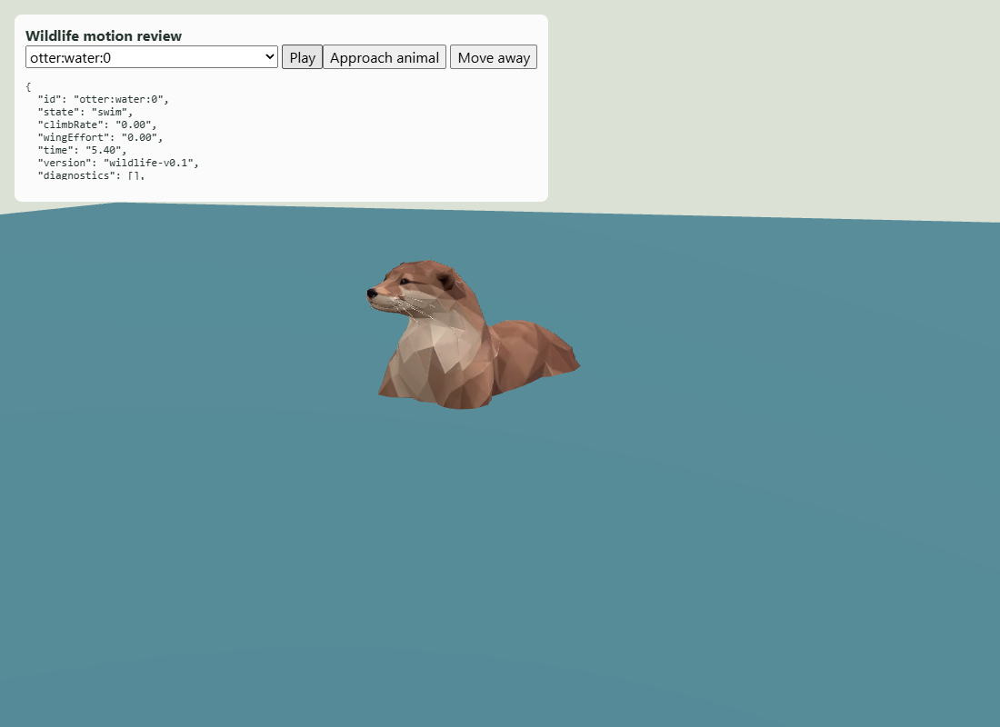
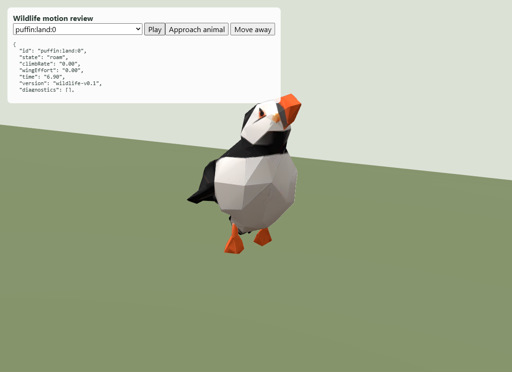
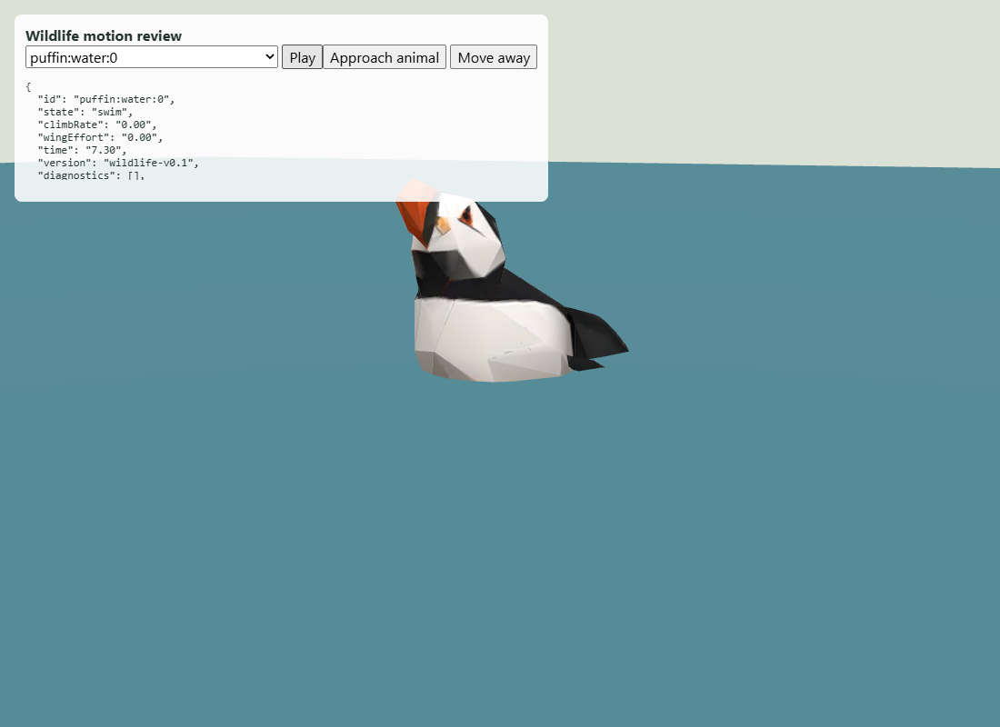

# Wildlife #213 — coastal motion revision 003

The otter source has a skeleton but no authored animation clip. Previously only
its upper leg joints received a small generic swing; underwater this was mostly
hidden. The dedicated motion now includes lower leg flexion, diagonal shore
strides, swimming paddles, spine movement, head turns and a phased tail wave.
Idle animals retain small head, breathing and tail movements.

All five puffins remain present on both curated islands: three on land and two
in water. Land birds now perch at least 0.6 m above water and waddle within a
3 m radius at 0.12 m/s. The colony initially spawns within 16 m of its shared
anchor. Swimming birds keep more of their upper body visible. Head and feather
motions run during rests; legs paddle while swimming. Canonical height remains
0.32 m. Discovery still hides the colony until its coast has been explored.

These are procedural motions on the supplied rig, not new authored Meshy clips.
Every frame restores the original local joint rotations before applying motion;
clones own their joint poses while sharing geometry and materials. Seals and gull
flight rules are unchanged.

The browser inspection used the actual recipe-7 island and WildlifeLayer with a
small terrain/water patch around each selected animal. It verified shore roaming
and swimming for both species with no browser errors (`browser.json`). This is a
close-up motion review, not an end-to-end full-scene browser test.

Sixteen focused wildlife/Fjord entity tests pass. New assertions measure actual
skinned-vertex displacement through a motion cycle, require visible motion above
water, retain finite compact geometry, verify resting motion and paused poses,
and keep land puffins above water during 60 seconds of valid roaming. Real island
planning records are preserved alongside this report. Code formatting was
reviewed manually; no project formatter is configured.
