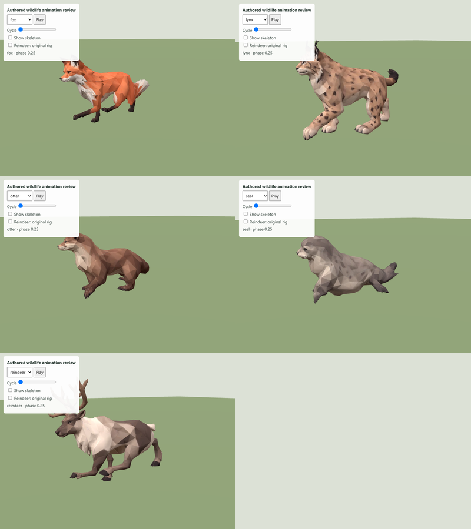
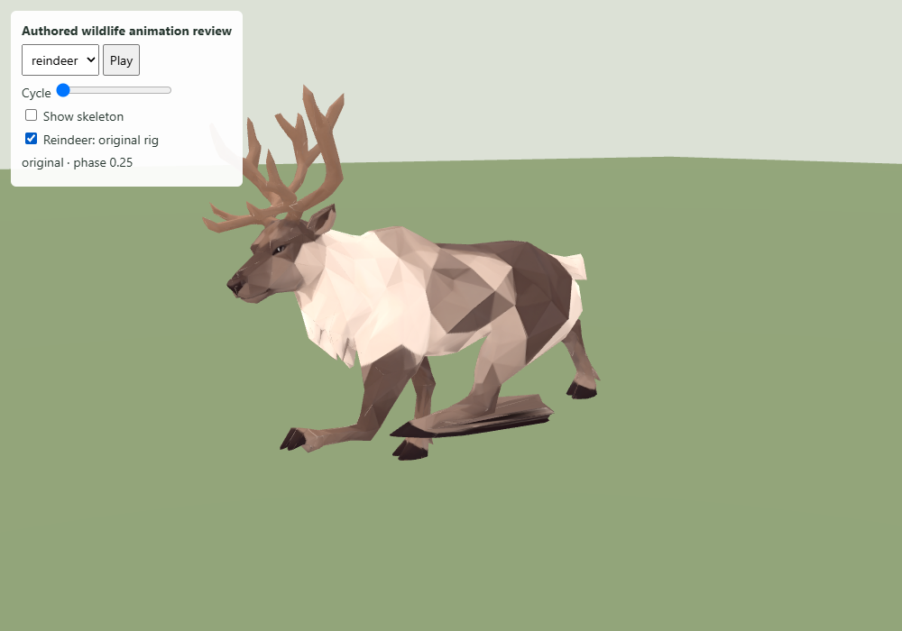
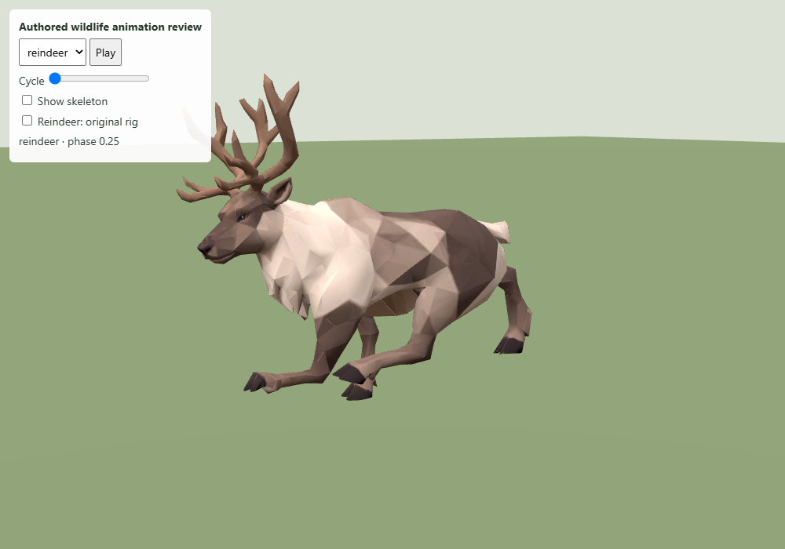
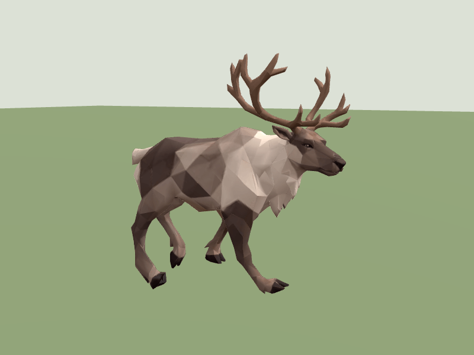
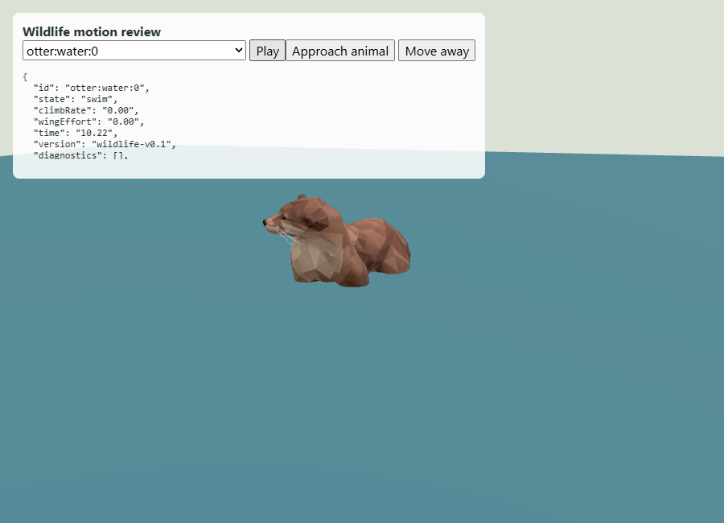
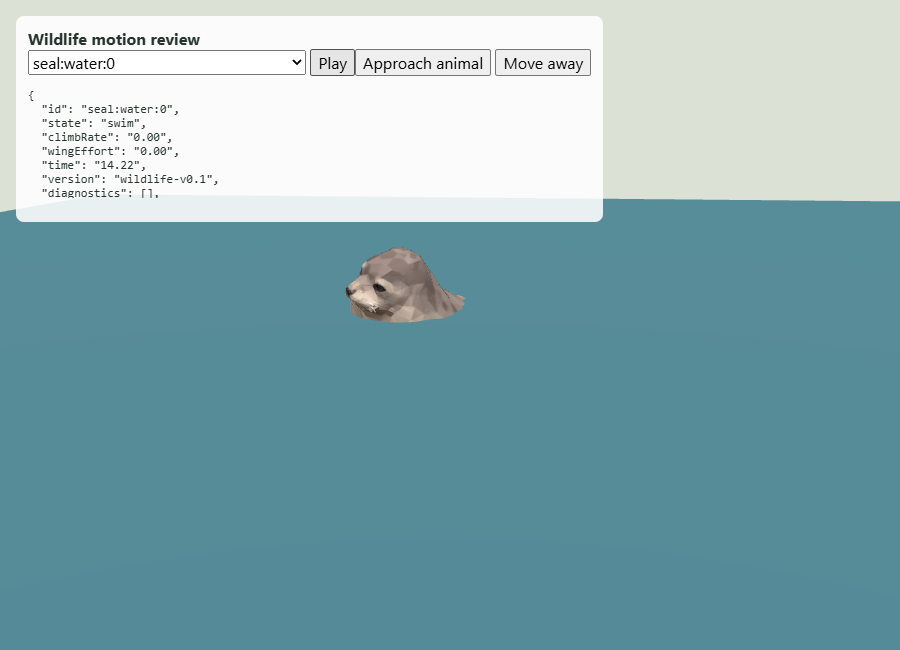

# Wildlife #213 — authored motion revision 004

Fox, lynx, reindeer, sea otter and seal now use the supplied Meshy `-animated`
exports. Each has 27 joints and one one-second locomotion loop. The existing
pipeline retains the clip, removes horizontal hip root motion, compresses the
colour map and exports the model in metres. First-frame body length matches the
previous runtime model within 0.1 mm; differing export units are not inherited.
All seven other runtime models remain byte-identical. Total wildlife assets are
1,600,056 bytes. Source identities, dimensions and operations are retained in
`export-summary.json` and the publication manifest.

## Reindeer repair

The supplied right hind hock and hoof were located across the body on the left
side, and lower-paw skin weights also crossed onto the left surface. This produced
a stretched sheet of triangles during locomotion. The derivative export repairs
all four right hind joints, their inverse bind matrices and the affected weights.

The sound left chain is reflected into the right side. Its animation is sampled
half a cycle later relative to the moving hip, then converted to the new right
parent frames. The other 23 animated joint channels remain unchanged before the
shared resampling/compression step. Geometry, UVs and materials are retained.
Weight transfer uses the undeformed authored surface, not the already damaged
skin pose: 897 hindquarter vertices are processed and the largest mirrored donor
gap is 0.000009412 source units. A source-structure check and donor-distance bound
reject this repair if a future source no longer matches its assumptions.

At the same runtime scale, the longest triangle edge over twenty cycle samples
falls from about 0.94 m to 0.44 m. The regression test samples forty phases,
requires both hocks and hooves to remain on their own side of the pelvis,
requires normalized weights and rejects right hind weights on the left surface.
The longest edge must remain below 0.50 m, including the antlers.

The original supplied files are unchanged. No source GLBs are added to public
assets. The repair runs reproducibly through `scripts/prepare-wildlife.mjs`.

## Runtime and validation

The existing WildlifeLayer automatically selects authored clips for these assets,
so no second procedural leg pose is applied. Otter and seal water variants reuse
the supplied locomotion loop with the existing immersion and bob. These are not
separate swimming clips. Hauled-out seals retain the resting frame. Habitat,
population, roaming speed and shyness values are unchanged. Rabbit and puffin
procedural motion remains intact.

All 23 focused wildlife, Fjord yard-cache and presentation-quality tests pass.
Checks include all seven source clips, stationary horizontal hip roots, visible
skin deformation, finite compact geometry, independent instances, exact pause,
resting seals, rabbit support contacts and the repaired reindeer chain. The Vite
production build, TypeScript and public asset validation pass. The build retains
the existing large-chunk advisory; it is not a failed check. No formatter is
configured; changed source was checked manually and with `git diff --check`.

The browser close-up inspected all five runtime clips without page errors
(`browser.json`). A separate review used the actual WildlifeLayer and campaign
terrain fixture: fox, lynx, reindeer and shore otter fled; the water otter and seal
swam; the hauled-out seal rested. All 28 actors loaded with no layer diagnostics
or browser errors (`island-browser.json`). These are focused layer/motion checks,
not a full Fjord Play end-to-end test.

Local interactive review: `/output/animated-wildlife-001/index.html`. It has an
animal selector, a cycle scrubber and an original/repaired reindeer comparison.
