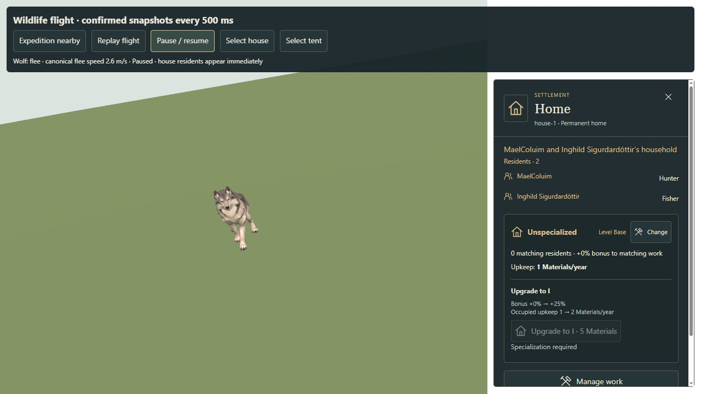

# Wildlife flight timing and immediate home residents

## Wildlife presentation

Previously, each canonical wildlife snapshot became the target of exponential
position easing. With batched updates this produced a burst of travel followed
by a near-stop before the next snapshot. Meanwhile, the land animation sampled
`elapsedTime * currentSpeed`, regardless of displayed distance. Changing into
fleeing also jumped the animation to a new absolute phase. This caused fast feet
over slow/stationary bodies and abrupt pose changes.

Land and shore presentation now interpolates confirmed positions over the actual
campaign update cadence, retaining the displayed position when interrupted.
Heading uses its shortest arc. Meshy land clip phase and the fallback moose leg
swing advance from displayed horizontal travel, preserving phase across pace
changes and stopping when the body stops. Pausing freezes the interpolated pose;
an unchanged snapshot from a pause command cannot finish a pending movement.
Loading snaps to confirmed positions without treating the jump as a stride.

The renderer never extrapolates beyond confirmed targets or mutates authoritative
wildlife. Physical flee speeds, shyness, habitats, saves and sighting eligibility
are unchanged. Existing marine, water and bird motion remains separate. The
supplied Meshy clips are retained; this does not create new authored running clips.

## Home selection

The initial home card used a closed `details` element around the resident list.
It is now an always-visible labelled section, retaining household name, resident
count, occupations and the existing person-card links. Both house/building and
tent/household selections behave this way on desktop and mobile.

## Validation

- 59 focused motion, wildlife, marine, sighting, home-improvement and UI tests pass.
- Motion tests cover equal per-frame travel at 30/60/120 Hz, different update
  cadences, interrupted movement, phase continuity, stopping without foot cycling,
  short heading turns, load snaps, pause and immutable canonical snapshots.
- Production `WildlifeLayer` tests compare actual clip time with displayed metres
  and assert that entering flee cannot jump the clip phase.
- Source skin playback tests now supply actual body travel for land locomotion;
  idle breathing/head motion, water animation and exact paused poses remain checked.
- The real home controller is tested on initial house and tent selection, both
  layouts, every resident link and unchanged Core state.
- Production asset validation, TypeScript and Vite build pass. The existing
  bundle-size warning remains unchanged.
- Browser review confirms flight and pause, immediate house/tent lists, and a
  resident link opening the correct individual card. No browser errors or warnings
  were recorded during these checks.

The self-contained review at `/scripts/qa/wildlife-home-regressions.html` uses
the production wildlife renderer, a separate canonical population updated every
500 ms, and the real home interface. Its campaign is in memory only. It offers a
nearby expedition stimulus, pause and house/tent selection. It does not replace
or import a player's saved campaign. Historical QA reports remain unchanged.

Formatting reviewed manually; no project formatter is configured.

[Browser motion and console record](browser.json).
