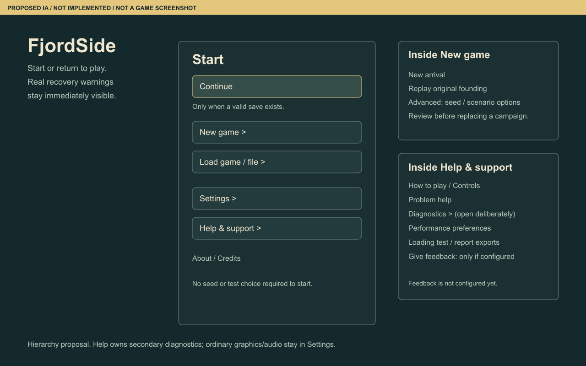
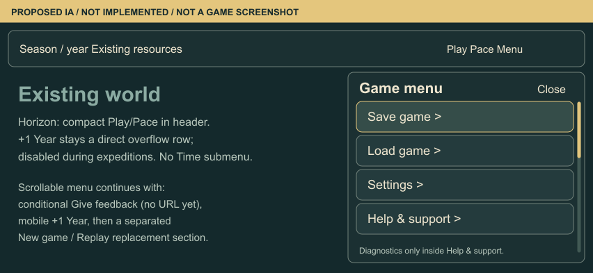

# FjordSide alpha player experience audit — #297

Version 0.3 · 29 October 2026 · source inventory and proposed information architecture.
Parent: [#296](https://github.com/sidesliders1983/Pillagers/issues/296).

**Status: source inventory revised after owner review; five real journey attempts
and a narrow Horizon-layout check recorded.** The owner initially chose source
inventory first, then enabled the browser and requested journey/empathy maps before
implementation, using the prototype skill. See the [observed journeys and empathy
maps](alpha-297/journey-empathy-maps.md). These are informed-agent attempts, not
uncoached player research or physical-device approval. C ended in a blocked-route
return; the discovery goal remains incomplete. #297 remains open for the gaps
listed below. No player UI, Core, RNG, Lore, save format, runtime asset, dependency
or gameplay behavior changed in this branch.

## Scope and evidence

The start menu and top-bar game menu were audited first. The item-level result is
[67 classified entries](alpha-297/menu-inventory.md), including injected controls
and their conditional recovery/diagnostic states. The machine-readable
[inventory](alpha-297/menu-inventory.json) records current label/location, selector,
actual action, audience, availability, proposed destination, disposition,
justification, handler, implementation owner, source commit and file hash.

| Evidence | Identity / result | What it proves |
| --- | --- | --- |
| Pinned source | `main` / `4086baac26c6953b879b439546b68f2406ca767a` | Exact source inspected; a separate documentation-only branch starts here. |
| Published identity | `https://pillagers-test.sidesliders.chatgpt.site/site-version.json` reports the same main commit, routes `/` and `/fjord-play` | HTTP metadata observation. It does not independently prove every deployed asset matches source or that a UI journey works. |
| Workspace | `D:/CodexSites/Pillagers/scratch/ui-audit-297`, branch `codex/ui-audit-297` | Isolated from the unmerged marine/recording branch and its LAN playtest. |
| Browser | Owner subsequently enabled the Windows in-app browser; isolated origin `http://127.0.0.1:5192/fjord-play` | Actual screenshots and agent journeys at requested 1440×900 and 390×844; 852×393 start-layout check. Narrow Horizon layout with mouse automation, not physical touch or coarse-pointer emulation. |
| Served source | Fresh Vite build of the preserved Sites export for pinned main; 1,854 inputs compared | 1,853 match main content; only `src/main.ts` has the existing Sites entry-route transform (root opens Fjord; labs omitted). `/fjord-play` modules are unchanged. [Build identity](alpha-297/runtime/build-identity.json) records this difference and output hashes. No whole-live-site parity claim. |
| Historical patterns | Merged [PR #192](https://github.com/sidesliders1983/Pillagers/pull/192), [Horizon report](../qa/mobile-horizon-182/README.md), [integrated report](../qa/integrated-playtest-180/README.md) | Existing Context & Focus/Horizon intent and historical evidence only; not current-build validation. |
| Proposals | Four [annotated wireframes](alpha-297/wireframes/README.md) | Proposed navigation structure, explicitly not game screenshots or implemented controls. |

Source hashes and the observed public version document are retained in the
[source manifest](alpha-297/source-manifest.json). Evidence labels used below:
**S** = source-confirmed; **H** = historical evidence; **P** = proposal/hypothesis;
**R** = observed in this agent browser audit; **U** = unverified behavior. No usability score, participant quote, emotion score or independent player result is invented.

## Start menu — current structure before the proposal

The source unconditionally appends performance settings and the shared audio
controls next to the entry shell (`FjordEntry.showShell`). In ordinary mode,
`Run loading diagnostics` is available; it is not restricted to an already enabled
technical mode. Continue is shown disabled when no valid selected save exists.

```text
FjordSide / selected save source + date + seed / real storage warning
├─ Continue campaign                         [valid selected save required]
├─ New campaign — same founders              [valid founding data required]
├─ New scenario                              [fresh campaign seed; island can repeat]
├─ Recover or import a campaign
├─ Run loading diagnostics                   [normal mode entry]
├─ Debug / Performance overlay               [Off / Compact / Details]
└─ Sound                                     [Enable, Mute, Master, Sound groups]
```

An explicit `diagnostics=load` state relabels the three campaign buttons as tests,
shows Back to normal play and prepares without activation. Reports remain local.
Recovery, failed preparation and replacement confirmation have separate controls;
these must not disappear with the normal-screen cleanup. See E01–F04 and S01–S17.

### Proposed start structure — owner review, not implemented

```text
Start
├─ Continue                                 [only when a valid save exists]
│  └─ useful campaign/date summary; source/seed under details
├─ New game
│  ├─ New arrival                            [new people/seed; island can repeat]
│  ├─ Replay original founding               [eligible saves only]
│  └─ Advanced: seed / existing generation options
├─ Load game / file                          [existing recovery/import owner]
├─ Settings                                 [ordinary sound/display; graphics where supported]
├─ Help & support
│  ├─ How to play / Controls / Problem help
│  └─ Diagnostics                            [explicitly opened secondary section]
│     ├─ Performance overlay preferences     [available before starting]
│     └─ Loading test → result / report export / retry / normal-play exit
└─ About / Credits                           [quiet link or help subentry]
```

New game must not promise a unique new island: a new seed can select the same
validated geography. Seed and founding replay are legitimate player choices,
not automatically debug controls. A real storage/damage warning stays immediate.
The proposal preserves all current capabilities through classification and routing;
removing one of the parallel primary entries is not permission to delete its action.
Settings placement should not imply that currently unavailable entry graphics
controls already exist: inspect/apply their current owner in #298.



[Landscape touch proposal](alpha-297/wireframes/start-mobile-landscape.png).

## Game menu — current structure before the proposal

```text
Game menu
├─ Nature asset credits
├─ +1 Year                                  [Horizon only; desktop header otherwise]
├─ Clan Book
├─ Expedition groups
├─ Quality / HDR / Local effects
├─ Keep screen awake
├─ Debug / Performance overlay
├─ Sound / volumes
├─ Camera views & controls
│  ├─ View settlement
│  └─ View highlands
├─ Loading diagnostics → Copy / Save last report
├─ Campaign
│  ├─ Save locally / Load locally
│  ├─ Export Fjord campaign / Export canonical JSON / Import campaign
│  ├─ Seed / geography information
│  ├─ Winter weather / exploration & rival / same-founders inputs
│  └─ New campaign from seed / Restart with same or new founders
└─ Download recovery diagnostics             [only debugLifecycle query]
```

Two important handler distinctions are confirmed in source:

- The ordinary navigation Clan Book button forwards to the existing reader opener.
  That is a shared destination, not evidence of two books.
- The game-menu Expedition groups handler closes the hamburger, calls
  `showManagement(true)`, `shared.select(null)`, `refresh()`, `expeditions.refresh()`,
  **then `desktopUI?.open('expeditions')`**. Established navigation calls
  `FjordInterface.open` directly. These entry paths converge on the same interface
  with different preceding state transitions; they are not proven separate final
  screens. #298 must determine which side effects are required, then consolidate
  the opening path while preserving capabilities and selection expectations.

### Proposed game-menu structure — owner review, not implemented

```text
Game menu                                   [Close / Escape; no implicit clock resume]
├─ Save game
│  ├─ Save on this device                    [browser-local checkpoint]
│  └─ Download campaign file                 [Fjord export; coordinate #284]
├─ Load game
│  ├─ Saved on this device
│  └─ Campaign file                          [validation, backup and explicit intent]
├─ Settings
│  ├─ Graphics: Quality / HDR / local effects
│  ├─ Sound: enable/mute / master / groups
│  └─ Display: keep awake / reduced-motion explanation
├─ Help & support
│  ├─ How to play / Controls / camera shortcuts / Problem help
│  ├─ About / Credits                        [quiet subentry or footer link]
│  └─ Diagnostics                            [explicitly opened secondary section]
│     ├─ Performance overlay / last loading report
│     └─ Developer data: Core JSON / lifecycle recovery
├─ Give feedback                             [CONDITIONAL: no URL configured; do not ship yet]
├─ +1 Year                                   [Horizon overflow ONLY; not desktop]
├─ ── New campaign ──                        [separate lower replacement section]
│  └─ New game / Replay…                     [existing safeguards preserved]
└─ Return to start                           [CONDITIONAL: safe handoff not implemented]
```

Keep primary Settlement, Expeditions, Clan Book, Map/Home and Attention in their
established Context & Focus/Horizon places. No new six-button hub is proposed.
**One responsive time rule:** desktop keeps Play/Pause, pace and `+1 Year`
together in the existing World & Time header, with no extra Time submenu. Horizon
keeps compact Play/Pace in the header and the existing direct `+1 Year` overflow
row in the hamburger, because header width is constrained. The wireframes show
that row as mobile-only. No second Time flow is proposed; preserve its expedition
restriction and current eligibility. Verify coarse-pointer landscape separately.
Generation weather/exploration inputs belong with the campaign they create,
not beside settings that immediately change the currently running scene.

Two proposed destinations need genuine wiring, not a fake button:
**Return to start** has no ordinary current-session menu handler in the inspected
shell; any future entry needs checkpoint/error recovery and explicit clock intent.
**Give feedback** has no configured in-game destination found in the inspected
source. #298 must obtain an owner-configured URL or omit the external CTA. In-game
`.fjord-feedback` is command/status feedback, not a player-feedback collection path.
Neither proposal is represented as already available.



[Desktop game-menu proposal](alpha-297/wireframes/game-desktop.png).

## Save/storage and safety contract

| Current capability | Source contract | Audit consequence |
| --- | --- | --- |
| Active-session persistence | `persistSettlement` writes `SharedSettlement.persist()` to sessionStorage: Fjord envelope, pacing and optional presentation sidecar. | Distinguish tab/session continuation from a manual device checkpoint. |
| Save locally | `SharedSettlement.saveLocal` writes the Fjord envelope and a separate raw Core fallback to localStorage. | Rename truthfully; it is not a cloud save or the whole Shared envelope. |
| Export Fjord campaign | `FjordCampaign.exportJSON` includes campaign, recipe/layout, selection, narrative, attention and applicable sidecars. It omits Shared pacing/presentation. | Preserve the file path and coordinate fidelity/round-trip UX with #284. |
| Export canonical JSON | `GameplaySession.saveJSON` serializes Core only. | Technical/developer destination; do not imply portable scenery/book equivalence. |
| In-game local/file load | Pauses, snapshots a rollback candidate, validates/prepares and restores; this load handler has no explicit replacement-confirm dialog. | Review replacement intent with #284; do not claim a dialog already protects every load. |
| New/restart | Explicit replacement confirmation; preparation/activation fencing; original-founding, new-founder and legacy branches differ. | Preserve all safeguards and verify each option's actual effect before relabeling. |
| Menu close | `FjordHeader` handles Escape/outside click; it has no resume command. | Preserve manually paused/running intent; verify in browser after restructuring. |

## Six functional clusters and overlap ownership

| Intent cluster | Current primary entry / context | Known overlap / ownership |
| --- | --- | --- |
| World & Time | Header Play/Pause, year pace, +1 Year; IslandMap and Return Home/camera controls. | Camera shortcuts in game menu are optional secondary access. Keep #194 owner/contracts; #298 owns their menu grouping. |
| Settlement | Settlement directory, resource counters, resident/home/livestock selection; work/build/upgrade context. | No new global management hub. Existing `FjordInterface`, work offers and command review remain. |
| People & Legacy | Resident card → Personal details/relatives/history; Clan Book → Family Tree. | Reuse #198/#287 and current identity/history; do not invent Health/Mood or new family state. |
| Exploration | Established Expeditions navigation → group/crew/eligibility/pack → real destination order and return. | Hamburger route reaches the same interface after extra state changes. #298 owns entry consolidation; #299 cannot independently redesign these menus. |
| Chronicle & Events | Attention/Activity Center plus Clan Book Story/Family/Wildlife and real event links. | Menu Clan Book duplicates access to the same reader; preserve event and witness deep links (#216/#287). |
| Game & Support | Entry choices; browser/file save routes; ordinary settings; deliberate diagnostic tools. | #298 owns both menus and immediate destinations; #284 owns portable-save completeness; #260 diagnostics stays available. |

## Five journey maps — source baseline and observed attempts

The table below preserves the original source-derived expectations. Current
[observed journey/empathy maps](alpha-297/journey-empathy-maps.md) add actual actions,
results, evidence, friction and exit/recovery. U entries below still name the
original questions, not new claims that the recorded attempts were never run.
No completion times are inferred from automation/file-transfer delays.

| Journey | Entry → source-derived steps | Decision/context and expected canonical result | Exit/recovery and pending observation |
| --- | --- | --- | --- |
| A Arrival | `/fjord-play` → new/continue choice → IslandLoading → real FoundingBook → Guide me or Explore on my own → world. | Guide holds the clock; Explore on my own starts it. Continue/restored games pause. New seed uses existing founding/species/island rules. | Back/retry preserves prior saves; genuine errors stay visible. U: actual clean and returning entry layouts, role comprehension and the story/guide handoff. |
| B Establish | Select an actual resident/home → Personal details or Manage work/build/upgrade → inspect available quote → confirm an eligible ordinary action → observe actual work/home state. | Costs/eligibility come from current offers, not this audit. A free valid work assignment may be an early decision; do not assume a funded farmyard or fabricate Materials. | Existing back/close and stale-offer revalidation. U: affordability/discoverability, touch click-through, selection restoration and visible consequence on this exact build. |
| C Discover | Expeditions → eligible members → actual Food quote → prepare group → map flag/Send group → canonical travel/discovery → focus/Return home. | Current supply rules and mission eligibility apply; no promise of a discovery in a timed first-ten-minute script. | Unconfirmed flag cancellation differs from recalling a departed group. U: competing entry routes, quote comprehension, safe cancellation and discovery handoff. |
| D Connect | Select real resident → Personal details → relative/history or Clan Book Family Tree/real event → return to selected world context. | Use actual known relationships; current founders need not yield a new birth/marriage on demand. | Reader/Family Tree close and focus handling exist. U: orientation, opener focus and selection persistence after cross-surface travel. |
| E Continue | Save on device or download Fjord file → deliberate load/import via existing owner → paused continuation → find feedback if configured. | Distinguish sessionStorage, localStorage, Fjord file and raw Core; no cloud/account promise. | Invalid file keeps recovery feedback; failed restore rolls back. U: successful/failed round-trip fidelity, unsaved replacement warning and feedback discoverability. |

## Findings and priority — separate facts from impact hypotheses

| ID / class | Evidence and specific claim | Journey / owner | Interpretation |
| --- | --- | --- | --- |
| A01 · P1 candidate | S: entry appends the performance selector/audio controls and offers Run loading diagnostics in normal mode. | A; #298 | The mixed starting hierarchy is source-confirmed. How strongly it impedes unfamiliar players is P/U, not measured. |
| A02 · P1 candidate | S: game Campaign mixes checkpoint/file operations, Core export, generation options and replacement actions. | E/A; #298 with #284 | Task-placement confusion is a supported design hypothesis. Keep legitimate seed/year capabilities. |
| A03 · P1 candidate | S: two expedition entries converge on `FjordInterface.open`; the hamburger first opens management, clears selection and refreshes state/panel. | C; #298 | Different opening side effects; shared destination. #298 must establish required behavior and consistent selection expectations, not preserve redundant flows. #299 must not redesign the same menu. |
| A04 · P1 dependency | S: no configured Give feedback route found in inspected player shell. | E; #298 / owner | Missing inspected configuration; do not invent a URL, destination or live collection claim. |
| A05 · P2 candidate | S: New scenario and raw seed/source/geography terminology coexist with ordinary actions; geography summary hardcodes validated set v1 while recipe v3 is current. | A/E; #298 | Rename/reclassify after checking context; a new seed is not a unique-island guarantee. |
| A06 · P2 candidate | S: game-menu generation weather/founder inputs have different new/replay/legacy branches. | A/E; #298 | Exact option semantics need a scenario matrix before moving/relabeling; no live weather toggle is proven. |
| A07 · already delivered, retest U | S/H: loading diagnostics disclosure is hidden in ordinary loading; performance overlay defaults Off absent opt-in; diagnostics, onboarding, map and Family Tree owners already exist. | A/D; #151/#259/#260/#263/#194/#287 | Do not reopen accepted loading optimization or build a second tutorial/map/book. |
| A08 · P0 not reproduced | No new crash, save loss or inability to enter was reproduced in these recorded attempts; C ended in a route-blocked return and successful discovery remains open. | All; #151 if a new blocker is reproduced | This is not evidence that no P0 exists. Technical and device acceptance remain U. |
| A09 · partially observed | R: desktop/narrow layouts, normal/technical entry, work, family, save/local load/file import and Escape pause behavior. U: physical touch, coarse landscape, full keyboard/hit-target sweep, successful discovery and failure recovery. | #297 browser phase; later #300 | Actual screenshots and agent actions are recorded; no physical-device, uncoached-player or touch-gesture result is claimed. |
| R01 · P1 candidate | R: after paying 8 Food for one person, an accepted land order returned with `outward-route-blocked`; the later summary said `Completed`. [Evidence](alpha-297/runtime/11-expedition-return-reason.jpg). | C; #299, navigation/explanation only | Show the actual outcome and actionable next step consistently; do not alter navigation physics or refund/balance rules in this audit. One observed case, not a measured prevalence. |

## Boundary for follow-up work

**#298** receives the item-level mapping, both before/after structures and proposed
wireframes. It owns normal-vs-support gating, label hierarchy and the immediate
routes in both menus. Coordinate #284 around save-file wording, fidelity and
replacement protection. Keep current diagnostics deliberately reachable and real
recovery warnings visible. Do not move every technically named control into a
hidden developer bucket by default.

**#299 receives one observed non-menu candidate:** route-blocked return and
contradictory/technical outcome wording (R01). The field attempt is recorded in
Journey C; no successful discovery is claimed. Confirm repeatability and the
explanation owner before implementation; do not change simulation pathfinding to
make the UI test pass. Work assignment and Family Tree return succeeded in this
sample. There is no evidence here to invent two further repairs merely to reach
three. Menu hierarchy, support placement and opening-route parity stay with #298.

**#300** still owns uncoached unfamiliar-player evidence and the final external-alpha
Go/Conditional/No-Go gate. Source review and a code/documentation merge do not
establish concept desirability or device readiness.

## Focused follow-up after the second owner review

The [follow-up evidence](alpha-297/runtime/followup/README.md) records a refused
invalid import followed by a successful load of the preserved save; 21 existing
storage/quota/start/save regressions pass. The owner reports the requested LAN
landscape navigation/scroll/Family Tree/pause checks working; exact device/OS/browser
remain unreported.

A second real expedition reaches Exploring and records a first gull sighting.
Its commanded return then becomes Stranded with a confirmed-route-blocked reason.
Discovery and successful homecoming must therefore remain separate outcomes.
R01 stays the single bounded #299 wording/projection candidate; M01 is a separate
technical route case for the #151 baseline owner, supported by the unedited export.
#297 remains open; clearer menus do not resolve or waive that technical finding.
The reviewed menu direction can proceed to separate #298 UI implementation.

## Runtime protocol and remaining completion checklist

Use a fresh isolated test origin or protect/export an existing campaign before
replacement. Pin the exact compiled source and served version separately; preserve
storage and save errors. Capture desktop (e.g. 1440×900), coarse-pointer landscape
(e.g. 852×393), portrait fallback and the actual platform/DPR. Emulation is not a
physical iPhone. The current source switches Horizon at max-width 600px or at
max-width 1100px with a coarse pointer; resizing alone may not select touch UI.

Capture both clean normal settings and explicit diagnostic/support states; label
persisted diagnostic preference separately from a first-time default. Attempt A–E
using valid current campaign state, record before/action/after, actual quote/result,
exit/recovery and manual-pause/selection/focus state. Do not coerce RNG or forge a
family, mission or historical event to complete a journey. Recheck last observed
friction on the pinned build; preserve historical reports as historical.

- [x] Pin main source and record public version metadata.
- [x] Source-review start and game menus first, including injected/conditional entries.
- [x] Classify every inventoried entry and map existing handler/owner/proposed location.
- [x] Provide annotated structures, desktop/mobile proposal wireframes and six-cluster overlap map.
- [x] Trace five candidate journeys without invented click counts/outcomes.
- [x] Identify menu ownership and explicit #284/#299/#300 boundaries.
- [x] Revalidate normal start/game-menu visibility and deliberately enabled technical entry states; full loading-test execution remains U.
- [x] Capture current screenshots and five agent journey attempts, including narrow Horizon layout.
- [ ] Observe successful discovery/return, physical touch/coarse landscape and invalid-file/storage recovery.
- [x] Propose one observed non-menu candidate for #299; no forced top-three list.
- [ ] Complete #297 acceptance and any subsequent owner implementation decision.

This revision remains an audit-only draft. The [review response](alpha-297/review-response.md)
links each requested correction to the artifact. A separate throwaway navigation
prototype explores the proposed flow; it is not an implemented game menu. Owner
review and the remaining observations precede any #298/#299 production change.
