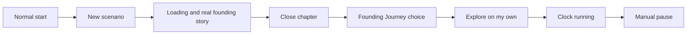
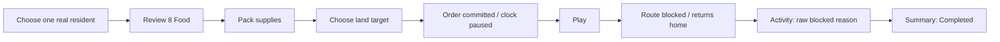

# Journey and empathy maps — current-build audit #297

29 October 2026 · informed-agent browser audit · no production implementation.

## Research question and evidence limits

Can a player get from an intention to a clear decision, actual consequence and
safe return, without learning the development structure of the game?

These maps combine **R: observed agent actions**, **S: inspected source**, and
**HYP: an explicitly unvalidated player-needs hypothesis**. They are not interviews,
think-aloud transcripts, independent-player tests or satisfaction scores. No
fictional quotes or emotions are attributed to players. The owner's request for
journey/empathy maps before implementation is the research brief, not a usability
result. #300 still owns uncoached participants and physical-device readiness.

The original review focused on the two menus. Their revised hierarchy is in the
[main report](../ALPHA-PLAYER-EXPERIENCE-AUDIT.md) and [four proposals](wireframes/README.md).
The owner then enabled browser use, so actual journeys were added before any UI
change. This is a small, purposive sample: one new campaign, not an estimate of
failure frequency across islands or players.

## Environment and campaign

- Windows host, ChatGPT in-app browser. Requested desktop viewport 1440×900;
  narrow 390×844; additional start-layout check 852×393. Scrollbar reduces narrow
  document content width to 375 px. Screenshots retain their actual pixel sizes.
- Mouse/keyboard automation at a narrow width activates the existing Horizon
  layout. No touch-input emulation, coarse-pointer landscape, physical iPhone,
  DPR, browser-version or Safari-performance result is claimed.
- Isolated test origin `http://127.0.0.1:5192/fjord-play`. No existing user campaign
  or public Site was replaced. The unrelated LAN marine branch was untouched.
- Main baseline `4086baac26c6953b879b439546b68f2406ca767a`; fresh Vite production
  build of its preserved Sites export. Of 1,854 compared inputs, only `src/main.ts`
  differs: the existing Sites transform maps `/` to Fjord and omits lab routes.
  The Fjord modules are unchanged. [Identity/hashes](runtime/build-identity.json).
- Real new campaign seed **2089668634**, island **112**, goats, 10 founders,
  initial 15 Food / 5 Materials. Names, relationships, events and mission results
  came from normal game commands. No edited save, guaranteed discovery or extra Food.
- Sound remained off; performance preference started Off, Compact was deliberately
  enabled on the start page and switched back Off. Ordinary and technical states
  are [separately captured](runtime/README.md).
- Browser download/file-picker transport took unusually long. Those tool waits
  are **not game load times**. No journey timings or first-ten-minute promise is
  inferred from them.

## A — Arrival: choose play and understand the handoff

| Stage / player job | Actual entry and action (R) | Information / outcome (R) | Need to validate (HYP) | Proposal / owner |
| --- | --- | --- | --- | --- |
| Choose a start | Open clean `/fjord-play`. Continue and same-founders restart are disabled; choose **New scenario**. | Reasons are shown for disabled starts. Loading diagnostics and performance selector share the normal page with play choices. | A first-time player should identify one ordinary way to begin without deciding whether a technical test is needed. | New game primary; replay inside it; Help & support → secondary Diagnostics. #298. |
| Wait with context | Loading shows a real island/founding chapter. | Founder names, occupations, existing partnership and goats are explained. Ordinary loading has no diagnostics disclosure. | Does the story explain enough while preparation proceeds? No loading optimization is requested. | Preserve #259/#263 handoff; do not rebuild onboarding. |
| Enter the world | Close the founding chapter. | **The Founding Journey** offers Guide me / Explore on my own and explicitly explains clock intent. | Does a new player understand autonomous residents versus their own role? | Keep the existing optional guide; validate with uncoached users in #300. |
| Choose autonomy | Choose Explore on my own, then manually pause. | Run control changes to **Pause simulation**; manual pause changes it to **Start simulation**. | Ability to inspect safely and resume deliberately. | Preserve clock intent across all proposed menus. #298. |

**Observed result:** new campaign entered successfully. The Guide me branch was
not traversed in this run. [Start](runtime/01-start-desktop.jpg),
[story handoff](runtime/04-founding-over-world.jpg),
[choice](runtime/05-onboarding-choice.jpg).

## B — Establish: make one real, comprehensible settlement decision

| Stage / player job | Actual entry and action (R) | Information / outcome (R) | Need to validate (HYP) | Proposal / owner |
| --- | --- | --- | --- | --- |
| Find a person | Settlement → Niilá (29). | Existing card shows Farmer, productivity 44%, fit 89%, household and no partner/children. | See the individual and current role before choosing a change. | Keep contextual ownership; no new management hub. |
| Compare work | Change work. | Occupation buttons show fit; Woodworker is 86.3%. | Fit should help a meaningful choice; distinguish aptitude from immediate output. | Existing work chooser is a positive baseline. No repair selected from this attempt. |
| Act | Choose Woodworker. | Immediate action, **no separate confirmation step**. Card becomes Woodworker, materials, 32% productivity, Assigned career; “Occupation updated.” | Understand the action applied and where its consequence appears. | Keep truthful immediate consequence; do not invent a cost/review dialog. |
| Return | Open Expeditions from established navigation. | Leaves the person card for the existing workspace. | Predictable movement between context and global navigation. | Preserve access and selection expectations while #298 consolidates duplicate entries. |

**Observed result:** valid real assignment, not just an inspected button. No
construction purchase was attempted; initial 5 Materials was not inflated to
make a shelter upgrade possible. [Consequence](runtime/07-work-consequence.jpg).
This sample does not prove long-term economic benefit or player comprehension.

## C — Discover: understand risk, send a real group and interpret its result

| Stage / player job | Actual entry and action (R) | Information / outcome (R) | Need to validate (HYP) | Proposal / owner |
| --- | --- | --- | --- | --- |
| Prepare a crew | Expeditions → New group → select Minmantė. | At home, one selected; **8 Food**, 8 per resident, paid once. “Test supplies” and Pillage equipment are also present although no rival is known. | Start with the exploration task without interpreting later equipment/test material. | Task-specific relevance is an inspection point; no removal without ability mapping. |
| Review cost | Prepare expedition. | Dedicated summary: 8 Food, one resident, shared travel/exploration/return pack, unused supplies discarded, clock stays paused. Back has default focus. | Know the price and cancel before paying. | Preserve this existing explicit quote/back flow. |
| Commit and aim | Pack supplies → Group 1 controls → click apparent walkable land in the visible world. | Food 15→7; target click commits the order; toast says the group set out. No additional target-confirm dialog. Clock stays paused until Play. | Know whether the target is only a preview or a committed journey. | Map the actual state transitions, not a made-up confirmation flow. |
| Travel and recover | Press Play; inspect Activity Center after the group ends. | It returned with **outward-route-blocked**. Historical detail: Year 800, tick 526; later summary: exploration ended **Completed**. No sighting was recorded. | Distinguish successful exploration from safe termination; understand the next available action. | **R01 → #299:** one consistent outcome/explanation and actionable return path. Do not change Core pathfinding or pack rules here. |
| Follow consequence | Open blocked-return activity. | Historical record retains Minmantė; says live destination unavailable, record retained. Open recorded family is available. | Reach the current group when useful, or understand clearly why only history remains. | Reproduce on another route before choosing a specific UI repair. |

**Observed result: partial goal.** Payment, order, actual stepping and safe return
were exercised; successful discovery was **not** demonstrated. This is an observed
failure/recovery path, not a fake mission or evidence all routes fail.
[Quote](runtime/08-expedition-quote.jpg),
[committed paused order](runtime/09-expedition-order-paused.jpg),
[outcome list](runtime/11-expedition-return-reason.jpg),
[historical detail](runtime/12-expedition-historical-detail.jpg).

## D — Connect: discover a real relationship, then return to the world

| Stage / player job | Actual entry and action (R) | Information / outcome (R) | Need to validate (HYP) | Proposal / owner |
| --- | --- | --- | --- | --- |
| Inspect identity | Settlement → Leofgifu (34) → Personal history. | Card lists Hallrik Eiriksson as partner; factual arrival partnership record links to Saga Book context. | Connect character, relationship and recorded event without guessing which book owns it. | Naming consistency is an inspection question, not a reproduced navigation failure. |
| Broaden context | Existing Clan Book nav → Family Tree. | Founders and dashed partnership links; select Leofgifu. | Understand where the individual fits in the community. | Reuse #287; no second family system. |
| Read relations | Selected Family Tree card. | Hallrik Eiriksson is a current partnership; parents unrecorded, no recorded children. | Distinguish missing records from missing relatives or future-generation promises. | Preserve factual limits. |
| Return | Close Clan Book. | Focus returns to Clan Book navigation; the selected Leofgifu card is retained in the world. | Keep orientation and the inspected person. | Positive sampled return behavior; retain during #298 changes. |
| Narrow layout | After import, inspect retained Leofgifu summary → Personal details; close menu with Escape. | Compact card expands to full details; menu close leaves **Start simulation** (paused). | Reach family detail on a small screen without accidental world input. | Width-layout check only; real touch gestures remain to test. |

**Observed result:** actual existing relationship, Family Tree selection and return
succeeded. [Tree/card](runtime/10-family-tree-person.jpg),
[narrow details](runtime/21-personal-details-narrow.jpg).
No new birth, wedding or forged family event was required.

## E — Continue: protect progress and return without losing control

| Stage / player job | Actual entry and action (R) | Information / outcome (R) | Need to validate (HYP) | Proposal / owner |
| --- | --- | --- | --- | --- |
| Find saving | Hamburger → scroll → Campaign → Save locally. | “Campaign and exact Fjord saved locally.” Save sits beside raw Core export and generation/restart inputs. | Recognize ordinary saving without understanding engine formats. | Save game / Load game first; developer Core JSON inside secondary Diagnostics. #298 / #284. |
| Keep a file | Export Fjord campaign. | Actual `fjordside-campaign (1).json` downloaded; preserved in this audit as `campaign-2089668634.json`. | Know this differs from browser-local and raw Core data. | Keep truthful labels; #284 owns complete portable fidelity. |
| Load checkpoint | Load locally. | Genuine restore; **Shared campaign loaded, paused.** Leofgifu and 9 Food / 5 Materials / 10 residents / 3 livestock retained. | Safe, deliberate continuation, not silent resume. | Preserve rollback and clock intent; this sample is not full save-parity certification. |
| Return/import | Reload → Recover or import a campaign → Import campaign → choose this downloaded file. | Returns to start with **Imported campaign**; Continue is still required. Continue opens the actual game paused with Leofgifu retained. | Understand whether import selected a candidate or already started play. | Clarify handoff and keep validated activation owner; do not bypass protection merely to shorten flow. |
| Seek help/feedback | Inspect normal hamburger/start and source inventory. | No Give feedback destination configured or exposed; technical diagnostics remain available. | A clear place to get help or report a problem without a fake CTA. | Show conditional feedback position in proposals only. Owner-configured URL required before shipping. #298. |

**Observed result:** ordinary local save/load, file export/import and Continue
worked for this campaign. Invalid files, storage failure, replacement-cancel,
rollback failure paths and complete campaign equivalence remain untested.
[Local save](runtime/13-save-local-result.jpg),
[restore](runtime/14-restored-local.jpg),
[returning entry](runtime/15-returning-start.jpg),
[recovery](runtime/17-recovery-narrow.jpg),
[import pending Continue](runtime/18-imported-before-continue.jpg),
[restored narrow game](runtime/19-import-restored-narrow.jpg).

## Empathy maps — hypotheses grounded in the observed touchpoints

“Says” below contains only evidence available in this study. “Thinks/feels” are
research questions, **not player quotes or diagnosed feelings**. Validate them
with unfamiliar people in #300; this agent knows the source and is not such a tester.

| Situation / goal | Says / does — evidence | Sees / receives — R | Thinks / feels — HYP to test | Need / design response — proposal |
| --- | --- | --- | --- | --- |
| First arrival: start safely | Owner asks to optimize flow before implementation; agent chooses New scenario. No novice quote collected. | Disabled Continue/replay, normal diagnostics, story, optional guide. | Is it clear which choice begins ordinary play? Does the story invite attention without uncertainty about time? | One New game flow; context before options; retain Guide/Explore choice and truthful clock explanation. |
| Community care: make an informed decision | Agent inspects Niilá and changes one occupation. | Fit list, direct action, updated role/productivity and status. | Can a newcomer predict a useful change and recognize it applied? | Keep individual context and consequence adjacent; no second management hub. |
| Expedition: commit resources with confidence | Agent pays real 8 Food and receives a route-blocked return. | Clear pack quote, then a technical reason and “Completed” summary. | Might safe termination be mistaken for a successful expedition? Is the cost/result relationship understood? | Consistent outcome wording and next step; preserve actual losses/rules. R01 candidate. |
| Legacy: care about a person | Agent follows a real partnership to the Family Tree and closes it. | Same names/relationship; selected card survives return. | Does this support connection rather than feeling like unrelated records? | Preserve person/reader context; validate language and orientation with participants. |
| Returning player: protect prior effort | Agent saves, downloads, imports and presses Continue. | Local-versus-file distinction is implicit in technical labels; import has a second handoff. | Is progress believed to be protected? Does “imported” imply already playing? | Routine Save/Load at top; explicit storage scope, replacement review and import handoff. |
| Technical tester: diagnose deliberately | Agent opens diagnostics mode and enables Compact, then Off. | Explicit test wording and live technical overlay, separate from ordinary state. | Can a tester reach evidence without making everyone navigate test controls? | One Help & support entry; secondary Diagnostics, reachable before play. No diagnostic removal. |

## Flow decisions to review before implementation

1. **Routine intent before capability list.** Start with Continue/New/Load; game menu
   with Save/Load/Settings/Help. Keep both browser and file operations, but not raw
   Core data at the same player-facing level.
2. **One help destination, progressive disclosure within it.** Controls, problem
   help and quiet credits live there; Diagnostics requires a further deliberate
   open. Keep genuine recovery errors immediate and pre-start tests available.
3. **Protect session intent.** Closing/back does not resume time; new/replay is a
   visually separate lower section. Return to start stays conditional until safe
   handoff exists. Seed/replay remain legitimate player choices.
4. **One responsive time rule.** Desktop header owns Play/Pace/+1 Year. Horizon
   header keeps Play/Pace, and its existing direct +1 Year overflow row remains
   in the menu. No duplicate desktop Time submenu.
5. **Explain the real expedition outcome.** R01 is the only presently proposed
   non-menu repair. Reproduce and bound it before choosing implementation. No
   invented second/third problem to fill a quota.

The [throwaway flow prototype](prototype/README.md) exercises start/help/back,
paused-session close, replacement-cancel and the distinction between imported
candidate and activated session. It is a proposed navigation model, not evidence
those screens already exist or a replacement for the real journey attempts.

## Remaining evidence before acceptance

- Successful real discovery and return on a reachable target; repeat R01 to bound it.
- Physical touch, coarse-pointer landscape, safe areas, text scaling, gesture
  leakage and full keyboard/focus/hit-target sweep. Narrow screenshots alone do not pass these.
- Invalid-file, storage-error, cancellation and failure rollback journeys; full
  portable-save parity remains #284.
- Uncoached first-time and returning users, including actual statements and
  comprehension, for #300. Do not infer fun or desirability from these agent checks.
- Owner review of the proposed hierarchy/flow. No #298/#299 production change,
  merge or release is authorized by this document.
