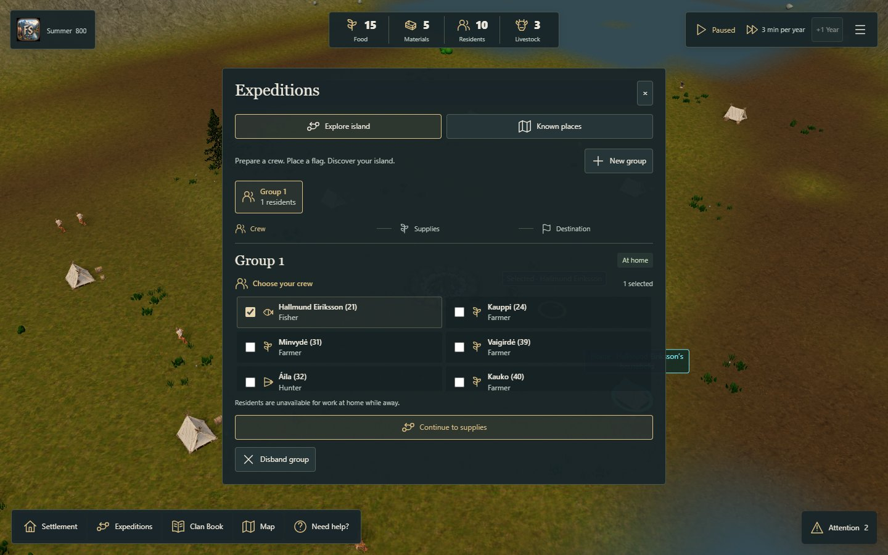
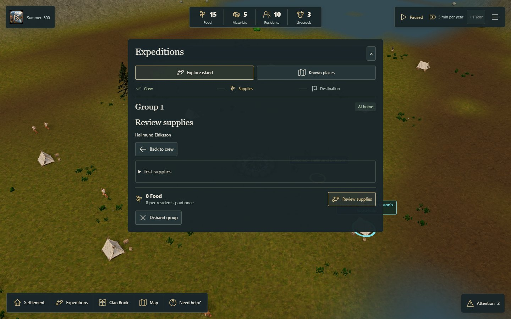
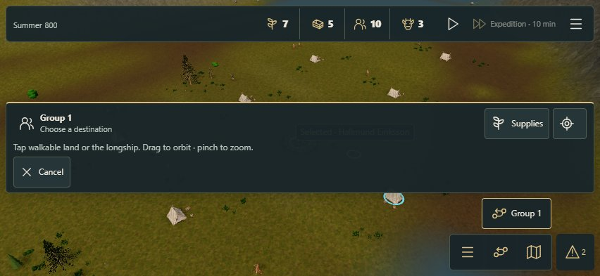

# Guided expedition preparation — owner-selected variant A

Implements the owner's preference for [variant A](https://github.com/sidesliders1983/Pillagers/blob/d5b1d8f4708d84e9cee1caad433f8d5ee2e78448/docs/ux/expedition-menu-prototype/review-decision.md): crew → supplies → destination. This rewrites the production presentation around the existing owners; the throwaway prototype/state model is not imported.

## Behavior and ownership

- Crew selection leads to a separate supplies step. Continue and Back do not issue Core commands, change selection or unpause time.
- Review supplies retains the existing exact quote and confirmation revalidation. Normal packs still cost 8 Food per actual resident; two residents cannot pack with the original 15 Food. Test supplies remains a deliberate secondary disclosure with the existing supported override.
- After one real payment, the destination toolbar is visible immediately. Valid map selection still issues the existing order immediately; cancelling a map choice retains the paid pack and never refunds or charges again.
- Explore island and Known places have one selected group. The mission panel's independent second selector is omitted only in the integrated workspace; its standalone contract remains available. Existing home/availability/discovery/equipment/route checks remain authoritative.
- End expedition and Disband group now open bounded confirmation dialogs. Back is read-only. Ending a prepared pack discards unused supplies without refunds. Confirmed disband removes only an eligible home group and preserves mission history.
- The selected group's existing public return reason is used for a factual previous-journey label instead of presenting Completed as success. This is limited to the expedition workspace; it does not rewrite events, fix pathfinding, or complete every #299 Activity Center/Chronicle follow-up.
- The landscape task heading stays reachable while scrolling. On the supplies step, redundant group navigation is hidden; Back returns to the crew/group choice. The global clock remains its existing owner.

No Simulation Core, rules, save schema, RNG or assets changed. The original #297 blocked physical return remains a separate risk; no teleport, forced success, Food refund or rescue was added.

## Executed validation

Source base: `4bbb0e96ccc9bd3c206ecc8d6e6928771e62286a`, the current #298/#314 menu implementation, above main `4086baac26c6953b879b439546b68f2406ca767a`. This is a stacked change; #314 remains separate.

Application code under final browser review: `723ece8812ea9742123f7c13dc40057af89a38db`. The first implementation was `ec7b23980384a12cc06d18c21facbe8d3073f207`; its layout observation led to the bounded sticky-exit fix. Earlier local screenshots remain under scratch/expedition-guided/browser, not relabelled as final evidence.

- Red/green UI slices demonstrated absent crew/supplies navigation, collapsed destination controls after payment, missing shared Known places context, and missing end/disband review before each corresponding change. The final public DOM tests exercise the real GameplaySession/Core, not mocked internal collaborators.
- [Targeted output](targeted-tests.txt): 41 passed, zero failed/skipped across guided UI, expedition costs/history/save contracts, longship controls, mission preparation and equipment. The existing disband test now follows the real new confirmation and additionally verifies that opening review alone does not remove the group.
- [Clean public-assets / TypeScript / Vite build](build.txt) passed at the final application code commit.
- [Actual browser result](result.json): isolated headless Google Chrome 156.0.8078.74; four end-to-end journey categories; no page errors. Desktop 1440×900 and coarse-pointer touch emulation 852×393. This is not a physical iPhone/Safari or novice-player acceptance claim.
- Actual portable exports before/after navigation have identical complete Core and selection. Prepared versus cancelled-map exports preserve the paid pack. End-review Back preserves canonical state. A real one-person pack changes Food 15→7 once; confirmed end/disband leaves 7 Food, no group and the original mission history.







## Reproduce

Use the repository's Node 24 / pnpm 10 setup. Build and preview this branch, then run:

```powershell
$env:PLAYWRIGHT_MODULE='C:/Users/Devoteam/.cache/codex-runtimes/codex-primary-runtime/dependencies/node/node_modules/playwright'
$env:QA_ORIGIN='http://127.0.0.1:5195'
node scripts/qa/check-guided-expeditions.mjs
```

The runner requires externally installed Playwright and Google Chrome; no shipping dependency was added. It uses a separate temporary browser context and an exported QA fixture, not the owner's profile or save. QA_OUTPUT selects its scratch evidence folder. It exercises menus, the file picker, downloads and actual UI actions; no private game hooks or forced mission outcomes.

LAN review: http://192.168.68.100:5195/fjord-play. No merge or Sites publication. Physical device/owner visual review remains separate from CI and emulation. Issue #315's title artwork is a subsequent, separate visual change.
