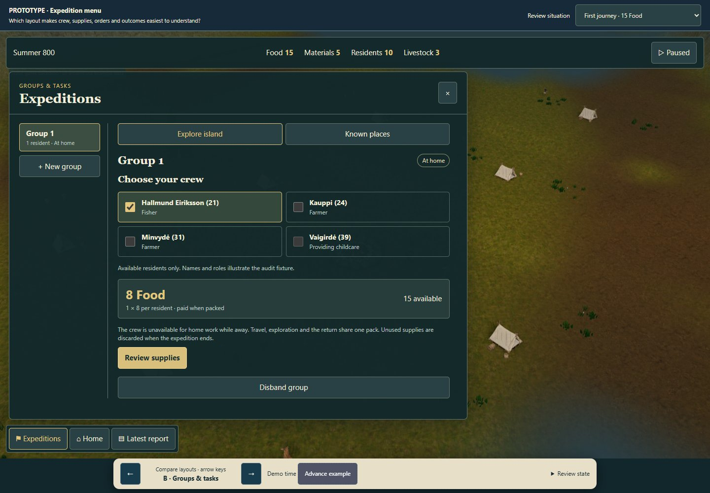
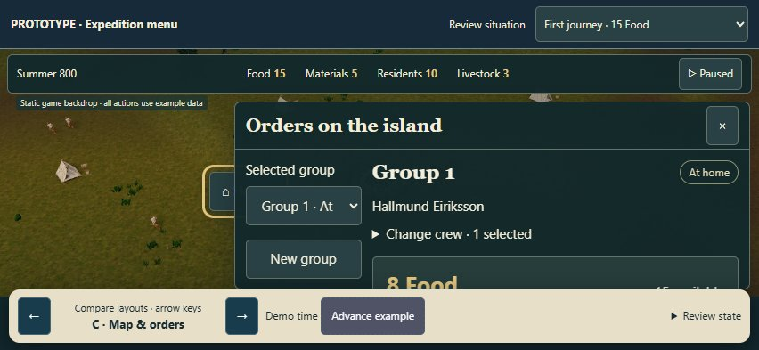

# Expedition menu — clickable design study

30 October 2026. **Prototype only; A is the owner's preferred structure. Implementation has not started.** No expedition UI, Core, save format, balance or default has been changed. PR #314 and main remain untouched.

Question: which structure makes it easiest to choose a group, understand its costs, issue a valid order, and understand where that group actually ended up?

## Open and compare

- [LAN preview](http://192.168.68.100:5194/expedition-menu.prototype.html?variant=A).
- [A — Guided preparation](expedition-menu.prototype.html?variant=A): a focused crew → supplies → destination sequence.
- [B — Groups & tasks](expedition-menu.prototype.html?variant=B): a persistent group list beside the selected group's current task. Fewer step transitions; more information together.
- [C — Map & orders](expedition-menu.prototype.html?variant=C): known-place pins and a compact order sheet; crew editing is secondary.

Use the bottom arrows or keyboard arrows to compare layouts without resetting the example. Arrow keys stay available to inputs/selects and modal controls. Reload retains the variant URL, but resets the in-memory example. The floating review bar is explicitly prototype chrome; it is not a proposed shipping game control.

The top **Review situation** selector provides nine examples: first journey, insufficient Food, exploring, sighted settlement while away, sighted settlement at home, identified settlement, early return, stranding and safe-coast longship. **Advance example** is an explicit review control, requires Play, and jumps through authored examples. It does not run or predict the Simulation Core. Reaching land, safe return and successful Recon in that walkthrough are chosen example outcomes, never proof of reachability or guaranteed success.

A local copy opens directly by double-clicking the HTML while keeping its adjacent evidence folder. No installation is required. To serve the folder on LAN:

```powershell
python -m http.server 5194 --bind 0.0.0.0 --directory docs/ux/expedition-menu-prototype
```

This uses the UI branch of the [prototype skill](C:/Users/Devoteam/.codex/skills/prototype/SKILL.md). A standalone file is intentional: the owner requires review before any production UI edit. The existing `/fjord-play` route is not modified. Real game canvas pixels, the current HUD vocabulary and a populated scene keep the layouts in context. The static backdrop is not a second renderer or live map.

## Evidence and limits

Frozen source: `4bbb0e96ccc9bd3c206ecc8d6e6928771e62286a`, PR #314. Its expedition owners match the preceding main/source baseline `4086baac26c6953b879b439546b68f2406ca767a`. The actual browser observations use the clean application code build `7dfb602`, served at localhost:5193. The unrelated workstation local `main` points to an old revision and was not used as a substitute.

Fresh isolated headless Chrome 156.0.8078.74 loaded the original audit's valid exported campaign via the public file picker: seed 3802174487, Summer 800 tick 500, 15 Food and 5 Materials. No owner browser profile, cookies or active save was used. The observer created a group, selected residents, opened the real supply review, packed one ordinary 8-Food pack, opened the group's map controls, cancelled destination selection and returned to the expedition workspace. No route, discovery, success or refund was forced.

[Five actual UI observations](evidence/current-run-3/observations.json), [current empty menu](evidence/current-run-3/01-current-empty.jpg), [two-person shortage](evidence/current-run-3/02-current-insufficient.jpg), [real packing review](evidence/current-run-3/03-current-pack-review.jpg), [map controls](evidence/current-run-3/04-current-target-controls.jpg), and [prepared group after map cancellation](evidence/current-run-3/05-current-prepared-after-map-cancel.jpg) are preserved. Captured text uses LF with trailing line whitespace removed; original observer text remains in local scratch/revisions/current-observation-raw-text. The public WebGL canvas was exported separately for the backdrop; it is not an altered UI screenshot.

The prototype uses selected example residents and availability. Vaigirdė's childcare unavailability is an illustrative fixture condition, not a claim about the imported campaign. The 24 Food/identified-clan example is also a separate authored fixture, not Food added to a real campaign. Mission examples use the Normal-weather base schedule and no assigned gear. The real public offer must remain authoritative for current weather, equipment, route, duration, risk and final revalidation.

[Journey/empathy maps](journey-empathy-maps.md) distinguish actual observations, source-backed constraints and review hypotheses. No new player interview, emotional quote, physical iPhone/Safari test or uncoached usability validation is claimed.

## Current constraints retained in the concept

- Explore packs cost 8 Food per actual resident. Two people need 16 Food; a fresh 15-Food clan cannot afford that pack.
- Packing pays once before destination selection. Back from review is free; cancelling a later map choice does not undo the already purchased pack. Ending a prepared expedition discards unused supplies without refund.
- A valid map choice commits the order immediately. No extra target-confirmation transaction is invented.
- Opening, closing, Back and changing layout do not unpause the clock or change an expedition order. Only explicit Play and explicit demo advancement do so here.
- Recon/Surveillance/Pillage are separate missions from home. A sighting is not identification. Successful returned Recon unlocks the later actions; Pillage additionally requires a reported opportunity.
- Example mission prices, success and per-resident casualty risk are labelled Normal-weather examples, not live computed offers. No particular animal, sex or age can be selected as livestock loot.
- Group membership and disband are available at home; away/stranded residents are not silently released. No duplicate crew across two groups.
- Stranded is not home, and lifecycle Completed is not proof of success. There is no rescue, replenishment, refund or pathfinding repair in the concept.
- Boarding is condensed and labelled in the prototype. The real game still requires physical arrival/boarding; disembark is shown only in the authored safe-coast example.

## Executed concept walkthroughs

[Final walkthrough record](evidence/prototype-review-final/walkthrough.json): three desktop layouts; shortage; Back before payment; paid-pack cancellation; valid/invalid map choices; close/reopen; away-group Recon lock; example return and separate Recon; early-return and stranded wording; URL switching; all three layouts with coarse-pointer touch at 852×393. No page errors were captured. State is read through the visible review panel's DOM, not private Core hooks. [Direct-file switching and disband/create](evidence/prototype-review-final/file-and-disband.json) also completed without page errors.

The prototype has no automated/unit test suite and was not added to CI. These are recorded browser walkthroughs of a concept, not new Core tests or production acceptance. Earlier exploration and prototype revisions are preserved in the ignored local scratch/revisions folder, including the first observer's mistaken assumption that Cancel was immediately exposed, and the corrected prototype variant switcher.





## Review decision — A preferred

The owner selected A as the preferred structure: a guided crew → supplies → destination sequence. [Decision and scope](review-decision.md) preserve that feedback. B and C remain as comparison material; no hybrid was requested. This preference does not establish that all edge cases or physical-device behavior have been approved.

A is now the design basis for a bounded implementation proposal. Production implementation is a separate next step; this commit records the preference only. #299's existing R01 concerns truthful outcome presentation. The broader menu study follows the owner's new request; it does not silently authorize all of #299 or make the separate M01 return-route defect disappear. No PR, merge, main update or Sites publication is performed for this throwaway design branch.
