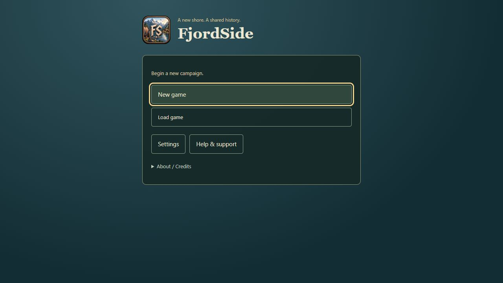
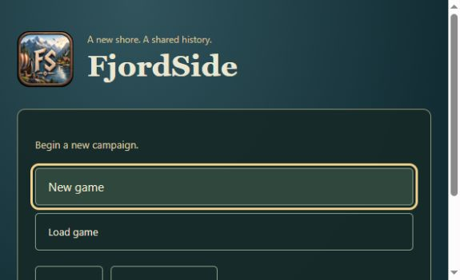
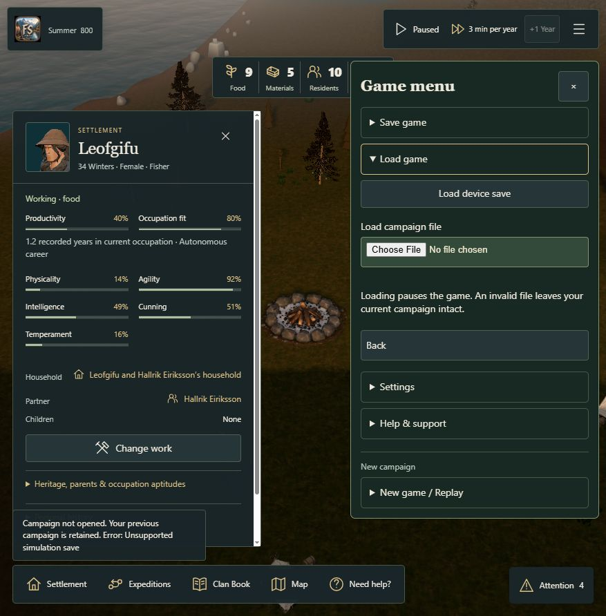
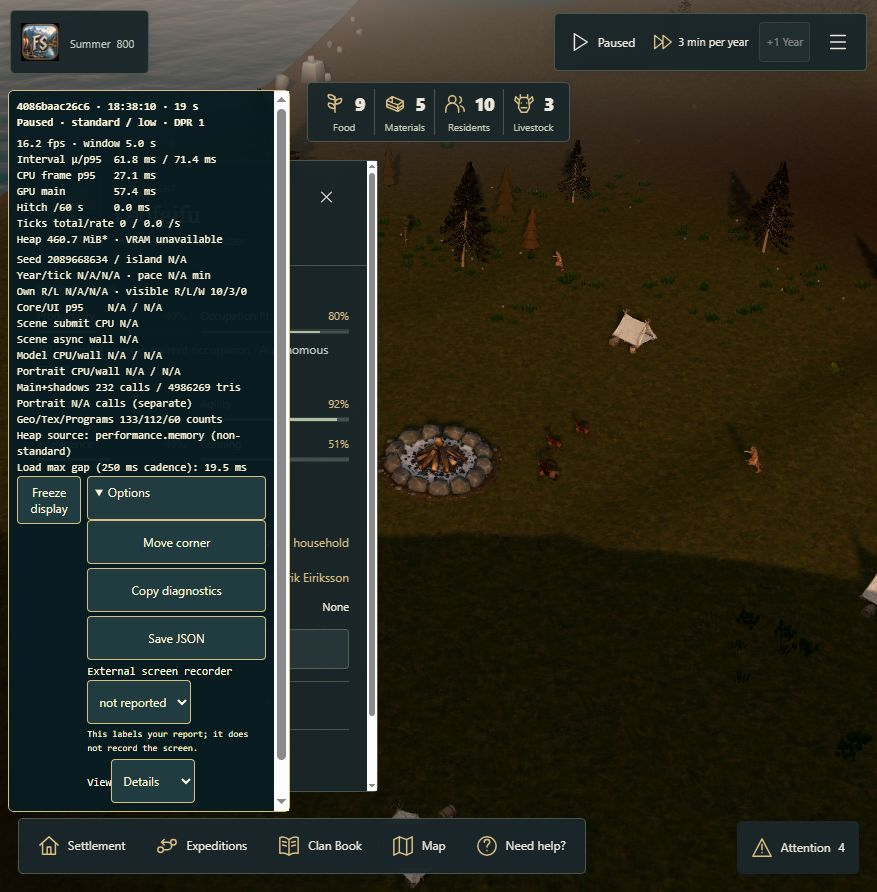

# Player start and session menus — #298

The start screen now leads with beginning/continuing a campaign. The game menu leads with managing the current session. Diagnostics remains available deliberately inside one Help & support entry. This implements the reviewed IA from #297 without importing the throwaway prototype.

> Current review status: [headless Chrome verification](headless/README.md) now passes the native confirmations, real Copy/Save, short-screen close and coarse-pointer touch journeys. It also found and fixed the menu obscuring guidance after confirmed replacement. Earlier evidence below remains labelled by its original build; real feedback configuration and physical/novice readiness remain separate.

## Source and review boundary

- Fresh base: main `4086baac26c6953b879b439546b68f2406ca767a`.
- Implementation code: `2893628d9c3fbc509aa8f977ad04235f4345a754` on `codex/player-menus-298`.
- Audit reference: PR #312, `c3c6e987e5754d9f4b83bb647923ef99d2053f96`. Audit/prototype branches remain separate.
- No Simulation Core, rules, RNG stream, authored historical facts, save schema, assets, dependencies or shipping feature defaults changed. No merge/publication.
- Approved seams: public entry/recovery, menu/settings, diagnostics/export and Core/save/clock parity; desktop and narrow browser journeys.

## Annotated before / after

| Surface | Observed before on main | Implemented after | Why |
| --- | --- | --- | --- |
| Fresh start | New scenario, same-founders restart, recovery, loading test, audio and performance settings share the entry surface | New game / Load game; secondary Settings / Help & support; quiet credits | Make the next player action clear before technical choices |
| Returning start | Source, season, year and raw seed mixed with several start actions | Continue campaign and date; source/seed in Campaign details | Recognize progress without removing reproducibility |
| New game | Competing restart/new actions on landing | New arrival / Replay original founding inside New game; real eligibility/replacement protection | Distinguish a new history from replay; explain that geography can repeat |
| Game menu | Credits, Clan Book, expeditions, quality, controls, load reports and campaign actions mixed | Save game / Load game / Settings / Help & support, then a separated New game / Replay section | Session tasks first; dangerous replacement lower |
| Save/export | Local save, Fjord export and canonical JSON near one another | Device save + portable campaign file under Save game; Core JSON under Diagnostics → Developer data | Do not present partial developer data as a portable campaign |
| Settings/support | Audio/performance injected at menu root | Shared audio under Settings; existing performance/load tools inside Help → Diagnostics | Keep normal preferences visible, diagnostics opt-in |
| Time | Header + responsive overflow | Same desktop header Play/Pace/+1 Year; Horizon header Play/Pace and direct +1 Year overflow | One responsive rule; no new clock owner |
| Gameplay | Redundant hamburger Book/expeditions beside established navigation | Established Clan Book/Expeditions retained; immediate handlers consolidated | Preserve context, avoid an extra hub or selection-clearing detour |

Before screenshots and empathy maps: [audit evidence at reviewed head](https://github.com/sidesliders1983/Pillagers/blob/c3c6e987e5754d9f4b83bb647923ef99d2053f96/docs/ux/alpha-297/runtime/README.md), [journey/empathy maps](https://github.com/sidesliders1983/Pillagers/blob/c3c6e987e5754d9f4b83bb647923ef99d2053f96/docs/ux/alpha-297/journey-empathy-maps.md). Every original item has a destination and owner in [the 67-item action map](action-map.md).



The first actions are visible without opening graphics or diagnostics. Continue is omitted until there is a valid selected campaign. Storage/corruption warnings remain prominent when real.



At the requested 590×360 responsive override, New game and Load game remain reachable; the document scrolls to secondary Settings/Help. This is mouse/keyboard responsive evidence, not an iPhone or coarse-pointer claim.

## Executed verification

**Code/build:** 66 targeted tests passed, zero failed/skipped. They cover entry, campaign start/resume, real recovery/storage seams, delayed/cancelled loading, save/session parity, menu focus/values, HDR, first steps, expedition onboarding, touch camera input and existing Clan Book/Family Tree/wildlife UI. The red/green slices preceded each feature, using the already approved seams. The test log is retained. The final code differs from that test run only by CSS/function-signature formatting. A clean build at the pinned implementation commit then passed public-asset validation, TypeScript and Vite. The existing >500 kB chunk warning remains; no validation was weakened. No formatter is configured; scoped manual style review and git diff --check were used.

**Working-tree browser integration before code commit:**

- Start → Settings → Back → Help → Diagnostics → Compact → real loading test completed in 73.9 s (173 observed resources, 23 settlement models); no game activation or saved-campaign replacement. Actual JSON and result screenshot retained.
- Imported existing QA campaign, Continue, then real paused world with Leofgifu selected, Summer 800, 9 Food / 5 Materials / 10 residents / 3 livestock.
- New game menu visibly presents routine sections first, with no normal Core JSON/performance controls. Save on this device reported success. Load device save restored the same campaign, selection, values and paused intent.
- Load campaign file rejected the supplied invalid fixture with “Your previous campaign is retained. Error: Unsupported simulation save”. Same resident/resources/pause persisted. The screenshot/DOM is retained.
- Quality changed from Low to Standard through the public control. Back closed Settings; Help → Diagnostics enabled Compact/Details. The overlay showed zero simulation ticks while paused. Copy diagnostics produced the retained real report. The report truthfully identifies `4086...-dirty`; it is NOT claimed as a pinned-head performance benchmark.
- Copy last loading diagnostics displayed success, but the browser clipboard adapter returned an empty payload. No empty file is included as proof. Loading-test JSON and performance Copy yielded actual data separately.
- External screen recorder label/help is visible. Off returns to a clean normal HUD without changing selection or time.





These integration screenshots/reports came from the precommit working build. They are retained with that provenance rather than relabelled as final-head browser acceptance.

**Pinned-build browser check and remaining limitation:**

The clean final code build was reloaded in a fresh localhost-origin test tab. Its normal fresh start and constrained-landscape screenshots are retained. The preceding test tab became unresponsive to the browser tool after invoking the existing native replacement confirmation for New arrival. Dialog retrieval, closing that own test tab and native-app fallback failed/timed out. A fresh tab could be read and resized but subsequent clicks (including native About disclosure) did not change state. No exception appeared in that tab's captured error/warn logs. This is a tool interaction limitation, not evidence that the game's buttons passed or failed. The confirmation was not removed or bypassed to obtain a pass. Final-head interactive narrow/Horizon, replacement confirm/cancel, configured external-tab return and full save/download journeys still need a usable browser connection. No physical-device or novice test was performed overnight; the owner is asleep. The earlier owner-reported 5192 touch check applies to main/audit, not this implementation.

## Configuration and readiness

`FJORD_FEEDBACK_URL=https://<owner-controlled-destination>` is read at build time by Vite. Only HTTPS URLs without embedded credentials produce Give feedback; no parameters or campaign/user data are appended. No URL is configured or real survey collection claimed. Tests use a reserved `.test` URL only. There is no feedback backend, tracking, upload or screen recorder.

No Return to start button is presented: safe lifecycle handoff is not implemented. Start graphics are honestly deferred to playing; the same audio owner/controls move between entry and game. Existing explicit diagnostics/query gates and genuine failure recovery exports remain supported. No new navigation destination is invented.

#297 remains open: successful discovery was proven but the confirmed return route stranded in its focused fixture. That M01 mechanical case and #299 R01 outcome clarity are not changed here. #284 retains portable-save completeness; #300 retains uncoached/device/alpha sign-off. This draft is reviewable; these gaps are not an acceptance or release claim.

## Reproduce

Use Node 24 and pnpm 10 from this branch:

```sh
pnpm install --frozen-lockfile
pnpm build
node --test --test-concurrency=2 tests/player-menu-entry.test.mjs tests/player-game-menu.test.mjs tests/campaign-start.test.mjs tests/campaign-start-dom.test.mjs tests/campaign-resume.test.mjs tests/loading-run-entry.test.mjs tests/loading-run-diagnostics.test.mjs tests/shared-settlement.test.mjs tests/performance-overlay-dom.test.mjs tests/playtest-performance.test.mjs tests/hdr-lighting.test.mjs tests/first-steps-dom.test.mjs tests/first-steps.test.mjs tests/journey-mission-dom.test.mjs tests/touch.test.mjs tests/family-tree-dom.test.mjs tests/wildlife-book-dom.test.mjs
pnpm preview:lan --port 5193 --strictPort
```

Open `/fjord-play`. Use the reviewed audit's preserved QA file for restoration. For a clean first-arrival view, use a browser profile/origin with no Fjord save. Never clear a player's browser storage to run this check. In the running test campaign, test Save → Load, invalid file, Settings → Back/Close, Help → diagnostics → Off and New arrival/replay Cancel while comparing paused clock/selection/resources. Test a real owner-configured feedback destination only when supplied. GitHub required checks must independently pass on the draft PR's exact head.

## Later browser follow-up

[Additional executed journeys, canonical save parity and the short-screen repair](followup/README.md) supersede the initial blanket tool-block status above. Earlier working-tree and code-build evidence remains as originally labelled. Native replacement confirmation and virtual-clipboard content still have explicit verification limits. The minimum-height fix has a separate pinned code build and real geometry evidence.
