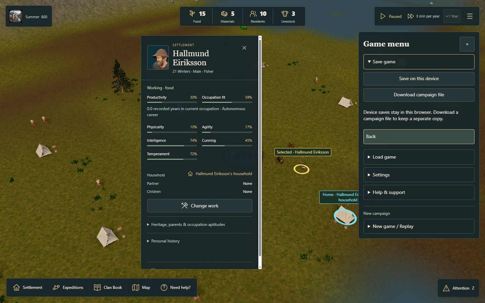
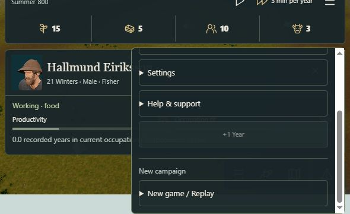
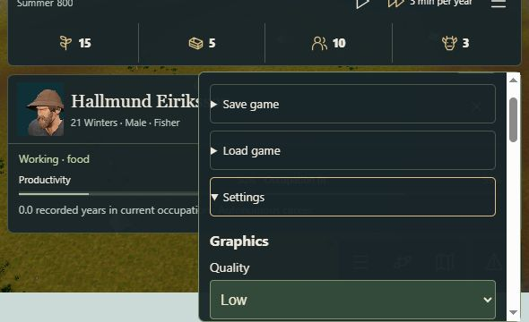
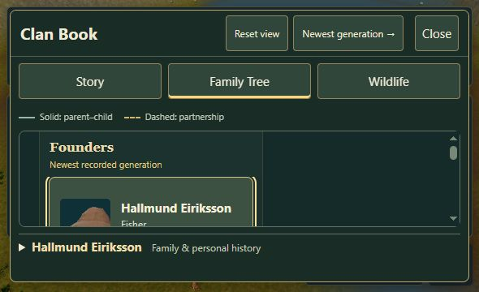
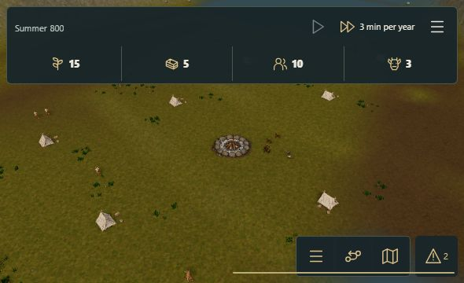
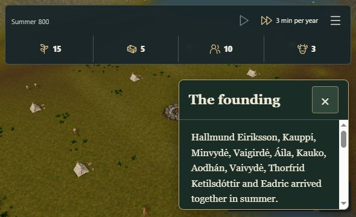

# Browser follow-up and short-screen repair

This follow-up supersedes the initial report's blanket browser-interaction block. The tool recovered temporarily and more real journeys were executed. Remaining limits below are explicit; earlier evidence is preserved.

## Versions and fixture

Menu/start integration ran on the clean code build `2893628d9c3fbc509aa8f977ad04235f4345a754` (also covered by all-green CI on docs head `85cbaa9aaf709dc14aadde21621688a602fe78f7`). A newly observed short-screen defect was then fixed in `cc8ad6295df1b22e84ed65e5d7da292d77ac06f6`: two CSS lines only. Header/menu/engine code is unchanged between those code commits. Its clean build passed; 16 focused menu/start/onboarding tests then passed with zero failures or skips. The geometry check below uses that newer code. Final PR-head CI is a separate gate.

All interactive work used Windows/in-app browser, mouse and keyboard. Requested responsive sizes were 1440×900 and 590×360; screenshot file dimensions are recorded separately in the manifest. No physical touch/coarse-pointer or novice claim is made.

A real New arrival created seed `3802174487`, island 227, Hallmund Eiriksson and nine other residents, two adult does and one adult buck. Summer 800 / tick 500, 15 Food / 5 Materials. Guide me kept time paused. All files here are actual game exports or observer evidence; there were no synthetic state transfers, Core commands, edited saves or hidden browser-state writes.

## Executed journeys

1. Start New game → Back → Settings → Back → Help & support → Diagnostics worked in short landscape. Replay was truthfully unavailable before founding data existed. An actual loading-only test completed in **24,423.9 ms**, 167 observed resources and 24 settlement models; the game did not start or replace saves. The downloaded, unmodified report is `loading-test.json`. The tool took much longer to retrieve one download; that is not game loading time.
2. New arrival through the normal start choices created the real campaign. Help → How to play opened the existing Founding Journey; Guide me left it paused. The primary Clan Book opened the same story and disposed the short founding window. This specifically exercises the relocated Book handler.
3. Selected Hallmund. The game menu showed session actions first. Quality Standard, HDR on/off, sound enabled with Master volume deliberately zero (silent overnight), Back, Close and reopening retained the preferences, selected resident, time and stocks. Low, HDR off and muted audio were restored. Screenshot/DOM records distinguish retained settings from scene state.
4. Save on this device succeeded. Download campaign file produced a real portable Fjord envelope. Importing that exact file restored the selected Hallmund, original geography, paused clock and stocks. An invalid JSON fixture was rejected with the existing retention error. Load device save also restored the same campaign.
5. Diagnostics → Developer data produced the separate raw Core export. **Every field in the original portable file's `campaign` member equals this later Core export**, including RNG, all events, time, identities, animals and stocks. See `core-parity.json`; this is stronger than comparing only header counters. These are unmodified UI exports, not observer mutations.
6. Compact/Details, Freeze/Unfreeze, Off and Save JSON remained reachable. `saved-performance.json` is the real downloaded report; its build marker is clean `2893628...`, ticks remain zero, and External screen recorder is correctly labelled off. This is functional evidence, not a performance benchmark. Copy displayed success, but the browser tool's virtual clipboard was empty; an actual Control+V attempt explicitly reported that its virtual clipboard had no data. OS-clipboard content cannot be independently verified here. Existing automated copy-port/report tests passed; no report was fabricated or pasted by hand.
7. In Horizon landscape, Back, Close, Settings/effects and the direct +1 Year overflow were reachable. +1 Year retained its existing disabled eligibility. Expeditions opened its existing workspace without clearing Hallmund's selected-world marker. The responsive drawer opened Clan Book → Family Tree; a named founder could be selected and the book closed. Time stayed paused. Camera wheel/pointer handlers remain scoped to the canvas; header key events are stopped at the existing owner. No new world command was dispatched by these menu actions.

## Actual short-screen bug and bounded repair

The normal new campaign exposed a layout defect in the inherited loading CSS on the 590×360 viewport. The loading grid measured the founding panel at **2 px** (its border). `FoundingBookWindow.release()` correctly retained that measured height, but the released card then kept only those 2 pixels. The close button was clipped; clicking its offscreen DOM location could reach controls behind it. This was an observed red browser check, not an invented regression test.

The repair adds `min-height:min(240px,60dvh)` to the released card. It preserves normal measured size, the existing 60dvh cap, text scrolling, close owner and authored text. No new UI engine, game rule or balance value was introduced. No CSS-text assertion or mirror test was added.

To repeat the collapsed measurement without touching preserved campaigns or opening another native replacement confirmation, the green geometry run used the **existing public QA start entry** on a clean test origin: `/fjord-play?entry=qa-new&seed=3802174487`. The viewport was set during preparation. This is a real new campaign with the same ordinary rules; it is not proof of the normal menu's replacement/cancel flow. The exact UI measurement still reported `--founding-book-height: 2px`, while the rendered card became **216 px** high. Its 44×45 px close button lay fully inside the 590×360 viewport. That geometry is captured in `founding-landscape-fixed.json`. A subsequent click could not be verified because the tool's global native-dialog problem had recurred; visual geometry and click acceptance are not conflated.

| Measurement | Before | After |
| --- | --- | --- |
| Retained measured height | 2 px | 2 px |
| Rendered card height | 2 px | 216 px |
| Card top/bottom | 346 / 348 | 132 / 348 |
| Close control visible in viewport | clipped | 44×45, top 143 / bottom 188 |

## Remaining acceptance and tool boundary

The browser tool again stalled at the native in-game New arrival replacement confirmation: Input.dispatchMouseEvent timed out, while the documented dialog API returned no dialog. A visible own QA tab and the other documented tab API did not resolve it; the stuck own tab could not be closed through its API. No native confirm/cancel success or new-seed activation is claimed. Existing startup confirmation/cancel tests and the literal game confirm-before-seed gate remain intact. Confirmations were not removed, auto-accepted or replaced merely to get a pass.

Likewise, no real feedback endpoint was supplied. The unconfigured CTA is absent, HTTPS configuration tests pass, and no external-feedback return journey or live collection is claimed. Physical touch, uncoached journeys and external-alpha sign-off remain #300 work. #297's stranded return case and #299 outcome presentation are untouched.

The first attempt to copy a normal campaign download found an older file. It was detected by checking its timestamp/identity, discarded from this evidence, and replaced with the exact new download handle (Hallmund's campaign). Only the correctly identified file is included. Download/file-picker tool waits are not presented as game latency.

The PR remains draft with these limits. No merge or release is authorized or performed.
