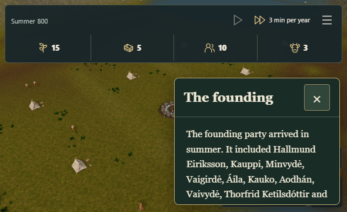
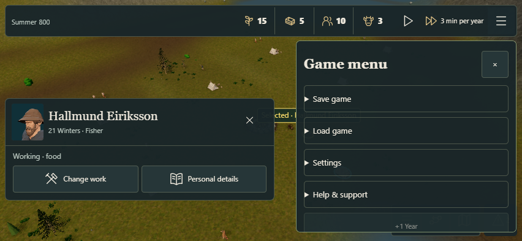
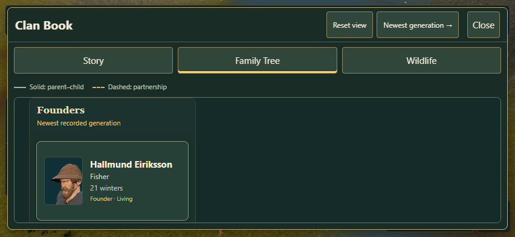

# Isolated headless Chrome verification — #298

The owner explicitly requested a headless Chrome route after the interactive desktop tool stalled. Chrome and Playwright were already installed. This run uses real Google Chrome 156.0.8078.48, Playwright 1.62.1 and Node 24.22.1, with Chromium sandboxing enabled. A fresh browser context, temporary profile and downloads stay on D:. It does not attach to the owner's Chrome or use their cookies/saves. Clipboard permission is scoped to this temporary test context and the local QA origin.

[Chrome Headless documentation](https://developer.chrome.com/docs/automation-and-testing/headless) describes unattended operation without displaying the browser. The execution computer must remain awake; headless does not continue through host sleep. Lid closure may disrupt the interactive desktop, but these tests do not establish it as the cause of the earlier tool failure. No Windows power/lid policy was changed.

## Executed result

**All eight public-UI journeys passed**, with no page errors. The machine-readable [result](result.json) records versions, source marker, runner hash, dialog messages/decisions, assertions, screenshots and timings. Timings are QA observations, not a performance benchmark. The test used ordinary entry/recovery/menu controls, native Chrome confirmation events, downloaded files and the browser clipboard API; no private game hooks or forced simulation state were used.

| Journey | Result |
| --- | --- |
| fresh start and real file recovery | Passed |
| portable baseline and device checkpoint | Passed |
| native New arrival cancellation keeps seed and complete Core state | Passed |
| short-screen Back and Close retain manual pause | Passed |
| real Copy and Save diagnostics through an isolated permission scope | Passed |
| native founding replay preserves original founders and closes on short screen | Passed |
| native fresh arrival changes seed and device checkpoint remains recoverable | Passed |
| coarse-pointer landscape menu and Family Tree touch navigation | Passed |

The application build was pinned to `7dfb602` (full SHA in result.json). The runner SHA matches the committed test script. Later documentation/test-only commits do not alter that application code. Initial 590×360 mouse/keyboard checks and 852×393 Chrome touch/coarse-pointer emulation are explicitly distinct from a physical iPhone/Safari test.

The real before/after portable exports are retained. Cancel keeps the entire Core object and selection unchanged. Replay preserves the original founders, uses the same seed and can be closed on the short screen. Confirming New arrival changes the seed. Loading the manually saved device checkpoint then restores the original complete Core and selection. The validated island pool may legitimately repeat an island; geographic uniqueness is not asserted.

Copy diagnostics produced parseable clipboard data with the expected build, seed and recorder label. Save JSON produced the matching browser report. Committed text uses LF, including the copied JSON; the original Windows clipboard byte length and SHA-256 are recorded separately in the manifest. JSON content is unchanged. These headless browser API results supersede the earlier desktop tool's virtual-clipboard limitation; physical-device clipboard behavior remains separate.

## Real replay-flow defect found and fixed

The first two headless attempts reached the actual replay confirmation and accepted it, then failed because Guide me was not reachable. The [red observation](replay-red.json) records that the game menu remained open while guidance existed. The existing CSS intentionally hides the guide when the menu is open. The [failure image](replay-red.png) shows that obstruction.

The bounded fix closes the game menu **after** replacement is confirmed. Cancel leaves the session and menu intact. No confirmation was removed or auto-accepted in production, and no Core/rule/save schema changed. The subsequent full run passes replay, founder preservation, the short-screen close action and guidance.







## Reproduce

Build a clean checkout first and serve it at the QA origin. Node 24, pnpm 10, Playwright 1.62.1 and installed Google Chrome are the recorded versions. Playwright is an external QA tool, not a new shipping dependency. On this workstation the bundled module is available at the path below; another machine can set PLAYWRIGHT_MODULE to its own installation.

```powershell
pnpm build
pnpm exec vite preview --host 0.0.0.0 --port 5193 --strictPort
# In a second terminal:
$env:PLAYWRIGHT_MODULE='C:/Users/Devoteam/.cache/codex-runtimes/codex-primary-runtime/dependencies/node/node_modules/playwright'
$env:CHROME_PATH='C:/Program Files (x86)/Google/Chrome/Application/chrome.exe'
$env:QA_ORIGIN='http://127.0.0.1:5193'
node scripts/qa/check-player-menus-headless.mjs
```

Output defaults to a fresh dated scratch directory. QA_OUTPUT selects an explicit new directory. QA_BUILD can pin an already-built code commit when only the runner/documentation changed; otherwise the expected marker comes from the current clean Git head. QA_CAMPAIGN can select another valid test file. Use test data, not a player's only save.

Headless verification resolves the native dialog, final close-click and browser Copy/Save acceptance gaps from the previous report. An owner-configured real feedback URL is still absent, so the CTA remains hidden as specified. Physical device/novice testing belongs to #300. #297's failed physical expedition return and #299 outcome clarity remain separately documented; this change does not alter navigation or refunds. No merge or publication is performed.
