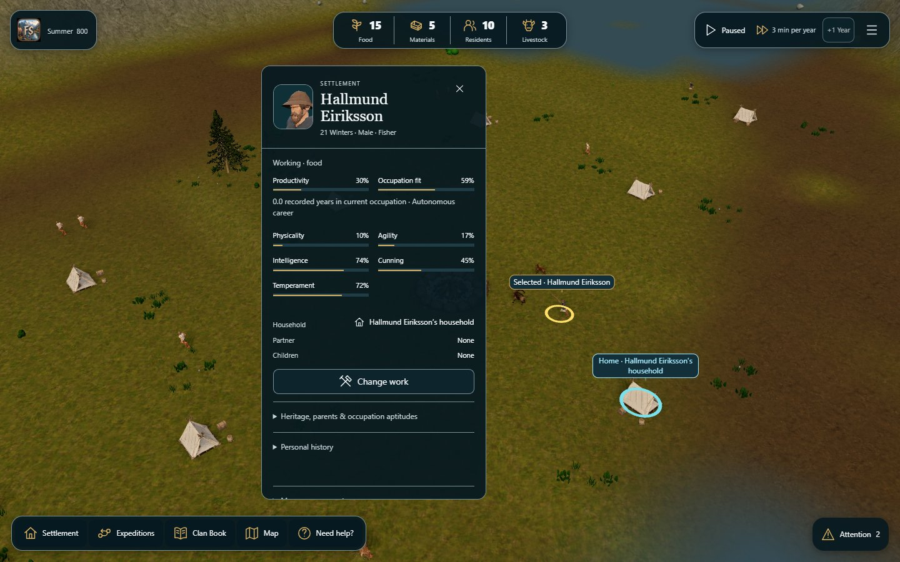
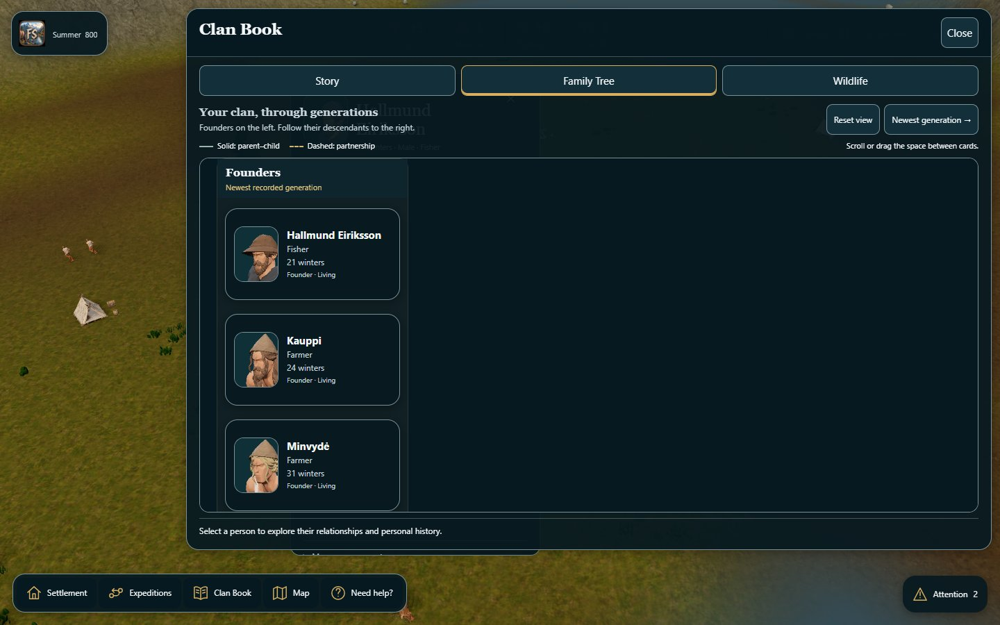
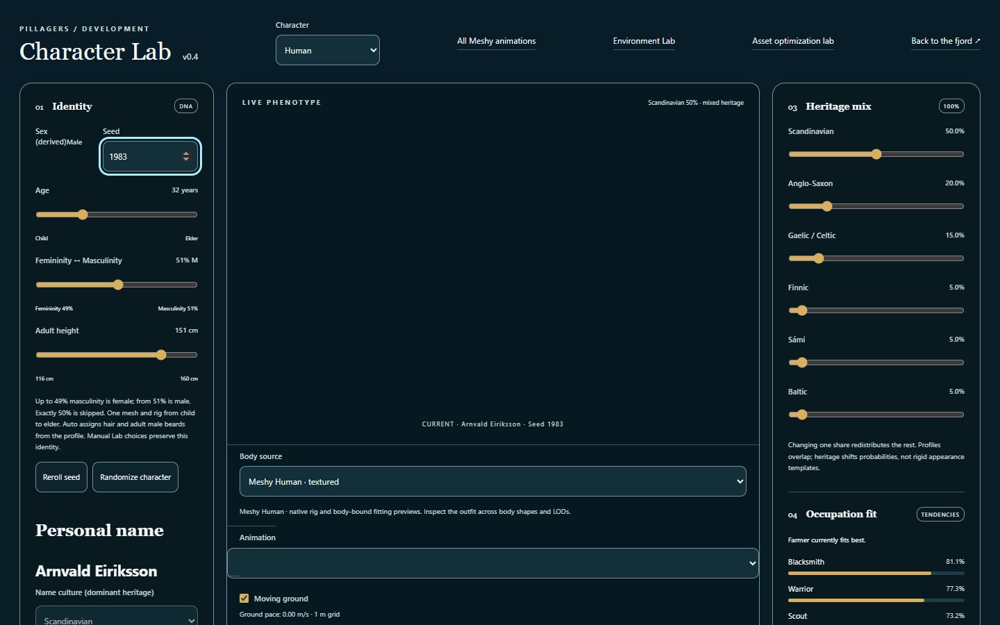
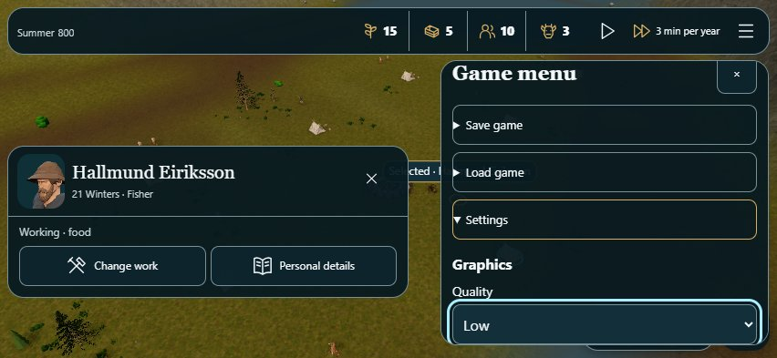

# Shared design style — executed evidence

The owner approved the #315 entry style and asked to record it and apply it consistently throughout the app. The current contract is [DESIGN-STYLE.md](../../DESIGN-STYLE.md); its runtime palette and native-control defaults are in `src/ui/fjord-theme.css`. AGENTS.md directs future UI work to these sources.

## Scope and source

This is a styling change over #317 (`1b216915e073373ffb785bfc07a31b548662a3c1`). Final application source/build: `cb7c060d832702c05336b440912bebcffb5ea40d`, branch `codex/shared-fjord-design-style`. The app review server is `http://192.168.68.100:5197/fjord-play`. Earlier review servers remain intact.

The new palette is shared by entry/recovery, desktop/mobile HUD, menus, resident/house details, expeditions, Activity Center, Clan Book/Family Tree, merchant/mining, loading, ceremonies/cinematics, performance/audio controls, all six dedicated labs and the older settlement/world UI. Primary copy is white, supporting copy cool white, panels 94% opaque navy, cards 92%, with gold selection/accent and separate cyan keyboard focus. Control/card/panel radii, shadows, font families and disabled appearance have named roles. Entry art remains scoped to entry; labs do not fetch it.

Application changes are CSS plus matching initial HTML/web-manifest theme colors and one presentation-only Character Lab readout: actual DNA hair color is retained as a swatch beside a white hex label. Core, rules, RNG, 3D models/materials, asset loading, event handlers, save format and UI navigation owners are unchanged. Data colors and scene geometry are intentional exceptions, not another decorative palette. Meter fills, low supplies, production labels, relationships and deceased indicators remain meaningful.

`final-build-identity.json` verifies the final served entry bytes against the review build and its embedded clean revision. `build-identity-8f7d641.json` pins the earlier full lab/game run and frozen baseline. The canonical `GameplaySession-D3_yXot7.js` bundle is byte-identical before/after: SHA-256 `c41f614577104f64ce7714ce6bafa01ee60793f432c16581e99d27d747be3419`. The manifest pins committed source bytes and retained evidence. Later evidence-only commits do not relabel these application builds.

## Executed checks

Headless Chrome 156.0.8078.74 in isolated Windows contexts; desktop 1440×900, narrow lab layouts 390×844, and real coarse-pointer/touch emulation at 852×393. No physical iPhone/Safari acceptance is claimed. Screenshots were inspected visually. Lab captures demonstrate the mounted public UI and its controls, not a new model/graphics qualification; some initial previews are still loading in those captures.

- On `8f7d641`, all seven lab/settlement routes opened their actual UI with shared white/cool-white copy and dark surfaces. Relevant public fields focused with cyan outlines. Narrow pages had no horizontal overflow; no lab requested the entry background. Character Lab retained the real DNA color value while its label stayed white.
- The same run completed actual file import → play → Settings → Settlement → resident → Family Tree → Close on desktop and touch. Stocks remained 15 Food and the clock stayed paused; no browser page error occurred.
- Visual inspection found the inherited Clan Book button rule masking the selected-tab boundary. The final CSS adds the existing book owner to the selected-tab selector and restores the gold inset underline. The final `cb7c060` desktop/touch journeys repeat the complete flow and assert both the real `aria-selected` state and its gold boundary. Food and pause state remain unchanged. This repair does not change the tab's event owner.
- The frozen baseline is the retained #315 build `d61f5082e8cfb96ede6b50d1d1caf66098485319`, not main. Its corrected desktop/touch comparison passed with the same fixture and unchanged 15 Food/pause state. Before/after computed colors, alpha, radii and fonts are retained.
- The existing full entry browser check passed on `8897c15`: five viewports, valid/invalid import, replacement Cancel, Settings/Back focus, Help/Diagnostics, slow/missing art, text-size approximation and pre-choice loading budget. Later changes are the initial paint metadata, the isolated Lab color swatch and selected Book-tab styling; entry control ownership and palette are unchanged.
- The existing expedition browser check passed on `8897c15`: full Core/selection equality during navigation, one 15→7 Food payment, safe paid-pack map cancellation, end/disband/history and landscape touch preparation. Its raw result keeps that build identity.
- Nineteen existing public menu, entry/save, Family Tree, wildlife-book and guided-expedition tests passed on final application source `cb7c060`, with zero failures or skips. The log is `tests-final.txt`.
- Final public-assets validation, TypeScript and Vite build passed on `cb7c060`. Existing large-chunk warnings remain visible; they were not disabled. No new dependency, font, image, blur or render loop was added.

The first two QA attempts targeted the visible word `Close` instead of the existing accessible name `Close Clan Book`, then omitted reopening the mobile navigation before choosing Clan Book. Both failures occurred on the unchanged baseline as well. The runner now uses the public accessible name and normal touch navigation. The original failure records are retained; no application behavior or validation was weakened to satisfy the runner.

There is no repository formatter configured. Existing file formatting was retained, new code was reviewed manually, and `git diff --check` passed. Historical measurement reports and original assets were not changed. Exact-final-head GitHub CI remains a separate draft gate; no merge or Sites publication is performed here.

## Reproduction

From this branch with its existing Node 24 / pnpm 10 dependencies:

```powershell
pnpm run build --outDir scratch/design-style/dist
pnpm exec vite preview --host 0.0.0.0 --port 5197 --strictPort --outDir scratch/design-style/dist
# In another terminal; installed Playwright, no package changes:
$env:PLAYWRIGHT_MODULE='C:/Users/Devoteam/.cache/codex-runtimes/codex-primary-runtime/dependencies/node/node_modules/playwright'
$env:QA_ORIGIN='http://127.0.0.1:5197'
$env:QA_OUTPUT='scratch/design-style/repeated-review'
node scripts/qa/check-shared-style.mjs
node --test --test-concurrency=2 tests/player-game-menu.test.mjs tests/player-menu-entry.test.mjs tests/campaign-start-dom.test.mjs tests/family-tree-dom.test.mjs tests/wildlife-book-dom.test.mjs tests/expedition-guided-dom.test.mjs
```

To repeat only game surfaces set `QA_ONLY_FJORD=1`. A before comparison needs the frozen baseline server and `QA_EXPECT_STYLE=0`, `QA_BUILD=d61f5082e8cfb96ede6b50d1d1caf66098485319`, plus a different output folder. Never label a rebuilt current checkout as the baseline. QA contexts do not use owner browser profiles or replace owner saves.








