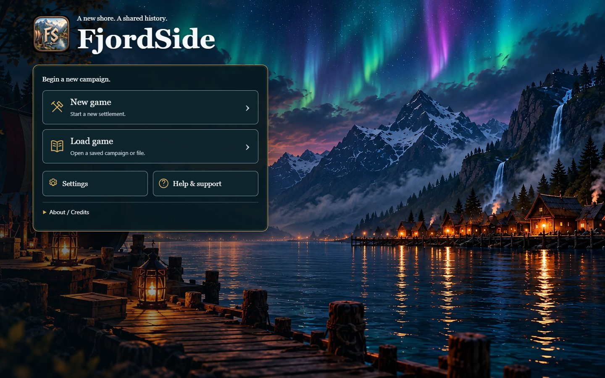
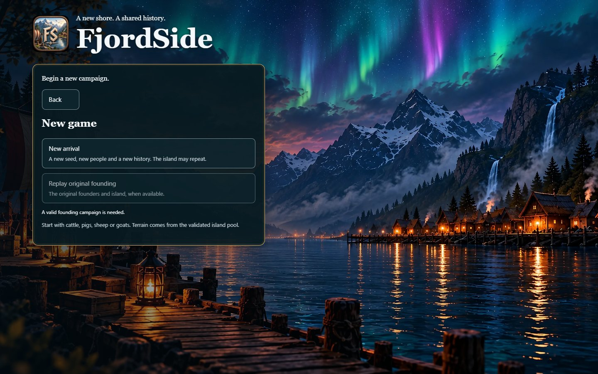
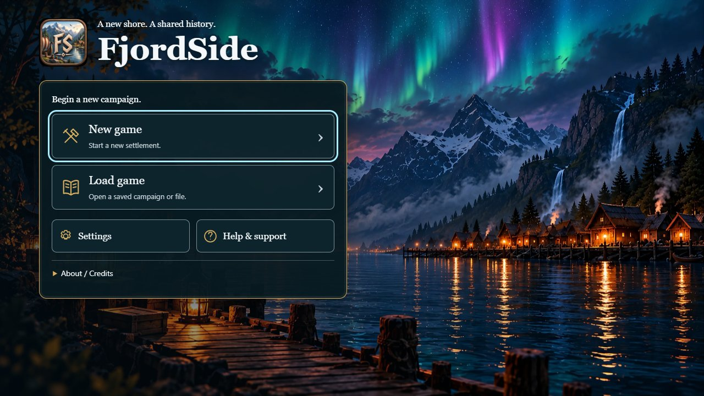

# Entry focus follow-up

The owner reported a selected-looking New game card and an outlined title after opening its panel. This owner correction supersedes the earlier persistent primary-card emphasis in #315. Entry actions now start neutral, without a forced action focus or gold default border. Continue remains first when available; no action is selected automatically.

Baseline: `cb7c060d832702c05336b440912bebcffb5ea40d`. Fixed application build: `a52d8d184b4e667dde4f07ed1aa330c72faec40f`. `build-identity.json` checks the served LAN entry against its local build and embedded revision. The new public initial-focus assertion failed before the repair (button rather than document body) and passes afterwards. Nine existing entry/save/menu tests pass, zero failures/skips; public-assets, TypeScript and Vite build pass.

Actual isolated headless Chrome checks reproduced the original initial button focus/gold border and the title's native auto outline on desktop and portrait touch emulation. The fixed run shows neither. Keyboard Tab still reaches New game (or Continue for an imported save) with visible cyan focus; Enter, the next Tab, Escape/back focus restoration and real file import work. A heading retains quiet reading focus to announce the new panel for screen readers; only its misleading noninteractive outline is suppressed. Interactive focus styles remain intact.

The existing entry matrix also passes across five sizes, including image failure/delay, import errors, safe replacement Cancel, no horizontal overflow, and no world/model/HDR loads before a campaign choice. No Core/save/clock changes. This is browser emulation, not a physical Safari claim. Re-run `scripts/qa/check-entry-focus.mjs` with the installed Playwright module and `QA_ORIGIN=http://127.0.0.1:5197`; `QA_BASELINE=1` records an old build without asserting the corrected behavior. Use a fresh output folder. Historical screenshots/results are preserved.

