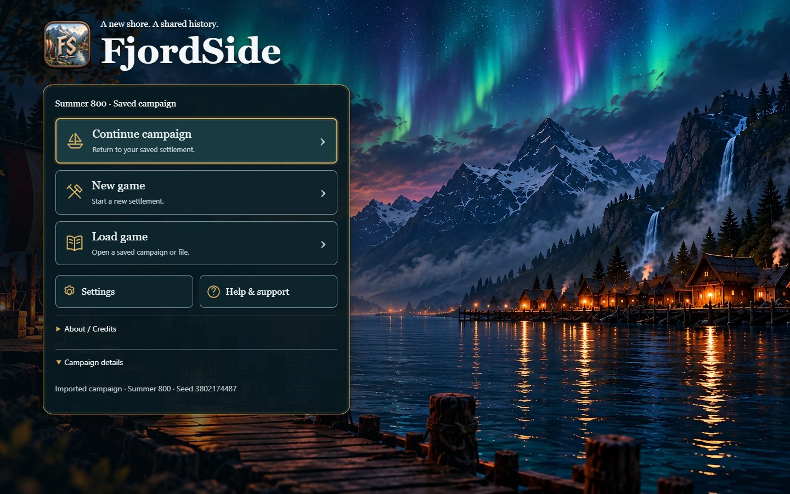
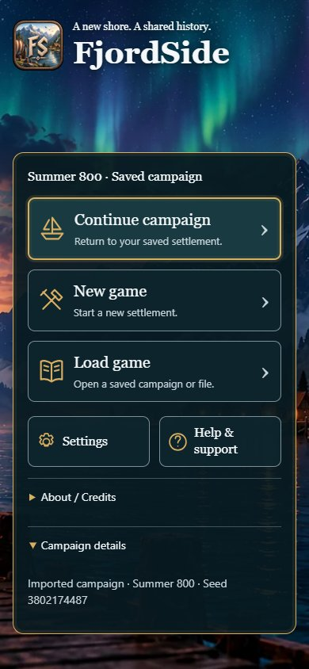
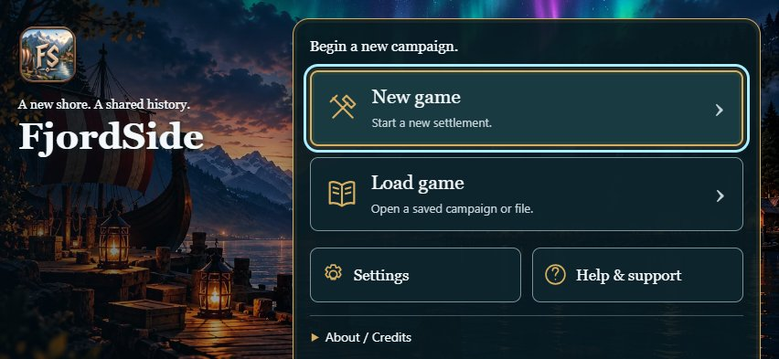

# Twilight start screen — executed review evidence

The owner-selected twilight fjord is now the decorative backdrop for the actual #298 campaign entry, above expedition PR #316. This implements #315 without importing the throwaway prototype or altering gameplay, clocks, RNG, rules, save schemas or the in-game HUD. English action labels and truthful campaign metadata remain authoritative.

## Source and build identities

- Final application code/build: `d61f5082e8cfb96ede6b50d1d1caf66098485319`, branch `codex/start-screen-twilight-315`.
- Parent expedition head: `43d4a17ff1ce30d3905a07650483035182ce0b24`; parent #298 head: `4bbb0e96ccc9bd3c206ecc8d6e6928771e62286a`.
- Before screenshot, red check and timing baseline: the retained clean #298 review build `7dfb602dff63f49a8445008d2ea14fd6f0cda2b8`, served on 5193. Its menu code is included in the parent #298 evidence head; it is not current main.
- `build-identity.json` checks both entry JavaScript bundles by HTTP against disk, with embedded clean revision strings. `manifest.json` pins source Git-blob bytes and retained evidence bytes. The docs commit may advance the branch without relabelling these measured builds.
- GitHub exact-head CI is a separate gate. PR #316 passed all steps at its own head: 1,623 tests passed, zero failed, ten existing conditional skips (nine optional original Human-source checks, one opt-in R3 qualification). This does not claim that its CI validates a newer #315 head. Draft status is retained pending exact-head checks and owner visual review.

## Latest owner artwork supersedes the earlier bundle

The owner subsequently supplied the actual 3344×1882 upscale, then a compressed PNG at the same dimensions. This explicit later source supersedes #315's older 1672px master hash, per the issue's owner-decision precedence. No replacement image or extra aurora was generated. This is owner-selected generated concept artwork, not a screenshot of the player's settlement, and is not native 4K.

| Preserved source | Bytes | SHA-256 |
| --- | ---: | --- |
| `owner-upscaled.png` | 9,249,975 | `f30358104ab57e32bf870b31282139fca98e64a0b89382a0274316f8991dcdb1` |
| `owner-compressed.png` | 2,957,082 | `af3b9c9e822b3169cafd2852cb5bbaad2c53a73180e64cabe5ffaeaf378b47d4` |

Both remain untouched under `D:/CodexSites/Pillagers/Assets/Branding/FjordSide-Start/`, outside the production tree. The compressed PNG has different decoded pixels; derivatives use the original upscale to avoid another lossy generation. Recipe: Sharp 0.35.5, WebP quality 84 / effort 6, aspect ratio preserved, no enlargement. The production manifest is `public/branding/fjordside/start/manifest.json`.

| Runtime derivative | Dimensions | Actual fetched body bytes | Decoded RGBA pixels |
| --- | --- | ---: | ---: |
| Phone/tablet (<1100 CSS px) | 1280×720 | 173,572 | 3.52 MiB |
| Desktop (≥1100 CSS px) | 2560×1441 | 405,640 | 14.07 MiB |

Every tested viewport fetched exactly one matching derivative; HTTP body hashes matched the manifest. The original PNGs, source mockups and other resolution candidates are not in the production start-art folder. These are decoded pixel sizes, not measured total browser/GPU memory. The same composition is cropped with CSS; no stretching, live thumbnail, remote font, video or animated title scene is used.

## Executed behavior and visual checks

Headless Chrome 156.0.8078.74, private empty contexts on Windows. Desktop viewports: 1440×900 and 1920×1080. Touch/coarse-pointer emulation: portrait 390×844, landscape 852×393 and tablet 1024×768. Screenshots are viewport captures, not physical-device evidence. Desktop and phone/tablet images were inspected visually.

Each viewport completed fresh entry (New game primary, no fabricated Continue), Settings/Back with focus return, Help → Controls → Diagnostics → Back, invalid file import with a genuine error, valid file import, actual Summer 800 metadata/details, and new-game replacement Cancel. No canvas, game chunk, GLB or HDR was requested before the explicit campaign choice. There was no page error, horizontal page overflow or button/disclosure target below 44 CSS px.

The valid imported file is the unchanged earlier public export at `docs/ux/player-menus-298/followup/campaign-before.json`: seed 3802174487. No hidden browser state or synthetic save edits were needed. Existing entry/save tests cover read-only inspection, stale-session fencing, cancelled/repeated choices, failures, recovery and lifecycle. The accessible button names stay concise while decorative icons and helper text are added to the existing controls.

Missing and deliberately held-back artwork both left Settings and navigation usable over a stable dark fallback. A separate keyboard-only journey used Tab → Enter to Load game and Tab → Enter to return, without initializing the world. Gold identifies the primary action; cyan identifies keyboard focus. The large-text screenshot uses explicit 200% key-action/body CSS, not a claim of physical Safari browser text scaling. Scrolling and Back remained usable.

The first contrast check found small tagline text at 4.21:1 in landscape. Only the local left scrim was darkened from .50 to .65 opacity; no layout, save or controller code changed. The unchanged measurement then passed all five sizes. Small tagline text is ≥5.62:1 against the brightest underlying pixel in its entire bounding box; the large title is ≥3.69:1. Cool secondary panel text has a conservative 10.37:1 contrast even over pure white art under the panel; the essential border is 4.59:1. This calculation is deliberately conservative and ignores text shadows. See both the retained initial failure and final raw result.

The public-assets / TypeScript / Vite build passed on final application code. Forty focused entry/recovery/loading/lifecycle tests passed with no failures or skips on `c6a27fb`; the later application change is only the two scrim-opacity CSS lines. The full real-game expedition browser check also passed on `c6a27fb`: actual import → play, Core/selection parity through navigation, one 15→7 Food payment, paid pack retained after map Cancel, end/disband, retained history, landscape touch preparation. Its raw result is preserved, not relabelled as the later CSS build. Entry branding is scoped to `body.fjord-entry`; the real game sets `body.fjord-play` and retains its own canvas/HUD.

## Bounded entry comparison

Three fresh contexts and a reload within each context per build, localhost preview, same Chrome executable. Time is navigation start to the real New game button being visible, not world load time, image decode completion, mobile-network performance or a general benchmark. Raw samples/resources are in `browser-result.json`; the runs took place while other validation was active, so small differences are noise.

| Build | Cold-context samples (ms) | Median | Same-context reload samples (ms) | Median |
| --- | --- | ---: | --- | ---: |
| Before | 237, 210, 175 | 210 | 99, 107, 107 | 107 |
| After | 209, 162, 198 | 198 | 97, 97, 88 | 97 |

The evidence supports a usable ungated entry, not a claim that artwork made it faster. Both builds had zero pre-choice canvases or world/model loads. The after build adds one 173,572- or 405,640-byte compressed decorative download; warm HTTP transfer/body sizes are retained separately in the raw resource entries.

## Reproduction

From the feature checkout, using its pinned dependencies (Node 24, pnpm 10):

```powershell
node scripts/prepare-start-art.mjs D:/CodexSites/Pillagers/Assets/Branding/FjordSide-Start/owner-upscaled.png
pnpm run build --outDir scratch/start-menu-315/dist
pnpm exec vite preview --host 0.0.0.0 --port 5196 --strictPort --outDir scratch/start-menu-315/dist
# In another terminal; use the installed Playwright module, no package changes:
$env:PLAYWRIGHT_MODULE='C:/Users/Devoteam/.cache/codex-runtimes/codex-primary-runtime/dependencies/node/node_modules/playwright'
$env:QA_ORIGIN='http://127.0.0.1:5196'
$env:QA_BEFORE_ORIGIN='http://127.0.0.1:5193'
$env:QA_OUTPUT='scratch/start-menu-315/repeated-browser-check'
node scripts/qa/check-start-screen.mjs
node docs/ux/start-screen-315/check-contrast.mjs
node --test --test-concurrency=2 tests/player-menu-entry.test.mjs tests/campaign-start.test.mjs tests/campaign-start-dom.test.mjs tests/campaign-resume.test.mjs tests/loading-run-entry.test.mjs tests/prepared-loading.test.mjs tests/loading-run-diagnostics.test.mjs tests/island-loading-lifecycle.test.mjs tests/fjord-lifecycle.test.mjs
```

The before timing server must serve the frozen #298 build, not a rebuilt current checkout. For a new comparison, retain its own build identity and write to a new evidence folder. The contrast helper writes scratch output only. Original source hashes are checked before generating derivatives; the normal build validates runtime hashes, dimensions and the per-image download budget.

Combined LAN review: `http://192.168.68.100:5196/fjord-play`. Local review: `http://127.0.0.1:5196/fjord-play`. Existing owner campaigns and other review servers remain intact. Physical iPhone/iPad, real browser text scaling, notch/chrome behavior and owner visual acceptance are still pending. No merge or Sites publication is performed by this change.






